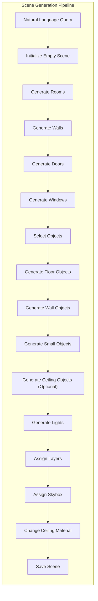
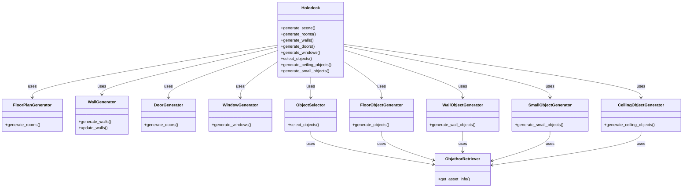
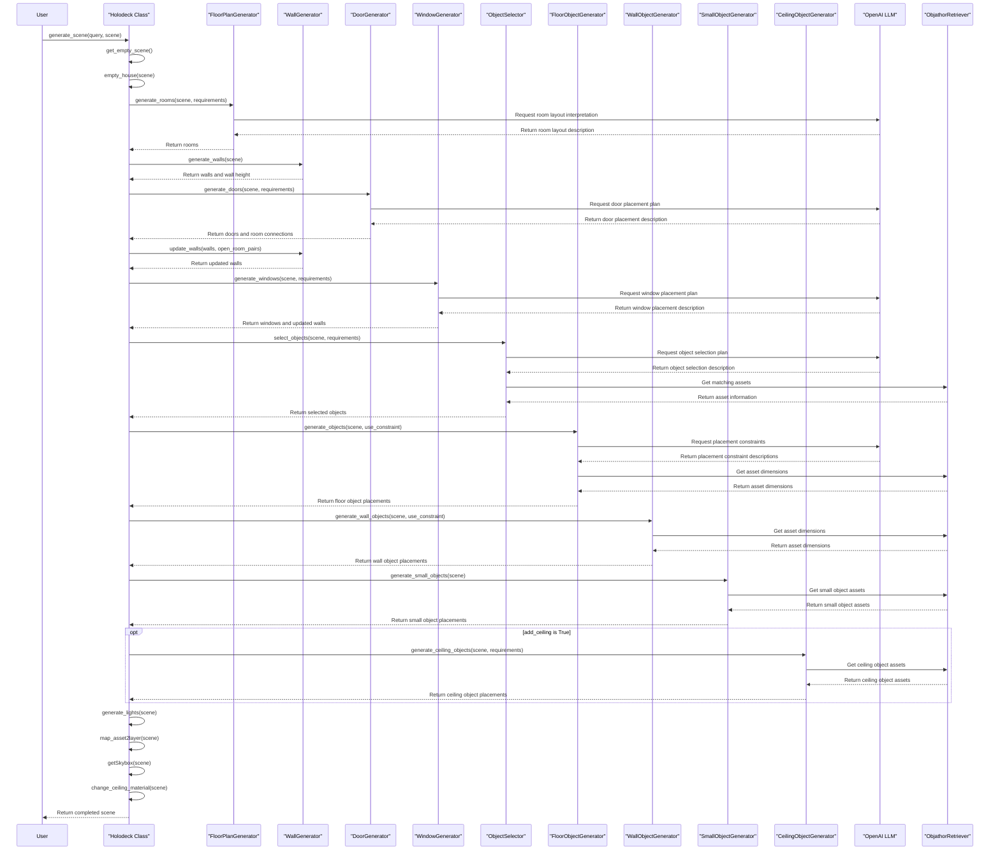
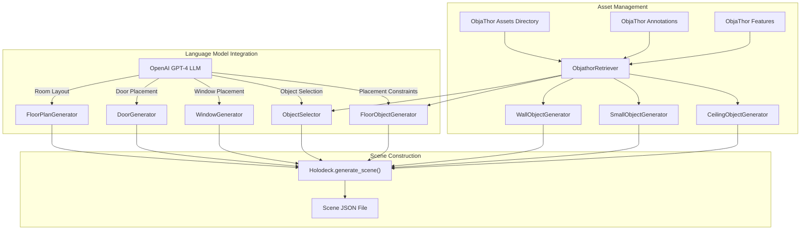

<!-- source: DeepWiki mcp.deepwiki.com · repo allenai/Holodeck · page 3.1 Scene Generation Pipeline · fetched 2026-10-26 -->

# Scene Generation Pipeline

Relevant source files

The following files were used as context for generating this wiki page:

- [ai2holodeck/generation/holodeck.py](ai2holodeck/generation/holodeck.py)

## Purpose and Scope

This document details the step-by-step process of how Holodeck generates 3D environments from natural language descriptions. It covers the entire pipeline from receiving a language query to producing a complete 3D scene that can be rendered in Unity. For information about the specific language model integration details, see [Language Model Integration](#3.2), and for details on how the generated scenes connect to Unity, see [Unity and AI2-THOR Integration](#3.3).

## Pipeline Overview

The Holodeck scene generation pipeline transforms natural language descriptions into structured 3D environments through a series of sequential generation steps. Each step builds upon the previous ones, gradually constructing a complete scene from basic elements like rooms and walls to complex arrangements of objects with appropriate relationships and constraints.

Sources: [ai2holodeck/generation/holodeck.py:259-389]()

## Key Components

The scene generation pipeline integrates multiple specialized components, each responsible for a specific aspect of the generation process:

Sources: [ai2holodeck/generation/holodeck.py:56-139]()

## Detailed Pipeline Steps

### 1. Scene Initialization

The pipeline begins by creating an empty scene structure using the `get_empty_scene()` method, which loads a template from `empty_house.json`. This template is then emptied of any existing content using the `empty_house()` method.

Sources: [ai2holodeck/generation/holodeck.py:140-152]()

### 2. Room Generation

Rooms are generated based on the natural language query and additional requirements using the `FloorPlanGenerator`. This component interprets room descriptions and creates appropriate floor plan layouts.

Sources: [ai2holodeck/generation/holodeck.py:154-158]()

### 3. Wall Generation

Walls are created around the generated rooms using the `WallGenerator`. This process determines wall heights and positions based on the room layouts.

Sources: [ai2holodeck/generation/holodeck.py:160-164]()

### 4. Door Generation

Doors are placed between rooms using the `DoorGenerator`. This process identifies appropriate wall sections for door placement and updates the wall structures accordingly.

Sources: [ai2holodeck/generation/holodeck.py:166-187]()

### 5. Window Generation

Windows are added to walls using the `WindowGenerator`. Like door generation, this process selects appropriate wall sections and modifies them to accommodate windows.

Sources: [ai2holodeck/generation/holodeck.py:189-202]()

### 6. Object Selection

Objects to be placed in the scene are selected using the `ObjectSelector`. This component determines which objects are appropriate for each room type based on the natural language query.

Sources: [ai2holodeck/generation/holodeck.py:204-211]()

### 7. Floor Object Placement

Floor objects (like furniture) are placed in the rooms using the `FloorObjectGenerator`. This component uses constraint-based reasoning to determine appropriate positions for objects.

Sources: [ai2holodeck/generation/holodeck.py:314-316]()

### 8. Wall Object Placement

Objects that belong on walls (like paintings and shelves) are placed using the `WallObjectGenerator`. This component considers wall availability and aesthetic factors.

Sources: [ai2holodeck/generation/holodeck.py:319-320]()

### 9. Small Object Placement

Small objects (like decorative items) are placed on receptacles (such as tables and shelves) using the `SmallObjectGenerator`. This requires interaction with the AI2-THOR simulation to identify valid receptacle surfaces.

Sources: [ai2holodeck/generation/holodeck.py:224-252]()

### 10. Ceiling Object Placement (Optional)

If ceiling objects are requested, they are placed using the `CeilingObjectGenerator`. This step is optional and can be skipped.

Sources: [ai2holodeck/generation/holodeck.py:332-336]()

### 11. Light Generation

Lights are added to the scene using the `generate_lights()` function. Lighting is critical for realistic rendering of the environment.

Sources: [ai2holodeck/generation/holodeck.py:339-340]()

### 12. Layer Assignment

Objects are assigned to appropriate rendering layers using the `map_asset2layer()` function. This helps organize the scene elements for processing and rendering.

Sources: [ai2holodeck/generation/holodeck.py:343]()

### 13. Skybox Assignment

A skybox (the background visible through windows) is assigned using the `getSkybox()` function.

Sources: [ai2holodeck/generation/holodeck.py:346]()

### 14. Ceiling Material Update

The ceiling material is updated to match the wall material using the `change_ceiling_material()` method.

Sources: [ai2holodeck/generation/holodeck.py:254-257](), [ai2holodeck/generation/holodeck.py:349]()

### 15. Scene Saving

The completed scene is saved as a JSON file, and optionally, images or videos of the scene may be generated.

Sources: [ai2holodeck/generation/holodeck.py:351-387]()

## Sequence Diagram of Generation Process

Sources: [ai2holodeck/generation/holodeck.py:259-389]()

## Data Structure Evolution

Throughout the pipeline, the scene data structure evolves as different components add their contributions. The following table outlines key fields added at each stage:

| Stage | Fields Added to Scene | Purpose |
|-------|----------------------|---------|
| Initialization | N/A | Creates empty scene template |
| Room Generation | `rooms` | Defines room layouts |
| Wall Generation | `walls`, `wall_height` | Defines wall structures and height |
| Door Generation | `doors`, `raw_doorway_plan`, `room_pairs`, `open_room_pairs`, `open_walls` | Defines doors and connections between rooms |
| Window Generation | `windows`, `raw_window_plan` | Defines window placements |
| Object Selection | `object_selection_plan`, `selected_objects` | Defines objects to be placed in the scene |
| Floor Object Placement | `floor_objects` | Defines floor object placements |
| Wall Object Placement | `wall_objects` | Defines wall object placements |
| Small Object Placement | `small_objects`, `receptacle2small_objects` | Defines small object placements and their receptacles |
| Ceiling Object Placement | `ceiling_objects`, `raw_ceiling_plan` | Defines ceiling object placements |
| Light Generation | `proceduralParameters.lights` | Defines lighting in the scene |
| Skybox Assignment | `proceduralParameters.skybox` | Defines background visible through windows |

Sources: [ai2holodeck/generation/holodeck.py:140-389]()

## Integration with LLM and Asset Management

The generation pipeline relies heavily on language model interactions and asset retrieval throughout the process:

Sources: [ai2holodeck/generation/holodeck.py:56-139](), [ai2holodeck/generation/holodeck.py:259-389]()

## Performance Considerations

The scene generation pipeline is computationally intensive, particularly in the object placement stages where constraint solving is used. Several options are available to manage performance:

1. **MILP Solver Option**: For floor object placement, a Mixed Integer Linear Programming solver can be used as an alternative to the default DFS solver by setting `use_milp=True` in the `generate_scene` method.

2. **Constraint Usage**: Object placement can be performed with or without constraints by setting the `use_constraint` parameter in the `generate_scene` method.

3. **Random Selection**: Object selection can use random selection rather than semantic matching by setting `random_selection=True` in the `generate_scene` method.

Sources: [ai2holodeck/generation/holodeck.py:259-389]()

## Scene Variation Generation

The pipeline also supports generating variations of existing scenes through the `generate_variants` method. This can create multiple versions of a scene while ensuring diverse asset usage.

Sources: [ai2holodeck/generation/holodeck.py:391-439]()

---

