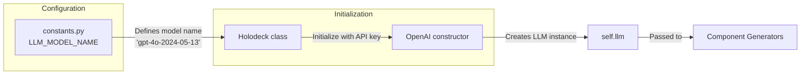
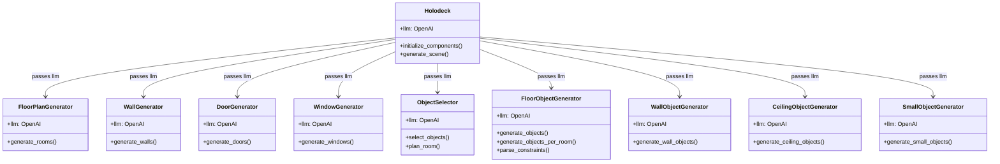
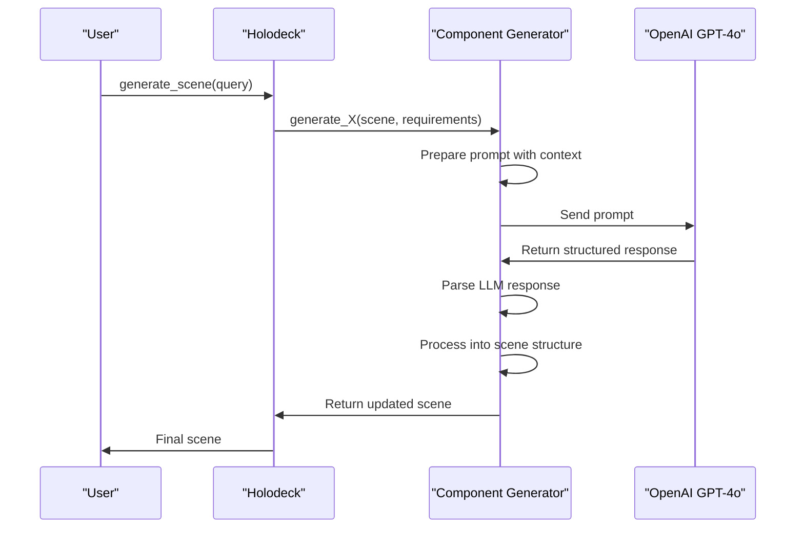
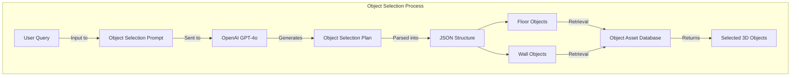
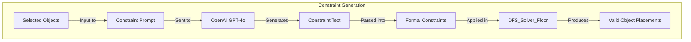
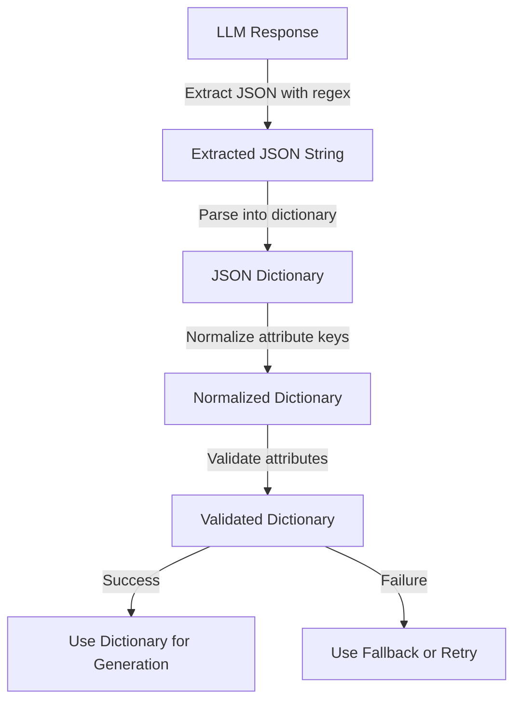
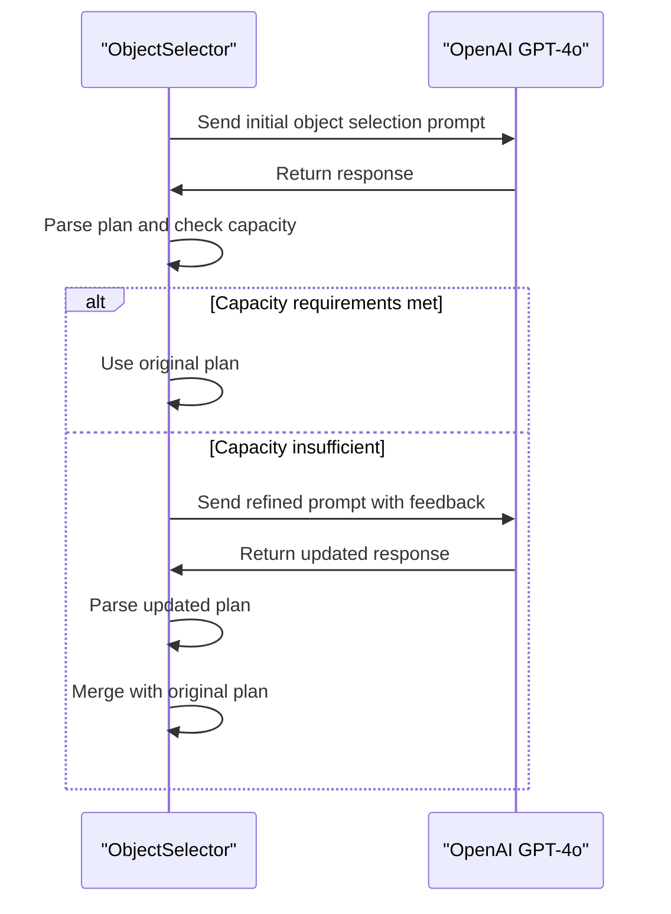

<!-- source: DeepWiki mcp.deepwiki.com · repo allenai/Holodeck · page 3.2 Language Model Integration · fetched 2026-10-26 -->

# Language Model Integration

Relevant source files

The following files were used as context for generating this wiki page:

- [ai2holodeck/constants.py](ai2holodeck/constants.py)
- [ai2holodeck/generation/holodeck.py](ai2holodeck/generation/holodeck.py)
- [ai2holodeck/generation/object_selector.py](ai2holodeck/generation/object_selector.py)

This document details how Holodeck integrates with large language models (LLMs) to transform natural language descriptions into detailed 3D scene specifications. The system uses LLMs for generating room layouts, selecting objects, positioning objects, and creating constraints for object placement.

For information about the overall generation pipeline, see [Scene Generation Pipeline](#3.1). For details on how constraints are generated and applied, see [Constraint Systems](#7.1).

## LLM Configuration and Setup

Holodeck uses OpenAI's GPT-4o model as the primary language model for scene generation. The model is configured in the codebase as follows:

The LLM is initialized in the Holodeck constructor using the OpenAI API key provided by the user. The model name is defined in the constants file, making it easy to update when new models become available.

Sources: [ai2holodeck/constants.py:32-33](), [ai2holodeck/generation/holodeck.py:70-74]()

## Integration Architecture

The LLM is integrated into multiple components of the Holodeck system. Each component uses the LLM for specific tasks in the scene generation pipeline:

The diagram shows how the Holodeck class initializes the LLM instance and passes it to various component generators. Each component uses the LLM for specific tasks in the scene generation process.

Sources: [ai2holodeck/generation/holodeck.py:101-123]()

## LLM Query Workflow

The general workflow for LLM integration in Holodeck follows this pattern:

This sequence diagram illustrates how each component interacts with the LLM:
1. The component prepares a prompt with specific context (e.g., room size, constraints)
2. The prompt is sent to the LLM
3. The LLM returns a structured response (often in JSON format)
4. The component parses the response and incorporates it into the scene structure

Sources: [ai2holodeck/generation/holodeck.py:146-337](), [ai2holodeck/generation/object_selector.py:65-142]()

## LLM Uses in Scene Generation

The language model is used at various stages in the scene generation pipeline:

### Room Layout Generation

The LLM generates room layouts based on the user's query, interpreting desired room types, arrangements, and sizes.

### Object Selection

The object selection process uses the LLM to:
1. Determine which objects should be included in each room
2. Specify object attributes (description, location, size, quantity)
3. Determine object variations and relationships

The LLM creates detailed plans for which objects should be included in each room, taking into account room type, size, and the overall query theme.

Sources: [ai2holodeck/generation/object_selector.py:144-230]()

### Object Placement Constraints

The LLM generates placement constraints for objects, which are then interpreted by the placement algorithms:

The LLM translates vague natural language positioning concepts (e.g., "near the window," "against the wall") into formal constraints that can be applied by the placement algorithms.

Sources: [ai2holodeck/generation/floor_objects.py]() (File referenced in other code)

## LLM Response Processing

A critical aspect of the LLM integration is the processing of LLM responses. Object selection responses are structured as JSON, which requires careful extraction and validation:

The `extract_json` method in the ObjectSelector class handles this process, extracting JSON from the LLM's response, parsing it, normalizing attribute keys, and validating the structure.

Sources: [ai2holodeck/generation/object_selector.py:251-290](), [ai2holodeck/generation/object_selector.py:22-29](), [ai2holodeck/generation/object_selector.py:232-249](), [ai2holodeck/generation/object_selector.py:292-357]()

## Fallback and Retry Mechanisms

Holodeck implements fallback and retry mechanisms for cases where LLM responses might not meet the required specifications:

This diagram shows how the system handles cases where the first LLM-generated plan might not meet capacity requirements. The system sends a follow-up prompt to refine the plan.

Sources: [ai2holodeck/generation/object_selector.py:187-228]()

## Model Configuration Details

The Holodeck system uses GPT-4o with the following configuration:

| Parameter | Value | Purpose |
|-----------|-------|---------|
| model_name | gpt-4o-2024-05-13 | Defines which OpenAI model to use |
| max_tokens | 2048 | Limits the length of generated responses |
| openai_api_key | User provided | Authentication for OpenAI API |

This configuration can be found in the Holodeck class constructor and the constants file.

Sources: [ai2holodeck/constants.py:32-33](), [ai2holodeck/generation/holodeck.py:70-74]()

## LLM Usage Across Generation Stages

The following table summarizes how LLMs are used across the different generation stages:

| Generation Stage | Component | LLM Usage |
|------------------|-----------|-----------|
| Room Layout | FloorPlanGenerator | Interpreting user query into room layouts |
| Walls | WallGenerator | Determining wall parameters |
| Doors | DoorGenerator | Planning door placement between rooms |
| Windows | WindowGenerator | Deciding window placement on walls |
| Object Selection | ObjectSelector | Selecting appropriate objects for rooms |
| Floor Objects | FloorObjectGenerator | Generating placement constraints |
| Wall Objects | WallObjectGenerator | Planning wall-mounted object placement |
| Ceiling Objects | CeilingObjectGenerator | Planning ceiling fixture placement |
| Small Objects | SmallObjectGenerator | Adding smaller decorative items |

Each stage uses the LLM in a specialized way to interpret the user's query and generate appropriate scene elements.

Sources: [ai2holodeck/generation/holodeck.py:154-337]()

---

