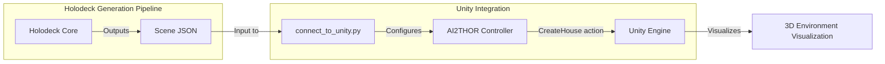
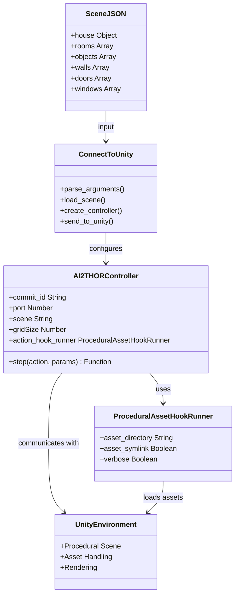
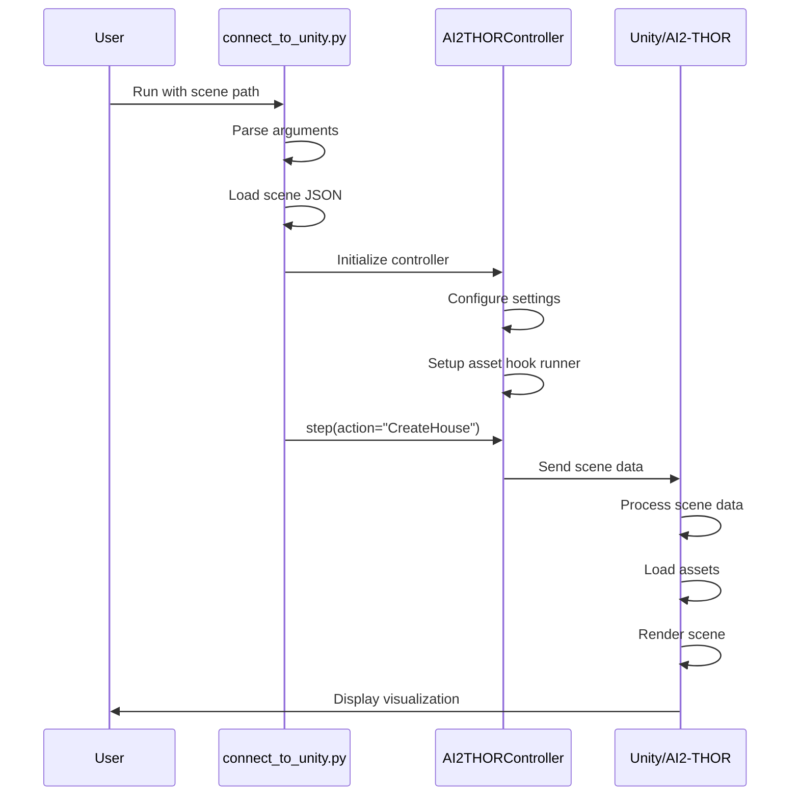
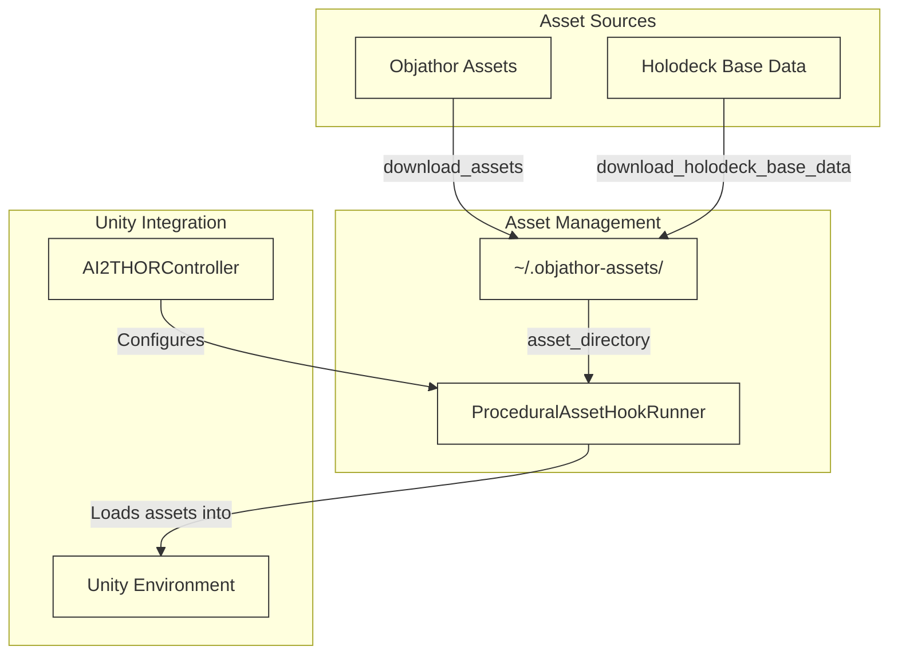
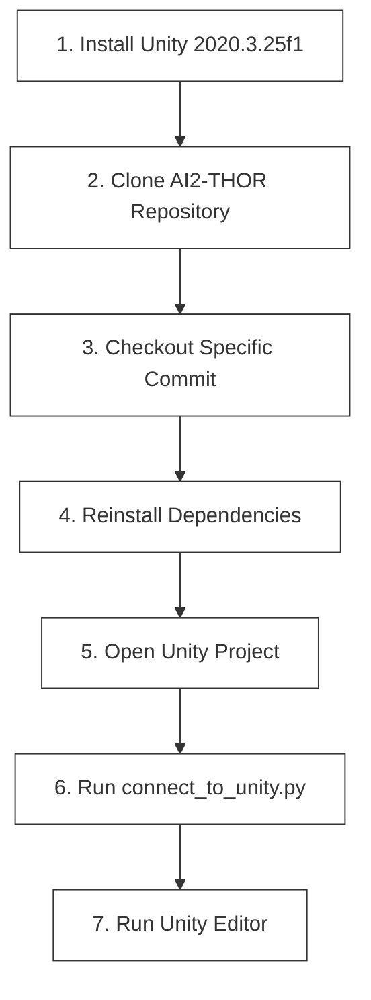

<!-- source: DeepWiki mcp.deepwiki.com · repo allenai/Holodeck · page 3.3 Unity and AI2-THOR Integration · fetched 2026-10-26 -->

# Unity and AI2-THOR Integration

<details>
<summary>Relevant source files</summary>

The following files were used as context for generating this wiki page:

- [README.md](README.md)
- [connect_to_unity.py](connect_to_unity.py)

</details>


This document explains how Holodeck integrates with Unity and AI2-THOR to visualize and interact with procedurally generated 3D environments. This page covers the technical aspects of connecting Holodeck's scene generation output to the Unity environment through AI2-THOR, the data flow between components, and the configuration required for proper visualization. For information about the scene generation process itself, see [Scene Generation Pipeline](#3.1).

## Overview

Holodeck generates scene descriptions in JSON format, which are then rendered and visualized using Unity and the AI2-THOR framework. This integration allows users to explore and interact with the environments generated from natural language descriptions.



Sources: [README.md:49-68](), [connect_to_unity.py:1-52]()

## Connection Architecture

The connection between Holodeck's generated scenes and Unity is handled by the `connect_to_unity.py` script, which serves as a bridge between the scene JSON files and the AI2-THOR framework.

### Components and Data Flow



Sources: [connect_to_unity.py:1-52]()

The architecture involves several key components:

1. **Scene JSON**: Output from Holodeck's generation pipeline containing all scene elements
2. **Connect to Unity Script**: Interfaces between Holodeck and AI2-THOR
3. **AI2-THOR Controller**: Manages communication with Unity
4. **Procedural Asset Hook Runner**: Handles asset loading and management
5. **Unity Environment**: Renders the scene and provides visualization

## Scene Loading Process

The process of loading a generated scene into Unity involves several steps, handled primarily by the `connect_to_unity.py` script.

### Connect to Unity Script

The `connect_to_unity.py` script performs the following operations:

1. Parses command-line arguments for scene file path and asset directory
2. Loads and decompresses the scene JSON
3. Initializes an AI2-THOR controller with specific configuration
4. Sends the scene data to Unity using the "CreateHouse" action



Sources: [connect_to_unity.py:1-52]()

### AI2-THOR Controller Configuration

The AI2-THOR controller is configured with specific parameters to ensure proper scene rendering:

| Parameter | Value | Purpose |
|-----------|-------|---------|
| commit_id | THOR_COMMIT_ID | Specifies the AI2-THOR version |
| start_unity | False | Assumes Unity is already running |
| port | 8200 | Communication port for Unity connection |
| scene | "Procedural" | Uses the procedural scene template |
| gridSize | 0.25 | Sets the navigation grid resolution |
| server_class | WsgiServer | Defines the server implementation |
| action_hook_runner | ProceduralAssetHookRunner | Handles asset loading |

The controller connects to the Unity instance and sends the "CreateHouse" action with the scene data:

```python
controller.step(action="CreateHouse", house=scene)
```

Sources: [connect_to_unity.py:32-48](), [connect_to_unity.py:51]()

## Asset Management

Asset management is a critical component of the Unity and AI2-THOR integration, handled by the `ProceduralAssetHookRunner`.



Sources: [connect_to_unity.py:43-47](), [README.md:30-38]()

The asset hook runner is configured with:
- **asset_directory**: Path to the directory containing 3D assets
- **asset_symlink**: Flag to use symbolic links instead of copying assets
- **verbose**: Flag to enable detailed logging during asset loading

## Setting Up Unity and AI2-THOR

To load Holodeck-generated scenes in Unity, you need to:

1. Install Unity with the specific editor version (2020.3.25f1)
2. Clone the AI2-THOR repository at the correct commit
3. Set up dependencies properly
4. Configure the Unity project

The specific steps are:



Sources: [README.md:49-68]()

### Dependency Configuration

Specific versions of dependencies are required for proper operation:

| Dependency | Required Version |
|------------|------------------|
| Werkzeug | 2.0.1 |
| Flask | 2.0.1 |
| AI2-THOR Commit | 07445be8e91ddeb5de2915c90935c4aef27a241d |

Sources: [README.md:56-62]()

## Running the Integration

The integration between Holodeck and Unity/AI2-THOR involves the following execution flow:

1. Generate a scene using Holodeck:
   ```
   python holodeck/main.py --query "a living room" --openai_api_key <API_KEY>
   ```

2. This generates a scene JSON file, typically saved in the format `scene_name/scene_name.json`

3. Run the connector script pointing to this JSON file:
   ```
   python connect_to_unity.py --scene <SCENE_JSON_FILE_PATH>
   ```

4. Press the play button in the Unity editor to view and interact with the scene

Sources: [README.md:40-68](), [connect_to_unity.py:15-28]()

## Technical Details

### JSON Scene Structure

The JSON scene file contains all information needed to reconstruct the 3D environment in Unity, including:

- Room layouts and dimensions
- Wall positions and properties
- Door and window placements
- Object definitions (type, position, rotation, scale)
- Material and texture specifications

The AI2-THOR "CreateHouse" action processes this JSON structure to build the complete 3D environment.

### Communication Protocol

Communication between `connect_to_unity.py` and Unity happens through the AI2-THOR controller, which:

1. Establishes a connection to Unity via a WSGI server on port 8200
2. Transmits JSON-formatted action requests
3. Receives responses from Unity with action results
4. Manages asset loading through the procedural asset hook

Sources: [connect_to_unity.py:32-48]()

## Conclusion

The Unity and AI2-THOR integration in Holodeck provides a seamless bridge between the language-guided scene generation system and the 3D visualization environment. By converting JSON scene descriptions into interactive 3D environments, users can explore and interact with spaces that were created from natural language descriptions.

For more information about the scene generation process itself, see [Scene Generation Pipeline](#3.1). For details on how language models are integrated to interpret queries, see [Language Model Integration](#3.2).

---

