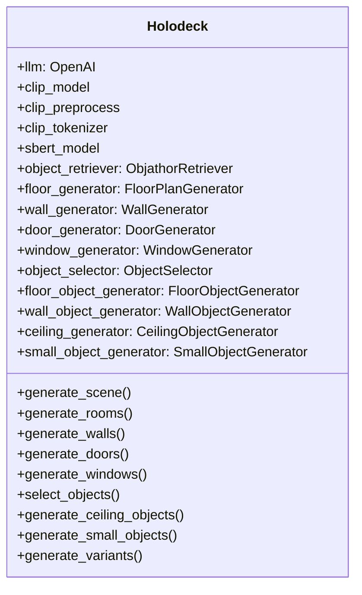
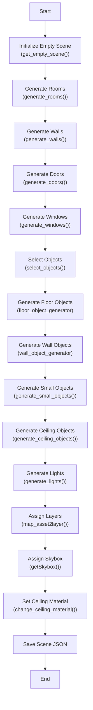
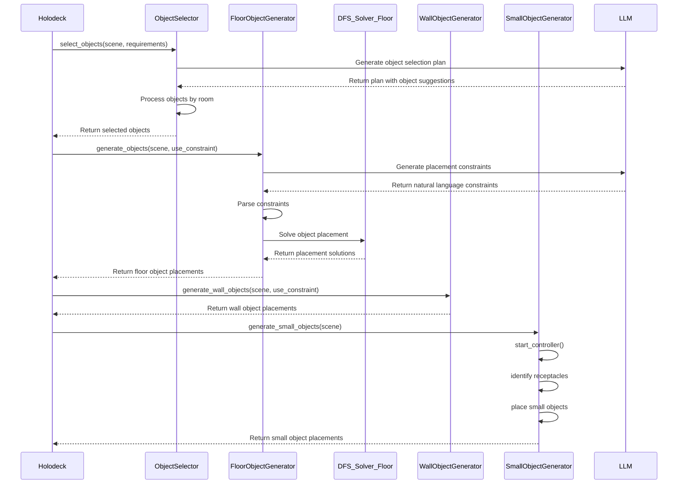
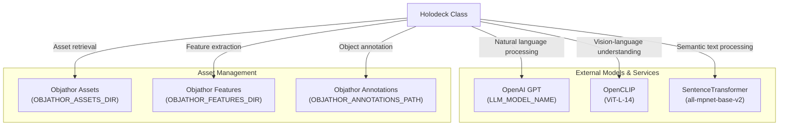
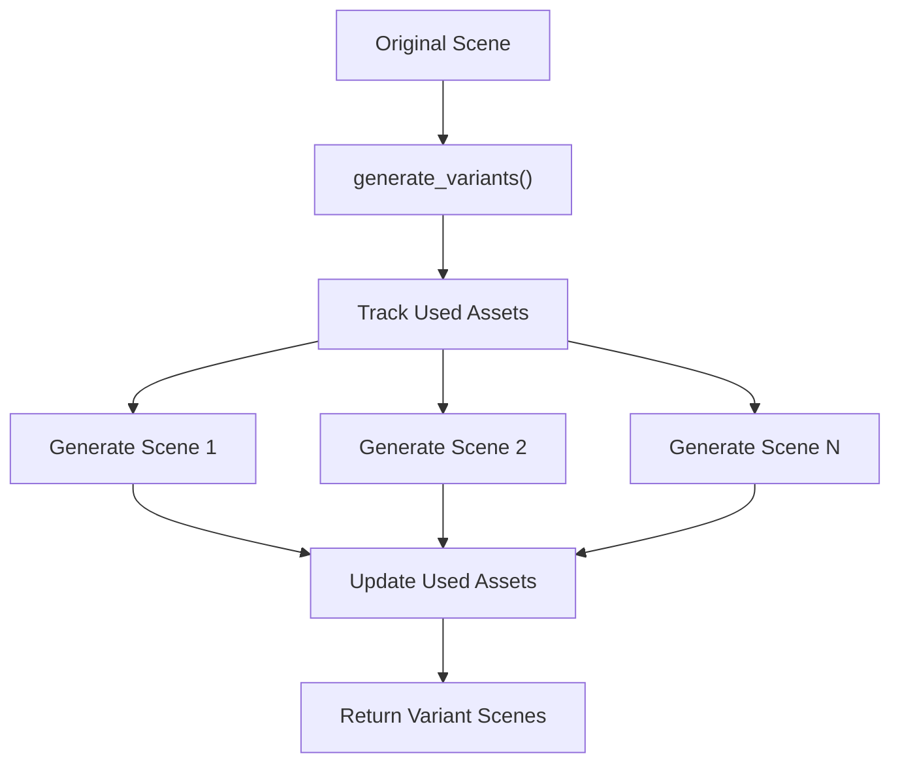

<!-- source: DeepWiki mcp.deepwiki.com · repo allenai/Holodeck · page 4 Core Components · fetched 2026-10-26 -->

# Core Components

Relevant source files

The following files were used as context for generating this wiki page:

- [ai2holodeck/generation/holodeck.py](ai2holodeck/generation/holodeck.py)

This document provides a technical overview of the core components that make up the Holodeck system. These components work together to transform natural language descriptions into fully realized 3D environments. For information about the overall system architecture, see [System Architecture](#3), and for details on how to use these components, see [Usage Guide](#5).

## The Holodeck Class

The `Holodeck` class serves as the central orchestrator of the entire system. It initializes and manages all other components, processes natural language queries, and coordinates the step-by-step generation of 3D scenes.

The `Holodeck` class initializes with several key components:
- Language model (OpenAI GPT) for processing natural language
- CLIP model for visual-language understanding
- Sentence transformer for semantic text understanding
- Various specialized generators for different aspects of the scene

Sources: [ai2holodeck/generation/holodeck.py:56-141]()

## Generation Pipeline

The scene generation process follows a sequential pipeline orchestrated by the `generate_scene()` method. Each step builds upon the previous one to gradually construct a complete 3D environment.

This pipeline demonstrates how a language description is progressively transformed into a fully structured 3D scene through multiple specialized generation steps.

Sources: [ai2holodeck/generation/holodeck.py:259-389]()

## Component Relationships

The system is built around a network of specialized components that interact with each other. The `Holodeck` class serves as the central hub that coordinates these interactions.

```mermaid
graph TD
    User[/"User Query"/] -->|"Natural language\ne.g. 'a living room'"| Holodeck["Holodeck Class"]
    
    subgraph "Language Understanding"
        LLM["OpenAI LLM\n(GPT model)"]
        CLIP["CLIP Model"]
        SBERT["Sentence Transformer"]
    end
    
    subgraph "Layout Generation"
        FloorGen["FloorPlanGenerator"]
        WallGen["WallGenerator"]
        DoorGen["DoorGenerator"]
        WindowGen["WindowGenerator"]
    end
    
    subgraph "Object Management"
        ObjRet["ObjathorRetriever"]
        ObjSel["ObjectSelector"]
        FloorObjGen["FloorObjectGenerator"]
        WallObjGen["WallObjectGenerator"]
        CeilingGen["CeilingObjectGenerator"]
        SmallObjGen["SmallObjectGenerator"]
    end
    
    Holodeck -->|"Initializes and uses"| LLM
    Holodeck -->|"Initializes and uses"| CLIP
    Holodeck -->|"Initializes and uses"| SBERT
    
    Holodeck -->|"Uses for room generation"| FloorGen
    Holodeck -->|"Uses for wall generation"| WallGen
    Holodeck -->|"Uses for door generation"| DoorGen
    Holodeck -->|"Uses for window generation"| WindowGen
    
    Holodeck -->|"Uses for asset retrieval"| ObjRet
    Holodeck -->|"Uses for object selection"| ObjSel
    Holodeck -->|"Uses for floor object placement"| FloorObjGen
    Holodeck -->|"Uses for wall object placement"| WallObjGen
    Holodeck -->|"Uses for ceiling object placement"| CeilingGen
    Holodeck -->|"Uses for small object placement"| SmallObjGen
    
    ObjSel -->|"Uses for asset retrieval"| ObjRet
    FloorObjGen -->|"Uses for asset retrieval"| ObjRet
    WallObjGen -->|"Uses for asset retrieval"| ObjRet
    CeilingGen -->|"Uses for asset retrieval"| ObjRet
    SmallObjGen -->|"Uses for asset retrieval"| ObjRet
    
    FloorGen -->|"Consults"| LLM
    DoorGen -->|"Consults"| LLM
    ObjSel -->|"Consults"| LLM
    FloorObjGen -->|"Consults"| LLM
    
    Holodeck -->|"Produces"| SceneJSON[/"Scene JSON"/]
    SceneJSON -->|"Visualized in"| Unity["Unity/AI2-THOR"]
```

This diagram illustrates how the various components interact with each other, showing both the natural language input path and the generation components involved in creating the final scene.

Sources: [ai2holodeck/generation/holodeck.py:56-141](), [ai2holodeck/generation/holodeck.py:259-389]()

## Key Components

### Layout Generation Components

These components handle the fundamental structure of the scene:

| Component | Description | Primary Methods |
|-----------|-------------|----------------|
| `FloorPlanGenerator` | Generates room layouts based on natural language | `generate_rooms()` |
| `WallGenerator` | Creates walls for the generated rooms | `generate_walls()`, `update_walls()` |
| `DoorGenerator` | Places doors between rooms | `generate_doors()` |
| `WindowGenerator` | Places windows on walls | `generate_windows()` |

Sources: [ai2holodeck/generation/holodeck.py:101-108](), [ai2holodeck/generation/holodeck.py:154-202]()

### Object Management Components

These components handle the selection and placement of objects in the scene:

| Component | Description | Primary Methods |
|-----------|-------------|----------------|
| `ObjathorRetriever` | Retrieves 3D assets based on text descriptions | Asset retrieval methods |
| `ObjectSelector` | Selects appropriate objects for the scene | `select_objects()` |
| `FloorObjectGenerator` | Places objects on the floor using constraint-based algorithms | `generate_objects()` |
| `WallObjectGenerator` | Places objects on walls | `generate_wall_objects()` |
| `CeilingObjectGenerator` | Places objects on ceilings | `generate_ceiling_objects()` |
| `SmallObjectGenerator` | Places small objects on surfaces | `generate_small_objects()` |

Sources: [ai2holodeck/generation/holodeck.py:109-123](), [ai2holodeck/generation/holodeck.py:204-252]()

## Object Placement Process

The object placement process is particularly sophisticated, using constraint-based algorithms to realistically position objects in the scene.

The object placement process involves multiple steps:
1. Object selection based on room type and user requirements
2. Constraint generation for realistic placement
3. Solving the placement constraints using algorithms like DFS or MILP
4. Placing objects according to the solved constraints

Sources: [ai2holodeck/generation/holodeck.py:204-252](), [ai2holodeck/generation/holodeck.py:312-325]()

## Scene Representation

The scene is represented as a hierarchical JSON structure that evolves through the generation process. The key elements include:

| Element | Description |
|---------|-------------|
| `rooms` | Room layouts with dimensions and materials |
| `walls` | Wall definitions with positions and materials |
| `doors` | Door placements between rooms |
| `windows` | Window placements on walls |
| `objects` | All objects placed in the scene |
| `floor_objects` | Objects placed on the floor |
| `wall_objects` | Objects placed on walls |
| `small_objects` | Small objects placed on surfaces |
| `ceiling_objects` | Objects placed on the ceiling |
| `proceduralParameters` | Additional parameters like lighting |

Sources: [ai2holodeck/generation/holodeck.py:140-152](), [ai2holodeck/generation/holodeck.py:324-337]()

## External Service Integration

The Holodeck system integrates with several external services and models:

These integrations enable the system to understand natural language descriptions, match them to appropriate 3D assets, and generate coherent 3D environments.

Sources: [ai2holodeck/generation/holodeck.py:69-87](), [ai2holodeck/generation/holodeck.py:11-21]()

## Scene Variation Generation

The Holodeck system can generate variations of scenes using the `generate_variants()` method, which creates multiple versions of a scene with different objects and materials while maintaining the overall structure.

This allows for creating diverse scene variations while ensuring that each variant uses different assets from the original scene.

Sources: [ai2holodeck/generation/holodeck.py:391-439]()

---

