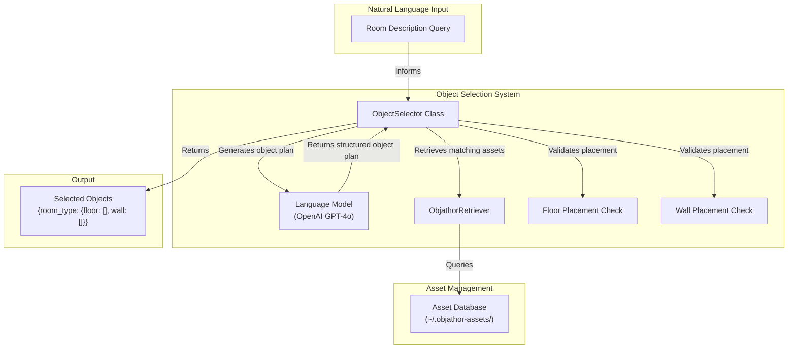
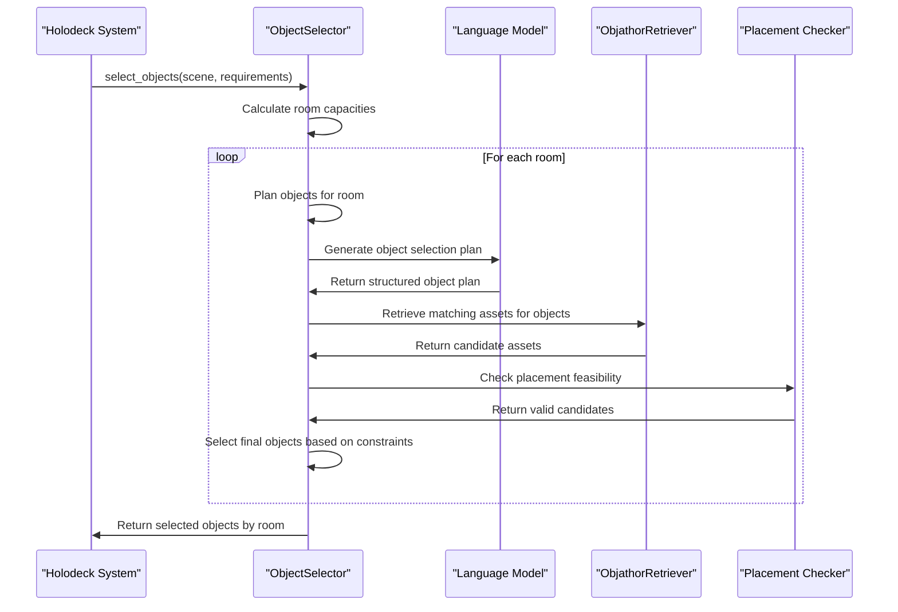
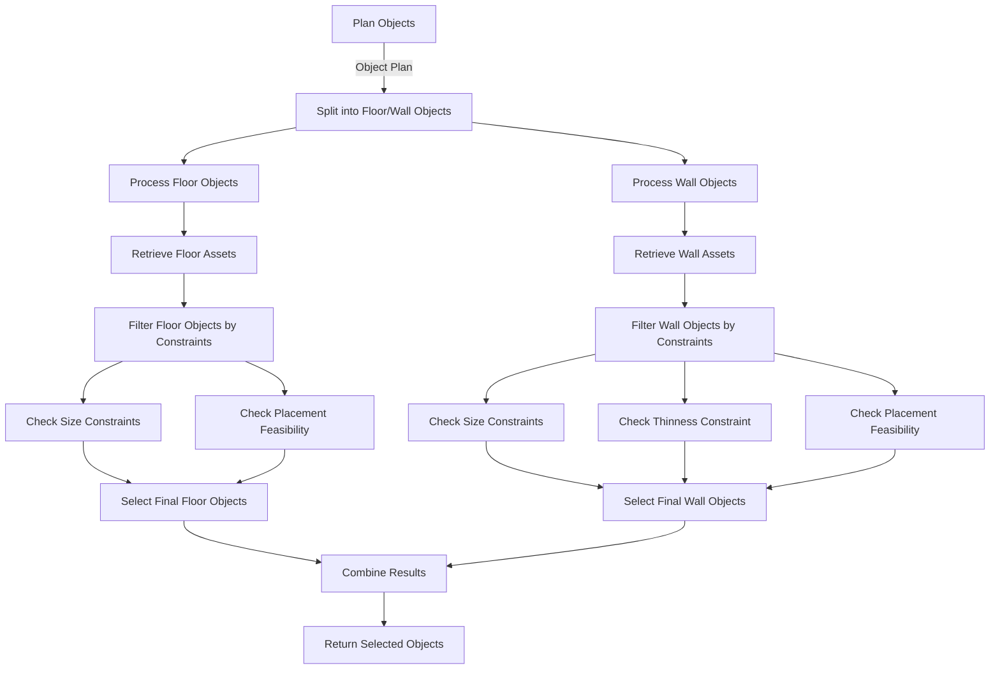
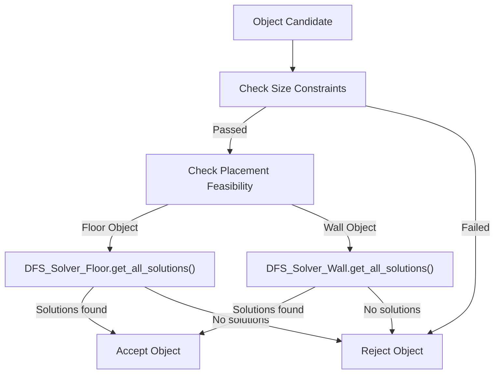

<!-- source: DeepWiki mcp.deepwiki.com · repo allenai/Holodeck · page 4.1 Object Selection System · fetched 2026-10-26 -->

# Object Selection System

<details>
<summary>Relevant source files</summary>

The following files were used as context for generating this wiki page:

- [ai2holodeck/constants.py](ai2holodeck/constants.py)
- [ai2holodeck/generation/object_selector.py](ai2holodeck/generation/object_selector.py)

</details>


## Overview

The Object Selection System is a core component of Holodeck that handles the selection of appropriate 3D objects to populate generated rooms. It serves as the bridge between high-level room descriptions and the specific 3D assets that will be placed in the environment. This system determines which objects should be placed in each room based on room type, size constraints, and language-guided specifications.

For information about how these objects are actually placed in the environment, see [Floor Object Placement](#4.2) and [Wall and Ceiling Objects](#4.3).

Sources: [ai2holodeck/generation/object_selector.py:32-65]()

## Architecture and Components

The Object Selection System is built around the `ObjectSelector` class, which orchestrates the entire object selection process.



### Key Components:

1. **ObjectSelector Class**: Central class that manages the object selection process
2. **Language Model**: Uses OpenAI's GPT-4o to generate a structured plan of objects for each room
3. **ObjathorRetriever**: Provides access to the 3D asset database and retrieves relevant assets
4. **Placement Validators**: Check if objects can be placed in the room given size and spatial constraints

Sources: [ai2holodeck/generation/object_selector.py:32-142](), [ai2holodeck/constants.py:6-20]()

## Object Selection Process

The object selection process follows these key steps:



### Step-by-Step Process:

1. **Capacity Calculation**: The system calculates the floor and wall capacity for each room based on its area and perimeter
2. **Object Planning**: For each room, the system queries the language model to generate a structured plan of objects
3. **Asset Retrieval**: For each object in the plan, the system retrieves matching 3D assets from the database
4. **Placement Validation**: The system checks if the selected assets can be physically placed in the room
5. **Final Selection**: The system makes the final selection of objects based on capacity constraints and placement feasibility

Sources: [ai2holodeck/generation/object_selector.py:65-142](), [ai2holodeck/generation/object_selector.py:144-229]()

## Object Planning and Selection

The core of the Object Selection System is the planning process that determines which objects should be included in each room.

### Object Plan Structure

Each object in the plan has the following attributes:

| Attribute | Description | Default Value |
|-----------|-------------|---------------|
| description | Textual description of the object | Required |
| location | Where the object should be placed (floor/wall) | "floor" |
| size | Dimensions of the object [x, y, z] in cm | None |
| quantity | Number of instances of this object | 1 |
| variance_type | Whether multiple instances should be the same or varied | "same" |
| objects_on_top | List of objects to place on top of this object | [] |

### Object Selection Process Flow



Sources: [ai2holodeck/generation/object_selector.py:361-381](), [ai2holodeck/generation/object_selector.py:22-29]()

## Floor Objects Selection

Floor objects are items that are placed on the floor of a room. The selection process for floor objects includes:

1. **Retrieval**: Getting candidate assets matching the object description
2. **Filtering**: Ensuring objects are appropriate for floor placement
3. **Size Checking**: Verifying the object fits within the room constraints
4. **Placement Validation**: Checking if the object can be physically placed in the room
5. **Capacity Management**: Ensuring the total floor objects don't exceed the room's capacity

### Floor Object Capacity Management

The system calculates floor capacity based on the floor area:
- Floor capacity = room area × floor_capacity_ratio (0.4 by default)
- The system tracks used capacity as objects are selected
- Objects are prioritized based on similarity to the requested description

Sources: [ai2holodeck/generation/object_selector.py:405-548](), [ai2holodeck/generation/object_selector.py:51-52]()

## Wall Objects Selection

Wall objects are items that are placed on walls. The selection process is similar to floor objects but with additional constraints:

1. **Retrieval**: Getting candidate assets matching the object description
2. **Filtering**: Ensuring objects are appropriate for wall placement
3. **Size Checking**: Verifying the object fits within the room constraints
4. **Thinness Check**: Ensuring the object is thin enough to be placed on a wall
5. **Placement Validation**: Checking if the object can be physically placed on the wall
6. **Capacity Management**: Ensuring the total wall objects don't exceed the room's wall capacity

### Wall Object Capacity Management

The system calculates wall capacity based on the room perimeter:
- Wall capacity = room perimeter × wall_capacity_ratio (0.5 by default)
- The system tracks used capacity as objects are selected
- Objects are prioritized based on similarity to the requested description

Sources: [ai2holodeck/generation/object_selector.py:550-690](), [ai2holodeck/generation/object_selector.py:51-52]()

## Object Validation and Placement Checks

Before selecting an object, the system performs several validation checks:

### Size Constraints

Objects are checked against room dimensions to ensure they fit:
- Object width < room width × tolerance (0.8 by default)
- Object height < room height × tolerance
- Object depth < room depth × tolerance
- Object footprint < 50% of room floor area

### Placement Feasibility

The system uses simplified solver algorithms to determine if an object can be placed:
- **Floor Placement**: Uses `DFS_Solver_Floor` to verify floor placement feasibility
- **Wall Placement**: Uses `DFS_Solver_Wall` to verify wall placement feasibility

These solvers check if there's enough space to place the object without overlapping with doors, windows, or other fixed elements.



Sources: [ai2holodeck/generation/object_selector.py:692-721](), [ai2holodeck/generation/object_selector.py:783-861](), [ai2holodeck/generation/object_selector.py:53-59]()

## Integration with Language Models

The Object Selection System relies heavily on language models to generate plans for objects in each room. The interaction works as follows:

1. The system sends a prompt to the language model with:
   - The original room query
   - Room type
   - Room dimensions
   - Additional requirements

2. The language model returns a structured JSON response with objects to include in the room

3. If the selected objects don't meet the minimum capacity requirements (80% of floor capacity), the system queries the language model again with feedback

The system ensures the language model output is properly structured through robust parsing and validation.

Sources: [ai2holodeck/generation/object_selector.py:158-228](), [ai2holodeck/generation/object_selector.py:251-290]()

## Configuration Parameters

The Object Selection System has several configurable parameters that affect its behavior:

| Parameter | Default | Description |
|-----------|---------|-------------|
| floor_capacity_ratio | 0.4 | Fraction of floor area that can be filled with objects |
| wall_capacity_ratio | 0.5 | Fraction of wall perimeter that can be filled with objects |
| object_size_tolerance | 0.8 | Maximum size of an object relative to room dimensions |
| similarity_threshold_floor | 31 | Minimum similarity score for floor object matches |
| similarity_threshold_wall | 31 | Minimum similarity score for wall object matches |
| thin_threshold | 3 | Maximum thickness ratio for wall objects |
| size_buffer | 10 | Additional buffer space (in cm) for object placement |

These parameters can be adjusted to control the density and selection criteria of objects in generated rooms.

Sources: [ai2holodeck/generation/object_selector.py:51-63]()

## System Output

The Object Selection System produces two main outputs:

1. **Object Selection Plan**: A structured plan of objects for each room
2. **Selected Objects**: The actual selected 3D assets for each room, organized by floor and wall objects

These outputs are passed to the Floor Object Generator and Wall Object Generator components for actual placement in the scene.

Example output structure:
```
{
  "livingroom": {
    "floor": [
      ("sofa-0", "asset_id_123"),
      ("coffeetable-0", "asset_id_456")
    ],
    "wall": [
      ("painting-0", "asset_id_789"),
      ("television-0", "asset_id_101")
    ]
  },
  "kitchen": {
    "floor": [...],
    "wall": [...]
  }
}
```

Sources: [ai2holodeck/generation/object_selector.py:110-142]()

---

