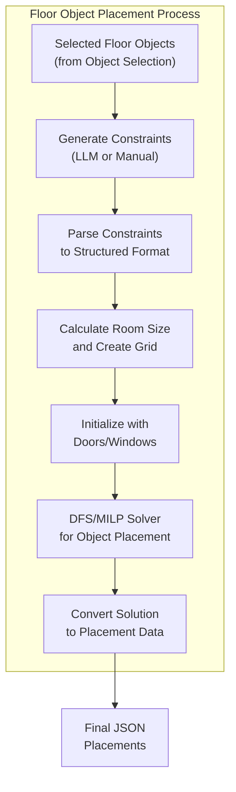
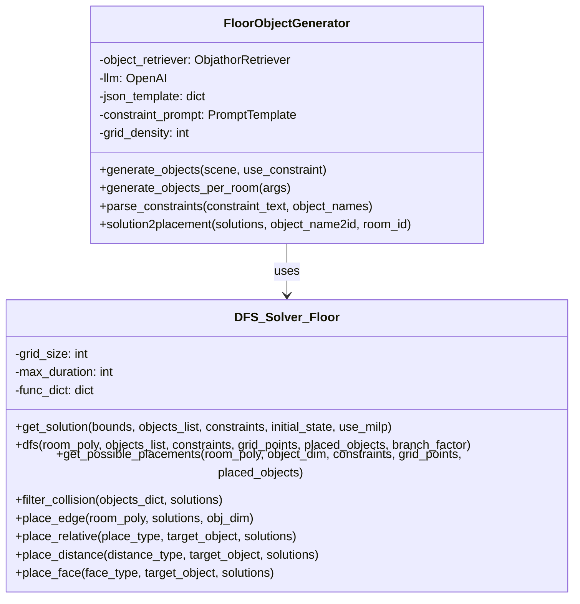
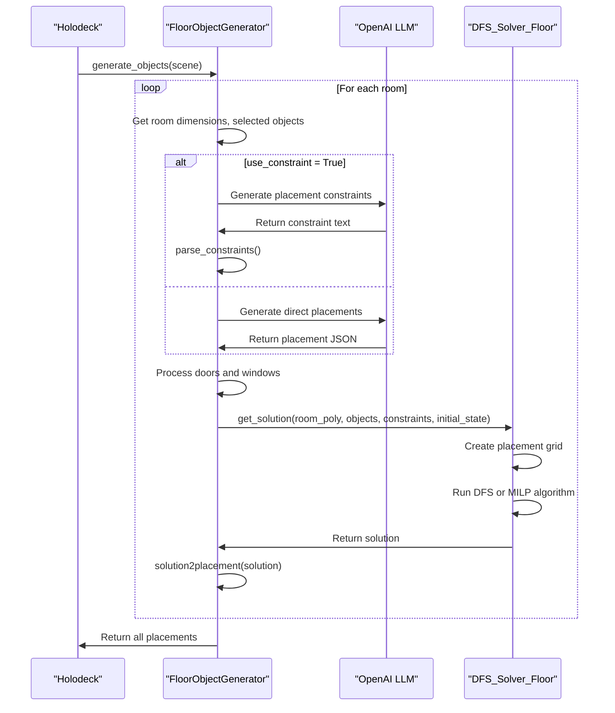
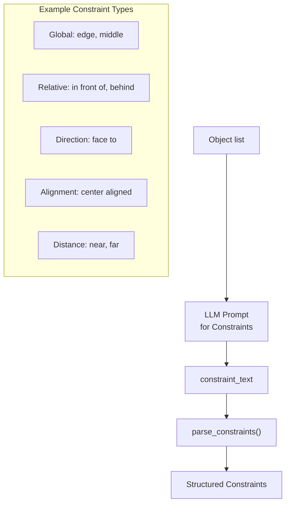
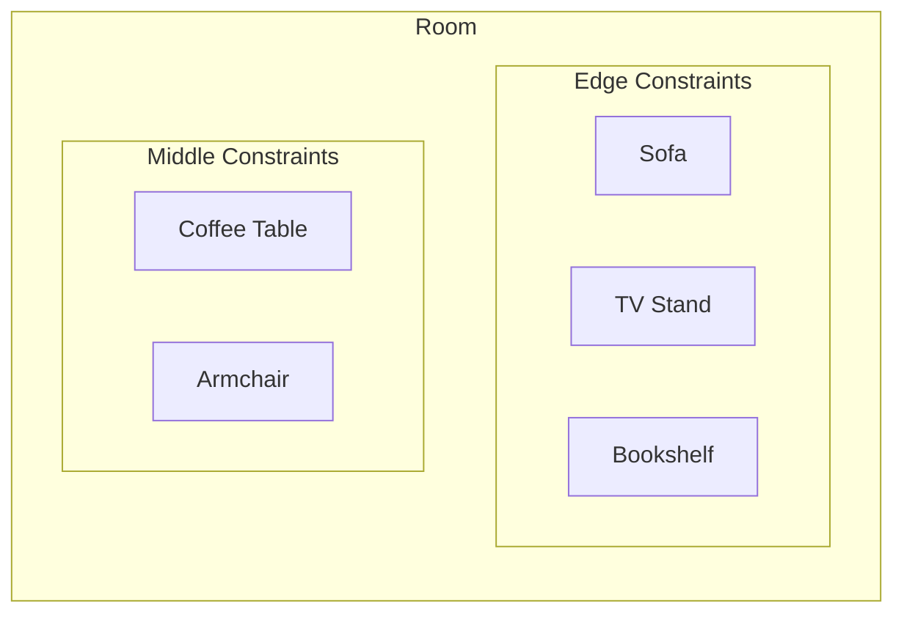
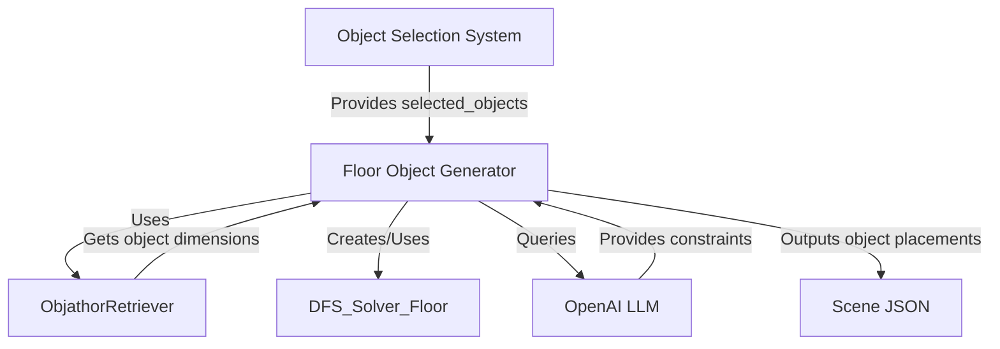

<!-- source: DeepWiki mcp.deepwiki.com · repo allenai/Holodeck · page 4.2 Floor Object Placement · fetched 2026-10-26 -->

# Floor Object Placement

<details>
<summary>Relevant source files</summary>

The following files were used as context for generating this wiki page:

- [ai2holodeck/generation/floor_objects.py](ai2holodeck/generation/floor_objects.py)

</details>


This document details Holodeck's floor object placement system, which is responsible for arranging 3D objects in generated scenes based on constraints. This subsystem is part of Holodeck's scene generation pipeline, specifically handling step 5: placing objects on room floors.

For information about the selection of which objects to place, see [Object Selection System](#4.1). For details on placing objects on walls and ceilings, see [Wall and Ceiling Objects](#4.3).

## Overview

The Floor Object Placement system operates after room generation and object selection have completed. It takes the previously selected floor objects and intelligently positions them within each room based on:

1. Room geometry and dimensions
2. Object sizes and rotation options
3. Natural language constraints generated by the LLM
4. Doors, windows, and other architectural features

The system uses constraint-based placement techniques, with either a depth-first search (DFS) solver or a mixed-integer linear programming (MILP) approach.



Sources: [ai2holodeck/generation/floor_objects.py:24-213]()

## Key Components



Sources: [ai2holodeck/generation/floor_objects.py:24-46](), [ai2holodeck/generation/floor_objects.py:461-487]()

### FloorObjectGenerator

The `FloorObjectGenerator` is the main class handling the placement of objects on floors. It manages:

- The JSON structure for object placements
- LLM-based constraint generation
- Conversion between solver solutions and final placements
- Handling of room dimensions and architectural features

Its primary method is `generate_objects()`, which coordinates placement across all rooms in a scene.

Sources: [ai2holodeck/generation/floor_objects.py:24-46](), [ai2holodeck/generation/floor_objects.py:54-79]()

### DFS_Solver_Floor

The `DFS_Solver_Floor` implements the core placement algorithm using depth-first search or MILP. It handles:

- Creating a grid of potential placement points
- Evaluating constraints against possible placements
- Scoring different placement options
- Ensuring objects don't collide or intersect

The solver is initialized with parameters like grid size and maximum solving duration, and its main entry point is the `get_solution()` method.

Sources: [ai2holodeck/generation/floor_objects.py:461-487](), [ai2holodeck/generation/floor_objects.py:490-541]()

## Placement Process



Sources: [ai2holodeck/generation/floor_objects.py:54-213]()

### Step 1: Initialization and Room Processing

For each room, the system:
1. Extracts the room dimensions
2. Gets the list of selected floor objects for that room type
3. Creates a placement grid based on the room's size
4. Initializes the state by marking doors and windows

```python
room_id = room["id"]
room_type = room["roomType"]
room_x, room_z = self.get_room_size(room)
room_size = f"{room_x} cm x {room_z} cm"
grid_size = max(room_x // self.grid_density, room_z // self.grid_density)
```

Sources: [ai2holodeck/generation/floor_objects.py:81-95]()

### Step 2: Constraint Generation and Parsing

If using constraints (the default), the system:
1. Prompts the LLM to generate constraints for the objects
2. Parses the text response into structured constraints
3. Prepares data structures for the solver



Sources: [ai2holodeck/generation/floor_objects.py:96-117](), [ai2holodeck/generation/floor_objects.py:302-439]()

The constraint parsing system handles different types of constraints:

| Constraint Type | Examples | Purpose |
|-----------------|----------|---------|
| Global | edge, middle | Determines overall position in room |
| Relative | in front of, behind, left of, right of | Positions relative to other objects |
| Direction | face to, face same as | Controls object orientation |
| Alignment | center alignment, edge alignment | Aligns objects with each other |
| Distance | near, far | Controls spacing between objects |

Sources: [ai2holodeck/generation/floor_objects.py:302-321]()

### Step 3: Solving for Object Placement

The system uses a DFS-based solver (or MILP) to find optimal placements that satisfy all constraints.

1. Creates a grid of potential placement positions in the room
2. For each object:
   - Gets possible placements based on room geometry
   - Filters placements based on collisions with doors, windows, and other objects
   - Applies different constraints (edge, relative, direction, etc.)
   - Scores placements based on how well they satisfy constraints
3. Uses depth-first search to explore different combinations of placements
4. Returns the solution with the highest overall score

The solver handles objects in a specific order, typically starting with larger objects before placing smaller ones.

Sources: [ai2holodeck/generation/floor_objects.py:550-596](), [ai2holodeck/generation/floor_objects.py:598-685]()

### Step 4: Converting Solutions to Placements

The final step converts the solver's solution into actual placement data with:
- 3D position coordinates (x, y, z)
- Rotation angles
- Room associations
- Object identifiers

```python
placement = self.json_template.copy()
placement["assetId"] = object_name2id[object_name]
placement["id"] = f"{object_name} ({room_id})"
placement["position"] = {
    "x": solution[0][0] / 100,
    "y": dimension["y"] / 2,
    "z": solution[0][1] / 100,
}
placement["rotation"] = {"x": 0, "y": solution[1], "z": 0}
placement["roomId"] = room_id
```

Sources: [ai2holodeck/generation/floor_objects.py:277-300]()

## Constraint Types and Implementation

### Global Constraints

Global constraints position objects relative to the room itself:

- **Edge**: Places objects against walls
- **Middle**: Places objects away from walls, in center areas



Sources: [ai2holodeck/generation/floor_objects.py:813-862]()

### Relative Positioning

These constraints position objects relative to other objects:

| Constraint | Description |
|------------|-------------|
| in front of | Places object in front of target object |
| behind | Places object behind target object |
| left of | Places object to the left of target object |
| right of | Places object to the right of target object |
| side of | Places object to the side of target object |

The system accounts for object rotation when applying these constraints, ensuring correct relative positioning regardless of how objects are facing.

Sources: [ai2holodeck/generation/floor_objects.py:903-960]()

### Direction Constraints

Direction constraints control how objects are oriented:

- **face to**: Object faces toward another object
- **face same as**: Object faces in same direction as another object
- **face opposite to**: Object faces in opposite direction to another object

Sources: [ai2holodeck/generation/floor_objects.py:1010-1074]()

### Distance Constraints

Distance constraints control spacing between objects:

- **near**: Places objects close to each other
- **far**: Places objects with distance between them

The system uses interpolation to determine optimal distances rather than fixed thresholds.

Sources: [ai2holodeck/generation/floor_objects.py:974-1009]()

## Advanced Features

### MILP Solver

For complex placement problems, the system can use Mixed Integer Linear Programming (MILP) instead of DFS, which provides:

- More optimal solutions for complex constraint sets
- Better handling of alignment constraints
- Ability to handle more objects simultaneously

The MILP solver uses the GUROBI optimizer to find solutions.

Sources: [ai2holodeck/generation/floor_objects.py:1139-1453]()

### Spatial Indexing

For efficient collision detection, the system uses an R-tree spatial index to quickly find potential collisions without checking every object pair.

```python
# Create an r-tree index
idx = index.Index()

# Populate the index with bounding boxes of the objects
for i, (_, _, obj, _) in enumerate(objects_dict.values()):
    idx.insert(i, Polygon(obj).bounds)
```

Sources: [ai2holodeck/generation/floor_objects.py:702-723]()

## Integration with Other Systems



Sources: [ai2holodeck/generation/floor_objects.py:24-79]()

The Floor Object Placement system integrates with:

1. **Object Selection System**: Receives the list of objects to place in each room
2. **ObjathorRetriever**: Gets asset information, including physical dimensions
3. **Language Model**: Generates placement constraints based on object types and room characteristics
4. **Scene Generation Pipeline**: The placements become part of the final scene JSON

## Common Constraints and Placement Patterns

The system is designed to handle common arrangement patterns:

1. **Living Room**:
   - Sofas and chairs against walls
   - Coffee tables in the middle, facing and near to seating
   - TV stands against walls opposite seating
   - Side tables adjacent to seating

2. **Bedroom**:
   - Beds against walls
   - Nightstands adjacent to beds
   - Dressers against walls
   - Desks against walls

3. **Kitchen/Dining Room**:
   - Dining tables in the middle or against walls
   - Chairs around tables
   - Kitchen islands in the middle

The constraint system allows for natural-looking object arrangements that reflect real-world interior design principles.

Sources: [ai2holodeck/generation/floor_objects.py:98-116]()

## Optimization Techniques

The system uses several techniques to optimize placement:

1. **Grid System**: Rather than testing every possible position, it uses a grid to sample the space efficiently
2. **Branch Factor Control**: Limits the search space by controlling the branching factor of DFS
3. **Time Limits**: Sets maximum solving durations to prevent excessive computation
4. **Constraint Weighting**: Prioritizes certain constraints over others
5. **Placement Scoring**: Scores different placements to choose optimal arrangements

Sources: [ai2holodeck/generation/floor_objects.py:462-486](), [ai2holodeck/generation/floor_objects.py:564-565]()

---

