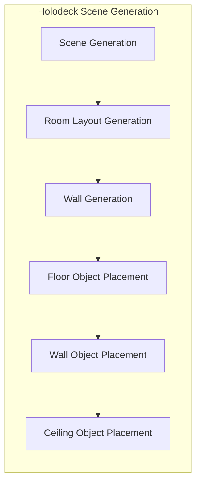
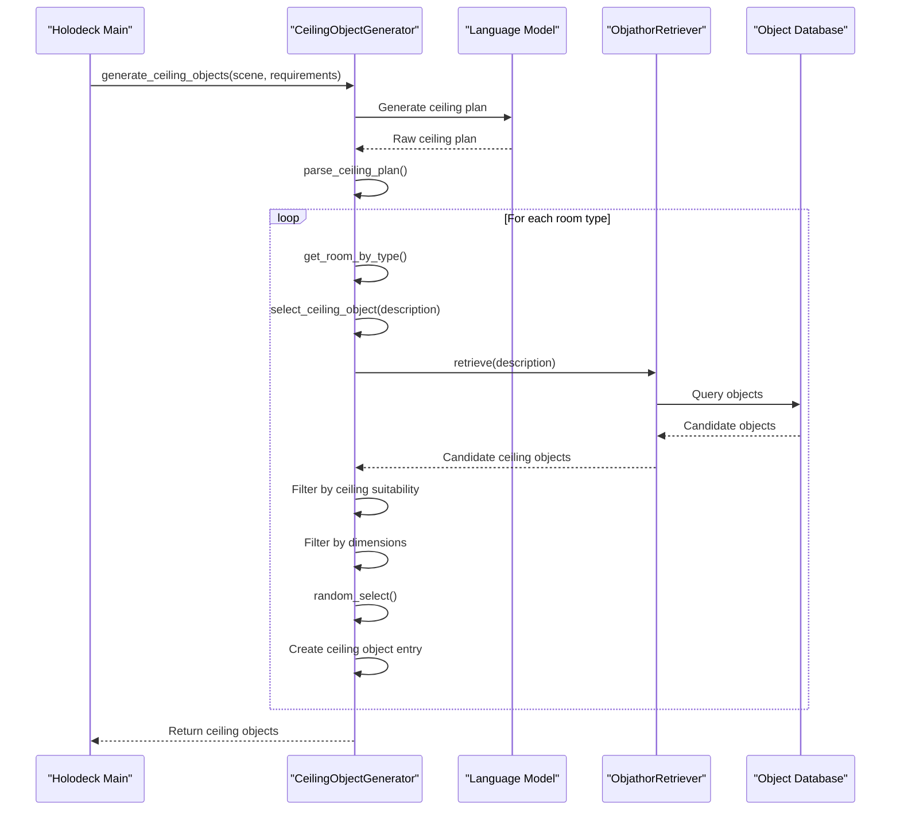
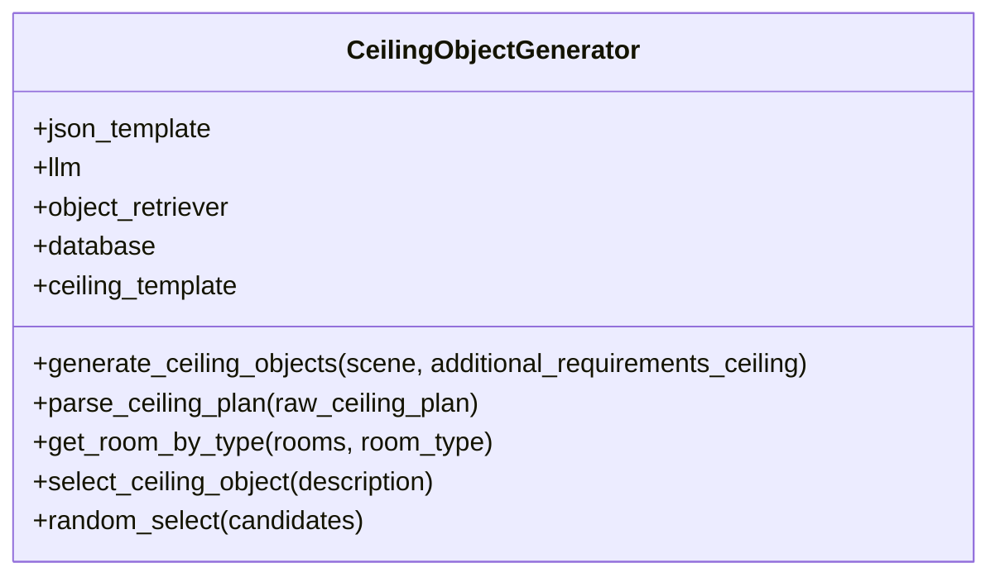
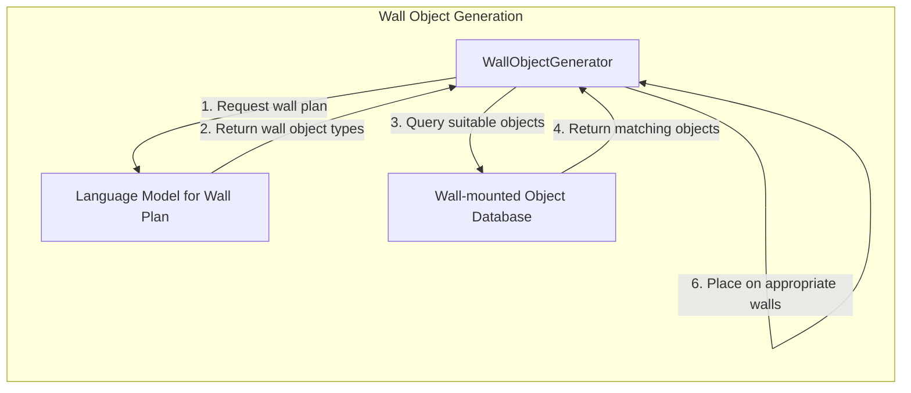
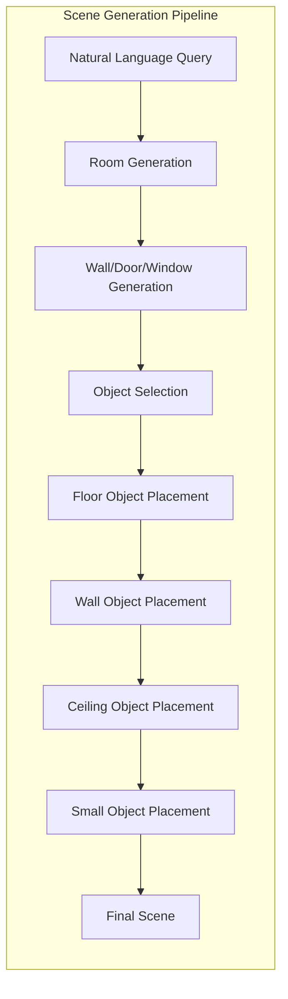

<!-- source: DeepWiki mcp.deepwiki.com · repo allenai/Holodeck · page 4.3 Wall and Ceiling Objects · fetched 2026-10-26 -->

# Wall and Ceiling Objects

<details>
<summary>Relevant source files</summary>

The following files were used as context for generating this wiki page:

- [ai2holodeck/generation/ceiling_objects.py](ai2holodeck/generation/ceiling_objects.py)

</details>


This document covers the generation and placement of wall-mounted and ceiling-mounted objects in Holodeck environments. It explains how objects suitable for these surfaces are selected, how placement decisions are made, and how they integrate with the overall scene generation process. For information about objects placed on the floor, see [Floor Object Placement](#4.2).

## Overview

Wall and ceiling objects are essential components of realistic indoor environments. These include light fixtures, wall art, air conditioners, and other items that are typically mounted on vertical surfaces or suspended from ceilings. In Holodeck, these objects are handled by dedicated generators that select appropriate objects and determine their placement in the scene.



Sources: [ai2holodeck/generation/ceiling_objects.py](ai2holodeck/generation/ceiling_objects.py)

## Ceiling Object Generation

The ceiling object generation system is responsible for selecting and placing objects on room ceilings, such as light fixtures, fans, and other ceiling-mounted items.

### Process Overview



Sources: [ai2holodeck/generation/ceiling_objects.py:34-85](ai2holodeck/generation/ceiling_objects.py)

### Ceiling Object Generator

The `CeilingObjectGenerator` class handles the selection and placement of ceiling objects. It is initialized with:
- An `ObjathorRetriever` instance for accessing 3D objects
- A language model (OpenAI) for generating ceiling plans



Sources: [ai2holodeck/generation/ceiling_objects.py:15-33](ai2holodeck/generation/ceiling_objects.py)

### Ceiling Plan Generation

The system uses a language model to generate a ceiling plan based on:
1. The original scene query
2. Types of rooms in the scene
3. Any additional requirements specified for ceiling objects

The language model produces a plan that maps room types to appropriate ceiling objects.

Sources: [ai2holodeck/generation/ceiling_objects.py:34-51](ai2holodeck/generation/ceiling_objects.py)

### Ceiling Plan Parsing

The raw ceiling plan from the language model is parsed to extract mappings between room types and ceiling object descriptions. The parsing logic handles various formatting cases to extract the relevant information.

```
Raw ceiling plan format example:
1. living room | ceiling fan with lights
2. kitchen | recessed lighting
```

The parsing function extracts pairs like:
- "living room" → "ceiling fan with lights"
- "kitchen" → "recessed lighting"

Sources: [ai2holodeck/generation/ceiling_objects.py:87-104](ai2holodeck/generation/ceiling_objects.py)

### Object Selection

For each room type, the system:
1. Retrieves object candidates that match the description
2. Filters objects to only include those marked as suitable for ceilings
3. Further filters objects to ensure they have appropriate dimensions
4. Randomly selects one object from the valid candidates

The selection process uses a probability distribution based on the similarity scores of the candidates to the description.

Sources: [ai2holodeck/generation/ceiling_objects.py:112-143](ai2holodeck/generation/ceiling_objects.py)

### Object Placement

Currently, ceiling objects are placed at the center of the room at a height just below the ceiling. The placement logic:
1. Calculates the centroid of the room's floor polygon
2. Positions the object at this x,z coordinate
3. Sets the y-coordinate to place the object just below the ceiling
4. Creates the object entry with position, rotation, and other metadata

Sources: [ai2holodeck/generation/ceiling_objects.py:66-83](ai2holodeck/generation/ceiling_objects.py)

## Object Representation and Data Model

Ceiling objects are represented using a JSON structure with the following fields:

| Field | Description |
|-------|-------------|
| `assetId` | ID of the 3D asset in the database |
| `id` | Unique identifier for the object in the scene |
| `kinematic` | Whether the object is kinematic (default: true) |
| `position` | x, y, z coordinates for placement |
| `rotation` | x, y, z rotation values |
| `material` | Material for the object (if applicable) |
| `roomId` | ID of the room containing the object |
| `object_name` | Human-readable name/category of the object |

Sources: [ai2holodeck/generation/ceiling_objects.py:17-26](ai2holodeck/generation/ceiling_objects.py)

## Filtering and Constraints

The system applies several constraints to ensure selected objects are appropriate for ceiling placement:

1. **Ceiling Suitability**: Objects must be explicitly marked as suitable for ceiling placement with `onCeiling: true` in the object annotations.

2. **Size Constraints**: Objects must have a height (y-dimension) less than or equal to 1.0 units to avoid excessively large ceiling fixtures.

These constraints help ensure that placed objects make sense in the context of ceiling mounting.

Sources: [ai2holodeck/generation/ceiling_objects.py:116-126](ai2holodeck/generation/ceiling_objects.py)

## Wall Object System

While the wall object system code isn't directly visible in the provided files, it likely follows a similar approach to the ceiling object system:



The wall object generation likely differs in:
1. Objects are filtered based on wall suitability rather than ceiling suitability
2. Placement logic must consider wall orientation and available wall space
3. Objects are positioned against walls rather than at room centers

## Integration with Overall Scene Generation

Wall and ceiling objects are part of the larger scene generation pipeline in Holodeck. They are typically generated after floor objects have been placed, as the placement of large furniture items can affect the available space for wall and ceiling objects.



The integration ensures that:
1. Wall objects only appear on valid walls (not where windows or doors are located)
2. Ceiling objects don't intersect with walls or other structural elements
3. The overall distribution of objects creates a cohesive and realistic environment

## Limitations and Future Improvements

Based on the examined code, several limitations and potential improvements can be identified:

1. **Advanced Placement**: Currently, ceiling objects are placed at room centers, which could be enhanced with more sophisticated placement strategies that consider room usage patterns, existing lighting, and architectural features.

2. **Multiple Objects**: The current implementation only considers one type of ceiling object per room. Support for multiple ceiling fixtures per room could enhance realism.

3. **Object Relationships**: Smarter placement that considers relationships between objects (e.g., placing a TV on a wall opposite to seating furniture) would create more realistic environments.

4. **Complex Ceiling Structures**: Support for more complex ceiling structures like beams, vaulted ceilings, etc., which would affect ceiling object placement.

Sources: [ai2holodeck/generation/ceiling_objects.py:66-73](ai2holodeck/generation/ceiling_objects.py)

---

