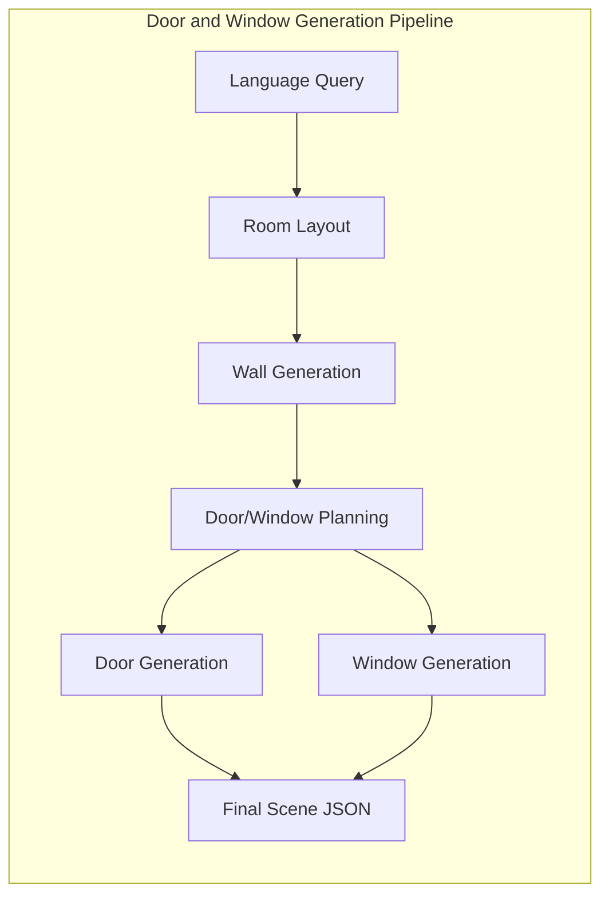
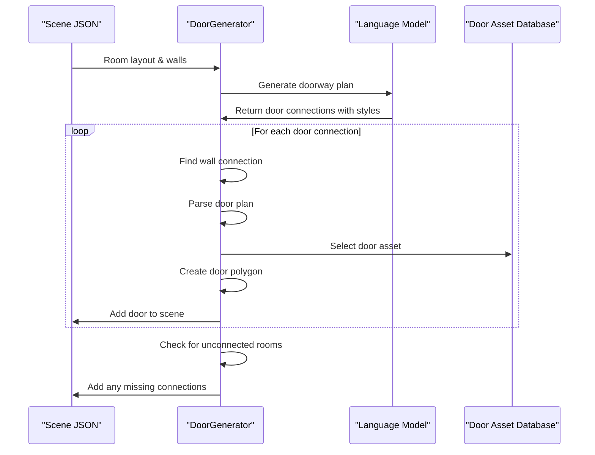
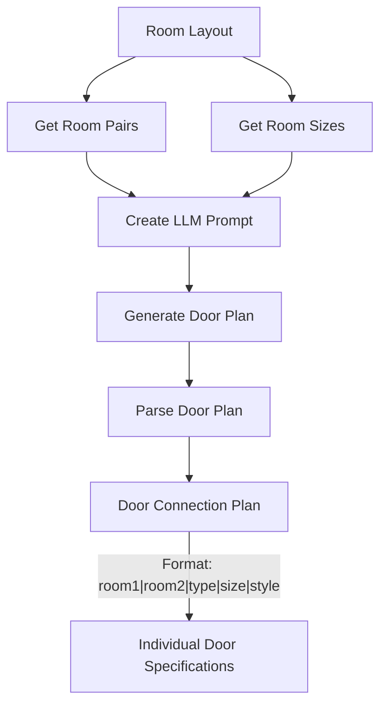
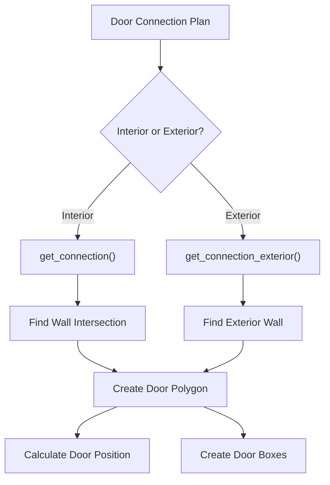
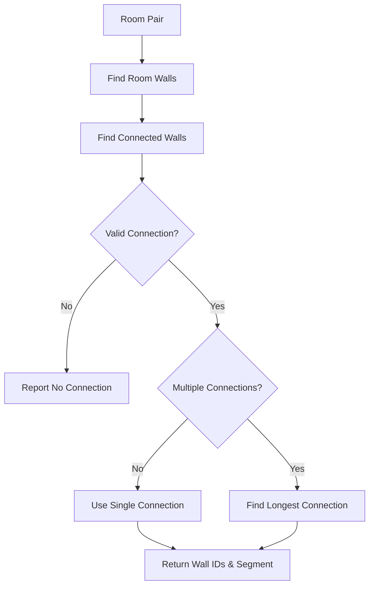
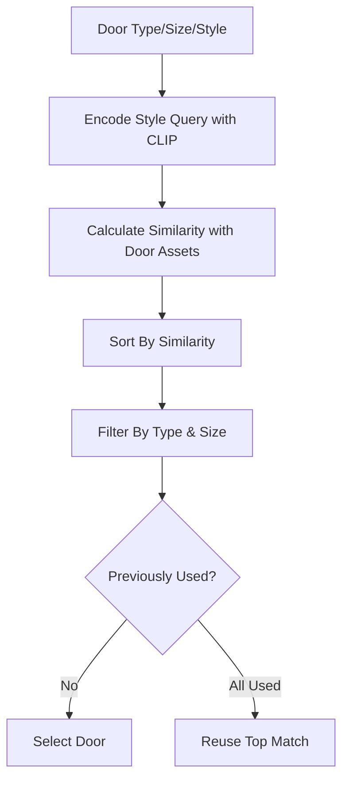
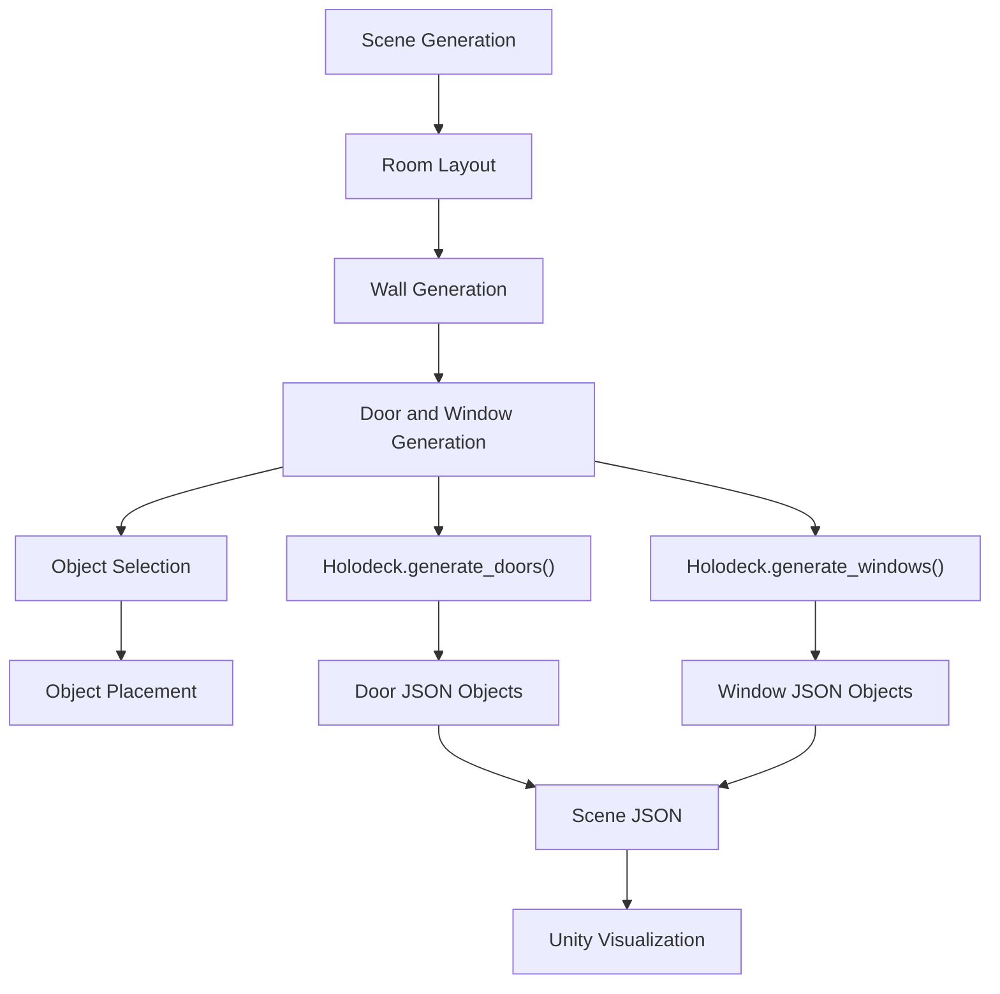

<!-- source: DeepWiki mcp.deepwiki.com · repo allenai/Holodeck · page 4.4 Doors and Windows · fetched 2026-10-26 -->

# Doors and Windows

<details>
<summary>Relevant source files</summary>

The following files were used as context for generating this wiki page:

- [ai2holodeck/generation/doors.py](ai2holodeck/generation/doors.py)

</details>


This document explains how the Holodeck system generates and integrates doors and windows into 3D environments. The door and window generation process is a crucial part of creating realistic, navigable spaces by connecting rooms appropriately and adding openings to exterior walls.

## Overview

The doors and windows system is responsible for:
1. Determining appropriate connections between rooms
2. Selecting and placing suitable door assets between connected rooms
3. Creating openings in walls with proper dimensions and positions
4. Supporting different types of doors (regular doors, doorframes, exterior doors)

The generation process relies on LLM-guided planning to determine which rooms should be connected and with what type of doors or openings.



Sources: [ai2holodeck/generation/doors.py:1-546]()

## Door Generation Process

The door generation system follows these key steps:

1. **Planning**: An LLM is prompted to create a door connection plan based on the room layout
2. **Connection Finding**: The system identifies valid wall connections between rooms
3. **Asset Selection**: Appropriate door assets are selected based on style, size, and connection type
4. **Placement**: Doors are placed along connecting walls with proper positioning
5. **Validation**: The system ensures all rooms have at least one connection



Sources: [ai2holodeck/generation/doors.py:82-261]()

## Door Types and Configuration

The Holodeck system supports different types of doors with various configurations:

1. **Connection Types**:
   - Doorway: Standard doors that can be opened and closed
   - Doorframe: Open frames without actual doors
   - Open: Completely open passages between rooms (no door asset)

2. **Door Sizes**:
   - Single: Standard width door for normal passages
   - Double: Wider doors for larger openings

3. **Door Styles**:
   - Various styles specified in natural language (e.g., "modern", "wooden")
   - Style selection is handled by CLIP-based similarity matching

```mermaid
classDiagram
    class "DoorObject" {
        +assetId: string
        +id: string
        +openable: boolean
        +openness: number
        +room0: string
        +room1: string
        +wall0: string
        +wall1: string
        +holePolygon: array
        +assetPosition: object
        +doorBoxes: array
    }
    
    class "DoorGenerator" {
        +json_template: object
        +door_data: object
        +door_ids: array
        +used_assets: array
        +clip_model: model
        +generate_doors()
        +select_door()
        +get_door_polygon()
        +get_connection()
        +parse_door_plan()
    }
    
    "DoorGenerator" --> "DoorObject" : creates
```

Sources: [ai2holodeck/generation/doors.py:18-55](), [ai2holodeck/generation/doors.py:422-447]()

## Door Planning and LLM Integration

The system uses an LLM to determine appropriate door connections between rooms based on:
- Room types and their spatial relationships
- Room sizes and dimensions
- Wall connections between rooms
- Additional style or functional requirements

The LLM generates a structured door plan that specifies:
1. Which rooms to connect
2. What type of connection to use
3. The size of the door
4. The style of the door



Sources: [ai2holodeck/generation/doors.py:82-114](), [ai2holodeck/generation/doors.py:268-280]()

## Door Placement and Geometry

Door placement involves complex geometric calculations to:
1. Identify valid wall segments for door placement
2. Create door polygons with appropriate dimensions
3. Position door assets correctly on walls
4. Create "holes" in walls for doors

The system handles both interior and exterior doors differently:



Sources: [ai2holodeck/generation/doors.py:282-319](), [ai2holodeck/generation/doors.py:320-362](), [ai2holodeck/generation/doors.py:363-420]()

## Technical Implementation Details

### Connection Finding

The system needs to find valid connections between rooms, which involves:
1. Identifying walls that separate two rooms
2. Finding the intersection segment between these walls
3. Ensuring the segment is long enough for a door
4. Handling special cases like exterior walls



Sources: [ai2holodeck/generation/doors.py:320-362](), [ai2holodeck/generation/doors.py:363-420]()

### Door Asset Selection

The door asset selection uses CLIP embeddings to match door assets with style descriptions:

1. Encode the style query using CLIP text encoder
2. Compare with pre-computed CLIP embeddings for door assets
3. Find the most similar doors that match the requested type and size
4. Select a door that hasn't been used already if possible



Sources: [ai2holodeck/generation/doors.py:422-447]()

## Door Database and Asset Management

The system uses a predefined database of door assets stored in the Holodeck base data directory:

1. Door metadata is stored in a JSON database
2. Each door has associated image files for visual similarity matching
3. CLIP features are precomputed for efficient matching
4. Door assets include information about:
   - Door type (doorway, doorframe)
   - Door size (single, double)
   - Door dimensions (for proper placement)

```mermaid
classDiagram
    class "DoorAsset" {
        +id: string
        +type: string
        +size: string
        +boundingBox: object
        +image: filepath
    }
    
    class "DoorDatabase" {
        +doors: Map<id, DoorAsset>
        +clip_features: tensor
    }
    
    "DoorDatabase" o-- "DoorAsset" : contains
```

Sources: [ai2holodeck/generation/doors.py:33-44](), [ai2holodeck/generation/doors.py:56-80]()

## Window Generation

While not explicitly shown in the provided code, window generation follows a similar process to door generation:

1. Windows are planned by the LLM alongside doors
2. Windows are primarily placed on exterior walls
3. Window assets are selected based on style and size requirements
4. Window geometry creates appropriate openings in walls

Windows can be placed on both exterior and interior walls, with exterior windows providing natural light and views.

## Integration with Scene Generation Pipeline

The door and window generation step occurs after room layout and wall generation but before object placement. This ensures that:

1. Spaces for doors are reserved before furniture placement
2. Object placement can respect door openings and traffic patterns
3. Room connections are established for proper navigation



Sources: [ai2holodeck/generation/doors.py:82-261]()

## Summary

The Doors and Windows system in Holodeck is a sophisticated component that:

1. Uses LLM-guided planning to determine appropriate room connections
2. Implements complex geometric operations for door placement
3. Selects suitable door assets using CLIP-based similarity matching
4. Handles different types of connections including interior doors, exterior doors, and open passages
5. Ensures all rooms have proper connections for navigation
6. Creates a detailed JSON representation of doors for the scene

The system balances realism, functionality, and aesthetic considerations to create coherent and navigable 3D environments.

---

