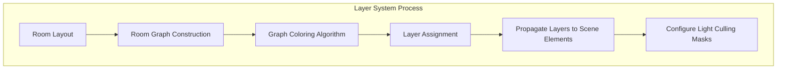
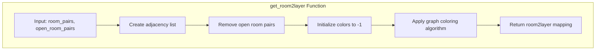
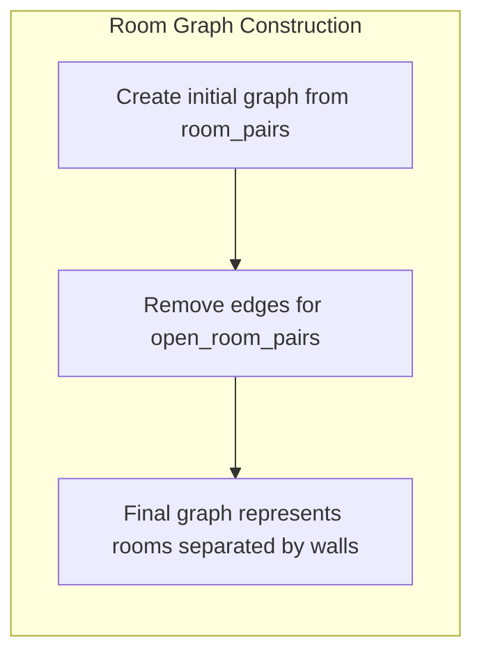
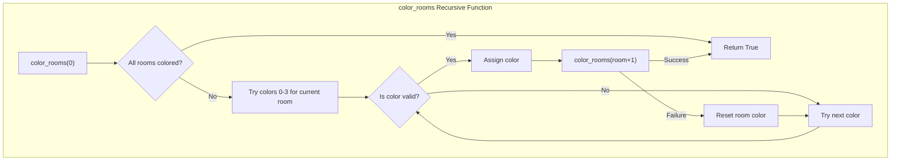
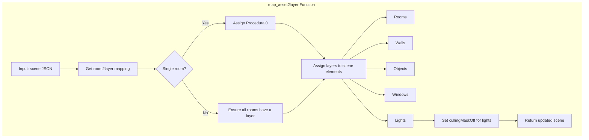
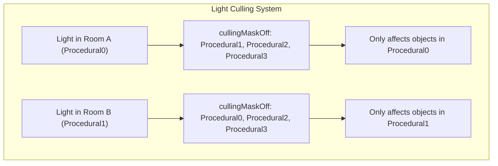
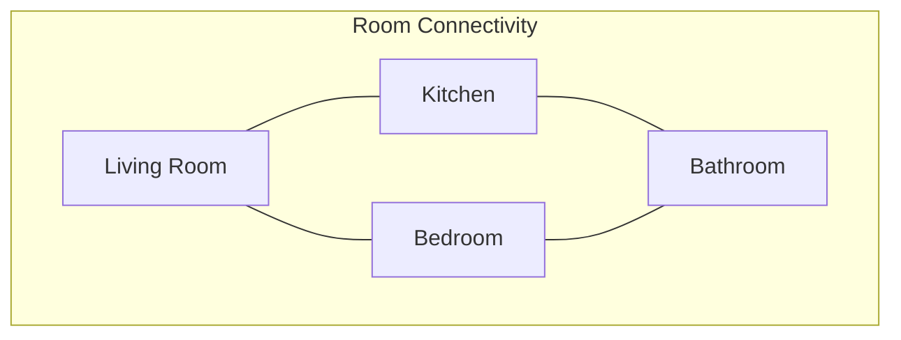
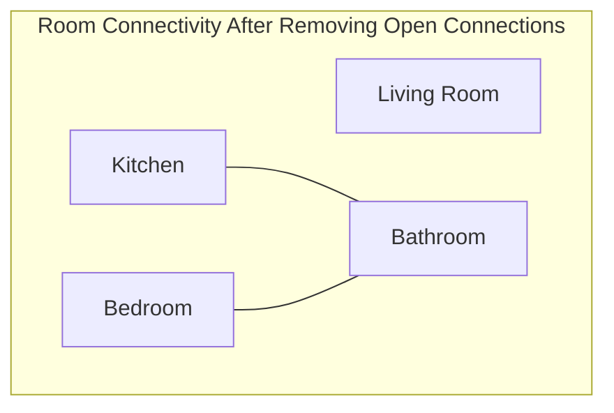
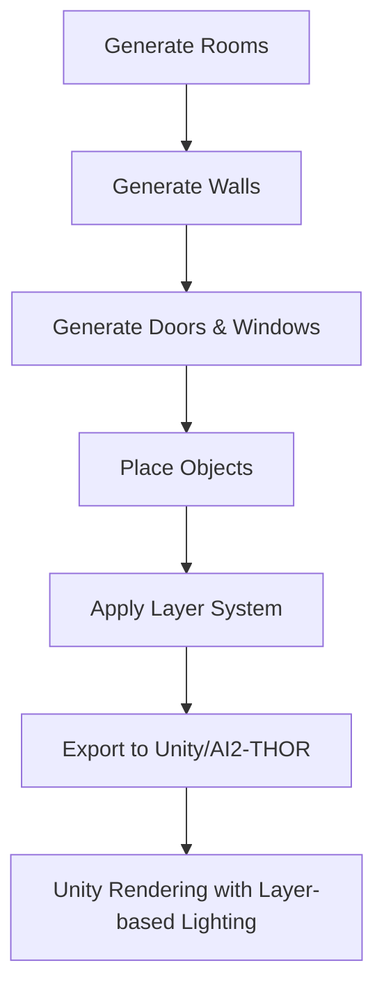

<!-- source: DeepWiki mcp.deepwiki.com · repo allenai/Holodeck · page 4.5 Layer System · fetched 2026-10-26 -->

# Layer System

Relevant source files

The following files were used as context for generating this wiki page:

- [ai2holodeck/generation/layers.py](ai2holodeck/generation/layers.py)

The Layer System in Holodeck organizes scene elements (rooms, walls, objects, lights) into separate rendering layers. Its primary purpose is to ensure proper lighting separation between rooms, preventing light from one room from affecting objects in other rooms, which creates more realistic lighting in the 3D environment.

For information about object placement on floors, walls, and ceilings, see [Floor Object Placement](#4.2) and [Wall and Ceiling Objects](#4.3).

## Overview of the Layer System

The Layer System uses a graph coloring algorithm to assign layers to rooms and their contained elements. This technique ensures that no two adjacent rooms (rooms sharing a wall without an open doorway) have the same layer. Holodeck uses up to four layers named "Procedural0" through "Procedural3".

Sources: [ai2holodeck/generation/layers.py]()

## Layer Assignment Algorithm

The layer assignment process uses a graph coloring approach implemented in the `get_room2layer` function:

1. Create an adjacency list representing room connections
2. Remove open room pairs (rooms with open doorways) from consideration
3. Apply a backtracking algorithm to assign up to 4 different layers

Sources: [ai2holodeck/generation/layers.py:1-47]()

### Room Graph Construction

The system starts by creating a graph representation where:
- Nodes are rooms
- Edges connect rooms that share a wall
- Open connections between rooms are removed from consideration

Sources: [ai2holodeck/generation/layers.py:4-19]()

### Graph Coloring Implementation

The algorithm assigns layers (colors) to rooms using a recursive backtracking approach that ensures no adjacent rooms have the same layer:

Sources: [ai2holodeck/generation/layers.py:25-41]()

## Layer Propagation to Scene Elements

After determining room layers, the `map_asset2layer` function assigns these layers to all elements in the scene:

Sources: [ai2holodeck/generation/layers.py:50-91]()

Each scene element receives the layer of the room it belongs to:
- Rooms: `room["layer"] = room2layer[room["id"]]`
- Walls: `wall["layer"] = room2layer[wall["roomId"]]`
- Objects: `obj["layer"] = room2layer[obj["roomId"]]`
- Windows: `window["layer"] = room2layer[window["roomId"]]`
- Lights: `light["layer"] = room2layer[light["roomId"]]`

For lights, an additional property `cullingMaskOff` is set to exclude all other layers, ensuring each light only affects objects in its own layer.

Sources: [ai2holodeck/generation/layers.py:63-89]()

## Light Culling Behavior

The layer system critically enables proper lighting separation in Unity through culling masks:

This ensures:
- Light from one room doesn't "bleed" through walls into adjacent rooms
- Each room has independent lighting
- More realistic lighting in the 3D environment

Sources: [ai2holodeck/generation/layers.py:87-89]()

## Example of Layer Assignment

Consider a house with these room connections:

With open connections between:
- Living Room and Kitchen
- Living Room and Bedroom

After removing open connections, the graph for layer assignment becomes:

The layer assignment might be:
- Living Room: Procedural0 (no adjacency constraints)
- Kitchen: Procedural0
- Bedroom: Procedural1
- Bathroom: Procedural2

This ensures rooms sharing walls without open doorways have different layers.

Sources: [ai2holodeck/generation/layers.py:94-102]()

## Integration with Scene Generation Pipeline

The Layer System is applied in the final stages of scene generation:

By organizing scene elements into layers, the system creates more realistic environments with proper lighting separation between rooms.

Sources: [ai2holodeck/generation/layers.py]()

---

