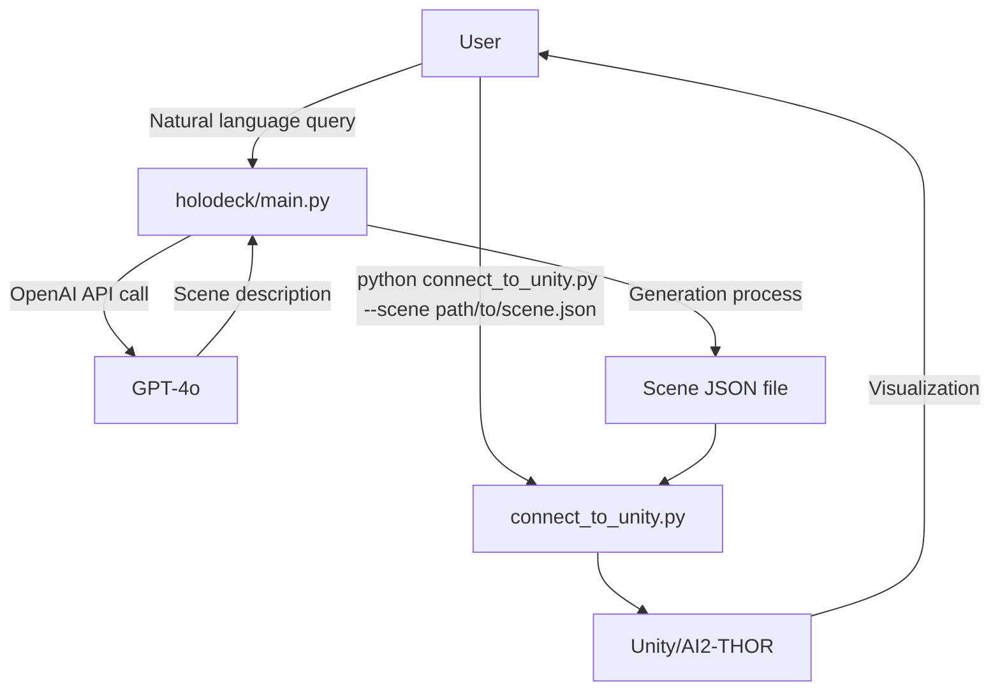
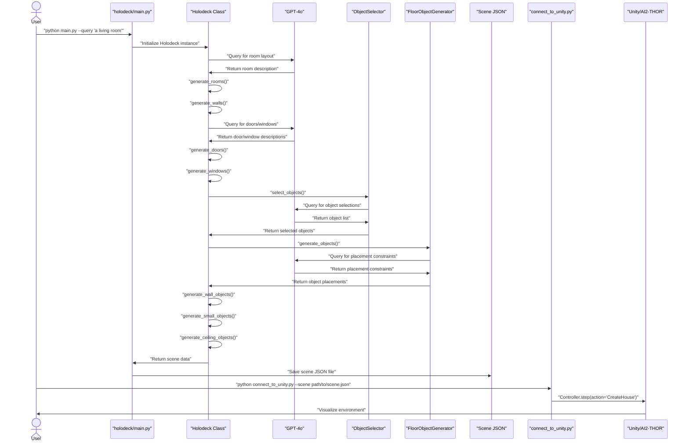
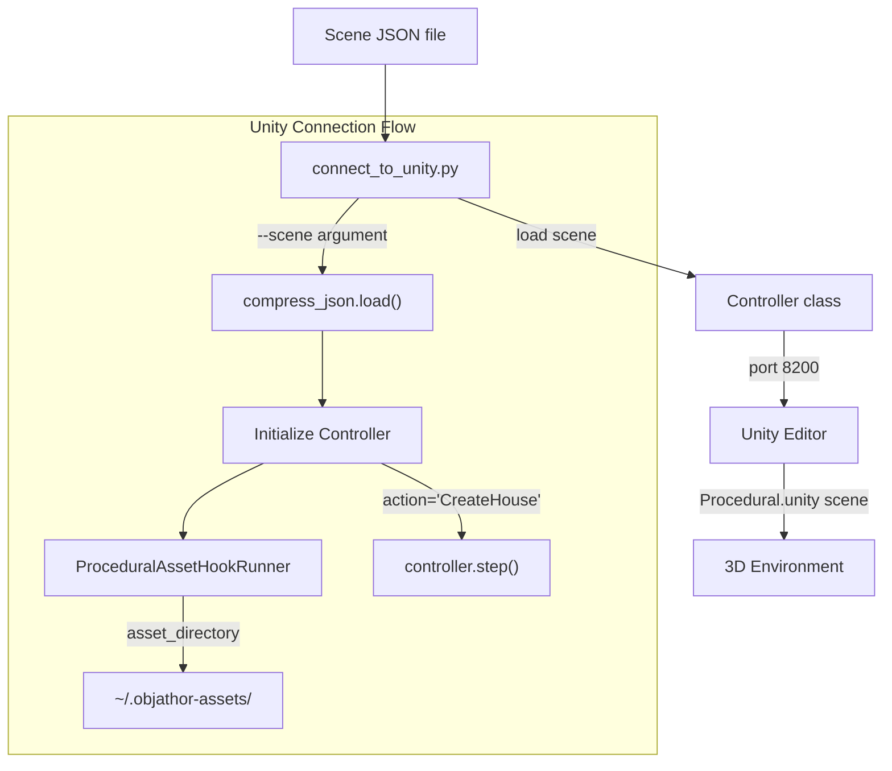

<!-- source: DeepWiki mcp.deepwiki.com · repo allenai/Holodeck · page 5 Usage Guide · fetched 2026-10-26 -->

# Usage Guide

<details>
<summary>Relevant source files</summary>

The following files were used as context for generating this wiki page:

- [README.md](README.md)
- [connect_to_unity.py](connect_to_unity.py)

</details>


This document provides detailed instructions for using Holodeck to generate 3D embodied AI environments from natural language descriptions and visualize them in Unity. For information about customizing the generation process, see [Customizing Generation](#5.2), and for examples of different types of environments, see [Generation Examples](#5.1).

## Basic Usage

Holodeck enables you to generate detailed 3D environments by simply describing them in natural language. The basic command to generate an environment is:

```bash
python holodeck/main.py --query "a living room" --openai_api_key <OPENAI_API_KEY>
```

This command processes your natural language query, generates a complete 3D environment matching that description, and saves the resulting scene as a JSON file in the `./scenes/` directory.

Sources: [README.md:42-44]()

## Command-Line Arguments

The following command-line arguments are supported when running Holodeck:

| Argument | Description | Default |
|----------|-------------|---------|
| `--query` | Natural language description of the environment | Required |
| `--openai_api_key` | Your OpenAI API key | Required |
| `--use_milp` | Whether to use MILP solver for object placement | False (uses DFS instead) |
| `--save_dir` | Directory to save generated scenes | ./scenes/ |
| `--openai_org` | OpenAI organization ID | None |
| `--single_room` | Generate a single room only | False |

**Note:** Holodeck uses `gpt-4o-2024-05-13`, so ensure you have access to this model.

Sources: [README.md:42-46](), [README.md:19-19]()

## Generation Workflow

The diagram below illustrates the basic workflow when using Holodeck:



Sources: [README.md:42-44](), [README.md:64-66]()

## Generation Pipeline

The diagram below shows how your natural language query is processed through the generation pipeline, mapping natural language concepts to specific code components:



Sources: [README.md:42-44](), [connect_to_unity.py:30-52]()

## Step-by-Step Guide

### 1. Installation and Setup

Before using Holodeck, complete the following steps:

1. Install dependencies:
   ```bash
   conda create --name holodeck python=3.10
   conda activate holodeck
   pip install -r requirements.txt
   pip install --extra-index-url https://ai2thor-pypi.allenai.org ai2thor==0+8524eadda94df0ab2dbb2ef5a577e4d37c712897
   ```

2. Download required data assets:
   ```bash
   python -m objathor.dataset.download_holodeck_base_data --version 2023_09_23
   python -m objathor.dataset.download_assets --version 2023_09_23
   python -m objathor.dataset.download_annotations --version 2023_09_23
   python -m objathor.dataset.download_features --version 2023_09_23
   ```

   By default, these assets are saved to `~/.objathor-assets/`. If you choose a different location using the `--path` argument, set the `OBJAVERSE_ASSETS_DIR` environment variable to that path.

Sources: [README.md:23-27](), [README.md:32-38]()

### 2. Generate an Environment

Run the main script with your desired environment description:

```bash
python holodeck/main.py --query "a modern kitchen with an island" --openai_api_key <OPENAI_API_KEY>
```

This will create a new directory under `./scenes/` named after your query (e.g., `./scenes/a_modern_kitchen_with_an_island/`) containing a JSON file with the complete scene description.

Sources: [README.md:42-44]()

### 3. Visualize in Unity

To visualize your generated environment:

1. Install Unity version 2020.3.25f1
2. Clone and check out the correct version of AI2-THOR:
   ```bash
   git clone https://github.com/allenai/ai2thor.git
   git checkout 07445be8e91ddeb5de2915c90935c4aef27a241d
   ```
3. Reinstall specific packages if needed:
   ```bash
   pip uninstall Werkzeug
   pip uninstall Flask
   pip install Werkzeug==2.0.1
   pip install Flask==2.0.1
   ```
4. Load `ai2thor/unity` as a project in Unity
5. Open `ai2thor/unity/Assets/Scenes/Procedural/Procedural.unity`
6. Run the connection script:
   ```bash
   python connect_to_unity.py --scene <PATH_TO_SCENE_JSON>
   ```
7. Press the play button in Unity to view your environment

Sources: [README.md:49-68](), [connect_to_unity.py:15-47]()

## Connection to Unity

The diagram below shows the technical flow when connecting a generated scene to Unity:



Sources: [connect_to_unity.py:30-52](), [README.md:64-66]()

## Tips and Best Practices

### Crafting Effective Queries

Your natural language query determines the environment that will be generated. Consider including:
- Room type (kitchen, bedroom, office, etc.)
- Style (modern, rustic, minimalist, etc.)
- Key features or objects you want included
- Size and layout preferences

Examples:
- "a spacious living room with a fireplace and large windows"
- "a compact home office with bookshelves and a desk"
- "a child's bedroom with colorful furniture and toys"

### Using the DFS Solver

For better object placement, Holodeck uses a DFS solver. This is now the default option, but if you're using an older version of the code (before 12/28/2023), explicitly set the MILP option to false:

```bash
python holodeck/main.py --query "your query" --openai_api_key <KEY> --use_milp False
```

Sources: [README.md:19-19](), [README.md:46-46]()

## Troubleshooting

### OpenAI API Access

Ensure:
- Your API key is valid
- You have access to the GPT-4o-2024-05-13 model
- You have sufficient credits in your OpenAI account

Sources: [README.md:45-45]()

### Asset Loading Issues

If you encounter missing assets:
1. Verify that you've downloaded all required data using the commands in the Installation section
2. Check that the `OBJAVERSE_ASSETS_DIR` environment variable is correctly set if you used a custom download path
3. Verify that the assets directory contains the expected files and folders

Sources: [README.md:32-38]()

### Unity Connection Issues

If you have trouble connecting to Unity:
1. Make sure you're using Unity version 2020.3.25f1
2. Ensure you have checked out the correct AI2-THOR commit: `07445be8e91ddeb5de2915c90935c4aef27a241d`
3. Make sure you've installed the correct versions of Werkzeug and Flask
4. Verify that you've opened the correct scene in Unity: `Procedural.unity`
5. Check that the controller connection is established on port 8200

Sources: [README.md:49-68](), [connect_to_unity.py:32-38]()

### Adding Custom Assets

To add custom assets to AI2-THOR environments, you can use the objathor repository. Refer to the [objathor repository](https://github.com/allenai/objathor) for detailed instructions.

Sources: [README.md:17-17]()

---

