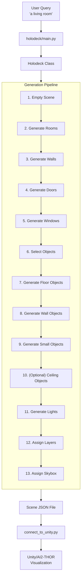
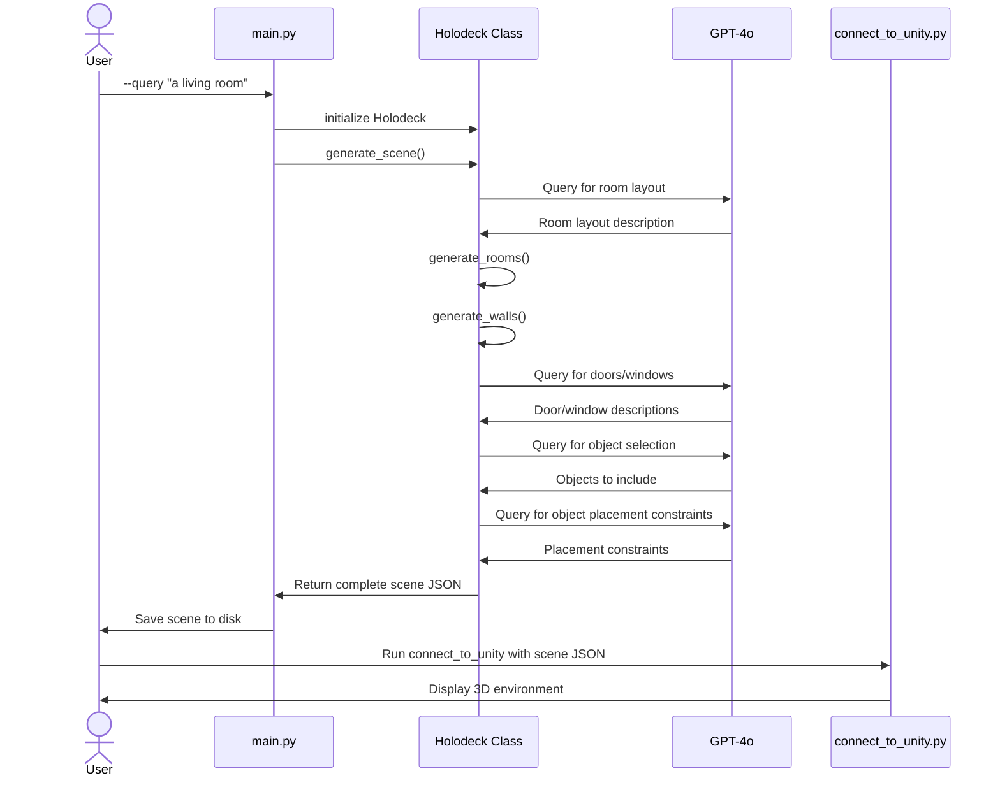
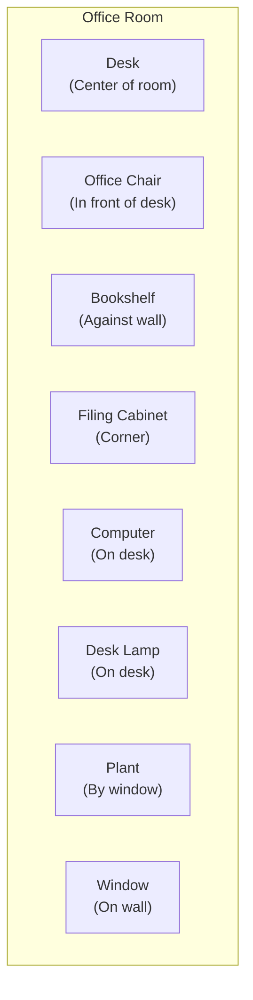
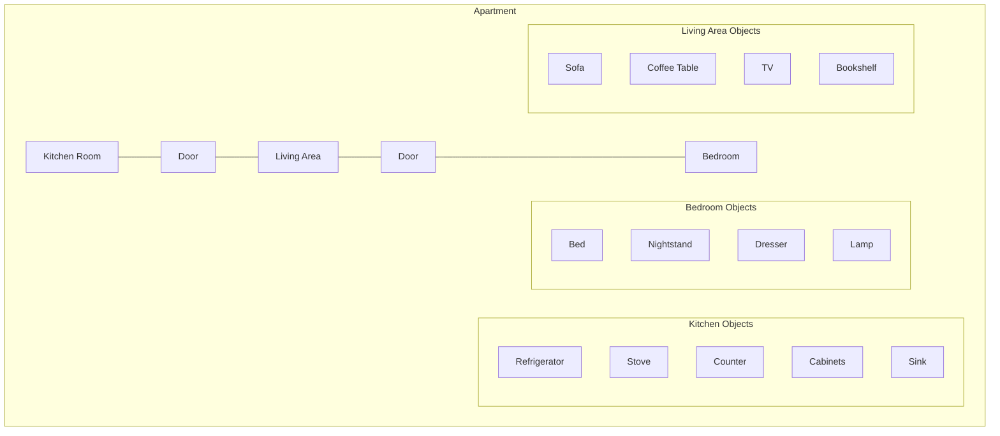
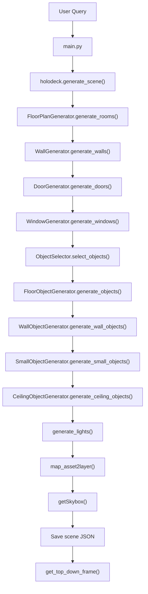
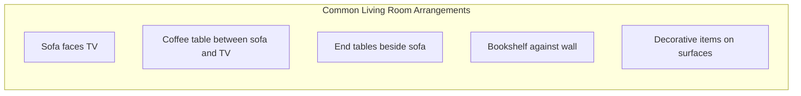
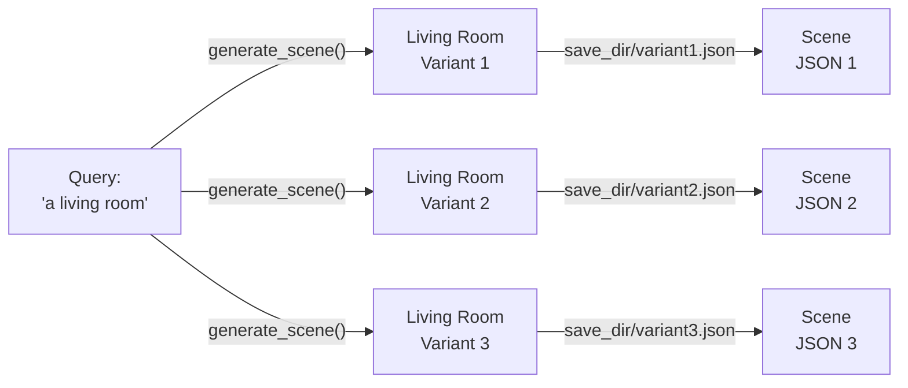

<!-- source: DeepWiki mcp.deepwiki.com · repo allenai/Holodeck · page 5.1 Generation Examples · fetched 2026-10-26 -->

# Generation Examples

<details>
<summary>Relevant source files</summary>

The following files were used as context for generating this wiki page:

- [README.md](README.md)
- [ai2holodeck/generation/holodeck.py](ai2holodeck/generation/holodeck.py)

</details>


This page showcases examples of different types of 3D environments that can be generated with Holodeck using natural language descriptions. For information about customizing the generation process, see [Customizing Generation](#5.2).

## Overview of the Generation Process

Before exploring specific examples, let's understand how Holodeck transforms language queries into 3D environments:



Sources: [ai2holodeck/generation/holodeck.py:258-347]()

## Basic Generation Example

The simplest way to generate an environment with Holodeck is by providing a natural language query:

```
python holodeck/main.py --query "a living room" --openai_api_key <OPENAI_API_KEY>
```

This command triggers the following process:



Sources: [ai2holodeck/generation/holodeck.py:258-389](), [README.md:43-44]()

## Living Room Example

A query for "a living room" goes through the following transformation process:

1. **Language Analysis**: The LLM interprets the query and determines the room type, size, and potential objects
2. **Room Creation**: A living room space is generated with appropriate dimensions
3. **Object Selection**: Common living room objects are selected (sofa, coffee table, TV, etc.)
4. **Object Placement**: Objects are placed according to common living room layouts and constraints

### Sample Output Visualization

The final living room might include:
- Sofa positioned against a wall
- Coffee table in front of the sofa
- TV placed opposite the sofa
- End tables with lamps
- Decorative items such as plants, artwork, and small accessories

Sources: [README.md:7-8]()

## Office Example

For a query like "an office space", Holodeck generates:

1. **Room Layout**: One or more office rooms with appropriate dimensions
2. **Office Furniture**: Desk, office chair, shelving, filing cabinets
3. **Electronics**: Computer, monitor, desk lamp
4. **Accessories**: Office supplies, books, decorative items

### Sample Office Layout



Sources: [README.md:7]()

## Multi-Room Example

For more complex queries like "a small apartment with a kitchen and bedroom", Holodeck generates multiple connected rooms:



Sources: [ai2holodeck/generation/holodeck.py:258-347]()

## Generation Process Mapping to Code

The following diagram shows how the generation example process maps to actual code components:



Sources: [ai2holodeck/generation/holodeck.py:258-389]()

## Specialized Environment Examples

Holodeck can generate a wide variety of environments beyond basic rooms. Here are some specialized examples:

| Environment Type | Sample Query | Key Features |
|-----------------|--------------|--------------|
| Kitchen | "a modern kitchen with an island" | Includes appliances, countertops, cabinets, island, and kitchen accessories |
| Bathroom | "a small bathroom with shower" | Includes toilet, sink, shower/tub, and bathroom fixtures |
| Classroom | "an elementary school classroom" | Includes student desks, teacher desk, whiteboard, educational materials |
| Restaurant | "a small cafe with tables" | Includes dining tables, chairs, service counter, and decorations |
| Outdoor Space | "a backyard patio" | Includes outdoor furniture, plants, and landscaping elements |

Sources: [ai2holodeck/generation/holodeck.py:258-389]()

## Object Placement Variations

The constraint-based object placement system creates realistic arrangements. For example, in a living room:



Holodeck handles these relationships through the `FloorObjectGenerator` and `DFS_Solver_Floor` which manage placement constraints.

Sources: [ai2holodeck/generation/holodeck.py:313-316]()

## Generating Variants of Scenes

Holodeck can generate variations of the same query to produce different interpretations of the same environment:



The `generate_variants` method in the `Holodeck` class creates these variations while ensuring each has unique assets.

Sources: [ai2holodeck/generation/holodeck.py:391-439]()

## Visualizing Generated Examples

After generating a scene, you can visualize it in Unity:

1. Save the scene JSON file (automatically done by `generate_scene()`)
2. Run connect_to_unity.py with the scene file:
   ```
   python connect_to_unity.py --scene <SCENE_JSON_FILE_PATH>
   ```
3. Open the Unity AI2-THOR project and press play to view the scene

The visualization will display the complete 3D environment with all placed objects, materials, lighting, and layout.

Sources: [README.md:64-68]()

## Example Output Files

Each generation example produces these outputs:

| File | Description |
|------|-------------|
| `<query_name>.json` | Complete scene description in JSON format |
| `<query_name>.png` | Top-down image of the generated scene |
| `<query_name>.mp4` (optional) | Video flythrough of the generated scene |

These files are saved in the directory specified by the `save_dir` parameter with a folder structure of `save_dir/<query_name>-<timestamp>/`.

Sources: [ai2holodeck/generation/holodeck.py:352-387]()

---

