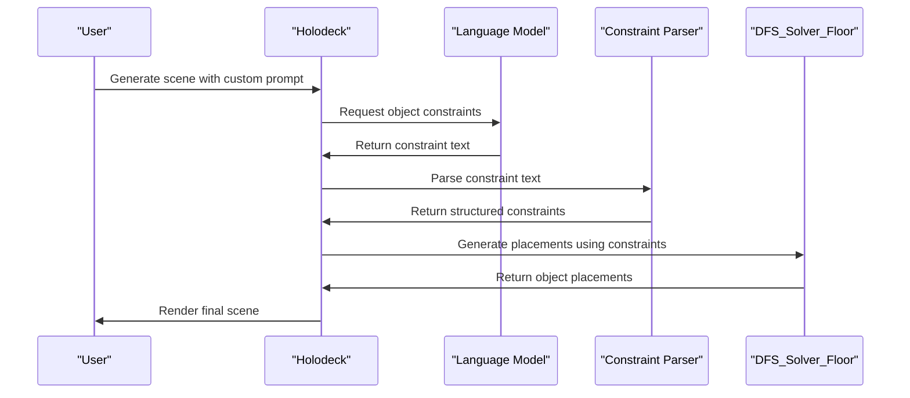

<!-- source: DeepWiki mcp.deepwiki.com · repo allenai/Holodeck · page 5.2 Customizing Generation · fetched 2026-10-26 -->

# Customizing Generation

<details>
<summary>Relevant source files</summary>

The following files were used as context for generating this wiki page:

- [ai2holodeck/constants.py](ai2holodeck/constants.py)
- [ai2holodeck/generation/floor_objects.py](ai2holodeck/generation/floor_objects.py)
- [ai2holodeck/generation/object_selector.py](ai2holodeck/generation/object_selector.py)

</details>


This document explains how to customize the generation process in Holodeck, allowing you to influence how 3D environments are created from natural language descriptions. You'll learn how to modify object selection criteria, customize object placement, define constraints, and adjust various parameters to achieve the desired outcomes.

For information on standard generation workflows, see [Generation Examples](#5.1).

## Object Selection Customization

The object selection process in Holodeck determines which 3D assets are chosen to populate a scene based on the natural language query. This process can be customized in several ways to influence the selection criteria.

### Selection Parameters

The `ObjectSelector` class contains several parameters that can be modified to customize the object selection process:

```mermaid
flowchart TD
    subgraph "Object Selection Parameters"
        floor_capacity_ratio["floor_capacity_ratio: Controls maximum floor coverage"]
        wall_capacity_ratio["wall_capacity_ratio: Controls maximum wall coverage"]
        object_size_tolerance["object_size_tolerance: Maximum object size relative to room"]
        similarity_threshold_floor["similarity_threshold_floor: Text-to-3D similarity threshold for floor objects"]
        similarity_threshold_wall["similarity_threshold_wall: Text-to-3D similarity threshold for wall objects"]
        thin_threshold["thin_threshold: Ratio to determine 'thin' objects"]
        size_buffer["size_buffer: Buffer added to object dimensions"]
        random_selection["random_selection: Use random selection instead of similarity scores"]
        reuse_selection["reuse_selection: Reuse objects from previous generations"]
    end
    
    User --> |"Modifies"| "Object Selection Parameters"
    "Object Selection Parameters" --> |"Influences"| ObjectSelector["ObjectSelector"]
    ObjectSelector --> |"Produces"| selected_objects["Selected 3D Objects"]
```

Sources: [ai2holodeck/generation/object_selector.py:51-62]()

Key parameters include:

| Parameter | Default | Description |
|-----------|---------|-------------|
| `floor_capacity_ratio` | 0.4 | Limits the maximum floor area coverage by objects (0.4 = 40%) |
| `wall_capacity_ratio` | 0.5 | Limits the maximum wall perimeter coverage (0.5 = 50%) |
| `object_size_tolerance` | 0.8 | Limits maximum object size relative to room dimensions |
| `similarity_threshold_floor` | 31 | Text-to-3D similarity threshold for retrieving floor objects |
| `similarity_threshold_wall` | 31 | Text-to-3D similarity threshold for retrieving wall objects |
| `random_selection` | False | If True, selects objects randomly instead of by similarity |

These parameters can be adjusted to influence the object selection process, such as allowing larger objects, increasing object diversity, or using more precise text-to-3D matching.

### Customizing Object Variance

The object selection process supports specifying variance types for objects, controlling whether multiple instances of the same object should be identical or different:

```mermaid
flowchart TD
    subgraph "Object Variance Types"
        same["same: All instances use identical 3D asset"]
        varied["varied: Each instance uses different 3D asset"]
    end
    
    llm["LLM-Generated Plan"] --> |"Specifies"| "Object Variance Types"
    "Object Variance Types" --> |"Controls"| asset_selection["Asset Selection Logic"]
    asset_selection --> |"Uses"| object_retriever["ObjathorRetriever"]
    object_retriever --> |"Provides"| selected_assets["Selected 3D Assets"]
```

Sources: [ai2holodeck/generation/object_selector.py:412-491]()

When a variance type of `"same"` is specified, all instances of an object will use the same 3D asset. When `"varied"` is specified, each instance will use a different asset, increasing visual diversity.

## Object Placement Customization

The object placement process determines where and how objects are positioned within a scene. This process can be customized through constraints and placement parameters.

### Placement Constraints System

Holodeck uses a sophisticated constraint system to determine object placement. Constraints can be defined through natural language and are processed by the system to generate appropriate placements.

```mermaid
flowchart TD
    subgraph "Constraint Types"
        global["Global Constraints (edge, middle)"]
        relative["Relative Constraints (in front of, behind, etc.)"]
        direction["Directional Constraints (face to, face same as)"]
        alignment["Alignment Constraints (center alignment, edge alignment)"]
        distance["Distance Constraints (near, far)"]
    end
    
    NL["Natural Language Description"] --> LLM["LLM Processor"]
    LLM --> |"Extracts"| "Constraint Types"
    "Constraint Types" --> FloorObjectGenerator["FloorObjectGenerator"]
    FloorObjectGenerator --> |"Uses"| DFS_Solver["DFS_Solver_Floor"]
    DFS_Solver --> |"Generates"| placement["Object Placement Solution"]
```

Sources: [ai2holodeck/generation/floor_objects.py:302-328](), [ai2holodeck/generation/floor_objects.py:460-690]()

The constraint system supports several types of constraints:

| Constraint Type | Examples | Description |
|-----------------|----------|-------------|
| Global | `edge`, `middle` | Controls position within the room |
| Relative | `in front of`, `behind`, `left of`, `right of` | Positions relative to other objects |
| Direction | `face to`, `face same as` | Controls object orientation |
| Alignment | `center alignment`, `edge alignment` | Aligns objects along axes |
| Distance | `near`, `far` | Controls spacing between objects |

### Customizing Placement Parameters

The `FloorObjectGenerator` class contains several parameters that can be modified to customize the object placement process:

```mermaid
flowchart TD
    subgraph "Placement Parameters"
        grid_density["grid_density: Controls placement grid resolution"]
        add_window["add_window: Whether to consider windows in placement"]
        size_buffer["size_buffer: Buffer added to object dimensions"]
        constraint_type["constraint_type: Method for generating constraints (llm, middle, edge)"]
        use_milp["use_milp: Whether to use MILP solver instead of DFS"]
    end
    
    User --> |"Modifies"| "Placement Parameters"
    "Placement Parameters" --> |"Configures"| FloorObjectGenerator["FloorObjectGenerator"]
    FloorObjectGenerator --> |"Produces"| placements["Object Placements"]
```

Sources: [ai2holodeck/generation/floor_objects.py:46-52]()

Key placement parameters include:

| Parameter | Default | Description |
|-----------|---------|-------------|
| `grid_density` | 20 | Controls resolution of the placement grid (higher = more precise) |
| `add_window` | False | Whether to consider windows when placing objects |
| `size_buffer` | 10 | Buffer (in cm) added to object dimensions for collision avoidance |
| `constraint_type` | `"llm"` | Method for generating constraints (`"llm"`, `"middle"`, `"edge"`) |
| `use_milp` | False | Whether to use MILP solver instead of DFS for placement optimization |

### Customizing LLM-Generated Constraints

The system can use a language model to generate placement constraints automatically. The prompts for generating these constraints can be customized:



Sources: [ai2holodeck/generation/floor_objects.py:99-108](), [ai2holodeck/generation/floor_objects.py:302-440]()

The constraint prompt template can be customized to influence how the language model generates constraints. This is useful for controlling the style and approach to object placement.

## Advanced Customization Techniques

### Using MILP for Advanced Placement

Holodeck supports using Mixed Integer Linear Programming (MILP) for more sophisticated object placement optimization:

```mermaid
flowchart TD
    subgraph "MILP Solver Components"
        hard_constraints["Hard Constraints (must be satisfied)"]
        soft_constraints["Soft Constraints (maximize satisfaction)"]
        boundary_constraints["Boundary Constraints (keep objects in room)"]
        collision_constraints["Collision Constraints (prevent overlaps)"]
        placement_constraints["Placement Constraints (from LLM)"]
    end
    
    constraints["Object Constraints"] --> |"Converted to"| "MILP Solver Components"
    "MILP Solver Components" --> milp_solve["MILP Solve Function"]
    milp_solve --> |"Optimizes"| placement["Object Placement Solution"]
```

Sources: [ai2holodeck/generation/floor_objects.py:1139-1456]()

To enable MILP solving:

1. Set `use_milp = True` in the `FloorObjectGenerator`
2. This enables more complex constraint satisfaction, often resulting in better placement solutions
3. MILP can handle complex interactions between multiple constraints

### Code-Level Customization

For more advanced customization, you can directly modify the constraint handling functions in the `DFS_Solver_Floor` class:

```mermaid
classDiagram
    class DFS_Solver_Floor {
        +grid_size
        +random_seed
        +max_duration
        +constraint_bouns
        +func_dict
        +constraint_type2weight
        +edge_bouns
        +get_solution()
        +dfs()
        +get_possible_placements()
        +place_edge()
        +place_relative()
        +place_distance()
        +place_face()
        +place_alignment_center()
    }
    
    DFS_Solver_Floor --> "Constraint Functions"
    class "Constraint Functions" {
        place_edge()
        place_corner()
        place_relative()
        place_distance()
        place_face_to()
        place_face_same()
        place_face_opposite()
        place_alignment_center()
    }
```

Sources: [ai2holodeck/generation/floor_objects.py:461-1075]()

Each constraint type has corresponding functions that can be customized:
- `place_edge`: Controls placement along room edges
- `place_relative`: Handles relative positioning between objects
- `place_distance`: Controls distance relationships between objects
- `place_face`: Manages object orientation
- `place_alignment_center`: Handles object alignment

### Customizing Weights for Constraints

The `DFS_Solver_Floor` class contains weights for different constraint types that can be adjusted to prioritize certain constraints:

```python
self.constraint_type2weight = {
    "global": 1.0,
    "relative": 0.5,
    "direction": 0.5,
    "alignment": 0.5,
    "distance": 1.8,
}
```

Sources: [ai2holodeck/generation/floor_objects.py:480-486]()

Increasing a weight makes that constraint type more important in the placement solution. For example, increasing the weight for "distance" constraints will prioritize satisfying distance relationships between objects.

## Environment Variables and Constants

Holodeck uses several environment variables and constants that can be customized to control the generation process:

```mermaid
flowchart TD
    subgraph "Environment Variables"
        assets_version["ASSETS_VERSION: Version of asset dataset"]
        hd_base_version["HD_BASE_VERSION: Version of Holodeck base data"]
        objathor_dir["OBJATHOR_ASSETS_BASE_DIR: Directory for ObjaTHOR assets"]
        llm_model["LLM_MODEL_NAME: Language model to use"]
        debugging["DEBUGGING: Enable debug mode"]
    end
    
    "Environment Variables" --> |"Configures"| Holodeck["Holodeck System"]
    Holodeck --> |"Generates"| Scene["3D Scene"]
```

Sources: [ai2holodeck/constants.py:6-35]()

Key environment variables include:

| Variable | Default | Description |
|----------|---------|-------------|
| `ASSETS_VERSION` | `"2023_09_23"` | Version of the asset dataset to use |
| `HD_BASE_VERSION` | `"2023_09_23"` | Version of Holodeck base data |
| `OBJATHOR_ASSETS_BASE_DIR` | `"~/.objathor-assets"` | Directory for ObjaTHOR assets |
| `LLM_MODEL_NAME` | `"gpt-4o-2024-05-13"` | Language model to use for generation |
| `DEBUGGING` | `False` | Enable debug mode for additional output |

These variables can be set in your environment before running Holodeck to customize the generation process.

## Example: Customizing Object Selection and Placement

Here's an example workflow for customizing object selection and placement:

1. Modify object selection parameters:
```python
object_selector = ObjectSelector(object_retriever, llm)
object_selector.floor_capacity_ratio = 0.6  # Allow more objects on floor
object_selector.similarity_threshold_floor = 25  # More strict matching
object_selector.random_selection = True  # Use random selection for variety
```

2. Modify object placement parameters:
```python
floor_object_generator = FloorObjectGenerator(object_retriever, llm)
floor_object_generator.grid_density = 30  # Higher resolution placement grid
floor_object_generator.constraint_type = "llm"  # Use LLM for constraints
floor_object_generator.use_milp = True  # Use MILP solver for better placement
```

3. Generate the scene with customized parameters:
```python
holodeck = Holodeck(openai_api_key, openai_org, objaverse_asset_dir)
holodeck.object_selector = object_selector
holodeck.floor_object_generator = floor_object_generator
scene = holodeck.generate_scene(query, save_dir)
```

Sources: [ai2holodeck/generation/object_selector.py:32-62](), [ai2holodeck/generation/floor_objects.py:24-52]()

By customizing these parameters, you can significantly influence how Holodeck selects and places objects in the generated environment, allowing for more control over the final scene's appearance and arrangement.

---

