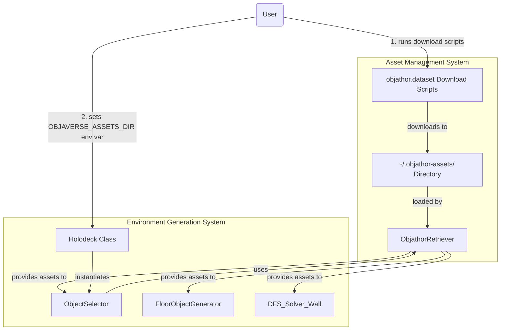
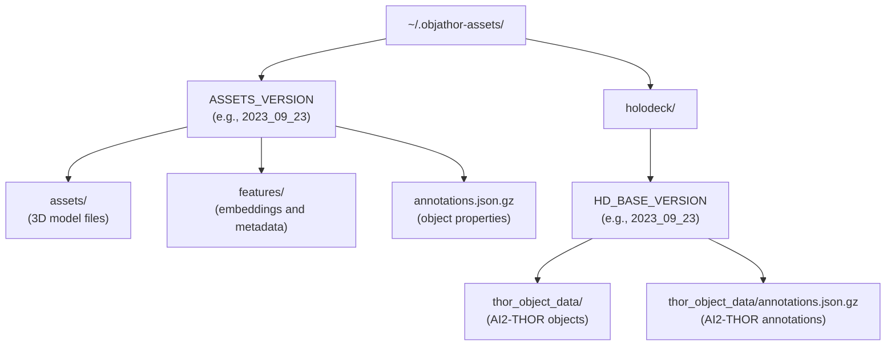
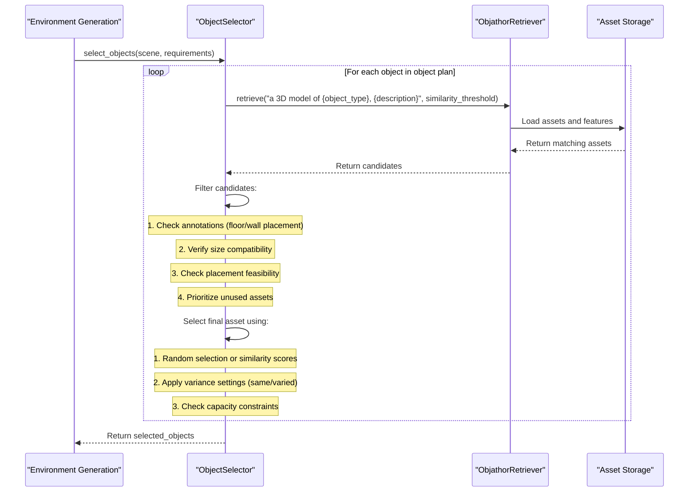
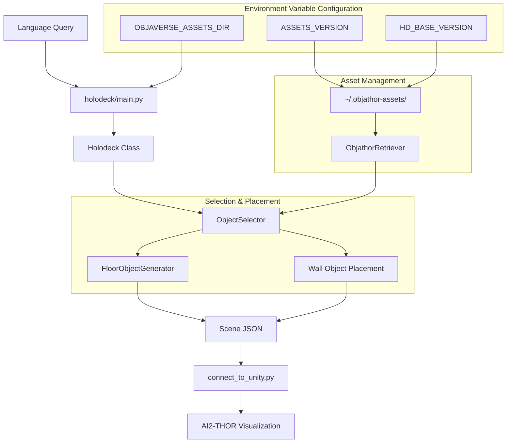

<!-- source: DeepWiki mcp.deepwiki.com · repo allenai/Holodeck · page 6 Asset Management · fetched 2026-10-26 -->

# Asset Management

<details>
<summary>Relevant source files</summary>

The following files were used as context for generating this wiki page:

- [README.md](README.md)
- [ai2holodeck/constants.py](ai2holodeck/constants.py)
- [ai2holodeck/generation/object_selector.py](ai2holodeck/generation/object_selector.py)

</details>


## Purpose and Scope

This document describes how 3D assets are managed, downloaded, and utilized within the Holodeck system. The asset management system is responsible for organizing, retrieving, and making available the 3D models that are used to populate generated environments. For information about how objects are selected for scenes, see [Object Selection System](#4.1).

## Asset System Overview

The Holodeck asset management system is built on top of the ObjaThor dataset infrastructure, which provides a structured way to store and access 3D assets with associated metadata. Assets are downloaded from remote servers and stored locally with versioning, allowing for consistent environment generation across different installations.



Sources: [README.md:30-38](), [ai2holodeck/constants.py:1-25]()

## Asset Directory Structure

Assets are organized in a versioned directory structure to maintain compatibility and consistency between different versions of the system.



Sources: [ai2holodeck/constants.py:6-25]()

## Asset Components

The asset management system consists of several key components:

| Component | Description | Location |
|-----------|-------------|----------|
| Assets | The actual 3D model files | `~/.objathor-assets/{version}/assets/` |
| Features | Embeddings and metadata used for retrieving assets | `~/.objathor-assets/{version}/features/` |
| Annotations | JSON data describing properties of assets (e.g., whether they go on floor/wall) | `~/.objathor-assets/{version}/annotations.json.gz` |
| Thor Object Data | AI2-THOR specific object data | `~/.objathor-assets/holodeck/{version}/thor_object_data/` |

Sources: [ai2holodeck/constants.py:6-25]()

## Downloading and Setting Up Assets

Assets must be downloaded before Holodeck can be used. The system provides scripts to download the necessary assets:

```bash
python -m objathor.dataset.download_holodeck_base_data --version 2023_09_23
python -m objathor.dataset.download_assets --version 2023_09_23
python -m objathor.dataset.download_annotations --version 2023_09_23
python -m objathor.dataset.download_features --version 2023_09_23
```

By default, these commands download assets to `~/.objathor-assets/`. To change this location, use the `--path` argument when running the download scripts, and set the `OBJAVERSE_ASSETS_DIR` environment variable to point to your custom location.

Sources: [README.md:30-38]()

## Asset Retrieval Process

Holodeck uses the `ObjathorRetriever` class to access assets from the local storage. This retriever is used by the `ObjectSelector` class during the object selection phase of scene generation.



Sources: [ai2holodeck/generation/object_selector.py:32-45](), [ai2holodeck/generation/object_selector.py:361-382](), [ai2holodeck/generation/object_selector.py:405-548]()

## Asset Selection Filtering

When selecting assets for a scene, the system applies several filters to ensure appropriate assets are chosen:

1. **Annotation Filtering**: Assets are filtered based on their annotations (e.g., whether they are suitable for floor or wall placement)
   ```python
   candidates = [
       candidate
       for candidate, annotation in zip(
           candidates,
           [get_annotations(self.database[candidate[0]]) for candidate in candidates],
       )
       if annotation["onFloor"]  # only select objects on the floor
       and (not annotation["onCeiling"])  # only select objects not on the ceiling
       and all(  # ignore doors and windows and frames
           k not in annotation["category"].lower()
           for k in ["door", "window", "frame"]
       )
   ]
   ```

2. **Size Compatibility**: Assets that are too large for the room are filtered out
   ```python
   candidates = self.check_object_size(candidates, room_size)
   ```

3. **Placement Feasibility**: Assets that cannot be feasibly placed in the room are filtered out
   ```python
   candidates = self.check_floor_placement(candidates[:20], room_vertices, scene)
   ```

4. **Asset Reuse Control**: The system tries to avoid reusing assets within the same scene
   ```python
   if len(candidates) > 1:
       candidates = [
           candidate
           for candidate in candidates
           if candidate[0] not in self.used_assets
       ]
   ```

Sources: [ai2holodeck/generation/object_selector.py:421-821]()

## Environment Variables and Configuration

The asset management system can be configured through several environment variables:

| Environment Variable | Description | Default Value |
|----------------------|-------------|---------------|
| OBJATHOR_ASSETS_BASE_DIR | Base directory for all assets | `~/.objathor-assets` |
| ASSETS_VERSION | Version of the assets to use | 2023_09_23 |
| HD_BASE_VERSION | Version of the Holodeck base data | 2023_09_23 |
| OBJAVERSE_ASSETS_DIR | Alternative way to specify asset directory | (Not set by default) |

Sources: [ai2holodeck/constants.py:6-20](), [README.md:38]()

## Asset System Integration with Generation Pipeline

The asset management system integrates with the broader Holodeck generation pipeline as follows:



Sources: [README.md:43-44](), [ai2holodeck/generation/object_selector.py:32-45]()

## Asset Capacity Management

The system manages asset placement within capacity constraints for both floor and wall objects:

### Floor Capacity
The system calculates the floor capacity of a room based on its area and applies a capacity ratio:

```python
room2floor_capacity = {
    room_type: [room_area * self.floor_capacity_ratio, 0]
    for room_type, room_area in room2area.items()
}
```

Where:
- `floor_capacity_ratio` is typically set to 0.4 (40% of room area)
- The first value [0] is the total capacity
- The second value [1] tracks used capacity

### Wall Capacity
Similarly for walls:

```python
room2wall_capacity = {
    room_type: [room_perimeter * self.wall_capacity_ratio, 0]
    for room_type, room_perimeter in room2perimeter.items()
}
```

Where:
- `wall_capacity_ratio` is typically set to 0.5 (50% of room perimeter)

Sources: [ai2holodeck/generation/object_selector.py:82-86](), [ai2holodeck/generation/object_selector.py:87-92]()

## Asset Version Compatibility

The asset management system ensures compatibility with specific versions of AI2-THOR:

```python
if ASSETS_VERSION > "2023_09_23":
    THOR_COMMIT_ID = "8524eadda94df0ab2dbb2ef5a577e4d37c712897"
else:
    THOR_COMMIT_ID = "3213d486cd09bcbafce33561997355983bdf8d1a"
```

This ensures that the assets used are compatible with the correct version of the AI2-THOR framework for visualization.

Sources: [ai2holodeck/constants.py:27-30]()

---

