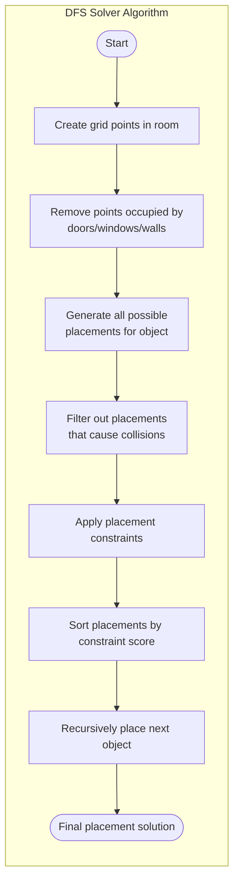
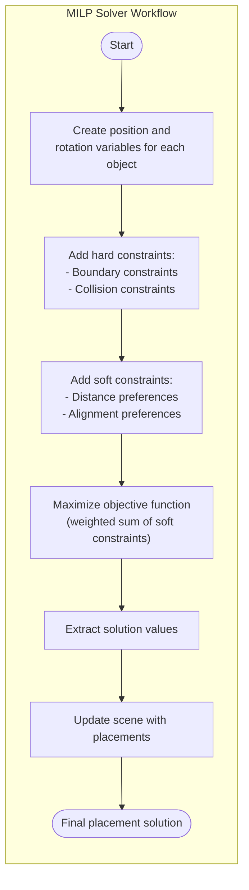
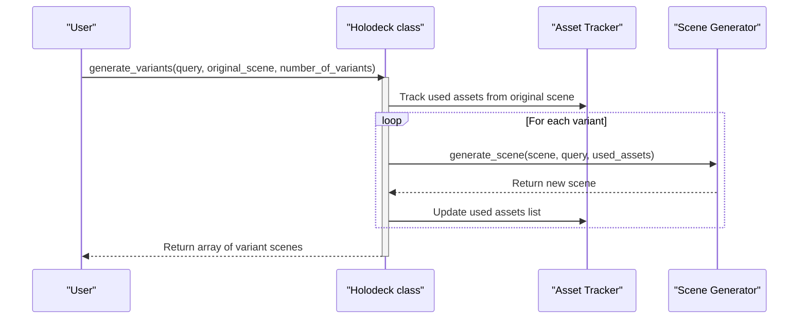
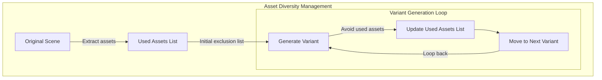
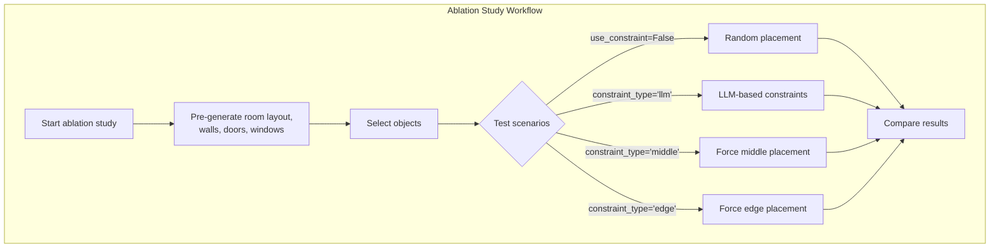
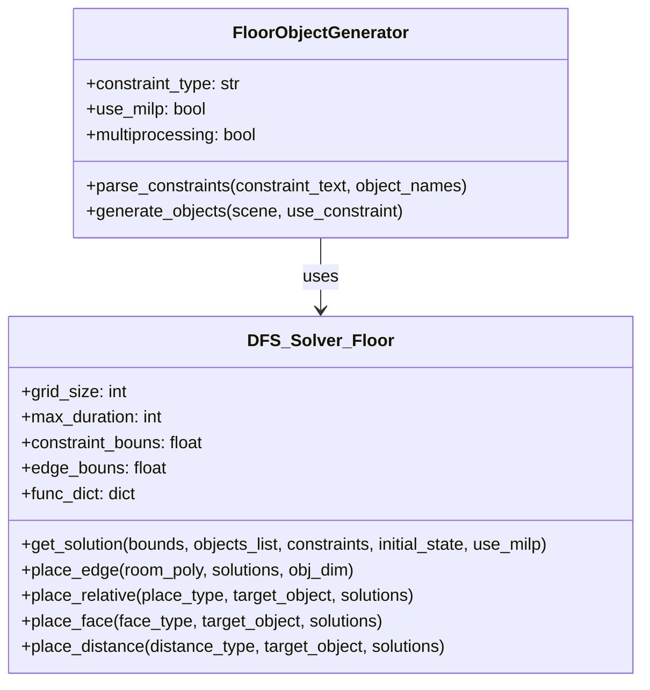

<!-- source: DeepWiki mcp.deepwiki.com · repo allenai/Holodeck · page 7 Advanced Topics · fetched 2026-10-26 -->

# Advanced Topics

<details>
<summary>Relevant source files</summary>

The following files were used as context for generating this wiki page:

- [ai2holodeck/generation/floor_objects.py](ai2holodeck/generation/floor_objects.py)
- [ai2holodeck/generation/holodeck.py](ai2holodeck/generation/holodeck.py)

</details>


This page covers advanced features and techniques for power users and developers working with the Holodeck system. We'll dive into the technical details of constraint-based object placement systems and scene variation generation. For basic usage instructions, see [Usage Guide](#5), and for general architecture overview, see [System Architecture](#3).

## 1. Constraint Systems

Holodeck employs sophisticated constraint systems to generate realistic object placements in 3D environments. These systems ensure objects are placed appropriately relative to room boundaries and other objects, creating natural-looking scenes.

### 1.1 Constraint Types

The constraint system supports several types of placement rules:

| Constraint Type | Purpose | Examples |
|----------------|---------|----------|
| Global | Defines where an object should be placed relative to the room | "edge", "middle" |
| Relative | Positions objects relative to other objects | "in front of", "behind", "left of", "right of", "side of" |
| Direction | Controls which way objects face | "face to", "face same as" |
| Alignment | Aligns objects with each other | "center alignment", "edge alignment" |
| Distance | Controls spacing between objects | "near", "far" |

Sources: [ai2holodeck/generation/floor_objects.py:302-440]()

### 1.2 Constraint-Based Placement Approaches

Holodeck implements two different approaches for constraint-based object placement:

```mermaid
flowchart TD
    subgraph "Constraint-Based Placement"
        Start["Generate Room Layout"]
        Query["Query LLM for object constraints"]
        ParseConstraints["Parse constraints"]
        
        Start --> Query
        Query --> ParseConstraints
        
        ParseConstraints --> SolverChoice{"Solver Type?"}
        
        SolverChoice -->|"use_milp=False"| DFS["DFS Solver"]
        SolverChoice -->|"use_milp=True"| MILP["MILP Solver"]
        
        DFS --> GridPoints["Create grid points"]
        GridPoints --> RemovePoints["Remove occupied points"]
        RemovePoints --> ApplyConstraints["Apply constraints"]
        ApplyConstraints --> OptimizePlacement["Optimize placement"]
        OptimizePlacement --> DFSResult["Final object placements"]
        
        MILP --> FormulateVariables["Formulate variables"]
        FormulateVariables --> HardConstraints["Add hard constraints"]
        HardConstraints --> SoftConstraints["Add soft constraints"]
        SoftConstraints --> SolveMILP["Solve with GUROBI"]
        SolveMILP --> MILPResult["Final object placements"]
    end
```



Sources: [ai2holodeck/generation/floor_objects.py:54-79](), [ai2holodeck/generation/floor_objects.py:490-542](), [ai2holodeck/generation/holodeck.py:306-336]()

#### 1.2.1 LLM-Based Constraint Generation

By default, Holodeck uses a large language model to generate appropriate constraints for object placement:

1. The LLM is provided with the room type, room size, and selected objects
2. The LLM returns a structured plan with constraints for each object
3. The constraints are parsed and applied during placement

Example constraint prompt to the LLM:

```
Your task is to develop a placement algorithm for objects in a [ROOM TYPE] with size [ROOM SIZE]. The available objects are: [OBJECTS].
For each object, define the placement strategy using these constraint types:
- edge (place against a wall)
- middle (place away from walls)
- in front of, behind, left of, right of, side of [TARGET OBJECT]
- face to, face same as [TARGET OBJECT]
- aligned, center alignment [TARGET OBJECT]
- near, far [TARGET OBJECT]
```

Sources: [ai2holodeck/generation/floor_objects.py:98-114]()

#### 1.2.2 DFS Solver

The DFS (Depth-First Search) solver uses a grid-based approach to find valid placements:



Sources: [ai2holodeck/generation/floor_objects.py:456-685]()

#### 1.2.3 MILP Solver

The Mixed Integer Linear Programming (MILP) solver formulates object placement as an optimization problem:



Sources: [ai2holodeck/generation/floor_objects.py:1139-1437]()

### 1.3 Choosing Between DFS and MILP

The choice between DFS and MILP solvers depends on your requirements:

| Approach | Advantages | Disadvantages | When to Use |
|----------|------------|--------------|-------------|
| DFS | - Faster for simpler scenes<br>- More robust for complex room shapes | - Less optimal for many constraints<br>- May not find solutions for tightly constrained scenes | Default choice for most scenes |
| MILP | - Finds globally optimal placements<br>- Better handles complex constraint systems | - Slower performance<br>- Requires GUROBI solver | Complex scenes with many interrelated constraints |

To use the MILP solver, set `use_milp=True` when calling `generate_scene`:

```python
holodeck_instance.generate_scene(scene, query, save_dir, use_milp=True)
```

Sources: [ai2holodeck/generation/holodeck.py:313]()

## 2. Scene Variation Generation

The scene variation system allows you to generate multiple different versions of a scene based on the same query but with different asset selections and placements.

### 2.1 Variation Generation Process



Sources: [ai2holodeck/generation/holodeck.py:391-439]()

### 2.2 How to Generate Variations

The `generate_variants` method creates multiple variations of an existing scene:

```python
variant_scenes = holodeck_instance.generate_variants(
    query="living room",
    original_scene=existing_scene,
    save_dir="path/to/save",
    number_of_variants=5,
    used_assets=[]
)
```

Key parameters:
- `query`: The original query used to generate the scene
- `original_scene`: The existing scene to create variations from
- `number_of_variants`: How many variations to generate
- `used_assets`: Optional list of asset IDs to exclude from new variations

Sources: [ai2holodeck/generation/holodeck.py:391-439]()

### 2.3 Asset Diversity in Variations

The variation system ensures diversity by:

1. Tracking all assets used in the original scene
2. Adding newly used assets to the list after each variation
3. Forcing the object selector to retrieve different assets for each new variation

This creates a progression of increasingly diverse scenes, as each new variation must use different assets from all previous scenes.



Sources: [ai2holodeck/generation/holodeck.py:404-414](), [ai2holodeck/generation/holodeck.py:427-438]()

## 3. Placement Ablation Studies

For researchers and developers, Holodeck provides an ablation feature to study the effects of different constraint systems on object placement:



Sources: [ai2holodeck/generation/holodeck.py:441-509]()

### 3.1 Using Ablation Studies

The `ablate_placement` method allows you to test different constraint approaches:

```python
result = holodeck_instance.ablate_placement(
    scene,
    query,
    save_dir,
    use_constraint=True,
    constraint_type="llm"  # or "middle", "edge"
)
```

This is particularly useful for:
- Comparing the effectiveness of different constraint systems
- Generating controlled test data for research
- Developing new constraint types

Sources: [ai2holodeck/generation/holodeck.py:441-452]()

## 4. Performance Optimization

For complex scenes, consider these optimization techniques:

### 4.1 Multi-Processing for Object Placement

The `FloorObjectGenerator` supports multi-processing to parallelize object placement across multiple rooms:

```python
# Enable multi-processing
floor_object_generator.multiprocessing = True
```

When enabled, the system will use Python's multiprocessing pool to distribute placement tasks across CPU cores.

Sources: [ai2holodeck/generation/floor_objects.py:52](), [ai2holodeck/generation/floor_objects.py:67-71]()

### 4.2 Solver Timeout Configuration

Both DFS and MILP solvers have configurable timeout parameters to prevent excessive computation time:

```python
# For DFS solver
dfs_solver = DFS_Solver_Floor(grid_size=20, max_duration=30)

# For MILP solver (via the DFS_Solver_Floor)
solver.get_solution(bounds, objects_list, constraints, initial_state, use_milp=True)
```

The `max_duration` parameter (in seconds) controls how long the solver will search for an optimal solution before returning the best solution found so far.

Sources: [ai2holodeck/generation/floor_objects.py:462-466](), [ai2holodeck/generation/floor_objects.py:564-565]()

### 4.3 Grid Density Adjustment

The DFS solver's grid density affects both performance and placement precision:

```python
# Configure a coarser grid for faster performance (default is 20)
floor_object_generator.grid_density = 40  # Larger number = coarser grid
```

A larger grid density value means fewer grid points to evaluate, resulting in faster performance but potentially less optimal placements.

Sources: [ai2holodeck/generation/floor_objects.py:46](), [ai2holodeck/generation/floor_objects.py:94]()

## 5. Advanced Configuration Options

The following configuration options provide fine-grained control over scene generation:

| Setting | Default | Description | Code Location |
|---------|---------|-------------|--------------|
| `single_room` | `False` | Generate only one room instead of multiple rooms | [ai2holodeck/generation/holodeck.py:127-131]() |
| `add_ceiling` | `False` | Include ceiling objects in generation | [ai2holodeck/generation/holodeck.py:332-336]() |
| `size_buffer` | `10` | Add buffer space (in cm) around objects | [ai2holodeck/generation/floor_objects.py:48]() |
| `add_window` | `False` | Include windows in placement calculations | [ai2holodeck/generation/floor_objects.py:47]() |
| `constraint_bouns` | `0.2` | Weight for satisfying constraints | [ai2holodeck/generation/floor_objects.py:466]() |
| `edge_bouns` | `0.0` | Additional weight for edge placement | [ai2holodeck/generation/floor_objects.py:488]() |

Sources: [ai2holodeck/generation/holodeck.py:127-138](), [ai2holodeck/generation/floor_objects.py:46-52]()

## 6. Integrating Custom Constraint Types

Advanced users can extend the constraint system by:

1. Adding new constraint types to `constraint_name2type` mapping
2. Implementing corresponding constraint functions
3. Registering them in the `func_dict` for the DFS solver
4. Implementing equivalent constraints for the MILP solver



New constraint functions should follow the pattern of existing functions like `place_edge`, `place_relative`, etc., and return a list of valid solutions with updated scores.

Sources: [ai2holodeck/generation/floor_objects.py:472-488](), [ai2holodeck/generation/floor_objects.py:302-440]()

## 7. Debug Visualization Tools

For debugging complex placement issues, the DFS solver includes visualization tools:

```python
# Enable visualization
dfs_solver.vistualize = True

# Generate a solution
solution = dfs_solver.get_solution(room_poly, objects_list, constraints, initial_state)
```

This will produce visualizations showing:
- Room boundaries
- Grid points
- Object placements with orientation arrows
- Constraint relationships

The visualization is saved as a PDF file with a timestamp in the current directory.

Sources: [ai2holodeck/generation/floor_objects.py:469](), [ai2holodeck/generation/floor_objects.py:539-540](), [ai2holodeck/generation/floor_objects.py:1090-1137]()

---

