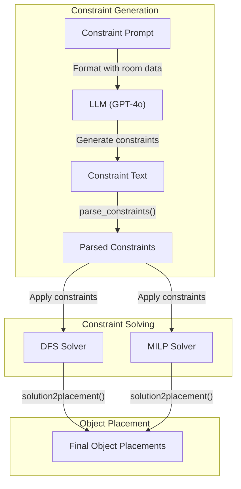
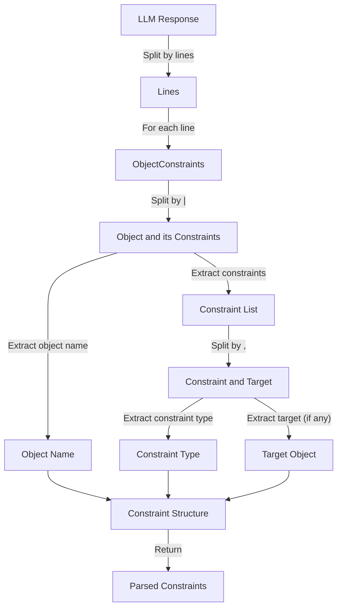
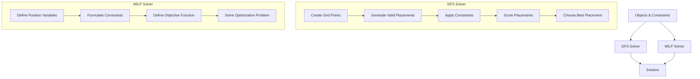
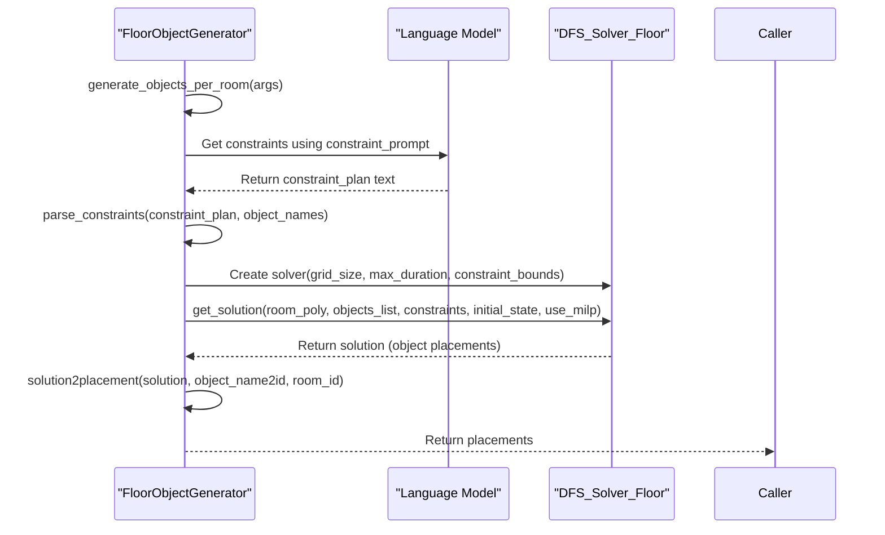

<!-- source: DeepWiki mcp.deepwiki.com · repo allenai/Holodeck · page 7.1 Constraint Systems · fetched 2026-10-26 -->

# Constraint Systems

<details>
<summary>Relevant source files</summary>

The following files were used as context for generating this wiki page:

- [ai2holodeck/generation/floor_objects.py](ai2holodeck/generation/floor_objects.py)

</details>


## Purpose and Scope

This document describes the constraint systems used in Holodeck for object placement. The constraint systems provide rules for determining where and how objects should be placed within generated environments, ensuring natural and realistic arrangements. This page covers both the LLM-based constraint generation approach and the solving strategies used (DFS and MILP).

For information about how the overall object selection process works, see [Object Selection System](#4.1). For information about how small objects are placed, see [Small Objects](#4.3).

## Constraint System Overview

Holodeck uses constraint systems to create realistic object arrangements within generated environments. The system applies both physical constraints (to prevent object collisions and ensure objects stay within room boundaries) and semantic constraints (to ensure furniture is arranged in a natural way, such as sofas along walls and coffee tables in front of sofas).


**Diagram: Constraint System Process Flow**

Sources: [ai2holodeck/generation/floor_objects.py:24-214](), [ai2holodeck/generation/floor_objects.py:277-440]()

## Constraint Types

The constraint system supports multiple types of constraints that influence object placement in different ways. These constraints are used to create natural arrangements within a room.

```mermaid
classDiagram
    class "Constraint" {
        type: string
        constraint: string
        target: string (optional)
    }
    
    class "GlobalConstraint" {
        type: "global"
        constraint: "edge" or "middle"
    }
    
    class "RelativeConstraint" {
        type: "relative"
        constraint: "in front of"/"behind"/"left of"/"right of"/"side of"
        target: targetObjectName
    }
    
    class "DirectionConstraint" {
        type: "direction"
        constraint: "face to"/"face same as"
        target: targetObjectName
    }
    
    class "AlignmentConstraint" {
        type: "alignment"
        constraint: "center alignment"
        target: targetObjectName
    }
    
    class "DistanceConstraint" {
        type: "distance"
        constraint: "near"/"far"
        target: targetObjectName
    }
    
    Constraint <|-- GlobalConstraint
    Constraint <|-- RelativeConstraint
    Constraint <|-- DirectionConstraint
    Constraint <|-- AlignmentConstraint
    Constraint <|-- DistanceConstraint
```
**Diagram: Constraint Type Hierarchy**

Sources: [ai2holodeck/generation/floor_objects.py:302-428]()

### Global Constraints

These constraints define general placement rules that aren't relative to other objects:
- `edge`: Place the object against a wall
- `middle`: Place the object away from walls

### Relative Constraints

These constraints position objects relative to other objects:
- `in front of`: Place in front of another object
- `behind`: Place behind another object
- `left of`: Place to the left of another object
- `right of`: Place to the right of another object
- `side of`: Place to the side of another object

### Direction Constraints

These constraints define which way an object faces:
- `face to`: Make the object face toward another object
- `face same as`: Make the object face the same direction as another object

### Alignment Constraints

These constraints define alignment relationships:
- `center alignment`: Align the center of an object with the center of another object

### Distance Constraints

These constraints define proximity relationships:
- `near`: Place close to another object
- `far`: Place far from another object

Sources: [ai2holodeck/generation/floor_objects.py:302-428]()

## Constraint Generation

Constraints are generated using large language models (LLM) which interpret the room type, room size, and list of objects to generate appropriate placement constraints.

### LLM-Based Constraint Generation

The system uses a prompt template (`object_constraints_prompt`) that includes information about:
- Room type (e.g., "living room", "bedroom")
- Room size in centimeters
- List of objects to be placed

The LLM returns a list of constraints for each object in a structured format:
```
ObjectName | ConstraintType, TargetObject
```

For example:
```
sofa | edge
coffee table | in front of, sofa
```

### Constraint Parsing

The `parse_constraints` method processes the LLM output into a structured format that the constraint solver can use. It handles various formats and normalizes constraint names to match known constraint types.


**Diagram: Constraint Parsing Process**

Sources: [ai2holodeck/generation/floor_objects.py:302-440]()

## Constraint Solving Strategies

The system supports two main constraint solving strategies: Depth-First Search (DFS) and Mixed Integer Linear Programming (MILP).

### DFS Solver

The DFS Solver (`DFS_Solver_Floor`) uses a depth-first search approach to find valid object placements that satisfy all constraints. It:

1. Creates a grid of potential placement points within the room
2. For each object, finds all valid placements considering the object's dimensions
3. Filters placements based on room boundaries and collisions with other objects
4. Applies constraints to score the placements
5. Selects the highest-scoring placement for each object

Key methods in the DFS solver include:
- `get_solution`: Entry point for finding solutions
- `dfs`: The recursive depth-first search algorithm
- `get_possible_placements`: Finds and scores valid placements for an object

### MILP Solver

The MILP (Mixed Integer Linear Programming) solver formulates the constraint problem as a mathematical optimization problem. It:

1. Represents object positions and rotations as variables
2. Formulates constraints as mathematical inequalities
3. Defines an objective function to maximize
4. Uses a solver (Gurobi) to find the optimal solution

The MILP approach is particularly useful for complex constraint scenarios with many interdependencies.


**Diagram: Constraint Solving Strategies**

Sources: [ai2holodeck/generation/floor_objects.py:461-1696]()

## Placement Constraint Functions

The solver uses specialized functions to apply different types of constraints. Here's a summary of the key constraint functions:

| Constraint Type | Function | Description |
|-----------------|----------|-------------|
| Global (Edge) | `place_edge` | Places objects against walls |
| Relative | `place_relative` | Handles relative positions (in front, behind, etc.) |
| Direction | `place_face` | Handles object facing directions |
| Alignment | `place_alignment_center` | Aligns objects' centers |
| Distance | `place_distance` | Handles proximity between objects |

Each of these functions evaluates potential placements against the constraint and assigns a score based on how well the placement satisfies the constraint.

Sources: [ai2holodeck/generation/floor_objects.py:473-486](), [ai2holodeck/generation/floor_objects.py:815-1074]()

## Integration with Floor Object Generator

The constraint system is integrated with the `FloorObjectGenerator` class, which uses the constraints to place objects in rooms. The key integration points are:


**Diagram: Constraint System Integration Flow**

Sources: [ai2holodeck/generation/floor_objects.py:81-213]()

## Constraint Weights and Scoring

The constraint system uses weights to determine the relative importance of different constraints:

```python
self.constraint_type2weight = {
    "global": 1.0,
    "relative": 0.5,
    "direction": 0.5,
    "alignment": 0.5,
    "distance": 1.8,
}
```

These weights influence how placements are scored. The system calculates a total score for each potential placement based on how well it satisfies all constraints. The highest-scoring placement is chosen.

Sources: [ai2holodeck/generation/floor_objects.py:480-486]()

## Example Constraint Processing

Here's an example of how constraints flow through the system:

1. LLM generates constraint text:
   ```
   sofa | edge
   coffee table | in front of, sofa | center alignment, sofa | near, sofa
   ```

2. Parsed constraints:
   ```json
   {
     "sofa": [
       {"type": "global", "constraint": "edge"}
     ],
     "coffee table": [
       {"type": "relative", "constraint": "in front of", "target": "sofa"},
       {"type": "alignment", "constraint": "center aligned", "target": "sofa"},
       {"type": "distance", "constraint": "near", "target": "sofa"}
     ]
   }
   ```

3. The solver uses these constraints to find optimal placements, placing the sofa against a wall and the coffee table in front of, aligned with, and near the sofa.

Sources: [ai2holodeck/generation/floor_objects.py:97-116](), [ai2holodeck/generation/floor_objects.py:302-440]()

## Advanced Features: Constraint Solver Implementation

### Grid-Based Placement

The DFS solver uses a grid-based approach to discretize the placement space. It:
1. Creates a grid of points within the room boundaries
2. Removes points that would result in object collisions
3. Considers rotations (0°, 90°, 180°, 270°) for each placement point

This approach makes the search space manageable while still allowing for realistic placements.

### Complex Constraints

The system handles complex constraints that combine multiple simple constraints:
- `around`: Combines `near` and `face to` constraints
- `in front of`: Combines relative positioning and center alignment

Sources: [ai2holodeck/generation/floor_objects.py:383-411]()

## Conclusion

The constraint systems in Holodeck enable realistic object placement in generated environments. By combining LLM-based constraint generation with sophisticated solving strategies, the system can create arrangements that respect both physical limitations and semantic relationships between objects.

---

