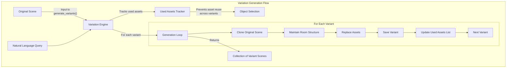
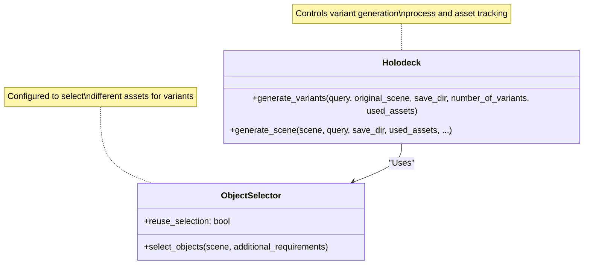

<!-- source: DeepWiki mcp.deepwiki.com · repo allenai/Holodeck · page 7.2 Scene Variation Generation · fetched 2026-10-26 -->

# Scene Variation Generation

<details>
<summary>Relevant source files</summary>

The following files were used as context for generating this wiki page:

- [ai2holodeck/generation/holodeck.py](ai2holodeck/generation/holodeck.py)

</details>


## Purpose and Overview

This document explains the Scene Variation Generation system in Holodeck, which enables the creation of multiple variations of an existing scene while maintaining the same overall structure but with different assets and materials. This feature is particularly useful for creating diverse environments for training AI models, generating alternative design options, or producing a collection of similar but distinct environments from a single query.

For information on creating brand new scenes from scratch, see [Scene Generation Pipeline](#3.1).

## How Scene Variation Works

The variation system takes an existing scene and generates a specified number of variants by preserving the room layout, wall structure, and door/window locations while replacing the objects, materials, and other assets with alternatives that fit the same purpose.

### Variation Generation Process



Sources: [ai2holodeck/generation/holodeck.py:391-439]()

## Core Components and Implementation

The scene variation generation is implemented in the `generate_variants` method of the `Holodeck` class. This method coordinates the entire variation process.



Sources: [ai2holodeck/generation/holodeck.py:56-121](), [ai2holodeck/generation/holodeck.py:391-439]()

### Key Parameters

The `generate_variants` method takes several important parameters:

| Parameter | Type | Description |
|-----------|------|-------------|
| `query` | string | Original natural language query that was used to generate the base scene |
| `original_scene` | dict | The original scene JSON representation to use as a base for variations |
| `save_dir` | string | Directory where variant scenes will be saved |
| `number_of_variants` | int | Number of variant scenes to generate (default: 5) |
| `used_assets` | list | Initial list of assets to avoid reusing (can be empty) |

Sources: [ai2holodeck/generation/holodeck.py:391-397]()

## Asset Tracking System

A key component of the variation system is the asset tracking mechanism, which ensures diversity across variants by preventing the reuse of assets.

```mermaid
flowchart TD
    subgraph "Asset Tracking System"
        OriginalScene["Original Scene"] --> |"Extract"| InitialAssets["Initial Asset List"]
        InitialAssets --> UsedAssetsList["Used Assets List"]
        
        UsedAssetsList --> |"Input to"| Variant1["Generate Variant 1"]
        Variant1 --> |"Extract new assets"| NewAssets1["New Assets from Variant 1"]
        NewAssets1 --> |"Add to"| UpdatedAssetsList1["Updated Used Assets List"]
        
        UpdatedAssetsList1 --> |"Input to"| Variant2["Generate Variant 2"]
        Variant2 --> |"Extract new assets"| NewAssets2["New Assets from Variant 2"]
        NewAssets2 --> |"Add to"| UpdatedAssetsList2["Updated Used Assets List"]
        
        UpdatedAssetsList2 --> |"Continue for\nall variants"| FinalAssetsList["Final Used Assets List"]
    end
```



Sources: [ai2holodeck/generation/holodeck.py:404-414](), [ai2holodeck/generation/holodeck.py:428-438]()

### Asset Collection Process

The system collects assets from multiple sources to ensure comprehensive tracking:

1. Object assets: All 3D models used for objects in the scene
2. Door and window assets: Architectural elements
3. Floor materials: Textures used for floor surfaces
4. Wall materials: Textures used for wall surfaces

All these assets are combined into a single list and deduplicated to avoid any redundancy.

Sources: [ai2holodeck/generation/holodeck.py:404-414]()

## Variation Generation Workflow

The complete workflow for generating scene variations includes:

1. **Initialize**: Set up the variation generation process
   - Disable asset reuse in the object selector
   - Collect all assets from the original scene

2. **Generate Variants**: For each requested variant
   - Create a copy of the original scene to preserve its structure
   - Pass the accumulated list of used assets to the generation process
   - Generate a new scene using the same query but different assets
   - Save the variant with appropriate naming (includes timestamp by default)

3. **Track Assets**: After each variant
   - Extract all assets from the newly generated variant
   - Add them to the used assets list
   - Deduplicate the list to maintain efficiency

4. **Return Results**: Provide the collection of variant scenes

Sources: [ai2holodeck/generation/holodeck.py:391-439]()

## Usage Example

To generate variants of an existing scene:

```python
# Create a Holodeck instance
holodeck = Holodeck(openai_api_key="your_api_key", 
                   openai_org="your_org", 
                   objaverse_asset_dir="path/to/assets",
                   single_room=False)

# Load an existing scene
original_scene = compress_json.load("path/to/original_scene.json")

# Generate 5 variants
variant_scenes = holodeck.generate_variants(
    query="a modern living room",
    original_scene=original_scene,
    save_dir="output/variants",
    number_of_variants=5
)
```

Each variant is saved with the original query name plus a timestamp in the specified directory, with both JSON scene descriptions and PNG preview images.

Sources: [ai2holodeck/generation/holodeck.py:391-439]()

## Scene Elements Preserved vs. Varied

The variation system carefully balances maintaining structure while introducing diversity:

| Preserved Elements | Varied Elements |
|--------------------|-----------------|
| Room layout and dimensions | Object models and assets |
| Wall positions | Wall materials and textures |
| Door and window locations | Door and window styles |
| Overall spatial arrangement | Floor materials |
| Object categories and purposes | Small decorative objects |
| Lighting positions | Material properties |

This approach ensures that variants maintain the functional requirements of the original scene while offering visual and stylistic diversity.

Sources: [ai2holodeck/generation/holodeck.py:416-427]()

## Implementation Details

The variation system leverages the existing scene generation pipeline but with constraints to maintain structural similarity:

1. Reuses the same `generate_scene` method that creates new scenes
2. Passes a copy of the original scene to preserve structure
3. Forces the ObjectSelector to choose different assets by setting `reuse_selection = False`
4. Maintains a growing list of used assets to prevent repetition across variants
5. Generates each variant sequentially, updating the used assets list after each one

This approach efficiently reuses existing generation code while producing diverse variations.

Sources: [ai2holodeck/generation/holodeck.py:399-427]()

---

