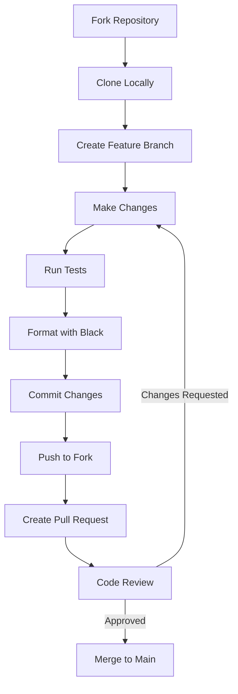
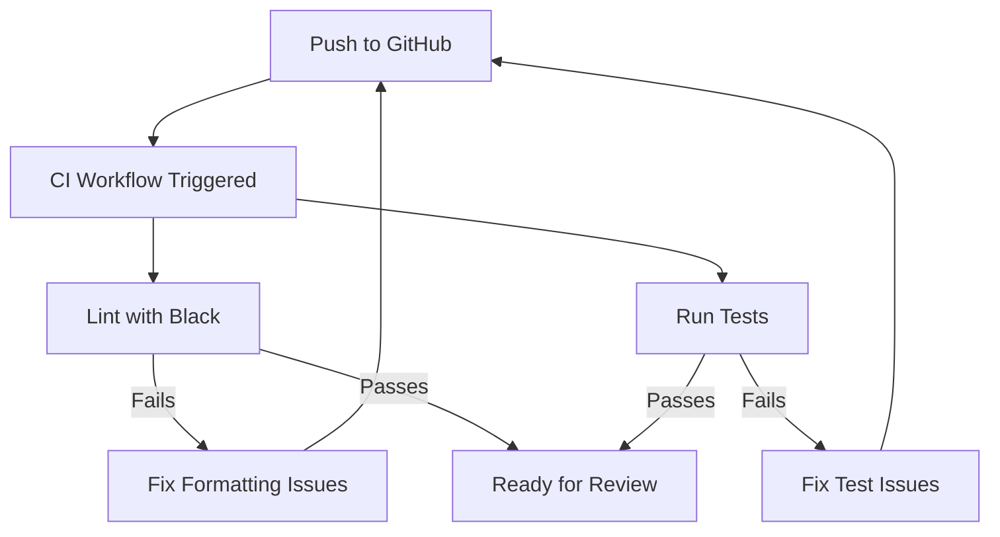
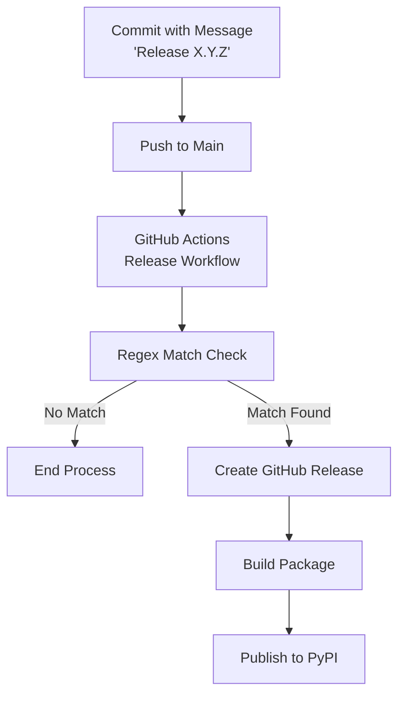
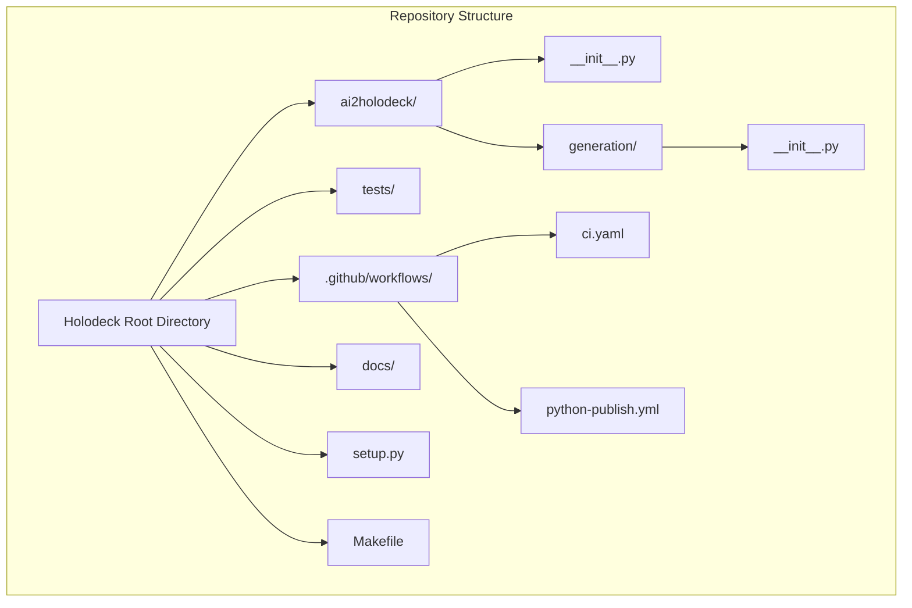

<!-- source: DeepWiki mcp.deepwiki.com · repo allenai/Holodeck · page 8 Development and Contribution · fetched 2026-10-26 -->

# Development and Contribution

<details>
<summary>Relevant source files</summary>

The following files were used as context for generating this wiki page:

- [.github/workflows/ci.yaml](.github/workflows/ci.yaml)
- [.github/workflows/python-publish.yml](.github/workflows/python-publish.yml)
- [ai2holodeck/__init__.py](ai2holodeck/__init__.py)
- [ai2holodeck/generation/__init__.py](ai2holodeck/generation/__init__.py)

</details>


This page provides guidance for developers who want to contribute to the Holodeck project. It covers development environment setup, code style guidelines, testing procedures, contribution workflow, and the release process. For information about using Holodeck, see [Usage Guide](#5).

## Development Environment Setup

Setting up your development environment for Holodeck requires a few key steps to ensure you can work effectively with the codebase.

### Prerequisites

- Python 3.10
- Git
- Make (for using the Makefile commands)

### Installation for Development

```bash
# Clone the repository
git clone https://github.com/allenai/Holodeck.git
cd Holodeck

# Create and activate a virtual environment
python3 -m venv .env
source .env/bin/activate

# Install dependencies in development mode
make install
```

The `make install` command installs the package in development mode, allowing you to modify the code without reinstalling.

Sources: [.github/workflows/ci.yaml:29-33]()

## Code Style and Standards

Holodeck follows a consistent code style to maintain readability and quality across the codebase.

### Code Formatting

The project uses Black for automatic code formatting. Before submitting a contribution, ensure your code is formatted with Black.

```bash
# Format your code with Black
black .
```

Sources: [.github/workflows/ci.yaml:16]()

## Testing

Holodeck maintains a suite of unit tests to ensure code quality and prevent regressions.

### Running Tests

Tests can be executed using the Makefile:

```bash
# Run all tests
make test
```

Sources: [.github/workflows/ci.yaml:34-37]()

## Contribution Workflow

The following diagram illustrates the typical workflow for contributing to the Holodeck project:



### Step-by-Step Contribution Guide

1. **Fork the Repository**: Create your own fork of the repository on GitHub.
2. **Clone Locally**: Clone your fork to your local machine.
3. **Create Feature Branch**: Create a new branch for your feature or bugfix.
4. **Make Changes**: Implement your changes in the codebase.
5. **Run Tests**: Ensure all tests pass with your changes.
6. **Format Code**: Run Black to ensure code formatting is consistent.
7. **Commit Changes**: Make meaningful commits with descriptive messages.
8. **Push to Fork**: Push your changes to your fork on GitHub.
9. **Create Pull Request**: Open a PR against the main repository.
10. **Code Review**: Address any feedback from reviewers.
11. **Merge**: Once approved, your changes will be merged into the main branch.

Sources: [.github/workflows/ci.yaml:3-9]()

## Continuous Integration

Holodeck uses GitHub Actions for continuous integration to automatically test and validate changes.



### CI Jobs

The CI pipeline consists of two main jobs:

1. **Lint**: Checks code formatting using Black
2. **Tests**: Runs unit tests on Python 3.10

These jobs are automatically triggered for:
- Pushes to the main branch
- Pull requests targeting the main branch

Sources: [.github/workflows/ci.yaml:11-37]()

## Release Process

The diagram below illustrates the release workflow for Holodeck:



### Creating a Release

To release a new version of Holodeck:

1. Ensure all changes for the release are merged to the main branch
2. Create a commit with a message following the pattern: `Release X.Y.Z` (where X.Y.Z is the version number)
3. Push this commit to the main branch
4. The GitHub Actions workflow will:
   - Create a new release tag
   - Build the package
   - Upload the package to PyPI

The release workflow is triggered only when a commit message matches the pattern `^Release ([^ ]+)`.

Sources: [.github/workflows/python-publish.yml:1-37]()

## Project Structure

Understanding the codebase structure helps new contributors navigate and make effective changes:



### Key Directories and Files

- **ai2holodeck/**: Main module directory containing the core code
  - **generation/**: Components for scene generation
- **tests/**: Contains test suites
- **.github/workflows/**: CI/CD configuration
- **Makefile**: Contains development commands
- **setup.py**: Package configuration

Sources: [ai2holodeck/__init__.py:1](), [ai2holodeck/generation/__init__.py:1]()

## Development Tools and Command Reference

The following table lists common development commands for the Holodeck project:

| Command | Description |
|---------|-------------|
| `make install` | Install dependencies in development mode |
| `make test` | Run the test suite |
| `black .` | Format code with Black |
| `python setup.py sdist bdist_wheel` | Build distribution packages |
| `twine upload dist/*` | Upload packages to PyPI |

Sources: [.github/workflows/ci.yaml:29-37](), [.github/workflows/python-publish.yml:36-37]()

## Suggested Areas for Contribution

New contributors might want to focus on these areas:

1. **Documentation Improvements**: Enhance docstrings and user guides
2. **Test Coverage**: Add tests for edge cases and new features
3. **Bug Fixes**: Address issues from the GitHub issue tracker
4. **Feature Enhancements**: Implement new generation capabilities or improve existing ones
5. **Performance Optimization**: Improve the efficiency of scene generation