# Page: Holodeck Overview

# Holodeck Overview

<details>
<summary>Relevant source files</summary>

The following files were used as context for generating this wiki page:

- [README.md](README.md)
- [ai2holodeck/generation/holodeck.py](ai2holodeck/generation/holodeck.py)

</details>


Holodeck is a framework for generating 3D embodied AI environments from natural language descriptions. This system allows users to create detailed, interactive 3D scenes by providing simple text queries like "a living room" or "a modern kitchen with island."

For installation instructions, see [Installation and Setup](#2). For detailed information about the system architecture, see [System Architecture](#3).

## Purpose and Capabilities

Holodeck translates natural language descriptions into fully-realized 3D environments by:

1. Generating room layouts based on semantic understanding of the query
2. Creating walls, doors, and windows appropriate for the space
3. Selecting contextually appropriate objects from a 3D asset library
4. Placing objects using constraint-based systems that respect real-world arrangements
5. Rendering the final scene in the AI2-THOR visualization framework

The system supports generating both single-room and multi-room environments, with customizable object selection and placement strategies.

Sources: [README.md:1-11](), [ai2holodeck/generation/holodeck.py:56-67]()

## System Architecture Overview

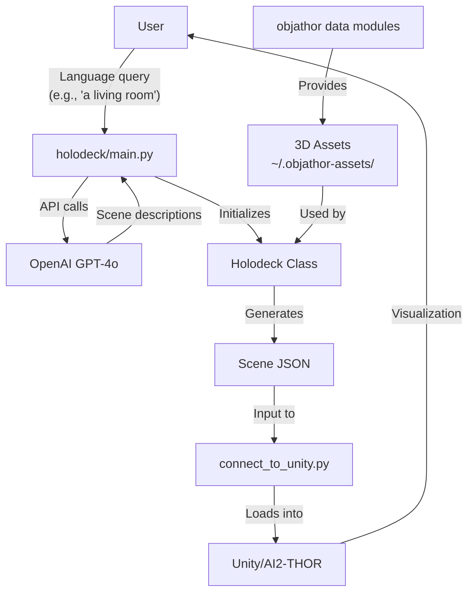

The system begins with a user submitting a language query through `holodeck/main.py`. This query is processed using OpenAI's GPT-4o to generate detailed scene descriptions. The `Holodeck` class orchestrates the generation of a complete 3D scene, which is saved as a JSON file. This JSON file is then loaded into Unity via the AI2-THOR framework for visualization.

Sources: [README.md:14-19](), [ai2holodeck/generation/holodeck.py:56-62]()

## Core Components

```mermaid
classDiagram
    class Holodeck {
        +__init__(openai_api_key, openai_org, objaverse_asset_dir, single_room)
        +generate_scene(scene, query, save_dir, ...)
        +generate_rooms(scene, additional_requirements)
        +generate_walls(scene)
        +generate_doors(scene, additional_requirements)
        +generate_windows(scene, additional_requirements)
        +select_objects(scene, additional_requirements)
        +generate_ceiling_objects(scene, additional_requirements)
        +generate_small_objects(scene)
    }
    
    class FloorPlanGenerator {
        +generate_rooms(scene, additional_requirements)
    }
    
    class WallGenerator {
        +generate_walls(scene)
        +update_walls(walls, open_room_pairs)
    }
    
    class DoorGenerator {
        +generate_doors(scene, additional_requirements)
    }
    
    class WindowGenerator {
        +generate_windows(scene, additional_requirements)
    }
    
    class ObjectSelector {
        +select_objects(scene, additional_requirements)
        +plan_room(args)
        +get_objects_by_room(parsed_plan, scene, room_size, floor_capacity, wall_capacity)
    }
    
    class FloorObjectGenerator {
        +generate_objects(scene, use_constraint)
        +generate_objects_per_room(args)
        +parse_constraints(constraint_text, object_names)
    }
    
    class WallObjectGenerator {
        +generate_wall_objects(scene, use_constraint)
    }
    
    class SmallObjectGenerator {
        +generate_small_objects(scene, controller, receptacle_ids)
    }
    
    class ObjathorRetriever {
        // Asset retrieval functions
    }
    
    Holodeck --> FloorPlanGenerator: uses
    Holodeck --> WallGenerator: uses
    Holodeck --> DoorGenerator: uses
    Holodeck --> WindowGenerator: uses
    Holodeck --> ObjectSelector: uses
    Holodeck --> FloorObjectGenerator: uses
    Holodeck --> WallObjectGenerator: uses
    Holodeck --> SmallObjectGenerator: uses
    ObjectSelector --> ObjathorRetriever: uses
    FloorObjectGenerator --> ObjathorRetriever: uses
    WallObjectGenerator --> ObjathorRetriever: uses
    SmallObjectGenerator --> ObjathorRetriever: uses
```

The Holodeck system is centered around the `Holodeck` class which orchestrates the entire generation process. Each component handles a specific aspect of scene generation:

- **FloorPlanGenerator**: Creates room layouts based on language descriptions
- **WallGenerator**: Constructs walls based on room vertices
- **DoorGenerator & WindowGenerator**: Place doors to connect rooms and windows on exterior walls
- **ObjectSelector**: Selects objects suitable for each room based on its type and purpose
- **FloorObjectGenerator**: Places objects on the floor using constraint-based algorithms
- **WallObjectGenerator**: Places objects on walls (e.g., paintings, shelves)
- **SmallObjectGenerator**: Places small objects on surfaces of larger objects
- **ObjathorRetriever**: Retrieves 3D assets from the Objathor dataset based on semantic queries

Sources: [ai2holodeck/generation/holodeck.py:56-139]()

## Generation Pipeline

The scene generation process follows a structured pipeline, implemented by the `generate_scene` method in the `Holodeck` class:

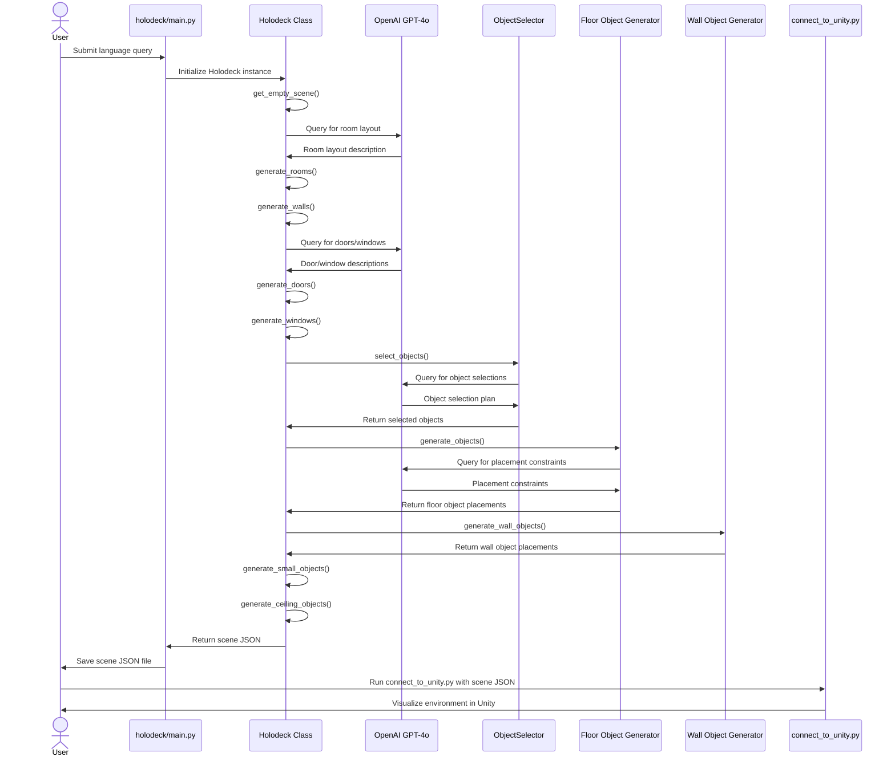

The generation process follows these steps:

1. **Scene Initialization**: Create an empty scene structure
2. **Room Generation**: Generate room layouts based on the language query
3. **Wall Generation**: Construct walls based on room vertices
4. **Door & Window Generation**: Place doors to connect rooms and windows on exterior walls
5. **Object Selection**: Select appropriate objects for each room
6. **Object Placement**:
   - Floor objects: Place furniture and other floor-based objects
   - Wall objects: Place paintings, shelves, and other wall-mounted objects
   - Small objects: Place small objects on surfaces of larger objects
   - Ceiling objects: Place lights and other ceiling-mounted objects
7. **Light Generation**: Add lighting to enhance scene realism
8. **Export**: Save the final scene as a JSON file and generate visualization

Sources: [ai2holodeck/generation/holodeck.py:259-389]()

## Data Flow and Asset Management

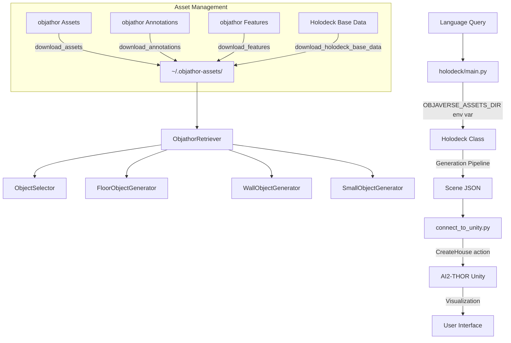

The system relies on pre-downloaded assets from the Objathor dataset, which are stored in the `~/.objathor-assets/` directory by default. These assets include 3D models, annotations, and features that are used throughout the generation process. The directory path can be configured using the `OBJAVERSE_ASSETS_DIR` environment variable.

Sources: [README.md:30-38](), [ai2holodeck/generation/holodeck.py:38-53]()

## Basic Usage

To generate a new environment, you can use the following command:

```bash
python holodeck/main.py --query "a living room" --openai_api_key <OPENAI_API_KEY>
```

The system will generate a scene JSON file and a top-down image of the scene. To visualize the scene in Unity:

1. Install Unity (version 2020.3.25f1)
2. Clone the AI2-THOR repository
3. Load the Unity project and open the Procedural scene
4. Run the connection script:
   ```bash
   python connect_to_unity --scene <SCENE_JSON_FILE_PATH>
   ```
5. Press play in Unity to visualize the scene

Sources: [README.md:40-68]()

## Advanced Features

Holodeck also supports several advanced features:

- **Scene Variations**: Generate multiple variations of the same scene with different objects and layouts
- **Constraint-Based Placement**: Control object placement using semantic constraints
- **Selective Generation**: Generate only specific parts of a scene (e.g., only floor objects, only wall objects)
- **Ablation Studies**: Test different object placement strategies for research purposes

For more information on these features, see the System Architecture and Scene Generation Pipeline pages.

Sources: [ai2holodeck/generation/holodeck.py:391-509]()

## Summary

Holodeck provides a powerful framework for generating 3D environments from natural language descriptions. By combining large language models with a structured generation pipeline and a library of 3D assets, it enables the creation of diverse and semantically accurate scenes for embodied AI research and other applications.

For more detailed information on how to use Holodeck, see the [Usage Guide](#5) section.

Sources: [README.md:1-11](), [ai2holodeck/generation/holodeck.py:259-389]()

---

# Page: Installation and Setup

# Installation and Setup

<details>
<summary>Relevant source files</summary>

The following files were used as context for generating this wiki page:

- [README.md](README.md)
- [requirements.txt](requirements.txt)
- [setup.py](setup.py)

</details>


This page provides comprehensive instructions for installing and configuring Holodeck, a framework for generating 3D embodied AI environments from natural language descriptions. For information about using Holodeck after installation, see [Usage Guide](#5).

## System Requirements

Holodeck has the following system requirements based on its dependency on AI2-THOR:

* **Operating System**: macOS 10.9+ or Ubuntu 14.04+
* **Python**: Version 3.10
* **OpenAI API**: Access to `gpt-4o-2024-05-13` model
* **Unity** (optional, for visualization): Editor version 2020.3.25f1

## Installation Steps

### 1. Python Environment Setup

Create a dedicated Conda environment for Holodeck:

```bash
conda create --name holodeck python=3.10
conda activate holodeck
```

Sources: [README.md:23-26]()

### 2. Clone and Install Dependencies

Clone the Holodeck repository and install the required dependencies:

```bash
git clone https://github.com/allenai/Holodeck.git
cd Holodeck
pip install -r requirements.txt
pip install --extra-index-url https://ai2thor-pypi.allenai.org ai2thor==0+8524eadda94df0ab2dbb2ef5a577e4d37c712897
```

The main dependencies include:
* OpenAI API and LangChain for LLM integration
* PyTorch for machine learning operations
* Objathor for asset management
* Shapely and CVXPY for geometric operations
* Gurobi for optimization in the MILP solver

Sources: [README.md:22-28](), [requirements.txt:1-27]()

### 3. Installation Architecture

The following diagram shows the key components installed and their relationships:

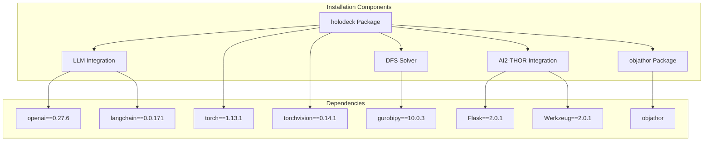

Sources: [requirements.txt:1-27](), [README.md:22-28]()

## Data Setup

### 1. Download Required Assets

Run the following commands to download the necessary data assets:

```bash
python -m objathor.dataset.download_holodeck_base_data --version 2023_09_23
python -m objathor.dataset.download_assets --version 2023_09_23
python -m objathor.dataset.download_annotations --version 2023_09_23
python -m objathor.dataset.download_features --version 2023_09_23
```

These commands download:
* **Holodeck base data**: Core environment templates and configurations
* **Assets**: 3D model files for objects 
* **Annotations**: Metadata about objects (dimensions, categories, etc.)
* **Features**: Pre-computed feature vectors for object retrieval and similarity

Sources: [README.md:32-37]()

### 2. Asset Directory Configuration

By default, assets are saved to `~/.objathor-assets/`. To use a custom location:

1. Add the `--path` argument to the download commands:
   ```bash
   python -m objathor.dataset.download_holodeck_base_data --version 2023_09_23 --path /your/custom/path
   ```

2. Set the environment variable for Holodeck to locate the assets:
   ```bash
   export OBJAVERSE_ASSETS_DIR=/your/custom/path
   ```

Sources: [README.md:38]()

## Data and Asset Flow

The following diagram illustrates how Holodeck accesses and uses the downloaded assets:

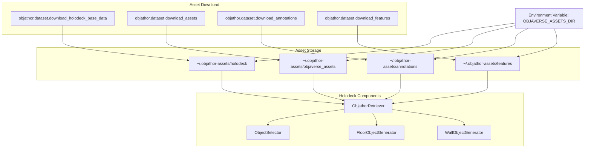

Sources: [README.md:32-38]()

## OpenAI API Configuration

Holodeck uses the OpenAI API for natural language processing and scene generation:

1. Create an account on [OpenAI](https://openai.com/)
2. Generate an API key from the OpenAI dashboard
3. Ensure you have access to the `gpt-4o-2024-05-13` model (required)
4. Provide your API key when running Holodeck:

```bash
python holodeck/main.py --query "a living room" --openai_api_key YOUR_API_KEY
```

Sources: [README.md:43-45]()

## Unity Setup for Visualization (Optional)

To visualize generated environments in 3D using Unity:

### 1. Install Unity

Install Unity Hub and the specific Unity editor version:
* Download Unity Hub from: [https://unity.com/download](https://unity.com/download)
* Install editor version `2020.3.25f1`

Sources: [README.md:50-51]()

### 2. Set Up AI2-THOR

Clone the AI2-THOR repository and checkout the specific commit:

```bash
git clone https://github.com/allenai/ai2thor.git
cd ai2thor
git checkout 07445be8e91ddeb5de2915c90935c4aef27a241d
```

Sources: [README.md:52-55]()

### 3. Install Compatible Package Versions

```bash
pip uninstall Werkzeug
pip uninstall Flask
pip install Werkzeug==2.0.1
pip install Flask==2.0.1
```

Sources: [README.md:56-61]()

### 4. Configure Unity Project

1. Open Unity Hub
2. Add the `ai2thor/unity` directory as a project
3. Open the project and navigate to `ai2thor/unity/Assets/Scenes/Procedural/Procedural.unity`

Sources: [README.md:62-63]()

## Visualization Process

The following diagram illustrates the process of generating and visualizing environments with Holodeck:

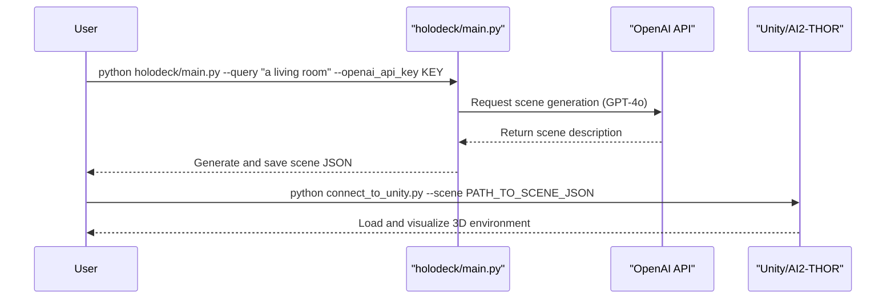

Sources: [README.md:43-45](), [README.md:64-68]()

## Verification

To verify your installation is working properly:

1. Generate a simple environment:
```bash
python holodeck/main.py --query "a living room" --openai_api_key YOUR_API_KEY
```

2. If you've set up Unity, visualize the generated environment:
```bash
python connect_to_unity.py --scene path/to/generated/scene.json
```
Then press the play button in Unity to view the scene.

Sources: [README.md:43-45](), [README.md:64-68]()

## Troubleshooting

### Solver Selection

For better layout generation, ensure the DFS solver is used instead of MILP:

```bash
python holodeck/main.py --query "a living room" --openai_api_key YOUR_API_KEY --use_milp False
```

If you pulled the repository before December 28, 2023, you must explicitly set `--use_milp` to `False` to use the DFS solver.

Sources: [README.md:19](), [README.md:47]()

### Asset Path Issues

If Holodeck can't find your assets, verify:
1. The assets were downloaded correctly
2. The `OBJAVERSE_ASSETS_DIR` environment variable is set correctly if using a custom path
3. You have sufficient disk space (several GB required for all assets)

Sources: [README.md:38]()

---

# Page: System Architecture

# System Architecture

<details>
<summary>Relevant source files</summary>

The following files were used as context for generating this wiki page:

- [README.md](README.md)
- [ai2holodeck/generation/holodeck.py](ai2holodeck/generation/holodeck.py)

</details>


This page documents the overall architecture of the Holodeck framework, explaining how different components interact to generate 3D environments from natural language descriptions. It focuses on the system's structure, the generation pipeline flow, and the integration with external systems like OpenAI's language models and Unity/AI2-THOR.

For details on specific generation components, see [Core Components](#4). For installation and setup information, see [Installation and Setup](#2).

## High-Level Architecture

### Holodeck System Overview

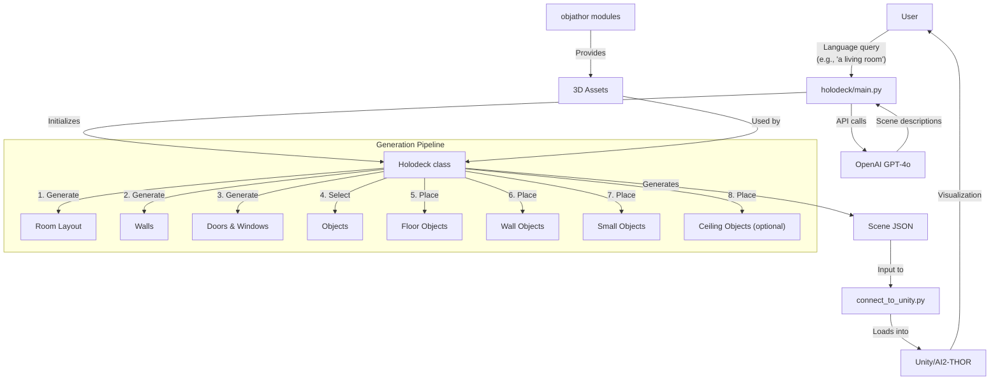

Sources: [ai2holodeck/generation/holodeck.py:259-389](), [README.md:42-44]()

This diagram illustrates the core architecture of Holodeck. The system begins with user input as a natural language query, which is processed by `holodeck/main.py`. This main script initializes the Holodeck class and coordinates the generation process through API calls to OpenAI's GPT-4o model. The Holodeck class orchestrates the step-by-step generation of the 3D environment, using asset data from objathor modules. The output is a Scene JSON file, which can be loaded into Unity using the AI2-THOR framework via `connect_to_unity.py`.

## Core Components

The Holodeck framework is built around a central `Holodeck` class that orchestrates various specialized generators, each responsible for different aspects of the 3D environment generation.

### Component Organization

```mermaid
classDiagram
    class Holodeck {
        +__init__(openai_api_key, openai_org, objaverse_asset_dir, single_room)
        +get_empty_scene()
        +empty_house(scene)
        +generate_rooms(scene, additional_requirements_room, used_assets)
        +generate_walls(scene)
        +generate_doors(scene, additional_requirements_door, used_assets)
        +generate_windows(scene, additional_requirements_window, used_assets)
        +select_objects(scene, additional_requirements_object, used_assets)
        +generate_ceiling_objects(scene, additional_requirements_ceiling)
        +generate_small_objects(scene, used_assets)
        +change_ceiling_material(scene)
        +generate_scene(scene, query, save_dir, used_assets, ...)
    }
    
    class FloorPlanGenerator {
        +generate_rooms(scene, additional_requirements_room)
    }
    
    class WallGenerator {
        +generate_walls(scene)
        +update_walls(walls, open_room_pairs)
    }
    
    class DoorGenerator {
        +generate_doors(scene, additional_requirements_door)
    }
    
    class WindowGenerator {
        +generate_windows(scene, additional_requirements_window)
    }
    
    class ObjectSelector {
        +select_objects(scene, additional_requirements_object)
    }
    
    class FloorObjectGenerator {
        +generate_objects(scene, use_constraint)
    }
    
    class WallObjectGenerator {
        +generate_wall_objects(scene, use_constraint)
    }
    
    class CeilingObjectGenerator {
        +generate_ceiling_objects(scene, additional_requirements_ceiling)
    }
    
    class SmallObjectGenerator {
        +generate_small_objects(scene, controller, receptacle_ids)
    }
    
    class ObjathorRetriever {
        +retrieve_assets(query, asset_count, exclude_ids)
    }
    
    Holodeck --> FloorPlanGenerator : uses
    Holodeck --> WallGenerator : uses
    Holodeck --> DoorGenerator : uses
    Holodeck --> WindowGenerator : uses
    Holodeck --> ObjectSelector : uses
    Holodeck --> FloorObjectGenerator : uses
    Holodeck --> WallObjectGenerator : uses
    Holodeck --> CeilingObjectGenerator : uses
    Holodeck --> SmallObjectGenerator : uses
    
    ObjectSelector --> ObjathorRetriever : uses
    FloorObjectGenerator --> ObjathorRetriever : uses
    WallObjectGenerator --> ObjathorRetriever : uses
    CeilingObjectGenerator --> ObjathorRetriever : uses
    SmallObjectGenerator --> ObjathorRetriever : uses
```

Sources: [ai2holodeck/generation/holodeck.py:56-123]()

The diagram shows the central `Holodeck` class and its relationships with specialized generator classes. Each generator is responsible for a specific aspect of scene generation:

- `FloorPlanGenerator`: Creates the basic room layouts
- `WallGenerator`: Generates walls based on room boundaries
- `DoorGenerator` and `WindowGenerator`: Add doors and windows to appropriate walls
- `ObjectSelector`: Selects appropriate objects for the scene based on room type and query
- `FloorObjectGenerator`: Places selected objects on the floor with appropriate positioning
- `WallObjectGenerator`: Places objects on walls (e.g., paintings, shelves)
- `CeilingObjectGenerator`: Adds ceiling elements (lights, fans)
- `SmallObjectGenerator`: Places small objects on receptacles (e.g., items on tables)
- `ObjathorRetriever`: Retrieves 3D assets from the objathor dataset

## Generation Pipeline Flow

The generation of a 3D environment follows a sequential process, where each step builds upon the results of previous steps.

### Generation Sequence

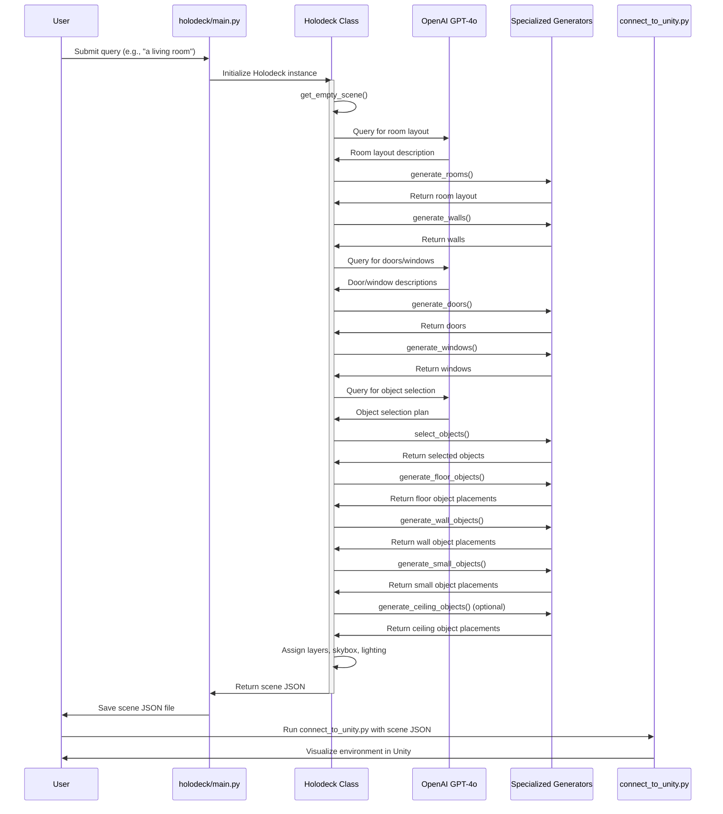

Sources: [ai2holodeck/generation/holodeck.py:259-389]()

The sequence diagram illustrates the step-by-step process of environment generation:

1. **Initialization**: User provides a natural language query, and the main script initializes the Holodeck instance.
2. **Room Generation**: The system queries the LLM for a room layout and generates the basic room structure.
3. **Wall Generation**: Walls are created based on the room boundaries.
4. **Door and Window Generation**: The LLM provides guidance on door and window placement, which are then added to appropriate walls.
5. **Object Selection**: The LLM helps select appropriate objects for the environment based on the query and room type.
6. **Object Placement**:
   - Floor objects are placed using constraint-based positioning
   - Wall objects are positioned on appropriate walls
   - Small objects are placed on available receptacles
   - Ceiling objects are optionally added
7. **Finalization**: The system assigns layers, adds a skybox, and configures lighting
8. **Output**: The generated scene is saved as a JSON file
9. **Visualization**: The user can load the scene into Unity using the AI2-THOR framework

## Integration with External Systems

Holodeck integrates with two key external systems: OpenAI's language models for natural language understanding and generation, and Unity/AI2-THOR for visualization and interaction.

### Language Model Integration

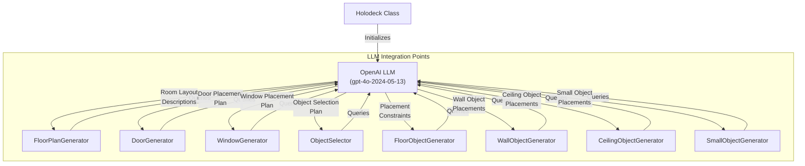

Sources: [ai2holodeck/generation/holodeck.py:70-74](), [README.md:45]()

The Holodeck framework uses OpenAI's GPT-4o model to generate detailed descriptions and plans for different aspects of environment generation. The language model is initialized during the Holodeck class construction and is used by various generators to:

1. Create room layouts from natural language descriptions
2. Plan door and window placements
3. Select appropriate objects for each room
4. Determine placement constraints for objects
5. Generate small object placements

### Unity and AI2-THOR Integration

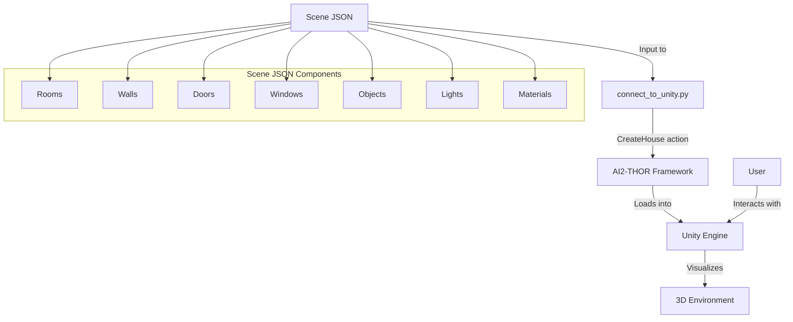

Sources: [README.md:49-68]()

The Holodeck framework connects to Unity through the AI2-THOR framework for visualization and interaction:

1. The generated scene is saved as a JSON file with detailed information about rooms, walls, doors, windows, objects, lights, and materials.
2. The `connect_to_unity.py` script establishes a connection with Unity running the AI2-THOR framework.
3. The scene is loaded into Unity through the AI2-THOR framework's `CreateHouse` action.
4. The user can interact with the generated environment in Unity.

## Asset Management and Data Flow

The Holodeck system relies on a comprehensive asset management system that handles 3D models, annotations, and features.

### Asset Management

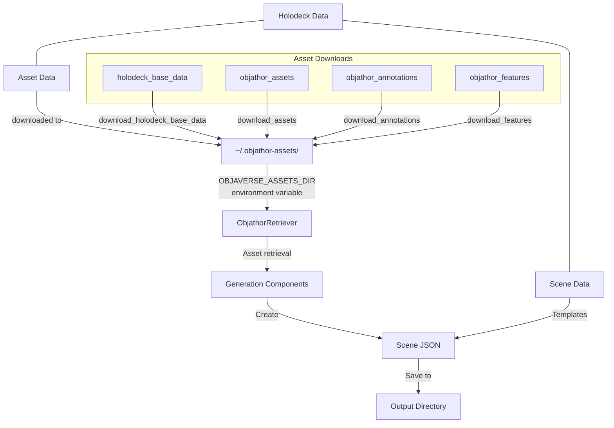

Sources: [README.md:30-38](), [ai2holodeck/generation/holodeck.py:11-20]()

The asset management system involves:

1. **Asset Downloads**: The system downloads various data sets to the `~/.objathor-assets/` directory:
   - `holodeck_base_data`: Base data for scene generation
   - `objathor_assets`: 3D model assets
   - `objathor_annotations`: Annotations for 3D models
   - `objathor_features`: Features for 3D models

2. **Environment Configuration**: The system uses the `OBJAVERSE_ASSETS_DIR` environment variable to locate the assets directory.

3. **Asset Retrieval**: The `ObjathorRetriever` class retrieves appropriate 3D assets for scene generation based on queries and constraints.

4. **Scene Generation**: The generation components use the retrieved assets to create the scene, which is saved as a JSON file.

### Data Flow

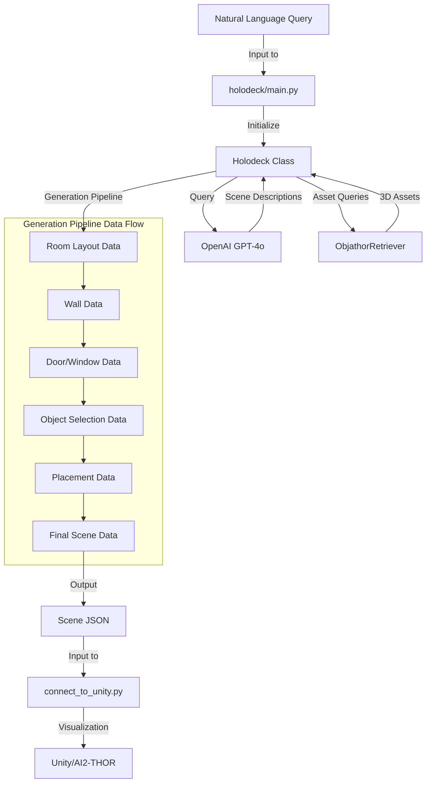

Sources: [ai2holodeck/generation/holodeck.py:259-389]()

The data flow through the Holodeck system follows these steps:

1. The user provides a natural language query to `holodeck/main.py`
2. The main script initializes the Holodeck class and passes the query
3. Holodeck consults the language model (OpenAI GPT-4o) for scene descriptions
4. Asset queries are sent to the ObjathorRetriever to find appropriate 3D assets
5. The generation pipeline processes the data in sequential stages:
   - Room layout data
   - Wall data
   - Door/window data
   - Object selection data
   - Placement data
   - Final scene data
6. The final scene is output as a JSON file
7. The JSON file can be loaded into Unity/AI2-THOR for visualization

## Key Configuration and Integration Points

The table below summarizes the key configuration and integration points in the Holodeck system:

| Component | Configuration | Purpose |
|-----------|---------------|---------|
| OpenAI LLM | `openai_api_key`, `openai_org` | Enables natural language processing for scene generation |
| CLIP Model | "ViT-L-14", "laion2b_s32b_b82k" | Provides visual understanding for asset selection |
| Sentence Transformer | "all-mpnet-base-v2" | Provides semantic understanding for queries |
| Asset Directory | `OBJAVERSE_ASSETS_DIR` environment variable | Specifies location of 3D assets |
| Retrieval Threshold | `self.retrieval_threshold = 28` | Controls asset retrieval sensitivity |
| Unity Connection | `connect_to_unity.py` | Enables visualization in Unity/AI2-THOR |

Sources: [ai2holodeck/generation/holodeck.py:56-123](), [README.md:38]()

## Advanced Architecture Features

### Constraint-Based Placement System

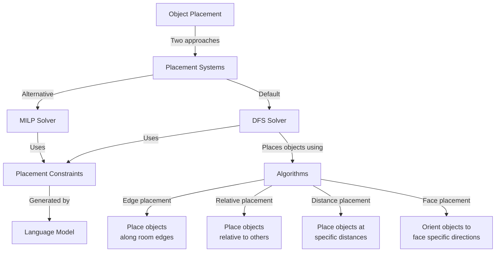

Sources: [ai2holodeck/generation/holodeck.py:313-314](), [README.md:19]()

The Holodeck system uses two approaches for object placement:

1. **DFS Solver (Default)**: A depth-first search algorithm that places objects according to constraints
2. **MILP Solver (Alternative)**: A mixed-integer linear programming approach (less used)

The constraint-based placement system allows for sophisticated object arrangements based on:
- Edge placement: Positioning objects along room edges
- Relative placement: Placing objects in relation to other objects
- Distance placement: Maintaining specific distances between objects
- Face placement: Orienting objects to face specific directions

### Layer System

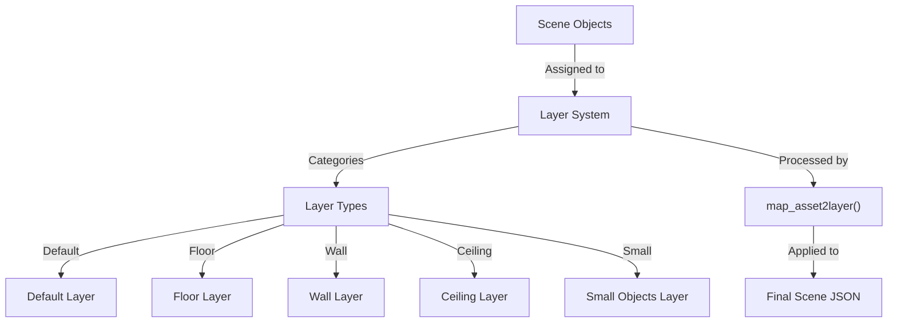

Sources: [ai2holodeck/generation/holodeck.py:343]()

The layer system organizes scene elements for rendering and processing:

1. Objects are assigned to appropriate layers based on their type and placement
2. The `map_asset2layer()` function handles the layer assignment
3. Layers help organize the scene for Unity rendering and make it easier to manipulate specific types of objects

## Summary

The Holodeck system architecture follows a sequential pipeline approach to generate 3D environments from natural language descriptions. The core `Holodeck` class orchestrates specialized generators, each handling a specific aspect of the environment. The system integrates with OpenAI's language models for natural language understanding and with Unity/AI2-THOR for visualization.

Key architectural components include:
- Room and structure generators (rooms, walls, doors, windows)
- Object selection and placement systems
- Constraint-based placement algorithms
- Layer management
- External integrations (OpenAI, Unity/AI2-THOR)
- Asset management system

This architecture enables the flexible generation of diverse 3D environments based on natural language descriptions, making it a powerful tool for embodied AI research and applications.

---

# Page: Scene Generation Pipeline

# Scene Generation Pipeline

<details>
<summary>Relevant source files</summary>

The following files were used as context for generating this wiki page:

- [ai2holodeck/generation/holodeck.py](ai2holodeck/generation/holodeck.py)

</details>


## Purpose and Scope

This document details the step-by-step process of how Holodeck generates 3D environments from natural language descriptions. It covers the entire pipeline from receiving a language query to producing a complete 3D scene that can be rendered in Unity. For information about the specific language model integration details, see [Language Model Integration](#3.2), and for details on how the generated scenes connect to Unity, see [Unity and AI2-THOR Integration](#3.3).

## Pipeline Overview

The Holodeck scene generation pipeline transforms natural language descriptions into structured 3D environments through a series of sequential generation steps. Each step builds upon the previous ones, gradually constructing a complete scene from basic elements like rooms and walls to complex arrangements of objects with appropriate relationships and constraints.

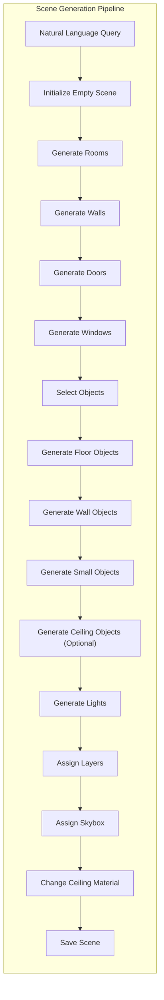

Sources: [ai2holodeck/generation/holodeck.py:259-389]()

## Key Components

The scene generation pipeline integrates multiple specialized components, each responsible for a specific aspect of the generation process:

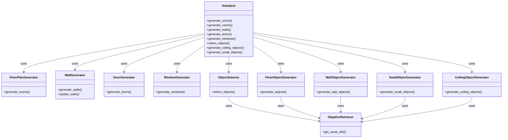

Sources: [ai2holodeck/generation/holodeck.py:56-139]()

## Detailed Pipeline Steps

### 1. Scene Initialization

The pipeline begins by creating an empty scene structure using the `get_empty_scene()` method, which loads a template from `empty_house.json`. This template is then emptied of any existing content using the `empty_house()` method.

Sources: [ai2holodeck/generation/holodeck.py:140-152]()

### 2. Room Generation

Rooms are generated based on the natural language query and additional requirements using the `FloorPlanGenerator`. This component interprets room descriptions and creates appropriate floor plan layouts.

Sources: [ai2holodeck/generation/holodeck.py:154-158]()

### 3. Wall Generation

Walls are created around the generated rooms using the `WallGenerator`. This process determines wall heights and positions based on the room layouts.

Sources: [ai2holodeck/generation/holodeck.py:160-164]()

### 4. Door Generation

Doors are placed between rooms using the `DoorGenerator`. This process identifies appropriate wall sections for door placement and updates the wall structures accordingly.

Sources: [ai2holodeck/generation/holodeck.py:166-187]()

### 5. Window Generation

Windows are added to walls using the `WindowGenerator`. Like door generation, this process selects appropriate wall sections and modifies them to accommodate windows.

Sources: [ai2holodeck/generation/holodeck.py:189-202]()

### 6. Object Selection

Objects to be placed in the scene are selected using the `ObjectSelector`. This component determines which objects are appropriate for each room type based on the natural language query.

Sources: [ai2holodeck/generation/holodeck.py:204-211]()

### 7. Floor Object Placement

Floor objects (like furniture) are placed in the rooms using the `FloorObjectGenerator`. This component uses constraint-based reasoning to determine appropriate positions for objects.

Sources: [ai2holodeck/generation/holodeck.py:314-316]()

### 8. Wall Object Placement

Objects that belong on walls (like paintings and shelves) are placed using the `WallObjectGenerator`. This component considers wall availability and aesthetic factors.

Sources: [ai2holodeck/generation/holodeck.py:319-320]()

### 9. Small Object Placement

Small objects (like decorative items) are placed on receptacles (such as tables and shelves) using the `SmallObjectGenerator`. This requires interaction with the AI2-THOR simulation to identify valid receptacle surfaces.

Sources: [ai2holodeck/generation/holodeck.py:224-252]()

### 10. Ceiling Object Placement (Optional)

If ceiling objects are requested, they are placed using the `CeilingObjectGenerator`. This step is optional and can be skipped.

Sources: [ai2holodeck/generation/holodeck.py:332-336]()

### 11. Light Generation

Lights are added to the scene using the `generate_lights()` function. Lighting is critical for realistic rendering of the environment.

Sources: [ai2holodeck/generation/holodeck.py:339-340]()

### 12. Layer Assignment

Objects are assigned to appropriate rendering layers using the `map_asset2layer()` function. This helps organize the scene elements for processing and rendering.

Sources: [ai2holodeck/generation/holodeck.py:343]()

### 13. Skybox Assignment

A skybox (the background visible through windows) is assigned using the `getSkybox()` function.

Sources: [ai2holodeck/generation/holodeck.py:346]()

### 14. Ceiling Material Update

The ceiling material is updated to match the wall material using the `change_ceiling_material()` method.

Sources: [ai2holodeck/generation/holodeck.py:254-257](), [ai2holodeck/generation/holodeck.py:349]()

### 15. Scene Saving

The completed scene is saved as a JSON file, and optionally, images or videos of the scene may be generated.

Sources: [ai2holodeck/generation/holodeck.py:351-387]()

## Sequence Diagram of Generation Process

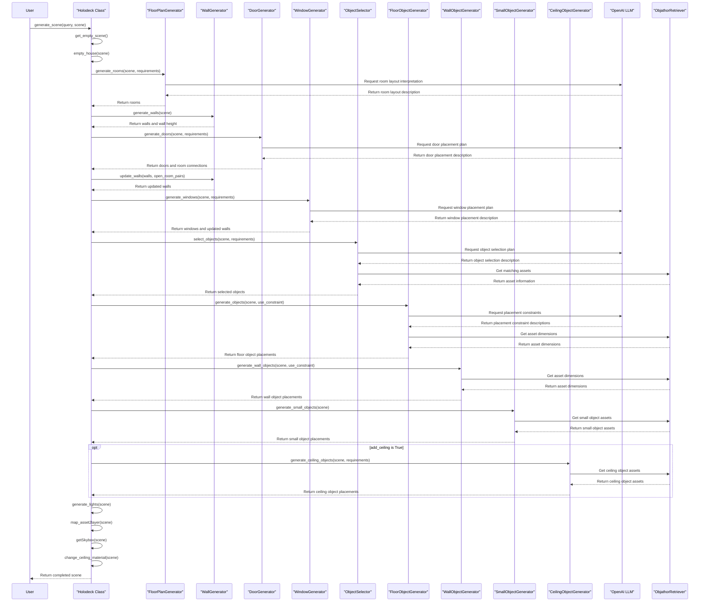

Sources: [ai2holodeck/generation/holodeck.py:259-389]()

## Data Structure Evolution

Throughout the pipeline, the scene data structure evolves as different components add their contributions. The following table outlines key fields added at each stage:

| Stage | Fields Added to Scene | Purpose |
|-------|----------------------|---------|
| Initialization | N/A | Creates empty scene template |
| Room Generation | `rooms` | Defines room layouts |
| Wall Generation | `walls`, `wall_height` | Defines wall structures and height |
| Door Generation | `doors`, `raw_doorway_plan`, `room_pairs`, `open_room_pairs`, `open_walls` | Defines doors and connections between rooms |
| Window Generation | `windows`, `raw_window_plan` | Defines window placements |
| Object Selection | `object_selection_plan`, `selected_objects` | Defines objects to be placed in the scene |
| Floor Object Placement | `floor_objects` | Defines floor object placements |
| Wall Object Placement | `wall_objects` | Defines wall object placements |
| Small Object Placement | `small_objects`, `receptacle2small_objects` | Defines small object placements and their receptacles |
| Ceiling Object Placement | `ceiling_objects`, `raw_ceiling_plan` | Defines ceiling object placements |
| Light Generation | `proceduralParameters.lights` | Defines lighting in the scene |
| Skybox Assignment | `proceduralParameters.skybox` | Defines background visible through windows |

Sources: [ai2holodeck/generation/holodeck.py:140-389]()

## Integration with LLM and Asset Management

The generation pipeline relies heavily on language model interactions and asset retrieval throughout the process:

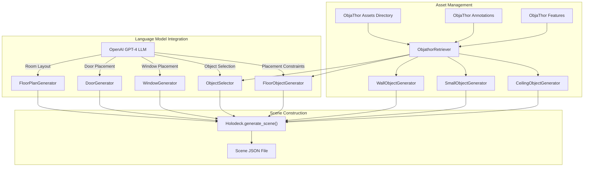

Sources: [ai2holodeck/generation/holodeck.py:56-139](), [ai2holodeck/generation/holodeck.py:259-389]()

## Performance Considerations

The scene generation pipeline is computationally intensive, particularly in the object placement stages where constraint solving is used. Several options are available to manage performance:

1. **MILP Solver Option**: For floor object placement, a Mixed Integer Linear Programming solver can be used as an alternative to the default DFS solver by setting `use_milp=True` in the `generate_scene` method.

2. **Constraint Usage**: Object placement can be performed with or without constraints by setting the `use_constraint` parameter in the `generate_scene` method.

3. **Random Selection**: Object selection can use random selection rather than semantic matching by setting `random_selection=True` in the `generate_scene` method.

Sources: [ai2holodeck/generation/holodeck.py:259-389]()

## Scene Variation Generation

The pipeline also supports generating variations of existing scenes through the `generate_variants` method. This can create multiple versions of a scene while ensuring diverse asset usage.

Sources: [ai2holodeck/generation/holodeck.py:391-439]()

---

# Page: Language Model Integration

# Language Model Integration

<details>
<summary>Relevant source files</summary>

The following files were used as context for generating this wiki page:

- [ai2holodeck/constants.py](ai2holodeck/constants.py)
- [ai2holodeck/generation/holodeck.py](ai2holodeck/generation/holodeck.py)
- [ai2holodeck/generation/object_selector.py](ai2holodeck/generation/object_selector.py)

</details>


This document details how Holodeck integrates with large language models (LLMs) to transform natural language descriptions into detailed 3D scene specifications. The system uses LLMs for generating room layouts, selecting objects, positioning objects, and creating constraints for object placement.

For information about the overall generation pipeline, see [Scene Generation Pipeline](#3.1). For details on how constraints are generated and applied, see [Constraint Systems](#7.1).

## LLM Configuration and Setup

Holodeck uses OpenAI's GPT-4o model as the primary language model for scene generation. The model is configured in the codebase as follows:

```mermaid
graph LR
    subgraph "Configuration"
        Constants["constants.py\nLLM_MODEL_NAME"]
    end
    
    subgraph "Initialization"
        HolodeckClass["Holodeck class"]
        OpenAIInit["OpenAI constructor"]
    end
    
    Constants --> |"Defines model name\n'gpt-4o-2024-05-13'"| HolodeckClass
    HolodeckClass --> |"Initialize with API key"| OpenAIInit
    OpenAIInit --> |"Creates LLM instance"| LLMInstance["self.llm"]
    
    LLMInstance --> |"Passed to"| Components["Component Generators"]
```

The LLM is initialized in the Holodeck constructor using the OpenAI API key provided by the user. The model name is defined in the constants file, making it easy to update when new models become available.

Sources: [ai2holodeck/constants.py:32-33](), [ai2holodeck/generation/holodeck.py:70-74]()

## Integration Architecture

The LLM is integrated into multiple components of the Holodeck system. Each component uses the LLM for specific tasks in the scene generation pipeline:

```mermaid
classDiagram
    class Holodeck {
        +llm: OpenAI
        +initialize_components()
        +generate_scene()
    }
    
    class FloorPlanGenerator {
        +llm: OpenAI
        +generate_rooms()
    }
    
    class WallGenerator {
        +llm: OpenAI
        +generate_walls()
    }
    
    class DoorGenerator {
        +llm: OpenAI
        +generate_doors()
    }
    
    class WindowGenerator {
        +llm: OpenAI
        +generate_windows()
    }
    
    class ObjectSelector {
        +llm: OpenAI
        +select_objects()
        +plan_room()
    }
    
    class FloorObjectGenerator {
        +llm: OpenAI
        +generate_objects()
        +generate_objects_per_room()
        +parse_constraints()
    }
    
    class WallObjectGenerator {
        +llm: OpenAI
        +generate_wall_objects()
    }
    
    class CeilingObjectGenerator {
        +llm: OpenAI
        +generate_ceiling_objects()
    }
    
    class SmallObjectGenerator {
        +llm: OpenAI
        +generate_small_objects()
    }
    
    Holodeck --> FloorPlanGenerator: passes llm
    Holodeck --> WallGenerator: passes llm
    Holodeck --> DoorGenerator: passes llm
    Holodeck --> WindowGenerator: passes llm
    Holodeck --> ObjectSelector: passes llm
    Holodeck --> FloorObjectGenerator: passes llm
    Holodeck --> WallObjectGenerator: passes llm
    Holodeck --> CeilingObjectGenerator: passes llm
    Holodeck --> SmallObjectGenerator: passes llm
```

The diagram shows how the Holodeck class initializes the LLM instance and passes it to various component generators. Each component uses the LLM for specific tasks in the scene generation process.

Sources: [ai2holodeck/generation/holodeck.py:101-123]()

## LLM Query Workflow

The general workflow for LLM integration in Holodeck follows this pattern:

```mermaid
sequenceDiagram
    participant User as "User"
    participant Holodeck as "Holodeck"
    participant Component as "Component Generator"
    participant LLM as "OpenAI GPT-4o"
    
    User->>Holodeck: generate_scene(query)
    Holodeck->>Component: generate_X(scene, requirements)
    
    Component->>Component: Prepare prompt with context
    Component->>LLM: Send prompt
    LLM->>Component: Return structured response
    
    Component->>Component: Parse LLM response
    Component->>Component: Process into scene structure
    
    Component->>Holodeck: Return updated scene
    Holodeck->>User: Final scene
```

This sequence diagram illustrates how each component interacts with the LLM:
1. The component prepares a prompt with specific context (e.g., room size, constraints)
2. The prompt is sent to the LLM
3. The LLM returns a structured response (often in JSON format)
4. The component parses the response and incorporates it into the scene structure

Sources: [ai2holodeck/generation/holodeck.py:146-337](), [ai2holodeck/generation/object_selector.py:65-142]()

## LLM Uses in Scene Generation

The language model is used at various stages in the scene generation pipeline:

### Room Layout Generation

The LLM generates room layouts based on the user's query, interpreting desired room types, arrangements, and sizes.

### Object Selection

The object selection process uses the LLM to:
1. Determine which objects should be included in each room
2. Specify object attributes (description, location, size, quantity)
3. Determine object variations and relationships

```mermaid
flowchart TD
    subgraph "Object Selection Process"
        Query["User Query"] --> |"Input to"| Prompt["Object Selection Prompt"]
        Prompt --> |"Sent to"| LLM["OpenAI GPT-4o"]
        LLM --> |"Generates"| Plan["Object Selection Plan"]
        Plan --> |"Parsed into"| JSON["JSON Structure"]
        
        JSON --> FloorObjects["Floor Objects"]
        JSON --> WallObjects["Wall Objects"]
        
        FloorObjects --> |"Retrieval"| AssetDB["Object Asset Database"]
        WallObjects --> |"Retrieval"| AssetDB
        
        AssetDB --> |"Returns"| SelectedObjects["Selected 3D Objects"]
    end
```

The LLM creates detailed plans for which objects should be included in each room, taking into account room type, size, and the overall query theme.

Sources: [ai2holodeck/generation/object_selector.py:144-230]()

### Object Placement Constraints

The LLM generates placement constraints for objects, which are then interpreted by the placement algorithms:

```mermaid
flowchart TD
    subgraph "Constraint Generation"
        Objects["Selected Objects"] --> |"Input to"| ConstraintPrompt["Constraint Prompt"]
        ConstraintPrompt --> |"Sent to"| LLM["OpenAI GPT-4o"]
        LLM --> |"Generates"| ConstraintText["Constraint Text"]
        ConstraintText --> |"Parsed into"| Constraints["Formal Constraints"]
        
        Constraints --> |"Applied in"| DFSSolver["DFS_Solver_Floor"]
        DFSSolver --> |"Produces"| Placements["Valid Object Placements"]
    end
```

The LLM translates vague natural language positioning concepts (e.g., "near the window," "against the wall") into formal constraints that can be applied by the placement algorithms.

Sources: [ai2holodeck/generation/floor_objects.py]() (File referenced in other code)

## LLM Response Processing

A critical aspect of the LLM integration is the processing of LLM responses. Object selection responses are structured as JSON, which requires careful extraction and validation:

```mermaid
flowchart TD
    LLMResponse["LLM Response"] --> |"Extract JSON with regex"| ExtractedJSON["Extracted JSON String"]
    ExtractedJSON --> |"Parse into dictionary"| JSONDict["JSON Dictionary"]
    JSONDict --> |"Normalize attribute keys"| NormalizedDict["Normalized Dictionary"]
    NormalizedDict --> |"Validate attributes"| ValidatedDict["Validated Dictionary"]
    
    ValidatedDict --> |"Success"| UseDict["Use Dictionary for Generation"]
    ValidatedDict --> |"Failure"| Fallback["Use Fallback or Retry"]
```

The `extract_json` method in the ObjectSelector class handles this process, extracting JSON from the LLM's response, parsing it, normalizing attribute keys, and validating the structure.

Sources: [ai2holodeck/generation/object_selector.py:251-290](), [ai2holodeck/generation/object_selector.py:22-29](), [ai2holodeck/generation/object_selector.py:232-249](), [ai2holodeck/generation/object_selector.py:292-357]()

## Fallback and Retry Mechanisms

Holodeck implements fallback and retry mechanisms for cases where LLM responses might not meet the required specifications:

```mermaid
sequenceDiagram
    participant Selector as "ObjectSelector"
    participant LLM as "OpenAI GPT-4o"
    
    Selector->>LLM: Send initial object selection prompt
    LLM->>Selector: Return response
    Selector->>Selector: Parse plan and check capacity
    
    alt Capacity requirements met
        Selector->>Selector: Use original plan
    else Capacity insufficient
        Selector->>LLM: Send refined prompt with feedback
        LLM->>Selector: Return updated response
        Selector->>Selector: Parse updated plan
        Selector->>Selector: Merge with original plan
    end
```

This diagram shows how the system handles cases where the first LLM-generated plan might not meet capacity requirements. The system sends a follow-up prompt to refine the plan.

Sources: [ai2holodeck/generation/object_selector.py:187-228]()

## Model Configuration Details

The Holodeck system uses GPT-4o with the following configuration:

| Parameter | Value | Purpose |
|-----------|-------|---------|
| model_name | gpt-4o-2024-05-13 | Defines which OpenAI model to use |
| max_tokens | 2048 | Limits the length of generated responses |
| openai_api_key | User provided | Authentication for OpenAI API |

This configuration can be found in the Holodeck class constructor and the constants file.

Sources: [ai2holodeck/constants.py:32-33](), [ai2holodeck/generation/holodeck.py:70-74]()

## LLM Usage Across Generation Stages

The following table summarizes how LLMs are used across the different generation stages:

| Generation Stage | Component | LLM Usage |
|------------------|-----------|-----------|
| Room Layout | FloorPlanGenerator | Interpreting user query into room layouts |
| Walls | WallGenerator | Determining wall parameters |
| Doors | DoorGenerator | Planning door placement between rooms |
| Windows | WindowGenerator | Deciding window placement on walls |
| Object Selection | ObjectSelector | Selecting appropriate objects for rooms |
| Floor Objects | FloorObjectGenerator | Generating placement constraints |
| Wall Objects | WallObjectGenerator | Planning wall-mounted object placement |
| Ceiling Objects | CeilingObjectGenerator | Planning ceiling fixture placement |
| Small Objects | SmallObjectGenerator | Adding smaller decorative items |

Each stage uses the LLM in a specialized way to interpret the user's query and generate appropriate scene elements.

Sources: [ai2holodeck/generation/holodeck.py:154-337]()

---

# Page: Unity and AI2-THOR Integration

# Unity and AI2-THOR Integration

<details>
<summary>Relevant source files</summary>

The following files were used as context for generating this wiki page:

- [README.md](README.md)
- [connect_to_unity.py](connect_to_unity.py)

</details>


This document explains how Holodeck integrates with Unity and AI2-THOR to visualize and interact with procedurally generated 3D environments. This page covers the technical aspects of connecting Holodeck's scene generation output to the Unity environment through AI2-THOR, the data flow between components, and the configuration required for proper visualization. For information about the scene generation process itself, see [Scene Generation Pipeline](#3.1).

## Overview

Holodeck generates scene descriptions in JSON format, which are then rendered and visualized using Unity and the AI2-THOR framework. This integration allows users to explore and interact with the environments generated from natural language descriptions.

```mermaid
flowchart LR
    subgraph "Holodeck Generation Pipeline"
        HolodeckCore["Holodeck Core"]
        SceneJSON["Scene JSON"]
    end
    
    subgraph "Unity Integration"
        ConnectScript["connect_to_unity.py"]
        AI2THORController["AI2THOR Controller"]
        UnityEngine["Unity Engine"]
    end
    
    HolodeckCore -->|"Outputs"| SceneJSON
    SceneJSON -->|"Input to"| ConnectScript
    ConnectScript -->|"Configures"| AI2THORController
    AI2THORController -->|"CreateHouse action"| UnityEngine
    UnityEngine -->|"Visualizes"| Visualization["3D Environment Visualization"]
```

Sources: [README.md:49-68](), [connect_to_unity.py:1-52]()

## Connection Architecture

The connection between Holodeck's generated scenes and Unity is handled by the `connect_to_unity.py` script, which serves as a bridge between the scene JSON files and the AI2-THOR framework.

### Components and Data Flow

```mermaid
classDiagram
    class SceneJSON {
        +house Object
        +rooms Array
        +objects Array
        +walls Array
        +doors Array
        +windows Array
    }
    
    class ConnectToUnity {
        +parse_arguments()
        +load_scene()
        +create_controller()
        +send_to_unity()
    }
    
    class AI2THORController {
        +commit_id String
        +port Number
        +scene String
        +gridSize Number
        +action_hook_runner ProceduralAssetHookRunner
        +step(action, params) Function
    }
    
    class ProceduralAssetHookRunner {
        +asset_directory String
        +asset_symlink Boolean
        +verbose Boolean
    }
    
    class UnityEnvironment {
        +Procedural Scene
        +Asset Handling
        +Rendering
    }
    
    SceneJSON --> ConnectToUnity: input
    ConnectToUnity --> AI2THORController: configures
    AI2THORController --> ProceduralAssetHookRunner: uses
    AI2THORController --> UnityEnvironment: communicates with
    ProceduralAssetHookRunner --> UnityEnvironment: loads assets
```

Sources: [connect_to_unity.py:1-52]()

The architecture involves several key components:

1. **Scene JSON**: Output from Holodeck's generation pipeline containing all scene elements
2. **Connect to Unity Script**: Interfaces between Holodeck and AI2-THOR
3. **AI2-THOR Controller**: Manages communication with Unity
4. **Procedural Asset Hook Runner**: Handles asset loading and management
5. **Unity Environment**: Renders the scene and provides visualization

## Scene Loading Process

The process of loading a generated scene into Unity involves several steps, handled primarily by the `connect_to_unity.py` script.

### Connect to Unity Script

The `connect_to_unity.py` script performs the following operations:

1. Parses command-line arguments for scene file path and asset directory
2. Loads and decompresses the scene JSON
3. Initializes an AI2-THOR controller with specific configuration
4. Sends the scene data to Unity using the "CreateHouse" action

```mermaid
sequenceDiagram
    participant User
    participant Script as connect_to_unity.py
    participant Controller as AI2THORController
    participant Unity as Unity/AI2-THOR
    
    User->>Script: Run with scene path
    Script->>Script: Parse arguments
    Script->>Script: Load scene JSON
    Script->>Controller: Initialize controller
    Controller->>Controller: Configure settings
    Controller->>Controller: Setup asset hook runner
    Script->>Controller: step(action="CreateHouse")
    Controller->>Unity: Send scene data
    Unity->>Unity: Process scene data
    Unity->>Unity: Load assets
    Unity->>Unity: Render scene
    Unity->>User: Display visualization
```

Sources: [connect_to_unity.py:1-52]()

### AI2-THOR Controller Configuration

The AI2-THOR controller is configured with specific parameters to ensure proper scene rendering:

| Parameter | Value | Purpose |
|-----------|-------|---------|
| commit_id | THOR_COMMIT_ID | Specifies the AI2-THOR version |
| start_unity | False | Assumes Unity is already running |
| port | 8200 | Communication port for Unity connection |
| scene | "Procedural" | Uses the procedural scene template |
| gridSize | 0.25 | Sets the navigation grid resolution |
| server_class | WsgiServer | Defines the server implementation |
| action_hook_runner | ProceduralAssetHookRunner | Handles asset loading |

The controller connects to the Unity instance and sends the "CreateHouse" action with the scene data:

```python
controller.step(action="CreateHouse", house=scene)
```

Sources: [connect_to_unity.py:32-48](), [connect_to_unity.py:51]()

## Asset Management

Asset management is a critical component of the Unity and AI2-THOR integration, handled by the `ProceduralAssetHookRunner`.

```mermaid
flowchart TD
    subgraph "Asset Sources"
        ObjathorAssets["Objathor Assets"]
        HolodeckBase["Holodeck Base Data"]
    end
    
    subgraph "Asset Management"
        AssetsDir["~/.objathor-assets/"]
        AssetHook["ProceduralAssetHookRunner"]
    end
    
    subgraph "Unity Integration"
        Controller["AI2THORController"]
        Unity["Unity Environment"]
    end
    
    ObjathorAssets -->|"download_assets"| AssetsDir
    HolodeckBase -->|"download_holodeck_base_data"| AssetsDir
    AssetsDir -->|"asset_directory"| AssetHook
    AssetHook -->|"Loads assets into"| Unity
    Controller -->|"Configures"| AssetHook
    
    classDef nodeStyle fill:none,stroke:#333,stroke-width:1px;
    class ObjathorAssets,HolodeckBase,AssetsDir,AssetHook,Controller,Unity nodeStyle;
```

Sources: [connect_to_unity.py:43-47](), [README.md:30-38]()

The asset hook runner is configured with:
- **asset_directory**: Path to the directory containing 3D assets
- **asset_symlink**: Flag to use symbolic links instead of copying assets
- **verbose**: Flag to enable detailed logging during asset loading

## Setting Up Unity and AI2-THOR

To load Holodeck-generated scenes in Unity, you need to:

1. Install Unity with the specific editor version (2020.3.25f1)
2. Clone the AI2-THOR repository at the correct commit
3. Set up dependencies properly
4. Configure the Unity project

The specific steps are:

```mermaid
graph TD
    A["1. Install Unity 2020.3.25f1"] --> B["2. Clone AI2-THOR Repository"]
    B --> C["3. Checkout Specific Commit"]
    C --> D["4. Reinstall Dependencies"]
    D --> E["5. Open Unity Project"]
    E --> F["6. Run connect_to_unity.py"]
    F --> G["7. Run Unity Editor"]
    
    classDef nodeStyle fill:none,stroke:#333,stroke-width:1px;
    class A,B,C,D,E,F,G nodeStyle;
```

Sources: [README.md:49-68]()

### Dependency Configuration

Specific versions of dependencies are required for proper operation:

| Dependency | Required Version |
|------------|------------------|
| Werkzeug | 2.0.1 |
| Flask | 2.0.1 |
| AI2-THOR Commit | 07445be8e91ddeb5de2915c90935c4aef27a241d |

Sources: [README.md:56-62]()

## Running the Integration

The integration between Holodeck and Unity/AI2-THOR involves the following execution flow:

1. Generate a scene using Holodeck:
   ```
   python holodeck/main.py --query "a living room" --openai_api_key <API_KEY>
   ```

2. This generates a scene JSON file, typically saved in the format `scene_name/scene_name.json`

3. Run the connector script pointing to this JSON file:
   ```
   python connect_to_unity.py --scene <SCENE_JSON_FILE_PATH>
   ```

4. Press the play button in the Unity editor to view and interact with the scene

Sources: [README.md:40-68](), [connect_to_unity.py:15-28]()

## Technical Details

### JSON Scene Structure

The JSON scene file contains all information needed to reconstruct the 3D environment in Unity, including:

- Room layouts and dimensions
- Wall positions and properties
- Door and window placements
- Object definitions (type, position, rotation, scale)
- Material and texture specifications

The AI2-THOR "CreateHouse" action processes this JSON structure to build the complete 3D environment.

### Communication Protocol

Communication between `connect_to_unity.py` and Unity happens through the AI2-THOR controller, which:

1. Establishes a connection to Unity via a WSGI server on port 8200
2. Transmits JSON-formatted action requests
3. Receives responses from Unity with action results
4. Manages asset loading through the procedural asset hook

Sources: [connect_to_unity.py:32-48]()

## Conclusion

The Unity and AI2-THOR integration in Holodeck provides a seamless bridge between the language-guided scene generation system and the 3D visualization environment. By converting JSON scene descriptions into interactive 3D environments, users can explore and interact with spaces that were created from natural language descriptions.

For more information about the scene generation process itself, see [Scene Generation Pipeline](#3.1). For details on how language models are integrated to interpret queries, see [Language Model Integration](#3.2).

---

# Page: Core Components

# Core Components

<details>
<summary>Relevant source files</summary>

The following files were used as context for generating this wiki page:

- [ai2holodeck/generation/holodeck.py](ai2holodeck/generation/holodeck.py)

</details>


This document provides a technical overview of the core components that make up the Holodeck system. These components work together to transform natural language descriptions into fully realized 3D environments. For information about the overall system architecture, see [System Architecture](#3), and for details on how to use these components, see [Usage Guide](#5).

## The Holodeck Class

The `Holodeck` class serves as the central orchestrator of the entire system. It initializes and manages all other components, processes natural language queries, and coordinates the step-by-step generation of 3D scenes.

```mermaid
classDiagram
    class Holodeck {
        +llm: OpenAI
        +clip_model
        +clip_preprocess
        +clip_tokenizer
        +sbert_model
        +object_retriever: ObjathorRetriever
        +floor_generator: FloorPlanGenerator
        +wall_generator: WallGenerator
        +door_generator: DoorGenerator
        +window_generator: WindowGenerator
        +object_selector: ObjectSelector
        +floor_object_generator: FloorObjectGenerator
        +wall_object_generator: WallObjectGenerator
        +ceiling_generator: CeilingObjectGenerator
        +small_object_generator: SmallObjectGenerator
        +generate_scene()
        +generate_rooms()
        +generate_walls()
        +generate_doors()
        +generate_windows()
        +select_objects()
        +generate_ceiling_objects()
        +generate_small_objects()
        +generate_variants()
    }
```

The `Holodeck` class initializes with several key components:
- Language model (OpenAI GPT) for processing natural language
- CLIP model for visual-language understanding
- Sentence transformer for semantic text understanding
- Various specialized generators for different aspects of the scene

Sources: [ai2holodeck/generation/holodeck.py:56-141]()

## Generation Pipeline

The scene generation process follows a sequential pipeline orchestrated by the `generate_scene()` method. Each step builds upon the previous one to gradually construct a complete 3D environment.

```mermaid
flowchart TD
    Start[Start] --> InitScene["Initialize Empty Scene\n(get_empty_scene())"]
    InitScene --> GenRooms["Generate Rooms\n(generate_rooms())"] 
    GenRooms --> GenWalls["Generate Walls\n(generate_walls())"]
    GenWalls --> GenDoors["Generate Doors\n(generate_doors())"]
    GenDoors --> GenWindows["Generate Windows\n(generate_windows())"]
    GenWindows --> SelObjects["Select Objects\n(select_objects())"]
    SelObjects --> GenFloorObj["Generate Floor Objects\n(floor_object_generator)"]
    GenFloorObj --> GenWallObj["Generate Wall Objects\n(wall_object_generator)"]
    GenWallObj --> GenSmallObj["Generate Small Objects\n(generate_small_objects())"]
    GenSmallObj --> GenCeilObj["Generate Ceiling Objects\n(generate_ceiling_objects())"]
    GenCeilObj --> GenLights["Generate Lights\n(generate_lights())"]
    GenLights --> AssignLayers["Assign Layers\n(map_asset2layer())"]
    AssignLayers --> AssignSkybox["Assign Skybox\n(getSkybox())"]
    AssignSkybox --> SetCeilingMat["Set Ceiling Material\n(change_ceiling_material())"]
    SetCeilingMat --> SaveScene["Save Scene JSON"]
    SaveScene --> End[End]
```

This pipeline demonstrates how a language description is progressively transformed into a fully structured 3D scene through multiple specialized generation steps.

Sources: [ai2holodeck/generation/holodeck.py:259-389]()

## Component Relationships

The system is built around a network of specialized components that interact with each other. The `Holodeck` class serves as the central hub that coordinates these interactions.

```mermaid
graph TD
    User[/"User Query"/] -->|"Natural language\ne.g. 'a living room'"| Holodeck["Holodeck Class"]
    
    subgraph "Language Understanding"
        LLM["OpenAI LLM\n(GPT model)"]
        CLIP["CLIP Model"]
        SBERT["Sentence Transformer"]
    end
    
    subgraph "Layout Generation"
        FloorGen["FloorPlanGenerator"]
        WallGen["WallGenerator"]
        DoorGen["DoorGenerator"]
        WindowGen["WindowGenerator"]
    end
    
    subgraph "Object Management"
        ObjRet["ObjathorRetriever"]
        ObjSel["ObjectSelector"]
        FloorObjGen["FloorObjectGenerator"]
        WallObjGen["WallObjectGenerator"]
        CeilingGen["CeilingObjectGenerator"]
        SmallObjGen["SmallObjectGenerator"]
    end
    
    Holodeck -->|"Initializes and uses"| LLM
    Holodeck -->|"Initializes and uses"| CLIP
    Holodeck -->|"Initializes and uses"| SBERT
    
    Holodeck -->|"Uses for room generation"| FloorGen
    Holodeck -->|"Uses for wall generation"| WallGen
    Holodeck -->|"Uses for door generation"| DoorGen
    Holodeck -->|"Uses for window generation"| WindowGen
    
    Holodeck -->|"Uses for asset retrieval"| ObjRet
    Holodeck -->|"Uses for object selection"| ObjSel
    Holodeck -->|"Uses for floor object placement"| FloorObjGen
    Holodeck -->|"Uses for wall object placement"| WallObjGen
    Holodeck -->|"Uses for ceiling object placement"| CeilingGen
    Holodeck -->|"Uses for small object placement"| SmallObjGen
    
    ObjSel -->|"Uses for asset retrieval"| ObjRet
    FloorObjGen -->|"Uses for asset retrieval"| ObjRet
    WallObjGen -->|"Uses for asset retrieval"| ObjRet
    CeilingGen -->|"Uses for asset retrieval"| ObjRet
    SmallObjGen -->|"Uses for asset retrieval"| ObjRet
    
    FloorGen -->|"Consults"| LLM
    DoorGen -->|"Consults"| LLM
    ObjSel -->|"Consults"| LLM
    FloorObjGen -->|"Consults"| LLM
    
    Holodeck -->|"Produces"| SceneJSON[/"Scene JSON"/]
    SceneJSON -->|"Visualized in"| Unity["Unity/AI2-THOR"]
```

This diagram illustrates how the various components interact with each other, showing both the natural language input path and the generation components involved in creating the final scene.

Sources: [ai2holodeck/generation/holodeck.py:56-141](), [ai2holodeck/generation/holodeck.py:259-389]()

## Key Components

### Layout Generation Components

These components handle the fundamental structure of the scene:

| Component | Description | Primary Methods |
|-----------|-------------|----------------|
| `FloorPlanGenerator` | Generates room layouts based on natural language | `generate_rooms()` |
| `WallGenerator` | Creates walls for the generated rooms | `generate_walls()`, `update_walls()` |
| `DoorGenerator` | Places doors between rooms | `generate_doors()` |
| `WindowGenerator` | Places windows on walls | `generate_windows()` |

Sources: [ai2holodeck/generation/holodeck.py:101-108](), [ai2holodeck/generation/holodeck.py:154-202]()

### Object Management Components

These components handle the selection and placement of objects in the scene:

| Component | Description | Primary Methods |
|-----------|-------------|----------------|
| `ObjathorRetriever` | Retrieves 3D assets based on text descriptions | Asset retrieval methods |
| `ObjectSelector` | Selects appropriate objects for the scene | `select_objects()` |
| `FloorObjectGenerator` | Places objects on the floor using constraint-based algorithms | `generate_objects()` |
| `WallObjectGenerator` | Places objects on walls | `generate_wall_objects()` |
| `CeilingObjectGenerator` | Places objects on ceilings | `generate_ceiling_objects()` |
| `SmallObjectGenerator` | Places small objects on surfaces | `generate_small_objects()` |

Sources: [ai2holodeck/generation/holodeck.py:109-123](), [ai2holodeck/generation/holodeck.py:204-252]()

## Object Placement Process

The object placement process is particularly sophisticated, using constraint-based algorithms to realistically position objects in the scene.

```mermaid
sequenceDiagram
    participant Holodeck
    participant ObjectSelector
    participant FloorObjectGenerator
    participant DFS_Solver_Floor
    participant WallObjectGenerator
    participant SmallObjectGenerator
    participant LLM
    
    Holodeck->>ObjectSelector: select_objects(scene, requirements)
    ObjectSelector->>LLM: Generate object selection plan
    LLM-->>ObjectSelector: Return plan with object suggestions
    ObjectSelector->>ObjectSelector: Process objects by room
    ObjectSelector-->>Holodeck: Return selected objects
    
    Holodeck->>FloorObjectGenerator: generate_objects(scene, use_constraint)
    FloorObjectGenerator->>LLM: Generate placement constraints
    LLM-->>FloorObjectGenerator: Return natural language constraints
    FloorObjectGenerator->>FloorObjectGenerator: Parse constraints
    FloorObjectGenerator->>DFS_Solver_Floor: Solve object placement
    DFS_Solver_Floor-->>FloorObjectGenerator: Return placement solutions
    FloorObjectGenerator-->>Holodeck: Return floor object placements
    
    Holodeck->>WallObjectGenerator: generate_wall_objects(scene, use_constraint)
    WallObjectGenerator-->>Holodeck: Return wall object placements
    
    Holodeck->>SmallObjectGenerator: generate_small_objects(scene)
    SmallObjectGenerator->>SmallObjectGenerator: start_controller()
    SmallObjectGenerator->>SmallObjectGenerator: identify receptacles
    SmallObjectGenerator->>SmallObjectGenerator: place small objects
    SmallObjectGenerator-->>Holodeck: Return small object placements
```

The object placement process involves multiple steps:
1. Object selection based on room type and user requirements
2. Constraint generation for realistic placement
3. Solving the placement constraints using algorithms like DFS or MILP
4. Placing objects according to the solved constraints

Sources: [ai2holodeck/generation/holodeck.py:204-252](), [ai2holodeck/generation/holodeck.py:312-325]()

## Scene Representation

The scene is represented as a hierarchical JSON structure that evolves through the generation process. The key elements include:

| Element | Description |
|---------|-------------|
| `rooms` | Room layouts with dimensions and materials |
| `walls` | Wall definitions with positions and materials |
| `doors` | Door placements between rooms |
| `windows` | Window placements on walls |
| `objects` | All objects placed in the scene |
| `floor_objects` | Objects placed on the floor |
| `wall_objects` | Objects placed on walls |
| `small_objects` | Small objects placed on surfaces |
| `ceiling_objects` | Objects placed on the ceiling |
| `proceduralParameters` | Additional parameters like lighting |

Sources: [ai2holodeck/generation/holodeck.py:140-152](), [ai2holodeck/generation/holodeck.py:324-337]()

## External Service Integration

The Holodeck system integrates with several external services and models:

```mermaid
graph TD
    Holodeck["Holodeck Class"]
    
    subgraph "External Models & Services"
        OpenAI["OpenAI GPT\n(LLM_MODEL_NAME)"]
        CLIP["OpenCLIP\n(ViT-L-14)"]
        SBERT["SentenceTransformer\n(all-mpnet-base-v2)"]
    end
    
    Holodeck -->|"Natural language processing"| OpenAI
    Holodeck -->|"Vision-language understanding"| CLIP
    Holodeck -->|"Semantic text processing"| SBERT
    
    subgraph "Asset Management"
        ObjathorAssets["Objathor Assets\n(OBJATHOR_ASSETS_DIR)"]
        ObjathorFeatures["Objathor Features\n(OBJATHOR_FEATURES_DIR)"]
        ObjathorAnnotations["Objathor Annotations\n(OBJATHOR_ANNOTATIONS_PATH)"]
    end
    
    Holodeck -->|"Asset retrieval"| ObjathorAssets
    Holodeck -->|"Feature extraction"| ObjathorFeatures
    Holodeck -->|"Object annotation"| ObjathorAnnotations
```

These integrations enable the system to understand natural language descriptions, match them to appropriate 3D assets, and generate coherent 3D environments.

Sources: [ai2holodeck/generation/holodeck.py:69-87](), [ai2holodeck/generation/holodeck.py:11-21]()

## Scene Variation Generation

The Holodeck system can generate variations of scenes using the `generate_variants()` method, which creates multiple versions of a scene with different objects and materials while maintaining the overall structure.

```mermaid
flowchart TD
    OriginalScene["Original Scene"] --> GenerateVariants["generate_variants()"]
    GenerateVariants --> TrackUsedAssets["Track Used Assets"]
    TrackUsedAssets --> GenerateScene1["Generate Scene 1"]
    TrackUsedAssets --> GenerateScene2["Generate Scene 2"]
    TrackUsedAssets --> GenerateSceneN["Generate Scene N"]
    GenerateScene1 --> UpdateUsedAssets["Update Used Assets"]
    GenerateScene2 --> UpdateUsedAssets
    GenerateSceneN --> UpdateUsedAssets
    UpdateUsedAssets --> ReturnVariants["Return Variant Scenes"]
```

This allows for creating diverse scene variations while ensuring that each variant uses different assets from the original scene.

Sources: [ai2holodeck/generation/holodeck.py:391-439]()

---

# Page: Object Selection System

# Object Selection System

<details>
<summary>Relevant source files</summary>

The following files were used as context for generating this wiki page:

- [ai2holodeck/constants.py](ai2holodeck/constants.py)
- [ai2holodeck/generation/object_selector.py](ai2holodeck/generation/object_selector.py)

</details>


## Overview

The Object Selection System is a core component of Holodeck that handles the selection of appropriate 3D objects to populate generated rooms. It serves as the bridge between high-level room descriptions and the specific 3D assets that will be placed in the environment. This system determines which objects should be placed in each room based on room type, size constraints, and language-guided specifications.

For information about how these objects are actually placed in the environment, see [Floor Object Placement](#4.2) and [Wall and Ceiling Objects](#4.3).

Sources: [ai2holodeck/generation/object_selector.py:32-65]()

## Architecture and Components

The Object Selection System is built around the `ObjectSelector` class, which orchestrates the entire object selection process.

```mermaid
flowchart TD
    subgraph "Natural Language Input"
        Query["Room Description Query"]
    end
    
    subgraph "Object Selection System"
        ObjectSelector["ObjectSelector Class"]
        LLM["Language Model\n(OpenAI GPT-4o)"]
        ObjRetriever["ObjathorRetriever"]
        FloorCheck["Floor Placement Check"]
        WallCheck["Wall Placement Check"]
        
        ObjectSelector -->|"Generates object plan"| LLM
        LLM -->|"Returns structured object plan"| ObjectSelector
        ObjectSelector -->|"Retrieves matching assets"| ObjRetriever
        ObjectSelector -->|"Validates placement"| FloorCheck
        ObjectSelector -->|"Validates placement"| WallCheck
    end
    
    subgraph "Asset Management"
        AssetDB["Asset Database\n(~/.objathor-assets/)"]
        ObjRetriever -->|"Queries"| AssetDB
    end
    
    subgraph "Output"
        SelectedObjects["Selected Objects\n{room_type: {floor: [], wall: []}}"]
    end
    
    Query -->|"Informs"| ObjectSelector
    ObjectSelector -->|"Returns"| SelectedObjects
```

### Key Components:

1. **ObjectSelector Class**: Central class that manages the object selection process
2. **Language Model**: Uses OpenAI's GPT-4o to generate a structured plan of objects for each room
3. **ObjathorRetriever**: Provides access to the 3D asset database and retrieves relevant assets
4. **Placement Validators**: Check if objects can be placed in the room given size and spatial constraints

Sources: [ai2holodeck/generation/object_selector.py:32-142](), [ai2holodeck/constants.py:6-20]()

## Object Selection Process

The object selection process follows these key steps:

```mermaid
sequenceDiagram
    participant HS as "Holodeck System"
    participant OS as "ObjectSelector"
    participant LM as "Language Model"
    participant OR as "ObjathorRetriever"
    participant PC as "Placement Checker"
    
    HS->>OS: select_objects(scene, requirements)
    OS->>OS: Calculate room capacities
    
    loop For each room
        OS->>OS: Plan objects for room
        OS->>LM: Generate object selection plan
        LM->>OS: Return structured object plan
        
        OS->>OR: Retrieve matching assets for objects
        OR->>OS: Return candidate assets
        
        OS->>PC: Check placement feasibility
        PC->>OS: Return valid candidates
        
        OS->>OS: Select final objects based on constraints
    end
    
    OS->>HS: Return selected objects by room
```

### Step-by-Step Process:

1. **Capacity Calculation**: The system calculates the floor and wall capacity for each room based on its area and perimeter
2. **Object Planning**: For each room, the system queries the language model to generate a structured plan of objects
3. **Asset Retrieval**: For each object in the plan, the system retrieves matching 3D assets from the database
4. **Placement Validation**: The system checks if the selected assets can be physically placed in the room
5. **Final Selection**: The system makes the final selection of objects based on capacity constraints and placement feasibility

Sources: [ai2holodeck/generation/object_selector.py:65-142](), [ai2holodeck/generation/object_selector.py:144-229]()

## Object Planning and Selection

The core of the Object Selection System is the planning process that determines which objects should be included in each room.

### Object Plan Structure

Each object in the plan has the following attributes:

| Attribute | Description | Default Value |
|-----------|-------------|---------------|
| description | Textual description of the object | Required |
| location | Where the object should be placed (floor/wall) | "floor" |
| size | Dimensions of the object [x, y, z] in cm | None |
| quantity | Number of instances of this object | 1 |
| variance_type | Whether multiple instances should be the same or varied | "same" |
| objects_on_top | List of objects to place on top of this object | [] |

### Object Selection Process Flow

```mermaid
flowchart TD
    Start["Plan Objects"] -->|"Object Plan"| SplitObjects["Split into Floor/Wall Objects"]
    
    SplitObjects --> FloorObjects["Process Floor Objects"]
    SplitObjects --> WallObjects["Process Wall Objects"]
    
    FloorObjects --> RetrieveFloor["Retrieve Floor Assets"]
    WallObjects --> RetrieveWall["Retrieve Wall Assets"]
    
    RetrieveFloor --> FilterFloor["Filter Floor Objects by Constraints"]
    RetrieveWall --> FilterWall["Filter Wall Objects by Constraints"]
    
    FilterFloor --> CheckFloorSize["Check Size Constraints"]
    FilterFloor --> CheckFloorPlacement["Check Placement Feasibility"]
    
    FilterWall --> CheckWallSize["Check Size Constraints"]
    FilterWall --> CheckWallThin["Check Thinness Constraint"]
    FilterWall --> CheckWallPlacement["Check Placement Feasibility"]
    
    CheckFloorSize --> SelectFloor["Select Final Floor Objects"]
    CheckFloorPlacement --> SelectFloor
    
    CheckWallSize --> SelectWall["Select Final Wall Objects"]
    CheckWallThin --> SelectWall
    CheckWallPlacement --> SelectWall
    
    SelectFloor --> MergeResults["Combine Results"]
    SelectWall --> MergeResults
    
    MergeResults --> End["Return Selected Objects"]
```

Sources: [ai2holodeck/generation/object_selector.py:361-381](), [ai2holodeck/generation/object_selector.py:22-29]()

## Floor Objects Selection

Floor objects are items that are placed on the floor of a room. The selection process for floor objects includes:

1. **Retrieval**: Getting candidate assets matching the object description
2. **Filtering**: Ensuring objects are appropriate for floor placement
3. **Size Checking**: Verifying the object fits within the room constraints
4. **Placement Validation**: Checking if the object can be physically placed in the room
5. **Capacity Management**: Ensuring the total floor objects don't exceed the room's capacity

### Floor Object Capacity Management

The system calculates floor capacity based on the floor area:
- Floor capacity = room area × floor_capacity_ratio (0.4 by default)
- The system tracks used capacity as objects are selected
- Objects are prioritized based on similarity to the requested description

Sources: [ai2holodeck/generation/object_selector.py:405-548](), [ai2holodeck/generation/object_selector.py:51-52]()

## Wall Objects Selection

Wall objects are items that are placed on walls. The selection process is similar to floor objects but with additional constraints:

1. **Retrieval**: Getting candidate assets matching the object description
2. **Filtering**: Ensuring objects are appropriate for wall placement
3. **Size Checking**: Verifying the object fits within the room constraints
4. **Thinness Check**: Ensuring the object is thin enough to be placed on a wall
5. **Placement Validation**: Checking if the object can be physically placed on the wall
6. **Capacity Management**: Ensuring the total wall objects don't exceed the room's wall capacity

### Wall Object Capacity Management

The system calculates wall capacity based on the room perimeter:
- Wall capacity = room perimeter × wall_capacity_ratio (0.5 by default)
- The system tracks used capacity as objects are selected
- Objects are prioritized based on similarity to the requested description

Sources: [ai2holodeck/generation/object_selector.py:550-690](), [ai2holodeck/generation/object_selector.py:51-52]()

## Object Validation and Placement Checks

Before selecting an object, the system performs several validation checks:

### Size Constraints

Objects are checked against room dimensions to ensure they fit:
- Object width < room width × tolerance (0.8 by default)
- Object height < room height × tolerance
- Object depth < room depth × tolerance
- Object footprint < 50% of room floor area

### Placement Feasibility

The system uses simplified solver algorithms to determine if an object can be placed:
- **Floor Placement**: Uses `DFS_Solver_Floor` to verify floor placement feasibility
- **Wall Placement**: Uses `DFS_Solver_Wall` to verify wall placement feasibility

These solvers check if there's enough space to place the object without overlapping with doors, windows, or other fixed elements.

```mermaid
flowchart TD
    Input["Object Candidate"] --> CheckSize["Check Size Constraints"]
    CheckSize -->|"Passed"| CheckPlacement["Check Placement Feasibility"]
    CheckSize -->|"Failed"| Reject["Reject Object"]
    
    CheckPlacement -->|"Floor Object"| CheckFloor["DFS_Solver_Floor.get_all_solutions()"]
    CheckPlacement -->|"Wall Object"| CheckWall["DFS_Solver_Wall.get_all_solutions()"]
    
    CheckFloor -->|"Solutions found"| Accept["Accept Object"]
    CheckFloor -->|"No solutions"| Reject
    
    CheckWall -->|"Solutions found"| Accept
    CheckWall -->|"No solutions"| Reject
```

Sources: [ai2holodeck/generation/object_selector.py:692-721](), [ai2holodeck/generation/object_selector.py:783-861](), [ai2holodeck/generation/object_selector.py:53-59]()

## Integration with Language Models

The Object Selection System relies heavily on language models to generate plans for objects in each room. The interaction works as follows:

1. The system sends a prompt to the language model with:
   - The original room query
   - Room type
   - Room dimensions
   - Additional requirements

2. The language model returns a structured JSON response with objects to include in the room

3. If the selected objects don't meet the minimum capacity requirements (80% of floor capacity), the system queries the language model again with feedback

The system ensures the language model output is properly structured through robust parsing and validation.

Sources: [ai2holodeck/generation/object_selector.py:158-228](), [ai2holodeck/generation/object_selector.py:251-290]()

## Configuration Parameters

The Object Selection System has several configurable parameters that affect its behavior:

| Parameter | Default | Description |
|-----------|---------|-------------|
| floor_capacity_ratio | 0.4 | Fraction of floor area that can be filled with objects |
| wall_capacity_ratio | 0.5 | Fraction of wall perimeter that can be filled with objects |
| object_size_tolerance | 0.8 | Maximum size of an object relative to room dimensions |
| similarity_threshold_floor | 31 | Minimum similarity score for floor object matches |
| similarity_threshold_wall | 31 | Minimum similarity score for wall object matches |
| thin_threshold | 3 | Maximum thickness ratio for wall objects |
| size_buffer | 10 | Additional buffer space (in cm) for object placement |

These parameters can be adjusted to control the density and selection criteria of objects in generated rooms.

Sources: [ai2holodeck/generation/object_selector.py:51-63]()

## System Output

The Object Selection System produces two main outputs:

1. **Object Selection Plan**: A structured plan of objects for each room
2. **Selected Objects**: The actual selected 3D assets for each room, organized by floor and wall objects

These outputs are passed to the Floor Object Generator and Wall Object Generator components for actual placement in the scene.

Example output structure:
```
{
  "livingroom": {
    "floor": [
      ("sofa-0", "asset_id_123"),
      ("coffeetable-0", "asset_id_456")
    ],
    "wall": [
      ("painting-0", "asset_id_789"),
      ("television-0", "asset_id_101")
    ]
  },
  "kitchen": {
    "floor": [...],
    "wall": [...]
  }
}
```

Sources: [ai2holodeck/generation/object_selector.py:110-142]()

---

# Page: Floor Object Placement

# Floor Object Placement

<details>
<summary>Relevant source files</summary>

The following files were used as context for generating this wiki page:

- [ai2holodeck/generation/floor_objects.py](ai2holodeck/generation/floor_objects.py)

</details>


This document details Holodeck's floor object placement system, which is responsible for arranging 3D objects in generated scenes based on constraints. This subsystem is part of Holodeck's scene generation pipeline, specifically handling step 5: placing objects on room floors.

For information about the selection of which objects to place, see [Object Selection System](#4.1). For details on placing objects on walls and ceilings, see [Wall and Ceiling Objects](#4.3).

## Overview

The Floor Object Placement system operates after room generation and object selection have completed. It takes the previously selected floor objects and intelligently positions them within each room based on:

1. Room geometry and dimensions
2. Object sizes and rotation options
3. Natural language constraints generated by the LLM
4. Doors, windows, and other architectural features

The system uses constraint-based placement techniques, with either a depth-first search (DFS) solver or a mixed-integer linear programming (MILP) approach.

```mermaid
flowchart TB
    subgraph "Floor Object Placement Process"
        A["Selected Floor Objects\n(from Object Selection)"] --> B["Generate Constraints\n(LLM or Manual)"]
        B --> C["Parse Constraints\nto Structured Format"]
        C --> D["Calculate Room Size\nand Create Grid"]
        D --> E["Initialize with\nDoors/Windows"]
        E --> F["DFS/MILP Solver\nfor Object Placement"]
        F --> G["Convert Solution\nto Placement Data"]
    end
    
    G --> H["Final JSON\nPlacements"]
```

Sources: [ai2holodeck/generation/floor_objects.py:24-213]()

## Key Components

```mermaid
classDiagram
    class FloorObjectGenerator {
        -object_retriever: ObjathorRetriever
        -llm: OpenAI
        -json_template: dict
        -constraint_prompt: PromptTemplate
        -grid_density: int
        +generate_objects(scene, use_constraint)
        +generate_objects_per_room(args)
        +parse_constraints(constraint_text, object_names)
        +solution2placement(solutions, object_name2id, room_id)
    }
    
    class DFS_Solver_Floor {
        -grid_size: int
        -max_duration: int
        -func_dict: dict
        +get_solution(bounds, objects_list, constraints, initial_state, use_milp)
        +dfs(room_poly, objects_list, constraints, grid_points, placed_objects, branch_factor)
        +get_possible_placements(room_poly, object_dim, constraints, grid_points, placed_objects)
        +filter_collision(objects_dict, solutions)
        +place_edge(room_poly, solutions, obj_dim)
        +place_relative(place_type, target_object, solutions)
        +place_distance(distance_type, target_object, solutions)
        +place_face(face_type, target_object, solutions)
    }
    
    FloorObjectGenerator --> DFS_Solver_Floor : uses
```

Sources: [ai2holodeck/generation/floor_objects.py:24-46](), [ai2holodeck/generation/floor_objects.py:461-487]()

### FloorObjectGenerator

The `FloorObjectGenerator` is the main class handling the placement of objects on floors. It manages:

- The JSON structure for object placements
- LLM-based constraint generation
- Conversion between solver solutions and final placements
- Handling of room dimensions and architectural features

Its primary method is `generate_objects()`, which coordinates placement across all rooms in a scene.

Sources: [ai2holodeck/generation/floor_objects.py:24-46](), [ai2holodeck/generation/floor_objects.py:54-79]()

### DFS_Solver_Floor

The `DFS_Solver_Floor` implements the core placement algorithm using depth-first search or MILP. It handles:

- Creating a grid of potential placement points
- Evaluating constraints against possible placements
- Scoring different placement options
- Ensuring objects don't collide or intersect

The solver is initialized with parameters like grid size and maximum solving duration, and its main entry point is the `get_solution()` method.

Sources: [ai2holodeck/generation/floor_objects.py:461-487](), [ai2holodeck/generation/floor_objects.py:490-541]()

## Placement Process

```mermaid
sequenceDiagram
    participant Holodeck as "Holodeck"
    participant FloorGen as "FloorObjectGenerator"
    participant LLM as "OpenAI LLM"
    participant DFSSolver as "DFS_Solver_Floor"
    
    Holodeck->>FloorGen: generate_objects(scene)
    
    loop For each room
        FloorGen->>FloorGen: Get room dimensions, selected objects
        
        alt use_constraint = True
            FloorGen->>LLM: Generate placement constraints
            LLM->>FloorGen: Return constraint text
            FloorGen->>FloorGen: parse_constraints()
        else
            FloorGen->>LLM: Generate direct placements
            LLM->>FloorGen: Return placement JSON
        end
        
        FloorGen->>FloorGen: Process doors and windows
        FloorGen->>DFSSolver: get_solution(room_poly, objects, constraints, initial_state)
        
        DFSSolver->>DFSSolver: Create placement grid
        DFSSolver->>DFSSolver: Run DFS or MILP algorithm
        DFSSolver->>FloorGen: Return solution
        
        FloorGen->>FloorGen: solution2placement(solution)
    end
    
    FloorGen->>Holodeck: Return all placements
```

Sources: [ai2holodeck/generation/floor_objects.py:54-213]()

### Step 1: Initialization and Room Processing

For each room, the system:
1. Extracts the room dimensions
2. Gets the list of selected floor objects for that room type
3. Creates a placement grid based on the room's size
4. Initializes the state by marking doors and windows

```python
room_id = room["id"]
room_type = room["roomType"]
room_x, room_z = self.get_room_size(room)
room_size = f"{room_x} cm x {room_z} cm"
grid_size = max(room_x // self.grid_density, room_z // self.grid_density)
```

Sources: [ai2holodeck/generation/floor_objects.py:81-95]()

### Step 2: Constraint Generation and Parsing

If using constraints (the default), the system:
1. Prompts the LLM to generate constraints for the objects
2. Parses the text response into structured constraints
3. Prepares data structures for the solver

```mermaid
flowchart TD
    A["Object list"] --> B["LLM Prompt\nfor Constraints"]
    B --> C["constraint_text"]
    C --> D["parse_constraints()"]
    D --> E["Structured Constraints"]
    
    subgraph "Example Constraint Types"
        F["Global: edge, middle"]
        G["Relative: in front of, behind"]
        H["Direction: face to"]
        I["Alignment: center aligned"]
        J["Distance: near, far"]
    end
```

Sources: [ai2holodeck/generation/floor_objects.py:96-117](), [ai2holodeck/generation/floor_objects.py:302-439]()

The constraint parsing system handles different types of constraints:

| Constraint Type | Examples | Purpose |
|-----------------|----------|---------|
| Global | edge, middle | Determines overall position in room |
| Relative | in front of, behind, left of, right of | Positions relative to other objects |
| Direction | face to, face same as | Controls object orientation |
| Alignment | center alignment, edge alignment | Aligns objects with each other |
| Distance | near, far | Controls spacing between objects |

Sources: [ai2holodeck/generation/floor_objects.py:302-321]()

### Step 3: Solving for Object Placement

The system uses a DFS-based solver (or MILP) to find optimal placements that satisfy all constraints.

1. Creates a grid of potential placement positions in the room
2. For each object:
   - Gets possible placements based on room geometry
   - Filters placements based on collisions with doors, windows, and other objects
   - Applies different constraints (edge, relative, direction, etc.)
   - Scores placements based on how well they satisfy constraints
3. Uses depth-first search to explore different combinations of placements
4. Returns the solution with the highest overall score

The solver handles objects in a specific order, typically starting with larger objects before placing smaller ones.

Sources: [ai2holodeck/generation/floor_objects.py:550-596](), [ai2holodeck/generation/floor_objects.py:598-685]()

### Step 4: Converting Solutions to Placements

The final step converts the solver's solution into actual placement data with:
- 3D position coordinates (x, y, z)
- Rotation angles
- Room associations
- Object identifiers

```python
placement = self.json_template.copy()
placement["assetId"] = object_name2id[object_name]
placement["id"] = f"{object_name} ({room_id})"
placement["position"] = {
    "x": solution[0][0] / 100,
    "y": dimension["y"] / 2,
    "z": solution[0][1] / 100,
}
placement["rotation"] = {"x": 0, "y": solution[1], "z": 0}
placement["roomId"] = room_id
```

Sources: [ai2holodeck/generation/floor_objects.py:277-300]()

## Constraint Types and Implementation

### Global Constraints

Global constraints position objects relative to the room itself:

- **Edge**: Places objects against walls
- **Middle**: Places objects away from walls, in center areas

```mermaid
flowchart LR
    subgraph "Room"
        subgraph "Edge Constraints"
            A["Sofa"]
            B["TV Stand"]
            C["Bookshelf"]
        end
        
        subgraph "Middle Constraints"
            D["Coffee Table"]
            E["Armchair"]
        end
    end
```

Sources: [ai2holodeck/generation/floor_objects.py:813-862]()

### Relative Positioning

These constraints position objects relative to other objects:

| Constraint | Description |
|------------|-------------|
| in front of | Places object in front of target object |
| behind | Places object behind target object |
| left of | Places object to the left of target object |
| right of | Places object to the right of target object |
| side of | Places object to the side of target object |

The system accounts for object rotation when applying these constraints, ensuring correct relative positioning regardless of how objects are facing.

Sources: [ai2holodeck/generation/floor_objects.py:903-960]()

### Direction Constraints

Direction constraints control how objects are oriented:

- **face to**: Object faces toward another object
- **face same as**: Object faces in same direction as another object
- **face opposite to**: Object faces in opposite direction to another object

Sources: [ai2holodeck/generation/floor_objects.py:1010-1074]()

### Distance Constraints

Distance constraints control spacing between objects:

- **near**: Places objects close to each other
- **far**: Places objects with distance between them

The system uses interpolation to determine optimal distances rather than fixed thresholds.

Sources: [ai2holodeck/generation/floor_objects.py:974-1009]()

## Advanced Features

### MILP Solver

For complex placement problems, the system can use Mixed Integer Linear Programming (MILP) instead of DFS, which provides:

- More optimal solutions for complex constraint sets
- Better handling of alignment constraints
- Ability to handle more objects simultaneously

The MILP solver uses the GUROBI optimizer to find solutions.

Sources: [ai2holodeck/generation/floor_objects.py:1139-1453]()

### Spatial Indexing

For efficient collision detection, the system uses an R-tree spatial index to quickly find potential collisions without checking every object pair.

```python
# Create an r-tree index
idx = index.Index()

# Populate the index with bounding boxes of the objects
for i, (_, _, obj, _) in enumerate(objects_dict.values()):
    idx.insert(i, Polygon(obj).bounds)
```

Sources: [ai2holodeck/generation/floor_objects.py:702-723]()

## Integration with Other Systems

```mermaid
flowchart TB
    A["Object Selection System"] -->|"Provides selected_objects"| B["Floor Object Generator"]
    B -->|"Uses"| C["ObjathorRetriever"]
    C -->|"Gets object dimensions"| B
    B -->|"Creates/Uses"| D["DFS_Solver_Floor"]
    B -->|"Queries"| E["OpenAI LLM"]
    E -->|"Provides constraints"| B
    B -->|"Outputs object placements"| F["Scene JSON"]
```

Sources: [ai2holodeck/generation/floor_objects.py:24-79]()

The Floor Object Placement system integrates with:

1. **Object Selection System**: Receives the list of objects to place in each room
2. **ObjathorRetriever**: Gets asset information, including physical dimensions
3. **Language Model**: Generates placement constraints based on object types and room characteristics
4. **Scene Generation Pipeline**: The placements become part of the final scene JSON

## Common Constraints and Placement Patterns

The system is designed to handle common arrangement patterns:

1. **Living Room**:
   - Sofas and chairs against walls
   - Coffee tables in the middle, facing and near to seating
   - TV stands against walls opposite seating
   - Side tables adjacent to seating

2. **Bedroom**:
   - Beds against walls
   - Nightstands adjacent to beds
   - Dressers against walls
   - Desks against walls

3. **Kitchen/Dining Room**:
   - Dining tables in the middle or against walls
   - Chairs around tables
   - Kitchen islands in the middle

The constraint system allows for natural-looking object arrangements that reflect real-world interior design principles.

Sources: [ai2holodeck/generation/floor_objects.py:98-116]()

## Optimization Techniques

The system uses several techniques to optimize placement:

1. **Grid System**: Rather than testing every possible position, it uses a grid to sample the space efficiently
2. **Branch Factor Control**: Limits the search space by controlling the branching factor of DFS
3. **Time Limits**: Sets maximum solving durations to prevent excessive computation
4. **Constraint Weighting**: Prioritizes certain constraints over others
5. **Placement Scoring**: Scores different placements to choose optimal arrangements

Sources: [ai2holodeck/generation/floor_objects.py:462-486](), [ai2holodeck/generation/floor_objects.py:564-565]()

---

# Page: Wall and Ceiling Objects

# Wall and Ceiling Objects

<details>
<summary>Relevant source files</summary>

The following files were used as context for generating this wiki page:

- [ai2holodeck/generation/ceiling_objects.py](ai2holodeck/generation/ceiling_objects.py)

</details>


This document covers the generation and placement of wall-mounted and ceiling-mounted objects in Holodeck environments. It explains how objects suitable for these surfaces are selected, how placement decisions are made, and how they integrate with the overall scene generation process. For information about objects placed on the floor, see [Floor Object Placement](#4.2).

## Overview

Wall and ceiling objects are essential components of realistic indoor environments. These include light fixtures, wall art, air conditioners, and other items that are typically mounted on vertical surfaces or suspended from ceilings. In Holodeck, these objects are handled by dedicated generators that select appropriate objects and determine their placement in the scene.

```mermaid
flowchart TB
    subgraph "Holodeck Scene Generation"
        direction TB
        SceneGen["Scene Generation"]
        Rooms["Room Layout Generation"]
        Walls["Wall Generation"]
        FloorObj["Floor Object Placement"]
        WallObj["Wall Object Placement"]
        CeilingObj["Ceiling Object Placement"]
        
        SceneGen --> Rooms
        Rooms --> Walls
        Walls --> FloorObj
        FloorObj --> WallObj
        WallObj --> CeilingObj
    end
```

Sources: [ai2holodeck/generation/ceiling_objects.py](ai2holodeck/generation/ceiling_objects.py)

## Ceiling Object Generation

The ceiling object generation system is responsible for selecting and placing objects on room ceilings, such as light fixtures, fans, and other ceiling-mounted items.

### Process Overview

```mermaid
sequenceDiagram
    participant Holodeck as "Holodeck Main"
    participant CeilingGen as "CeilingObjectGenerator"
    participant LLM as "Language Model"
    participant Retriever as "ObjathorRetriever"
    participant DB as "Object Database"
    
    Holodeck->>CeilingGen: generate_ceiling_objects(scene, requirements)
    CeilingGen->>LLM: Generate ceiling plan
    LLM-->>CeilingGen: Raw ceiling plan
    CeilingGen->>CeilingGen: parse_ceiling_plan()
    
    loop For each room type
        CeilingGen->>CeilingGen: get_room_by_type()
        CeilingGen->>CeilingGen: select_ceiling_object(description)
        CeilingGen->>Retriever: retrieve(description)
        Retriever->>DB: Query objects
        DB-->>Retriever: Candidate objects
        Retriever-->>CeilingGen: Candidate ceiling objects
        CeilingGen->>CeilingGen: Filter by ceiling suitability
        CeilingGen->>CeilingGen: Filter by dimensions
        CeilingGen->>CeilingGen: random_select()
        CeilingGen->>CeilingGen: Create ceiling object entry
    end
    
    CeilingGen-->>Holodeck: Return ceiling objects
```

Sources: [ai2holodeck/generation/ceiling_objects.py:34-85](ai2holodeck/generation/ceiling_objects.py)

### Ceiling Object Generator

The `CeilingObjectGenerator` class handles the selection and placement of ceiling objects. It is initialized with:
- An `ObjathorRetriever` instance for accessing 3D objects
- A language model (OpenAI) for generating ceiling plans

```mermaid
classDiagram
    class CeilingObjectGenerator {
        +json_template
        +llm
        +object_retriever
        +database
        +ceiling_template
        +generate_ceiling_objects(scene, additional_requirements_ceiling)
        +parse_ceiling_plan(raw_ceiling_plan)
        +get_room_by_type(rooms, room_type)
        +select_ceiling_object(description)
        +random_select(candidates)
    }
```

Sources: [ai2holodeck/generation/ceiling_objects.py:15-33](ai2holodeck/generation/ceiling_objects.py)

### Ceiling Plan Generation

The system uses a language model to generate a ceiling plan based on:
1. The original scene query
2. Types of rooms in the scene
3. Any additional requirements specified for ceiling objects

The language model produces a plan that maps room types to appropriate ceiling objects.

Sources: [ai2holodeck/generation/ceiling_objects.py:34-51](ai2holodeck/generation/ceiling_objects.py)

### Ceiling Plan Parsing

The raw ceiling plan from the language model is parsed to extract mappings between room types and ceiling object descriptions. The parsing logic handles various formatting cases to extract the relevant information.

```
Raw ceiling plan format example:
1. living room | ceiling fan with lights
2. kitchen | recessed lighting
```

The parsing function extracts pairs like:
- "living room" → "ceiling fan with lights"
- "kitchen" → "recessed lighting"

Sources: [ai2holodeck/generation/ceiling_objects.py:87-104](ai2holodeck/generation/ceiling_objects.py)

### Object Selection

For each room type, the system:
1. Retrieves object candidates that match the description
2. Filters objects to only include those marked as suitable for ceilings
3. Further filters objects to ensure they have appropriate dimensions
4. Randomly selects one object from the valid candidates

The selection process uses a probability distribution based on the similarity scores of the candidates to the description.

Sources: [ai2holodeck/generation/ceiling_objects.py:112-143](ai2holodeck/generation/ceiling_objects.py)

### Object Placement

Currently, ceiling objects are placed at the center of the room at a height just below the ceiling. The placement logic:
1. Calculates the centroid of the room's floor polygon
2. Positions the object at this x,z coordinate
3. Sets the y-coordinate to place the object just below the ceiling
4. Creates the object entry with position, rotation, and other metadata

Sources: [ai2holodeck/generation/ceiling_objects.py:66-83](ai2holodeck/generation/ceiling_objects.py)

## Object Representation and Data Model

Ceiling objects are represented using a JSON structure with the following fields:

| Field | Description |
|-------|-------------|
| `assetId` | ID of the 3D asset in the database |
| `id` | Unique identifier for the object in the scene |
| `kinematic` | Whether the object is kinematic (default: true) |
| `position` | x, y, z coordinates for placement |
| `rotation` | x, y, z rotation values |
| `material` | Material for the object (if applicable) |
| `roomId` | ID of the room containing the object |
| `object_name` | Human-readable name/category of the object |

Sources: [ai2holodeck/generation/ceiling_objects.py:17-26](ai2holodeck/generation/ceiling_objects.py)

## Filtering and Constraints

The system applies several constraints to ensure selected objects are appropriate for ceiling placement:

1. **Ceiling Suitability**: Objects must be explicitly marked as suitable for ceiling placement with `onCeiling: true` in the object annotations.

2. **Size Constraints**: Objects must have a height (y-dimension) less than or equal to 1.0 units to avoid excessively large ceiling fixtures.

These constraints help ensure that placed objects make sense in the context of ceiling mounting.

Sources: [ai2holodeck/generation/ceiling_objects.py:116-126](ai2holodeck/generation/ceiling_objects.py)

## Wall Object System

While the wall object system code isn't directly visible in the provided files, it likely follows a similar approach to the ceiling object system:

```mermaid
flowchart LR
    subgraph "Wall Object Generation"
        direction TB
        WallGen["WallObjectGenerator"]
        WallLLM["Language Model for Wall Plan"]
        WallDB["Wall-mounted Object Database"]
        
        WallGen -- "1. Request wall plan" --> WallLLM
        WallLLM -- "2. Return wall object types" --> WallGen
        WallGen -- "3. Query suitable objects" --> WallDB
        WallDB -- "4. Return matching objects" --> WallGen
        WallGen -- "5. Filter by wall suitability" --> WallGen
        WallGen -- "6. Place on appropriate walls" --> WallGen
    end
```

The wall object generation likely differs in:
1. Objects are filtered based on wall suitability rather than ceiling suitability
2. Placement logic must consider wall orientation and available wall space
3. Objects are positioned against walls rather than at room centers

## Integration with Overall Scene Generation

Wall and ceiling objects are part of the larger scene generation pipeline in Holodeck. They are typically generated after floor objects have been placed, as the placement of large furniture items can affect the available space for wall and ceiling objects.

```mermaid
flowchart TB
    subgraph "Scene Generation Pipeline"
        direction TB
        Query["Natural Language Query"]
        Rooms["Room Generation"]
        Walls["Wall/Door/Window Generation"]
        ObjSelect["Object Selection"]
        FloorPlace["Floor Object Placement"]
        WallPlace["Wall Object Placement"]
        CeilingPlace["Ceiling Object Placement"]
        Small["Small Object Placement"]
        Scene["Final Scene"]
        
        Query --> Rooms
        Rooms --> Walls
        Walls --> ObjSelect
        ObjSelect --> FloorPlace
        FloorPlace --> WallPlace
        WallPlace --> CeilingPlace
        CeilingPlace --> Small
        Small --> Scene
    end
```

The integration ensures that:
1. Wall objects only appear on valid walls (not where windows or doors are located)
2. Ceiling objects don't intersect with walls or other structural elements
3. The overall distribution of objects creates a cohesive and realistic environment

## Limitations and Future Improvements

Based on the examined code, several limitations and potential improvements can be identified:

1. **Advanced Placement**: Currently, ceiling objects are placed at room centers, which could be enhanced with more sophisticated placement strategies that consider room usage patterns, existing lighting, and architectural features.

2. **Multiple Objects**: The current implementation only considers one type of ceiling object per room. Support for multiple ceiling fixtures per room could enhance realism.

3. **Object Relationships**: Smarter placement that considers relationships between objects (e.g., placing a TV on a wall opposite to seating furniture) would create more realistic environments.

4. **Complex Ceiling Structures**: Support for more complex ceiling structures like beams, vaulted ceilings, etc., which would affect ceiling object placement.

Sources: [ai2holodeck/generation/ceiling_objects.py:66-73](ai2holodeck/generation/ceiling_objects.py)

---

# Page: Doors and Windows

# Doors and Windows

<details>
<summary>Relevant source files</summary>

The following files were used as context for generating this wiki page:

- [ai2holodeck/generation/doors.py](ai2holodeck/generation/doors.py)

</details>


This document explains how the Holodeck system generates and integrates doors and windows into 3D environments. The door and window generation process is a crucial part of creating realistic, navigable spaces by connecting rooms appropriately and adding openings to exterior walls.

## Overview

The doors and windows system is responsible for:
1. Determining appropriate connections between rooms
2. Selecting and placing suitable door assets between connected rooms
3. Creating openings in walls with proper dimensions and positions
4. Supporting different types of doors (regular doors, doorframes, exterior doors)

The generation process relies on LLM-guided planning to determine which rooms should be connected and with what type of doors or openings.

```mermaid
flowchart TD
    subgraph "Door and Window Generation Pipeline"
        direction TB
        A["Language Query"] --> B["Room Layout"]
        B --> C["Wall Generation"]
        C --> D["Door/Window Planning"]
        D --> E["Door Generation"]
        D --> F["Window Generation"]
        E --> G["Final Scene JSON"]
        F --> G
    end
```

Sources: [ai2holodeck/generation/doors.py:1-546]()

## Door Generation Process

The door generation system follows these key steps:

1. **Planning**: An LLM is prompted to create a door connection plan based on the room layout
2. **Connection Finding**: The system identifies valid wall connections between rooms
3. **Asset Selection**: Appropriate door assets are selected based on style, size, and connection type
4. **Placement**: Doors are placed along connecting walls with proper positioning
5. **Validation**: The system ensures all rooms have at least one connection

```mermaid
sequenceDiagram
    participant Scene as "Scene JSON"
    participant DoorGen as "DoorGenerator"
    participant LLM as "Language Model"
    participant AssetDB as "Door Asset Database"
    
    Scene->>DoorGen: Room layout & walls
    DoorGen->>LLM: Generate doorway plan
    LLM->>DoorGen: Return door connections with styles
    
    loop For each door connection
        DoorGen->>DoorGen: Find wall connection
        DoorGen->>DoorGen: Parse door plan
        DoorGen->>AssetDB: Select door asset
        DoorGen->>DoorGen: Create door polygon
        DoorGen->>Scene: Add door to scene
    end
    
    DoorGen->>DoorGen: Check for unconnected rooms
    DoorGen->>Scene: Add any missing connections
```

Sources: [ai2holodeck/generation/doors.py:82-261]()

## Door Types and Configuration

The Holodeck system supports different types of doors with various configurations:

1. **Connection Types**:
   - Doorway: Standard doors that can be opened and closed
   - Doorframe: Open frames without actual doors
   - Open: Completely open passages between rooms (no door asset)

2. **Door Sizes**:
   - Single: Standard width door for normal passages
   - Double: Wider doors for larger openings

3. **Door Styles**:
   - Various styles specified in natural language (e.g., "modern", "wooden")
   - Style selection is handled by CLIP-based similarity matching

```mermaid
classDiagram
    class "DoorObject" {
        +assetId: string
        +id: string
        +openable: boolean
        +openness: number
        +room0: string
        +room1: string
        +wall0: string
        +wall1: string
        +holePolygon: array
        +assetPosition: object
        +doorBoxes: array
    }
    
    class "DoorGenerator" {
        +json_template: object
        +door_data: object
        +door_ids: array
        +used_assets: array
        +clip_model: model
        +generate_doors()
        +select_door()
        +get_door_polygon()
        +get_connection()
        +parse_door_plan()
    }
    
    "DoorGenerator" --> "DoorObject" : creates
```

Sources: [ai2holodeck/generation/doors.py:18-55](), [ai2holodeck/generation/doors.py:422-447]()

## Door Planning and LLM Integration

The system uses an LLM to determine appropriate door connections between rooms based on:
- Room types and their spatial relationships
- Room sizes and dimensions
- Wall connections between rooms
- Additional style or functional requirements

The LLM generates a structured door plan that specifies:
1. Which rooms to connect
2. What type of connection to use
3. The size of the door
4. The style of the door

```mermaid
flowchart TD
    A["Room Layout"] --> B["Get Room Pairs"]
    A --> C["Get Room Sizes"]
    B --> D["Create LLM Prompt"]
    C --> D
    D --> E["Generate Door Plan"]
    E --> F["Parse Door Plan"]
    F --> G["Door Connection Plan"]
    
    G -->|"Format: room1|room2|type|size|style"| H["Individual Door Specifications"]
```

Sources: [ai2holodeck/generation/doors.py:82-114](), [ai2holodeck/generation/doors.py:268-280]()

## Door Placement and Geometry

Door placement involves complex geometric calculations to:
1. Identify valid wall segments for door placement
2. Create door polygons with appropriate dimensions
3. Position door assets correctly on walls
4. Create "holes" in walls for doors

The system handles both interior and exterior doors differently:

```mermaid
flowchart TD
    A["Door Connection Plan"] --> B{"Interior or Exterior?"}
    
    B -->|"Interior"| C["get_connection()"]
    B -->|"Exterior"| D["get_connection_exterior()"]
    
    C --> E["Find Wall Intersection"]
    D --> F["Find Exterior Wall"]
    
    E --> G["Create Door Polygon"]
    F --> G
    
    G --> H["Calculate Door Position"]
    G --> I["Create Door Boxes"]
```

Sources: [ai2holodeck/generation/doors.py:282-319](), [ai2holodeck/generation/doors.py:320-362](), [ai2holodeck/generation/doors.py:363-420]()

## Technical Implementation Details

### Connection Finding

The system needs to find valid connections between rooms, which involves:
1. Identifying walls that separate two rooms
2. Finding the intersection segment between these walls
3. Ensuring the segment is long enough for a door
4. Handling special cases like exterior walls

```mermaid
flowchart TD
    A["Room Pair"] --> B["Find Room Walls"]
    B --> C["Find Connected Walls"]
    C --> D{"Valid Connection?"}
    
    D -->|"No"| E["Report No Connection"]
    D -->|"Yes"| F{"Multiple Connections?"}
    
    F -->|"No"| G["Use Single Connection"]
    F -->|"Yes"| H["Find Longest Connection"]
    
    G --> I["Return Wall IDs & Segment"]
    H --> I
```

Sources: [ai2holodeck/generation/doors.py:320-362](), [ai2holodeck/generation/doors.py:363-420]()

### Door Asset Selection

The door asset selection uses CLIP embeddings to match door assets with style descriptions:

1. Encode the style query using CLIP text encoder
2. Compare with pre-computed CLIP embeddings for door assets
3. Find the most similar doors that match the requested type and size
4. Select a door that hasn't been used already if possible

```mermaid
flowchart TD
    A["Door Type/Size/Style"] --> B["Encode Style Query with CLIP"]
    B --> C["Calculate Similarity with Door Assets"]
    C --> D["Sort By Similarity"]
    D --> E["Filter By Type & Size"]
    E --> F{"Previously Used?"}
    
    F -->|"No"| G["Select Door"]
    F -->|"All Used"| H["Reuse Top Match"]
```

Sources: [ai2holodeck/generation/doors.py:422-447]()

## Door Database and Asset Management

The system uses a predefined database of door assets stored in the Holodeck base data directory:

1. Door metadata is stored in a JSON database
2. Each door has associated image files for visual similarity matching
3. CLIP features are precomputed for efficient matching
4. Door assets include information about:
   - Door type (doorway, doorframe)
   - Door size (single, double)
   - Door dimensions (for proper placement)

```mermaid
classDiagram
    class "DoorAsset" {
        +id: string
        +type: string
        +size: string
        +boundingBox: object
        +image: filepath
    }
    
    class "DoorDatabase" {
        +doors: Map<id, DoorAsset>
        +clip_features: tensor
    }
    
    "DoorDatabase" o-- "DoorAsset" : contains
```

Sources: [ai2holodeck/generation/doors.py:33-44](), [ai2holodeck/generation/doors.py:56-80]()

## Window Generation

While not explicitly shown in the provided code, window generation follows a similar process to door generation:

1. Windows are planned by the LLM alongside doors
2. Windows are primarily placed on exterior walls
3. Window assets are selected based on style and size requirements
4. Window geometry creates appropriate openings in walls

Windows can be placed on both exterior and interior walls, with exterior windows providing natural light and views.

## Integration with Scene Generation Pipeline

The door and window generation step occurs after room layout and wall generation but before object placement. This ensures that:

1. Spaces for doors are reserved before furniture placement
2. Object placement can respect door openings and traffic patterns
3. Room connections are established for proper navigation

```mermaid
flowchart TD
    A["Scene Generation"] --> B["Room Layout"]
    B --> C["Wall Generation"]
    C --> D["Door and Window Generation"]
    D --> E["Object Selection"]
    E --> F["Object Placement"]
    
    D --> D1["Holodeck.generate_doors()"]
    D --> D2["Holodeck.generate_windows()"]
    
    D1 --> D3["Door JSON Objects"]
    D2 --> D4["Window JSON Objects"]
    
    D3 --> G["Scene JSON"]
    D4 --> G
    
    G --> H["Unity Visualization"]
```

Sources: [ai2holodeck/generation/doors.py:82-261]()

## Summary

The Doors and Windows system in Holodeck is a sophisticated component that:

1. Uses LLM-guided planning to determine appropriate room connections
2. Implements complex geometric operations for door placement
3. Selects suitable door assets using CLIP-based similarity matching
4. Handles different types of connections including interior doors, exterior doors, and open passages
5. Ensures all rooms have proper connections for navigation
6. Creates a detailed JSON representation of doors for the scene

The system balances realism, functionality, and aesthetic considerations to create coherent and navigable 3D environments.

---

# Page: Layer System

# Layer System

<details>
<summary>Relevant source files</summary>

The following files were used as context for generating this wiki page:

- [ai2holodeck/generation/layers.py](ai2holodeck/generation/layers.py)

</details>


The Layer System in Holodeck organizes scene elements (rooms, walls, objects, lights) into separate rendering layers. Its primary purpose is to ensure proper lighting separation between rooms, preventing light from one room from affecting objects in other rooms, which creates more realistic lighting in the 3D environment.

For information about object placement on floors, walls, and ceilings, see [Floor Object Placement](#4.2) and [Wall and Ceiling Objects](#4.3).

## Overview of the Layer System

The Layer System uses a graph coloring algorithm to assign layers to rooms and their contained elements. This technique ensures that no two adjacent rooms (rooms sharing a wall without an open doorway) have the same layer. Holodeck uses up to four layers named "Procedural0" through "Procedural3".

```mermaid
flowchart TD
    subgraph "Layer System Process"
        A["Room Layout"] --> B["Room Graph Construction"]
        B --> C["Graph Coloring Algorithm"]
        C --> D["Layer Assignment"]
        D --> E["Propagate Layers to Scene Elements"]
        E --> F["Configure Light Culling Masks"]
    end
```

Sources: [ai2holodeck/generation/layers.py]()

## Layer Assignment Algorithm

The layer assignment process uses a graph coloring approach implemented in the `get_room2layer` function:

1. Create an adjacency list representing room connections
2. Remove open room pairs (rooms with open doorways) from consideration
3. Apply a backtracking algorithm to assign up to 4 different layers

```mermaid
graph TD
    subgraph "get_room2layer Function"
        Input["Input: room_pairs, open_room_pairs"] --> AdjList["Create adjacency list"]
        AdjList --> RemoveOpen["Remove open room pairs"]
        RemoveOpen --> InitColors["Initialize colors to -1"]
        InitColors --> ColorRooms["Apply graph coloring algorithm"]
        ColorRooms --> Output["Return room2layer mapping"]
    end
```

Sources: [ai2holodeck/generation/layers.py:1-47]()

### Room Graph Construction

The system starts by creating a graph representation where:
- Nodes are rooms
- Edges connect rooms that share a wall
- Open connections between rooms are removed from consideration

```mermaid
flowchart LR
    subgraph "Room Graph Construction"
        A["Create initial graph from room_pairs"] --> B["Remove edges for open_room_pairs"]
        B --> C["Final graph represents rooms separated by walls"]
    end
```

Sources: [ai2holodeck/generation/layers.py:4-19]()

### Graph Coloring Implementation

The algorithm assigns layers (colors) to rooms using a recursive backtracking approach that ensures no adjacent rooms have the same layer:

```mermaid
flowchart TD
    subgraph "color_rooms Recursive Function"
        Start["color_rooms(0)"] --> CheckDone{"All rooms colored?"}
        CheckDone -- "Yes" --> Success["Return True"]
        CheckDone -- "No" --> TryColors["Try colors 0-3 for current room"]
        TryColors --> CheckValid{"Is color valid?"}
        CheckValid -- "No" --> NextColor["Try next color"]
        NextColor --> CheckValid
        CheckValid -- "Yes" --> AssignColor["Assign color"]
        AssignColor --> Recurse["color_rooms(room+1)"]
        Recurse -- "Success" --> Success
        Recurse -- "Failure" --> Reset["Reset room color"]
        Reset --> NextColor
    end
```

Sources: [ai2holodeck/generation/layers.py:25-41]()

## Layer Propagation to Scene Elements

After determining room layers, the `map_asset2layer` function assigns these layers to all elements in the scene:

```mermaid
graph TD
    subgraph "map_asset2layer Function"
        Scene["Input: scene JSON"] --> GetMapping["Get room2layer mapping"]
        GetMapping --> SingleRoom{"Single room?"}
        SingleRoom -- "Yes" --> AssignProcedural0["Assign Procedural0"]
        SingleRoom -- "No" --> ValidateRooms["Ensure all rooms have a layer"]
        AssignProcedural0 --> ElementAssignment["Assign layers to scene elements"]
        ValidateRooms --> ElementAssignment
        ElementAssignment --> AssignRooms["Rooms"]
        ElementAssignment --> AssignWalls["Walls"]
        ElementAssignment --> AssignObjects["Objects"]
        ElementAssignment --> AssignWindows["Windows"]
        ElementAssignment --> AssignLights["Lights"]
        AssignLights --> SetCulling["Set cullingMaskOff for lights"]
        SetCulling --> ReturnScene["Return updated scene"]
    end
```

Sources: [ai2holodeck/generation/layers.py:50-91]()

Each scene element receives the layer of the room it belongs to:
- Rooms: `room["layer"] = room2layer[room["id"]]`
- Walls: `wall["layer"] = room2layer[wall["roomId"]]`
- Objects: `obj["layer"] = room2layer[obj["roomId"]]`
- Windows: `window["layer"] = room2layer[window["roomId"]]`
- Lights: `light["layer"] = room2layer[light["roomId"]]`

For lights, an additional property `cullingMaskOff` is set to exclude all other layers, ensuring each light only affects objects in its own layer.

Sources: [ai2holodeck/generation/layers.py:63-89]()

## Light Culling Behavior

The layer system critically enables proper lighting separation in Unity through culling masks:

```mermaid
graph TD
    subgraph "Light Culling System"
        L1["Light in Room A (Procedural0)"] --> CM1["cullingMaskOff: Procedural1, Procedural2, Procedural3"]
        L2["Light in Room B (Procedural1)"] --> CM2["cullingMaskOff: Procedural0, Procedural2, Procedural3"]
        CM1 --> Effect1["Only affects objects in Procedural0"]
        CM2 --> Effect2["Only affects objects in Procedural1"]
    end
```

This ensures:
- Light from one room doesn't "bleed" through walls into adjacent rooms
- Each room has independent lighting
- More realistic lighting in the 3D environment

Sources: [ai2holodeck/generation/layers.py:87-89]()

## Example of Layer Assignment

Consider a house with these room connections:

```mermaid
graph TD
    subgraph "Room Connectivity"
        LR["Living Room"] --- BR["Bedroom"]
        LR --- K["Kitchen"]
        K --- BA["Bathroom"]
        BR --- BA
    end
```

With open connections between:
- Living Room and Kitchen
- Living Room and Bedroom

After removing open connections, the graph for layer assignment becomes:

```mermaid
graph TD
    subgraph "Room Connectivity After Removing Open Connections"
        LR["Living Room"] 
        K["Kitchen"] --- BA["Bathroom"]
        BR["Bedroom"] --- BA
    end
```

The layer assignment might be:
- Living Room: Procedural0 (no adjacency constraints)
- Kitchen: Procedural0
- Bedroom: Procedural1
- Bathroom: Procedural2

This ensures rooms sharing walls without open doorways have different layers.

Sources: [ai2holodeck/generation/layers.py:94-102]()

## Integration with Scene Generation Pipeline

The Layer System is applied in the final stages of scene generation:

```mermaid
flowchart TD
    A["Generate Rooms"] --> B["Generate Walls"]
    B --> C["Generate Doors & Windows"]
    C --> D["Place Objects"]
    D --> E["Apply Layer System"]
    E --> F["Export to Unity/AI2-THOR"]
    F --> G["Unity Rendering with Layer-based Lighting"]
```

By organizing scene elements into layers, the system creates more realistic environments with proper lighting separation between rooms.

Sources: [ai2holodeck/generation/layers.py]()

---

# Page: Usage Guide

# Usage Guide

<details>
<summary>Relevant source files</summary>

The following files were used as context for generating this wiki page:

- [README.md](README.md)
- [connect_to_unity.py](connect_to_unity.py)

</details>


This document provides detailed instructions for using Holodeck to generate 3D embodied AI environments from natural language descriptions and visualize them in Unity. For information about customizing the generation process, see [Customizing Generation](#5.2), and for examples of different types of environments, see [Generation Examples](#5.1).

## Basic Usage

Holodeck enables you to generate detailed 3D environments by simply describing them in natural language. The basic command to generate an environment is:

```bash
python holodeck/main.py --query "a living room" --openai_api_key <OPENAI_API_KEY>
```

This command processes your natural language query, generates a complete 3D environment matching that description, and saves the resulting scene as a JSON file in the `./scenes/` directory.

Sources: [README.md:42-44]()

## Command-Line Arguments

The following command-line arguments are supported when running Holodeck:

| Argument | Description | Default |
|----------|-------------|---------|
| `--query` | Natural language description of the environment | Required |
| `--openai_api_key` | Your OpenAI API key | Required |
| `--use_milp` | Whether to use MILP solver for object placement | False (uses DFS instead) |
| `--save_dir` | Directory to save generated scenes | ./scenes/ |
| `--openai_org` | OpenAI organization ID | None |
| `--single_room` | Generate a single room only | False |

**Note:** Holodeck uses `gpt-4o-2024-05-13`, so ensure you have access to this model.

Sources: [README.md:42-46](), [README.md:19-19]()

## Generation Workflow

The diagram below illustrates the basic workflow when using Holodeck:

```mermaid
graph TD
    User["User"] -->|"Natural language query"| HolodeckMain["holodeck/main.py"]
    HolodeckMain -->|"OpenAI API call"| GPT4o["GPT-4o"]
    GPT4o -->|"Scene description"| HolodeckMain
    HolodeckMain -->|"Generation process"| SceneJSON["Scene JSON file"]
    User -->|"python connect_to_unity.py --scene path/to/scene.json"| ConnectToUnity["connect_to_unity.py"]
    SceneJSON --> ConnectToUnity
    ConnectToUnity --> UnityTHOR["Unity/AI2-THOR"]
    UnityTHOR -->|"Visualization"| User
```

Sources: [README.md:42-44](), [README.md:64-66]()

## Generation Pipeline

The diagram below shows how your natural language query is processed through the generation pipeline, mapping natural language concepts to specific code components:

```mermaid
sequenceDiagram
    actor User
    participant Main as "holodeck/main.py"
    participant Holodeck as "Holodeck Class"
    participant GPT4o as "GPT-4o"
    participant ObjectSelector as "ObjectSelector"
    participant FloorObjectGen as "FloorObjectGenerator"
    participant SceneJSON as "Scene JSON"
    participant ConnectUnity as "connect_to_unity.py"
    participant Unity as "Unity/AI2-THOR"
    
    User->>Main: "python main.py --query 'a living room'"
    Main->>Holodeck: "Initialize Holodeck instance"
    Holodeck->>GPT4o: "Query for room layout"
    GPT4o->>Holodeck: "Return room description"
    Holodeck->>Holodeck: "generate_rooms()"
    Holodeck->>Holodeck: "generate_walls()"
    Holodeck->>GPT4o: "Query for doors/windows"
    GPT4o->>Holodeck: "Return door/window descriptions"
    Holodeck->>Holodeck: "generate_doors()"
    Holodeck->>Holodeck: "generate_windows()"
    Holodeck->>ObjectSelector: "select_objects()"
    ObjectSelector->>GPT4o: "Query for object selections"
    GPT4o->>ObjectSelector: "Return object list"
    ObjectSelector->>Holodeck: "Return selected objects"
    Holodeck->>FloorObjectGen: "generate_objects()"
    FloorObjectGen->>GPT4o: "Query for placement constraints"
    GPT4o->>FloorObjectGen: "Return placement constraints"
    FloorObjectGen->>Holodeck: "Return object placements"
    Holodeck->>Holodeck: "generate_wall_objects()"
    Holodeck->>Holodeck: "generate_small_objects()"
    Holodeck->>Holodeck: "generate_ceiling_objects()"
    Holodeck->>Main: "Return scene data"
    Main->>SceneJSON: "Save scene JSON file"
    User->>ConnectUnity: "python connect_to_unity.py --scene path/to/scene.json"
    ConnectUnity->>Unity: "Controller.step(action='CreateHouse')"
    Unity->>User: "Visualize environment"
```

Sources: [README.md:42-44](), [connect_to_unity.py:30-52]()

## Step-by-Step Guide

### 1. Installation and Setup

Before using Holodeck, complete the following steps:

1. Install dependencies:
   ```bash
   conda create --name holodeck python=3.10
   conda activate holodeck
   pip install -r requirements.txt
   pip install --extra-index-url https://ai2thor-pypi.allenai.org ai2thor==0+8524eadda94df0ab2dbb2ef5a577e4d37c712897
   ```

2. Download required data assets:
   ```bash
   python -m objathor.dataset.download_holodeck_base_data --version 2023_09_23
   python -m objathor.dataset.download_assets --version 2023_09_23
   python -m objathor.dataset.download_annotations --version 2023_09_23
   python -m objathor.dataset.download_features --version 2023_09_23
   ```

   By default, these assets are saved to `~/.objathor-assets/`. If you choose a different location using the `--path` argument, set the `OBJAVERSE_ASSETS_DIR` environment variable to that path.

Sources: [README.md:23-27](), [README.md:32-38]()

### 2. Generate an Environment

Run the main script with your desired environment description:

```bash
python holodeck/main.py --query "a modern kitchen with an island" --openai_api_key <OPENAI_API_KEY>
```

This will create a new directory under `./scenes/` named after your query (e.g., `./scenes/a_modern_kitchen_with_an_island/`) containing a JSON file with the complete scene description.

Sources: [README.md:42-44]()

### 3. Visualize in Unity

To visualize your generated environment:

1. Install Unity version 2020.3.25f1
2. Clone and check out the correct version of AI2-THOR:
   ```bash
   git clone https://github.com/allenai/ai2thor.git
   git checkout 07445be8e91ddeb5de2915c90935c4aef27a241d
   ```
3. Reinstall specific packages if needed:
   ```bash
   pip uninstall Werkzeug
   pip uninstall Flask
   pip install Werkzeug==2.0.1
   pip install Flask==2.0.1
   ```
4. Load `ai2thor/unity` as a project in Unity
5. Open `ai2thor/unity/Assets/Scenes/Procedural/Procedural.unity`
6. Run the connection script:
   ```bash
   python connect_to_unity.py --scene <PATH_TO_SCENE_JSON>
   ```
7. Press the play button in Unity to view your environment

Sources: [README.md:49-68](), [connect_to_unity.py:15-47]()

## Connection to Unity

The diagram below shows the technical flow when connecting a generated scene to Unity:

```mermaid
graph TD
    SceneJSON["Scene JSON file"] --> ConnectToUnity["connect_to_unity.py"]
    ConnectToUnity -->|"load scene"| Controller["Controller class"]
    
    subgraph "Unity Connection Flow"
        ConnectToUnity -->|"--scene argument"| LoadScene["compress_json.load()"]
        LoadScene --> CreateController["Initialize Controller"]
        CreateController --> ProceduralAssetHook["ProceduralAssetHookRunner"]
        ProceduralAssetHook -->|"asset_directory"| AssetDir["~/.objathor-assets/"]
        CreateController -->|"action='CreateHouse'"| CreateHouseAction["controller.step()"]
    end
    
    Controller -->|"port 8200"| UnityEditor["Unity Editor"]
    UnityEditor -->|"Procedural.unity scene"| Visualization["3D Environment"]
```

Sources: [connect_to_unity.py:30-52](), [README.md:64-66]()

## Tips and Best Practices

### Crafting Effective Queries

Your natural language query determines the environment that will be generated. Consider including:
- Room type (kitchen, bedroom, office, etc.)
- Style (modern, rustic, minimalist, etc.)
- Key features or objects you want included
- Size and layout preferences

Examples:
- "a spacious living room with a fireplace and large windows"
- "a compact home office with bookshelves and a desk"
- "a child's bedroom with colorful furniture and toys"

### Using the DFS Solver

For better object placement, Holodeck uses a DFS solver. This is now the default option, but if you're using an older version of the code (before 12/28/2023), explicitly set the MILP option to false:

```bash
python holodeck/main.py --query "your query" --openai_api_key <KEY> --use_milp False
```

Sources: [README.md:19-19](), [README.md:46-46]()

## Troubleshooting

### OpenAI API Access

Ensure:
- Your API key is valid
- You have access to the GPT-4o-2024-05-13 model
- You have sufficient credits in your OpenAI account

Sources: [README.md:45-45]()

### Asset Loading Issues

If you encounter missing assets:
1. Verify that you've downloaded all required data using the commands in the Installation section
2. Check that the `OBJAVERSE_ASSETS_DIR` environment variable is correctly set if you used a custom download path
3. Verify that the assets directory contains the expected files and folders

Sources: [README.md:32-38]()

### Unity Connection Issues

If you have trouble connecting to Unity:
1. Make sure you're using Unity version 2020.3.25f1
2. Ensure you have checked out the correct AI2-THOR commit: `07445be8e91ddeb5de2915c90935c4aef27a241d`
3. Make sure you've installed the correct versions of Werkzeug and Flask
4. Verify that you've opened the correct scene in Unity: `Procedural.unity`
5. Check that the controller connection is established on port 8200

Sources: [README.md:49-68](), [connect_to_unity.py:32-38]()

### Adding Custom Assets

To add custom assets to AI2-THOR environments, you can use the objathor repository. Refer to the [objathor repository](https://github.com/allenai/objathor) for detailed instructions.

Sources: [README.md:17-17]()

---

# Page: Generation Examples

# Generation Examples

<details>
<summary>Relevant source files</summary>

The following files were used as context for generating this wiki page:

- [README.md](README.md)
- [ai2holodeck/generation/holodeck.py](ai2holodeck/generation/holodeck.py)

</details>


This page showcases examples of different types of 3D environments that can be generated with Holodeck using natural language descriptions. For information about customizing the generation process, see [Customizing Generation](#5.2).

## Overview of the Generation Process

Before exploring specific examples, let's understand how Holodeck transforms language queries into 3D environments:

```mermaid
flowchart TD
    UserQuery["User Query<br>'a living room'"] --> Main["holodeck/main.py"]
    Main --> Holodeck["Holodeck Class"]
    Holodeck --> Pipeline["Generation Pipeline"]
    
    subgraph Pipeline["Generation Pipeline"]
        direction TB
        Empty["1. Empty Scene"] --> Rooms["2. Generate Rooms"]
        Rooms --> Walls["3. Generate Walls"]
        Walls --> Doors["4. Generate Doors"]
        Doors --> Windows["5. Generate Windows"]
        Windows --> Objects["6. Select Objects"]
        Objects --> FloorObj["7. Generate Floor Objects"]
        FloorObj --> WallObj["8. Generate Wall Objects"]
        WallObj --> SmallObj["9. Generate Small Objects"]
        SmallObj --> CeilingObj["10. (Optional) Ceiling Objects"]
        CeilingObj --> Lights["11. Generate Lights"]
        Lights --> Layers["12. Assign Layers"]
        Layers --> Skybox["13. Assign Skybox"]
    end
    
    Pipeline --> SceneJSON["Scene JSON File"]
    SceneJSON --> ConnectToUnity["connect_to_unity.py"]
    ConnectToUnity --> UnityVisualization["Unity/AI2-THOR<br>Visualization"]
```

Sources: [ai2holodeck/generation/holodeck.py:258-347]()

## Basic Generation Example

The simplest way to generate an environment with Holodeck is by providing a natural language query:

```
python holodeck/main.py --query "a living room" --openai_api_key <OPENAI_API_KEY>
```

This command triggers the following process:

```mermaid
sequenceDiagram
    actor User
    participant Main as main.py
    participant Holodeck as Holodeck Class
    participant LLM as GPT-4o
    participant Unity as connect_to_unity.py
    
    User->>Main: --query "a living room"
    Main->>Holodeck: initialize Holodeck
    Main->>Holodeck: generate_scene()
    
    Holodeck->>LLM: Query for room layout
    LLM->>Holodeck: Room layout description
    
    Holodeck->>Holodeck: generate_rooms()
    Holodeck->>Holodeck: generate_walls()
    
    Holodeck->>LLM: Query for doors/windows
    LLM->>Holodeck: Door/window descriptions
    
    Holodeck->>LLM: Query for object selection
    LLM->>Holodeck: Objects to include
    
    Holodeck->>LLM: Query for object placement constraints
    LLM->>Holodeck: Placement constraints
    
    Holodeck->>Main: Return complete scene JSON
    Main->>User: Save scene to disk
    
    User->>Unity: Run connect_to_unity with scene JSON
    Unity->>User: Display 3D environment
```

Sources: [ai2holodeck/generation/holodeck.py:258-389](), [README.md:43-44]()

## Living Room Example

A query for "a living room" goes through the following transformation process:

1. **Language Analysis**: The LLM interprets the query and determines the room type, size, and potential objects
2. **Room Creation**: A living room space is generated with appropriate dimensions
3. **Object Selection**: Common living room objects are selected (sofa, coffee table, TV, etc.)
4. **Object Placement**: Objects are placed according to common living room layouts and constraints

### Sample Output Visualization

The final living room might include:
- Sofa positioned against a wall
- Coffee table in front of the sofa
- TV placed opposite the sofa
- End tables with lamps
- Decorative items such as plants, artwork, and small accessories

Sources: [README.md:7-8]()

## Office Example

For a query like "an office space", Holodeck generates:

1. **Room Layout**: One or more office rooms with appropriate dimensions
2. **Office Furniture**: Desk, office chair, shelving, filing cabinets
3. **Electronics**: Computer, monitor, desk lamp
4. **Accessories**: Office supplies, books, decorative items

### Sample Office Layout

```mermaid
graph TD
    subgraph "Office Room"
        Desk["Desk<br>(Center of room)"]
        Chair["Office Chair<br>(In front of desk)"]
        Bookshelf["Bookshelf<br>(Against wall)"]
        FilingCabinet["Filing Cabinet<br>(Corner)"]
        Computer["Computer<br>(On desk)"]
        Lamp["Desk Lamp<br>(On desk)"]
        Plant["Plant<br>(By window)"]
        Window["Window<br>(On wall)"]
    end
```

Sources: [README.md:7]()

## Multi-Room Example

For more complex queries like "a small apartment with a kitchen and bedroom", Holodeck generates multiple connected rooms:

```mermaid
graph TD
    subgraph "Apartment"
        Kitchen["Kitchen Room"]
        Bedroom["Bedroom"]
        Living["Living Area"]
        
        Kitchen --- D1["Door"] --- Living
        Living --- D2["Door"] --- Bedroom
        
        subgraph "Kitchen Objects"
            K1["Refrigerator"]
            K2["Stove"]
            K3["Counter"]
            K4["Cabinets"]
            K5["Sink"]
        end
        
        subgraph "Bedroom Objects"
            B1["Bed"]
            B2["Nightstand"]
            B3["Dresser"]
            B4["Lamp"]
        end
        
        subgraph "Living Area Objects"
            L1["Sofa"]
            L2["Coffee Table"]
            L3["TV"]
            L4["Bookshelf"]
        end
    end
```

Sources: [ai2holodeck/generation/holodeck.py:258-347]()

## Generation Process Mapping to Code

The following diagram shows how the generation example process maps to actual code components:

```mermaid
flowchart TD
    Query["User Query"] --> Main["main.py"]
    
    Main --> Holodeck["holodeck.generate_scene()"]
    
    Holodeck --> Rooms["FloorPlanGenerator.generate_rooms()"]
    Rooms --> Walls["WallGenerator.generate_walls()"]
    Walls --> Doors["DoorGenerator.generate_doors()"]
    Doors --> Windows["WindowGenerator.generate_windows()"]
    Windows --> ObjectSelect["ObjectSelector.select_objects()"]
    ObjectSelect --> FloorObjects["FloorObjectGenerator.generate_objects()"]
    FloorObjects --> WallObjects["WallObjectGenerator.generate_wall_objects()"]
    WallObjects --> SmallObjects["SmallObjectGenerator.generate_small_objects()"]
    SmallObjects --> CeilingObjects["CeilingObjectGenerator.generate_ceiling_objects()"]
    
    CeilingObjects --> LightGen["generate_lights()"]
    LightGen --> Layer["map_asset2layer()"]
    Layer --> Skybox["getSkybox()"]
    
    Skybox --> SaveScene["Save scene JSON"]
    SaveScene --> TopDown["get_top_down_frame()"]
```

Sources: [ai2holodeck/generation/holodeck.py:258-389]()

## Specialized Environment Examples

Holodeck can generate a wide variety of environments beyond basic rooms. Here are some specialized examples:

| Environment Type | Sample Query | Key Features |
|-----------------|--------------|--------------|
| Kitchen | "a modern kitchen with an island" | Includes appliances, countertops, cabinets, island, and kitchen accessories |
| Bathroom | "a small bathroom with shower" | Includes toilet, sink, shower/tub, and bathroom fixtures |
| Classroom | "an elementary school classroom" | Includes student desks, teacher desk, whiteboard, educational materials |
| Restaurant | "a small cafe with tables" | Includes dining tables, chairs, service counter, and decorations |
| Outdoor Space | "a backyard patio" | Includes outdoor furniture, plants, and landscaping elements |

Sources: [ai2holodeck/generation/holodeck.py:258-389]()

## Object Placement Variations

The constraint-based object placement system creates realistic arrangements. For example, in a living room:

```mermaid
graph LR
    subgraph "Common Living Room Arrangements"
        A["Sofa faces TV"]
        B["Coffee table between sofa and TV"]
        C["End tables beside sofa"]
        D["Bookshelf against wall"]
        E["Decorative items on surfaces"]
    end
```

Holodeck handles these relationships through the `FloorObjectGenerator` and `DFS_Solver_Floor` which manage placement constraints.

Sources: [ai2holodeck/generation/holodeck.py:313-316]()

## Generating Variants of Scenes

Holodeck can generate variations of the same query to produce different interpretations of the same environment:

```mermaid
flowchart LR
    Query["Query:<br>'a living room'"] --> |"generate_scene()"| Scene1["Living Room<br>Variant 1"]
    Query --> |"generate_scene()"| Scene2["Living Room<br>Variant 2"]
    Query --> |"generate_scene()"| Scene3["Living Room<br>Variant 3"]
    
    Scene1 --> |"save_dir/variant1.json"| JSON1["Scene<br>JSON 1"]
    Scene2 --> |"save_dir/variant2.json"| JSON2["Scene<br>JSON 2"]
    Scene3 --> |"save_dir/variant3.json"| JSON3["Scene<br>JSON 3"]
```

The `generate_variants` method in the `Holodeck` class creates these variations while ensuring each has unique assets.

Sources: [ai2holodeck/generation/holodeck.py:391-439]()

## Visualizing Generated Examples

After generating a scene, you can visualize it in Unity:

1. Save the scene JSON file (automatically done by `generate_scene()`)
2. Run connect_to_unity.py with the scene file:
   ```
   python connect_to_unity.py --scene <SCENE_JSON_FILE_PATH>
   ```
3. Open the Unity AI2-THOR project and press play to view the scene

The visualization will display the complete 3D environment with all placed objects, materials, lighting, and layout.

Sources: [README.md:64-68]()

## Example Output Files

Each generation example produces these outputs:

| File | Description |
|------|-------------|
| `<query_name>.json` | Complete scene description in JSON format |
| `<query_name>.png` | Top-down image of the generated scene |
| `<query_name>.mp4` (optional) | Video flythrough of the generated scene |

These files are saved in the directory specified by the `save_dir` parameter with a folder structure of `save_dir/<query_name>-<timestamp>/`.

Sources: [ai2holodeck/generation/holodeck.py:352-387]()

---

# Page: Customizing Generation

# Customizing Generation

<details>
<summary>Relevant source files</summary>

The following files were used as context for generating this wiki page:

- [ai2holodeck/constants.py](ai2holodeck/constants.py)
- [ai2holodeck/generation/floor_objects.py](ai2holodeck/generation/floor_objects.py)
- [ai2holodeck/generation/object_selector.py](ai2holodeck/generation/object_selector.py)

</details>


This document explains how to customize the generation process in Holodeck, allowing you to influence how 3D environments are created from natural language descriptions. You'll learn how to modify object selection criteria, customize object placement, define constraints, and adjust various parameters to achieve the desired outcomes.

For information on standard generation workflows, see [Generation Examples](#5.1).

## Object Selection Customization

The object selection process in Holodeck determines which 3D assets are chosen to populate a scene based on the natural language query. This process can be customized in several ways to influence the selection criteria.

### Selection Parameters

The `ObjectSelector` class contains several parameters that can be modified to customize the object selection process:

```mermaid
flowchart TD
    subgraph "Object Selection Parameters"
        floor_capacity_ratio["floor_capacity_ratio: Controls maximum floor coverage"]
        wall_capacity_ratio["wall_capacity_ratio: Controls maximum wall coverage"]
        object_size_tolerance["object_size_tolerance: Maximum object size relative to room"]
        similarity_threshold_floor["similarity_threshold_floor: Text-to-3D similarity threshold for floor objects"]
        similarity_threshold_wall["similarity_threshold_wall: Text-to-3D similarity threshold for wall objects"]
        thin_threshold["thin_threshold: Ratio to determine 'thin' objects"]
        size_buffer["size_buffer: Buffer added to object dimensions"]
        random_selection["random_selection: Use random selection instead of similarity scores"]
        reuse_selection["reuse_selection: Reuse objects from previous generations"]
    end
    
    User --> |"Modifies"| "Object Selection Parameters"
    "Object Selection Parameters" --> |"Influences"| ObjectSelector["ObjectSelector"]
    ObjectSelector --> |"Produces"| selected_objects["Selected 3D Objects"]
```

Sources: [ai2holodeck/generation/object_selector.py:51-62]()

Key parameters include:

| Parameter | Default | Description |
|-----------|---------|-------------|
| `floor_capacity_ratio` | 0.4 | Limits the maximum floor area coverage by objects (0.4 = 40%) |
| `wall_capacity_ratio` | 0.5 | Limits the maximum wall perimeter coverage (0.5 = 50%) |
| `object_size_tolerance` | 0.8 | Limits maximum object size relative to room dimensions |
| `similarity_threshold_floor` | 31 | Text-to-3D similarity threshold for retrieving floor objects |
| `similarity_threshold_wall` | 31 | Text-to-3D similarity threshold for retrieving wall objects |
| `random_selection` | False | If True, selects objects randomly instead of by similarity |

These parameters can be adjusted to influence the object selection process, such as allowing larger objects, increasing object diversity, or using more precise text-to-3D matching.

### Customizing Object Variance

The object selection process supports specifying variance types for objects, controlling whether multiple instances of the same object should be identical or different:

```mermaid
flowchart TD
    subgraph "Object Variance Types"
        same["same: All instances use identical 3D asset"]
        varied["varied: Each instance uses different 3D asset"]
    end
    
    llm["LLM-Generated Plan"] --> |"Specifies"| "Object Variance Types"
    "Object Variance Types" --> |"Controls"| asset_selection["Asset Selection Logic"]
    asset_selection --> |"Uses"| object_retriever["ObjathorRetriever"]
    object_retriever --> |"Provides"| selected_assets["Selected 3D Assets"]
```

Sources: [ai2holodeck/generation/object_selector.py:412-491]()

When a variance type of `"same"` is specified, all instances of an object will use the same 3D asset. When `"varied"` is specified, each instance will use a different asset, increasing visual diversity.

## Object Placement Customization

The object placement process determines where and how objects are positioned within a scene. This process can be customized through constraints and placement parameters.

### Placement Constraints System

Holodeck uses a sophisticated constraint system to determine object placement. Constraints can be defined through natural language and are processed by the system to generate appropriate placements.

```mermaid
flowchart TD
    subgraph "Constraint Types"
        global["Global Constraints (edge, middle)"]
        relative["Relative Constraints (in front of, behind, etc.)"]
        direction["Directional Constraints (face to, face same as)"]
        alignment["Alignment Constraints (center alignment, edge alignment)"]
        distance["Distance Constraints (near, far)"]
    end
    
    NL["Natural Language Description"] --> LLM["LLM Processor"]
    LLM --> |"Extracts"| "Constraint Types"
    "Constraint Types" --> FloorObjectGenerator["FloorObjectGenerator"]
    FloorObjectGenerator --> |"Uses"| DFS_Solver["DFS_Solver_Floor"]
    DFS_Solver --> |"Generates"| placement["Object Placement Solution"]
```

Sources: [ai2holodeck/generation/floor_objects.py:302-328](), [ai2holodeck/generation/floor_objects.py:460-690]()

The constraint system supports several types of constraints:

| Constraint Type | Examples | Description |
|-----------------|----------|-------------|
| Global | `edge`, `middle` | Controls position within the room |
| Relative | `in front of`, `behind`, `left of`, `right of` | Positions relative to other objects |
| Direction | `face to`, `face same as` | Controls object orientation |
| Alignment | `center alignment`, `edge alignment` | Aligns objects along axes |
| Distance | `near`, `far` | Controls spacing between objects |

### Customizing Placement Parameters

The `FloorObjectGenerator` class contains several parameters that can be modified to customize the object placement process:

```mermaid
flowchart TD
    subgraph "Placement Parameters"
        grid_density["grid_density: Controls placement grid resolution"]
        add_window["add_window: Whether to consider windows in placement"]
        size_buffer["size_buffer: Buffer added to object dimensions"]
        constraint_type["constraint_type: Method for generating constraints (llm, middle, edge)"]
        use_milp["use_milp: Whether to use MILP solver instead of DFS"]
    end
    
    User --> |"Modifies"| "Placement Parameters"
    "Placement Parameters" --> |"Configures"| FloorObjectGenerator["FloorObjectGenerator"]
    FloorObjectGenerator --> |"Produces"| placements["Object Placements"]
```

Sources: [ai2holodeck/generation/floor_objects.py:46-52]()

Key placement parameters include:

| Parameter | Default | Description |
|-----------|---------|-------------|
| `grid_density` | 20 | Controls resolution of the placement grid (higher = more precise) |
| `add_window` | False | Whether to consider windows when placing objects |
| `size_buffer` | 10 | Buffer (in cm) added to object dimensions for collision avoidance |
| `constraint_type` | `"llm"` | Method for generating constraints (`"llm"`, `"middle"`, `"edge"`) |
| `use_milp` | False | Whether to use MILP solver instead of DFS for placement optimization |

### Customizing LLM-Generated Constraints

The system can use a language model to generate placement constraints automatically. The prompts for generating these constraints can be customized:

```mermaid
sequenceDiagram
    participant User as "User"
    participant Holodeck as "Holodeck"
    participant LLM as "Language Model"
    participant Parser as "Constraint Parser"
    participant Solver as "DFS_Solver_Floor"
    
    User->>Holodeck: Generate scene with custom prompt
    Holodeck->>LLM: Request object constraints
    LLM->>Holodeck: Return constraint text
    Holodeck->>Parser: Parse constraint text
    Parser->>Holodeck: Return structured constraints
    Holodeck->>Solver: Generate placements using constraints
    Solver->>Holodeck: Return object placements
    Holodeck->>User: Render final scene
```

Sources: [ai2holodeck/generation/floor_objects.py:99-108](), [ai2holodeck/generation/floor_objects.py:302-440]()

The constraint prompt template can be customized to influence how the language model generates constraints. This is useful for controlling the style and approach to object placement.

## Advanced Customization Techniques

### Using MILP for Advanced Placement

Holodeck supports using Mixed Integer Linear Programming (MILP) for more sophisticated object placement optimization:

```mermaid
flowchart TD
    subgraph "MILP Solver Components"
        hard_constraints["Hard Constraints (must be satisfied)"]
        soft_constraints["Soft Constraints (maximize satisfaction)"]
        boundary_constraints["Boundary Constraints (keep objects in room)"]
        collision_constraints["Collision Constraints (prevent overlaps)"]
        placement_constraints["Placement Constraints (from LLM)"]
    end
    
    constraints["Object Constraints"] --> |"Converted to"| "MILP Solver Components"
    "MILP Solver Components" --> milp_solve["MILP Solve Function"]
    milp_solve --> |"Optimizes"| placement["Object Placement Solution"]
```

Sources: [ai2holodeck/generation/floor_objects.py:1139-1456]()

To enable MILP solving:

1. Set `use_milp = True` in the `FloorObjectGenerator`
2. This enables more complex constraint satisfaction, often resulting in better placement solutions
3. MILP can handle complex interactions between multiple constraints

### Code-Level Customization

For more advanced customization, you can directly modify the constraint handling functions in the `DFS_Solver_Floor` class:

```mermaid
classDiagram
    class DFS_Solver_Floor {
        +grid_size
        +random_seed
        +max_duration
        +constraint_bouns
        +func_dict
        +constraint_type2weight
        +edge_bouns
        +get_solution()
        +dfs()
        +get_possible_placements()
        +place_edge()
        +place_relative()
        +place_distance()
        +place_face()
        +place_alignment_center()
    }
    
    DFS_Solver_Floor --> "Constraint Functions"
    class "Constraint Functions" {
        place_edge()
        place_corner()
        place_relative()
        place_distance()
        place_face_to()
        place_face_same()
        place_face_opposite()
        place_alignment_center()
    }
```

Sources: [ai2holodeck/generation/floor_objects.py:461-1075]()

Each constraint type has corresponding functions that can be customized:
- `place_edge`: Controls placement along room edges
- `place_relative`: Handles relative positioning between objects
- `place_distance`: Controls distance relationships between objects
- `place_face`: Manages object orientation
- `place_alignment_center`: Handles object alignment

### Customizing Weights for Constraints

The `DFS_Solver_Floor` class contains weights for different constraint types that can be adjusted to prioritize certain constraints:

```python
self.constraint_type2weight = {
    "global": 1.0,
    "relative": 0.5,
    "direction": 0.5,
    "alignment": 0.5,
    "distance": 1.8,
}
```

Sources: [ai2holodeck/generation/floor_objects.py:480-486]()

Increasing a weight makes that constraint type more important in the placement solution. For example, increasing the weight for "distance" constraints will prioritize satisfying distance relationships between objects.

## Environment Variables and Constants

Holodeck uses several environment variables and constants that can be customized to control the generation process:

```mermaid
flowchart TD
    subgraph "Environment Variables"
        assets_version["ASSETS_VERSION: Version of asset dataset"]
        hd_base_version["HD_BASE_VERSION: Version of Holodeck base data"]
        objathor_dir["OBJATHOR_ASSETS_BASE_DIR: Directory for ObjaTHOR assets"]
        llm_model["LLM_MODEL_NAME: Language model to use"]
        debugging["DEBUGGING: Enable debug mode"]
    end
    
    "Environment Variables" --> |"Configures"| Holodeck["Holodeck System"]
    Holodeck --> |"Generates"| Scene["3D Scene"]
```

Sources: [ai2holodeck/constants.py:6-35]()

Key environment variables include:

| Variable | Default | Description |
|----------|---------|-------------|
| `ASSETS_VERSION` | `"2023_09_23"` | Version of the asset dataset to use |
| `HD_BASE_VERSION` | `"2023_09_23"` | Version of Holodeck base data |
| `OBJATHOR_ASSETS_BASE_DIR` | `"~/.objathor-assets"` | Directory for ObjaTHOR assets |
| `LLM_MODEL_NAME` | `"gpt-4o-2024-05-13"` | Language model to use for generation |
| `DEBUGGING` | `False` | Enable debug mode for additional output |

These variables can be set in your environment before running Holodeck to customize the generation process.

## Example: Customizing Object Selection and Placement

Here's an example workflow for customizing object selection and placement:

1. Modify object selection parameters:
```python
object_selector = ObjectSelector(object_retriever, llm)
object_selector.floor_capacity_ratio = 0.6  # Allow more objects on floor
object_selector.similarity_threshold_floor = 25  # More strict matching
object_selector.random_selection = True  # Use random selection for variety
```

2. Modify object placement parameters:
```python
floor_object_generator = FloorObjectGenerator(object_retriever, llm)
floor_object_generator.grid_density = 30  # Higher resolution placement grid
floor_object_generator.constraint_type = "llm"  # Use LLM for constraints
floor_object_generator.use_milp = True  # Use MILP solver for better placement
```

3. Generate the scene with customized parameters:
```python
holodeck = Holodeck(openai_api_key, openai_org, objaverse_asset_dir)
holodeck.object_selector = object_selector
holodeck.floor_object_generator = floor_object_generator
scene = holodeck.generate_scene(query, save_dir)
```

Sources: [ai2holodeck/generation/object_selector.py:32-62](), [ai2holodeck/generation/floor_objects.py:24-52]()

By customizing these parameters, you can significantly influence how Holodeck selects and places objects in the generated environment, allowing for more control over the final scene's appearance and arrangement.

---

# Page: Asset Management

# Asset Management

<details>
<summary>Relevant source files</summary>

The following files were used as context for generating this wiki page:

- [README.md](README.md)
- [ai2holodeck/constants.py](ai2holodeck/constants.py)
- [ai2holodeck/generation/object_selector.py](ai2holodeck/generation/object_selector.py)

</details>


## Purpose and Scope

This document describes how 3D assets are managed, downloaded, and utilized within the Holodeck system. The asset management system is responsible for organizing, retrieving, and making available the 3D models that are used to populate generated environments. For information about how objects are selected for scenes, see [Object Selection System](#4.1).

## Asset System Overview

The Holodeck asset management system is built on top of the ObjaThor dataset infrastructure, which provides a structured way to store and access 3D assets with associated metadata. Assets are downloaded from remote servers and stored locally with versioning, allowing for consistent environment generation across different installations.

```mermaid
flowchart TD
    User("User")
    
    subgraph "Asset Management System"
        DownloadScripts["objathor.dataset Download Scripts"]
        AssetStorage["~/.objathor-assets/ Directory"]
        AssetRetriever["ObjathorRetriever"]
        
        DownloadScripts -->|"downloads to"| AssetStorage
        AssetStorage -->|"loaded by"| AssetRetriever
    end
    
    subgraph "Environment Generation System"
        Holodeck["Holodeck Class"]
        ObjectSelector["ObjectSelector"]
        FloorObjectGen["FloorObjectGenerator"]
        WallObjectGen["DFS_Solver_Wall"]
    end
    
    User -->|"1. runs download scripts"| DownloadScripts
    User -->|"2. sets OBJAVERSE_ASSETS_DIR env var"| Holodeck
    
    AssetRetriever -->|"provides assets to"| ObjectSelector
    AssetRetriever -->|"provides assets to"| FloorObjectGen
    AssetRetriever -->|"provides assets to"| WallObjectGen
    
    Holodeck -->|"instantiates"| ObjectSelector
    ObjectSelector -->|"uses"| AssetRetriever
```

Sources: [README.md:30-38](), [ai2holodeck/constants.py:1-25]()

## Asset Directory Structure

Assets are organized in a versioned directory structure to maintain compatibility and consistency between different versions of the system.

```mermaid
flowchart TD
    Root["~/.objathor-assets/"]
    
    VersionDir["ASSETS_VERSION\n(e.g., 2023_09_23)"]
    Assets["assets/\n(3D model files)"]
    Features["features/\n(embeddings and metadata)"]
    Annotations["annotations.json.gz\n(object properties)"]
    
    HolodeckDir["holodeck/"]
    HDVersionDir["HD_BASE_VERSION\n(e.g., 2023_09_23)"]
    ThorObjects["thor_object_data/\n(AI2-THOR objects)"]
    ThorAnnotations["thor_object_data/annotations.json.gz\n(AI2-THOR annotations)"]
    
    Root --> VersionDir
    VersionDir --> Assets
    VersionDir --> Features
    VersionDir --> Annotations
    
    Root --> HolodeckDir
    HolodeckDir --> HDVersionDir
    HDVersionDir --> ThorObjects
    HDVersionDir --> ThorAnnotations
```

Sources: [ai2holodeck/constants.py:6-25]()

## Asset Components

The asset management system consists of several key components:

| Component | Description | Location |
|-----------|-------------|----------|
| Assets | The actual 3D model files | `~/.objathor-assets/{version}/assets/` |
| Features | Embeddings and metadata used for retrieving assets | `~/.objathor-assets/{version}/features/` |
| Annotations | JSON data describing properties of assets (e.g., whether they go on floor/wall) | `~/.objathor-assets/{version}/annotations.json.gz` |
| Thor Object Data | AI2-THOR specific object data | `~/.objathor-assets/holodeck/{version}/thor_object_data/` |

Sources: [ai2holodeck/constants.py:6-25]()

## Downloading and Setting Up Assets

Assets must be downloaded before Holodeck can be used. The system provides scripts to download the necessary assets:

```bash
python -m objathor.dataset.download_holodeck_base_data --version 2023_09_23
python -m objathor.dataset.download_assets --version 2023_09_23
python -m objathor.dataset.download_annotations --version 2023_09_23
python -m objathor.dataset.download_features --version 2023_09_23
```

By default, these commands download assets to `~/.objathor-assets/`. To change this location, use the `--path` argument when running the download scripts, and set the `OBJAVERSE_ASSETS_DIR` environment variable to point to your custom location.

Sources: [README.md:30-38]()

## Asset Retrieval Process

Holodeck uses the `ObjathorRetriever` class to access assets from the local storage. This retriever is used by the `ObjectSelector` class during the object selection phase of scene generation.

```mermaid
sequenceDiagram
    participant Generation as "Environment Generation"
    participant ObjectSelector as "ObjectSelector"
    participant ObjathorRetriever as "ObjathorRetriever"
    participant AssetStorage as "Asset Storage"
    
    Generation->>ObjectSelector: select_objects(scene, requirements)
    
    loop For each object in object plan
        ObjectSelector->>ObjathorRetriever: retrieve("a 3D model of {object_type}, {description}", similarity_threshold)
        ObjathorRetriever->>AssetStorage: Load assets and features
        AssetStorage-->>ObjathorRetriever: Return matching assets
        ObjathorRetriever-->>ObjectSelector: Return candidates
        
        ObjectSelector->>ObjectSelector: Filter candidates:
        Note over ObjectSelector: 1. Check annotations (floor/wall placement)
        Note over ObjectSelector: 2. Verify size compatibility
        Note over ObjectSelector: 3. Check placement feasibility
        Note over ObjectSelector: 4. Prioritize unused assets
        
        ObjectSelector->>ObjectSelector: Select final asset using:
        Note over ObjectSelector: 1. Random selection or similarity scores
        Note over ObjectSelector: 2. Apply variance settings (same/varied)
        Note over ObjectSelector: 3. Check capacity constraints
    end
    
    ObjectSelector-->>Generation: Return selected_objects
```

Sources: [ai2holodeck/generation/object_selector.py:32-45](), [ai2holodeck/generation/object_selector.py:361-382](), [ai2holodeck/generation/object_selector.py:405-548]()

## Asset Selection Filtering

When selecting assets for a scene, the system applies several filters to ensure appropriate assets are chosen:

1. **Annotation Filtering**: Assets are filtered based on their annotations (e.g., whether they are suitable for floor or wall placement)
   ```python
   candidates = [
       candidate
       for candidate, annotation in zip(
           candidates,
           [get_annotations(self.database[candidate[0]]) for candidate in candidates],
       )
       if annotation["onFloor"]  # only select objects on the floor
       and (not annotation["onCeiling"])  # only select objects not on the ceiling
       and all(  # ignore doors and windows and frames
           k not in annotation["category"].lower()
           for k in ["door", "window", "frame"]
       )
   ]
   ```

2. **Size Compatibility**: Assets that are too large for the room are filtered out
   ```python
   candidates = self.check_object_size(candidates, room_size)
   ```

3. **Placement Feasibility**: Assets that cannot be feasibly placed in the room are filtered out
   ```python
   candidates = self.check_floor_placement(candidates[:20], room_vertices, scene)
   ```

4. **Asset Reuse Control**: The system tries to avoid reusing assets within the same scene
   ```python
   if len(candidates) > 1:
       candidates = [
           candidate
           for candidate in candidates
           if candidate[0] not in self.used_assets
       ]
   ```

Sources: [ai2holodeck/generation/object_selector.py:421-821]()

## Environment Variables and Configuration

The asset management system can be configured through several environment variables:

| Environment Variable | Description | Default Value |
|----------------------|-------------|---------------|
| OBJATHOR_ASSETS_BASE_DIR | Base directory for all assets | `~/.objathor-assets` |
| ASSETS_VERSION | Version of the assets to use | 2023_09_23 |
| HD_BASE_VERSION | Version of the Holodeck base data | 2023_09_23 |
| OBJAVERSE_ASSETS_DIR | Alternative way to specify asset directory | (Not set by default) |

Sources: [ai2holodeck/constants.py:6-20](), [README.md:38]()

## Asset System Integration with Generation Pipeline

The asset management system integrates with the broader Holodeck generation pipeline as follows:

```mermaid
flowchart TD
    LangQuery["Language Query"] --> MainScript["holodeck/main.py"]
    
    subgraph "Environment Variable Configuration"
        EnvVar["OBJAVERSE_ASSETS_DIR"]
        AssetVersion["ASSETS_VERSION"]
        HDVersion["HD_BASE_VERSION"]
    end
    
    subgraph "Asset Management"
        AssetStore["~/.objathor-assets/"]
        ObjRetriever["ObjathorRetriever"]
    end
    
    subgraph "Selection & Placement"
        ObjSelector["ObjectSelector"]
        FloorGen["FloorObjectGenerator"]
        WallGen["Wall Object Placement"]
    end
    
    EnvVar --> MainScript
    AssetVersion --> AssetStore
    HDVersion --> AssetStore
    
    MainScript --> Holodeck["Holodeck Class"]
    Holodeck --> ObjSelector
    
    AssetStore --> ObjRetriever
    ObjRetriever --> ObjSelector
    
    ObjSelector --> FloorGen
    ObjSelector --> WallGen
    
    FloorGen --> SceneJSON["Scene JSON"]
    WallGen --> SceneJSON
    
    SceneJSON --> UnityConnection["connect_to_unity.py"]
    UnityConnection --> AI2THOR["AI2-THOR Visualization"]
```

Sources: [README.md:43-44](), [ai2holodeck/generation/object_selector.py:32-45]()

## Asset Capacity Management

The system manages asset placement within capacity constraints for both floor and wall objects:

### Floor Capacity
The system calculates the floor capacity of a room based on its area and applies a capacity ratio:

```python
room2floor_capacity = {
    room_type: [room_area * self.floor_capacity_ratio, 0]
    for room_type, room_area in room2area.items()
}
```

Where:
- `floor_capacity_ratio` is typically set to 0.4 (40% of room area)
- The first value [0] is the total capacity
- The second value [1] tracks used capacity

### Wall Capacity
Similarly for walls:

```python
room2wall_capacity = {
    room_type: [room_perimeter * self.wall_capacity_ratio, 0]
    for room_type, room_perimeter in room2perimeter.items()
}
```

Where:
- `wall_capacity_ratio` is typically set to 0.5 (50% of room perimeter)

Sources: [ai2holodeck/generation/object_selector.py:82-86](), [ai2holodeck/generation/object_selector.py:87-92]()

## Asset Version Compatibility

The asset management system ensures compatibility with specific versions of AI2-THOR:

```python
if ASSETS_VERSION > "2023_09_23":
    THOR_COMMIT_ID = "8524eadda94df0ab2dbb2ef5a577e4d37c712897"
else:
    THOR_COMMIT_ID = "3213d486cd09bcbafce33561997355983bdf8d1a"
```

This ensures that the assets used are compatible with the correct version of the AI2-THOR framework for visualization.

Sources: [ai2holodeck/constants.py:27-30]()

---

# Page: Advanced Topics

# Advanced Topics

<details>
<summary>Relevant source files</summary>

The following files were used as context for generating this wiki page:

- [ai2holodeck/generation/floor_objects.py](ai2holodeck/generation/floor_objects.py)
- [ai2holodeck/generation/holodeck.py](ai2holodeck/generation/holodeck.py)

</details>


This page covers advanced features and techniques for power users and developers working with the Holodeck system. We'll dive into the technical details of constraint-based object placement systems and scene variation generation. For basic usage instructions, see [Usage Guide](#5), and for general architecture overview, see [System Architecture](#3).

## 1. Constraint Systems

Holodeck employs sophisticated constraint systems to generate realistic object placements in 3D environments. These systems ensure objects are placed appropriately relative to room boundaries and other objects, creating natural-looking scenes.

### 1.1 Constraint Types

The constraint system supports several types of placement rules:

| Constraint Type | Purpose | Examples |
|----------------|---------|----------|
| Global | Defines where an object should be placed relative to the room | "edge", "middle" |
| Relative | Positions objects relative to other objects | "in front of", "behind", "left of", "right of", "side of" |
| Direction | Controls which way objects face | "face to", "face same as" |
| Alignment | Aligns objects with each other | "center alignment", "edge alignment" |
| Distance | Controls spacing between objects | "near", "far" |

Sources: [ai2holodeck/generation/floor_objects.py:302-440]()

### 1.2 Constraint-Based Placement Approaches

Holodeck implements two different approaches for constraint-based object placement:

```mermaid
flowchart TD
    subgraph "Constraint-Based Placement"
        Start["Generate Room Layout"]
        Query["Query LLM for object constraints"]
        ParseConstraints["Parse constraints"]
        
        Start --> Query
        Query --> ParseConstraints
        
        ParseConstraints --> SolverChoice{"Solver Type?"}
        
        SolverChoice -->|"use_milp=False"| DFS["DFS Solver"]
        SolverChoice -->|"use_milp=True"| MILP["MILP Solver"]
        
        DFS --> GridPoints["Create grid points"]
        GridPoints --> RemovePoints["Remove occupied points"]
        RemovePoints --> ApplyConstraints["Apply constraints"]
        ApplyConstraints --> OptimizePlacement["Optimize placement"]
        OptimizePlacement --> DFSResult["Final object placements"]
        
        MILP --> FormulateVariables["Formulate variables"]
        FormulateVariables --> HardConstraints["Add hard constraints"]
        HardConstraints --> SoftConstraints["Add soft constraints"]
        SoftConstraints --> SolveMILP["Solve with GUROBI"]
        SolveMILP --> MILPResult["Final object placements"]
    end
```

Sources: [ai2holodeck/generation/floor_objects.py:54-79](), [ai2holodeck/generation/floor_objects.py:490-542](), [ai2holodeck/generation/holodeck.py:306-336]()

#### 1.2.1 LLM-Based Constraint Generation

By default, Holodeck uses a large language model to generate appropriate constraints for object placement:

1. The LLM is provided with the room type, room size, and selected objects
2. The LLM returns a structured plan with constraints for each object
3. The constraints are parsed and applied during placement

Example constraint prompt to the LLM:

```
Your task is to develop a placement algorithm for objects in a [ROOM TYPE] with size [ROOM SIZE]. The available objects are: [OBJECTS].
For each object, define the placement strategy using these constraint types:
- edge (place against a wall)
- middle (place away from walls)
- in front of, behind, left of, right of, side of [TARGET OBJECT]
- face to, face same as [TARGET OBJECT]
- aligned, center alignment [TARGET OBJECT]
- near, far [TARGET OBJECT]
```

Sources: [ai2holodeck/generation/floor_objects.py:98-114]()

#### 1.2.2 DFS Solver

The DFS (Depth-First Search) solver uses a grid-based approach to find valid placements:

```mermaid
flowchart LR
    subgraph "DFS Solver Algorithm"
        direction TB
        Start(["Start"])
        CreateGrid["Create grid points in room"]
        RemovePoints["Remove points occupied by\ndoors/windows/walls"]
        GetSolutions["Generate all possible\nplacements for object"]
        FilterCollision["Filter out placements\nthat cause collisions"]
        ApplyConstraints["Apply placement constraints"]
        SortPlacements["Sort placements by constraint score"]
        RecurseDFS["Recursively place next object"]
        Final(["Final placement solution"])
        
        Start --> CreateGrid
        CreateGrid --> RemovePoints
        RemovePoints --> GetSolutions
        GetSolutions --> FilterCollision
        FilterCollision --> ApplyConstraints
        ApplyConstraints --> SortPlacements
        SortPlacements --> RecurseDFS
        RecurseDFS --> Final
    end
```

Sources: [ai2holodeck/generation/floor_objects.py:456-685]()

#### 1.2.3 MILP Solver

The Mixed Integer Linear Programming (MILP) solver formulates object placement as an optimization problem:

```mermaid
flowchart LR
    subgraph "MILP Solver Workflow"
        direction TB
        Start(["Start"])
        Variables["Create position and\nrotation variables for each object"]
        HardConstraints["Add hard constraints:\n- Boundary constraints\n- Collision constraints"]
        SoftConstraints["Add soft constraints:\n- Distance preferences\n- Alignment preferences"]
        Optimize["Maximize objective function\n(weighted sum of soft constraints)"]
        Solution["Extract solution values"]
        UpdateScene["Update scene with placements"]
        Final(["Final placement solution"])
        
        Start --> Variables
        Variables --> HardConstraints
        HardConstraints --> SoftConstraints
        SoftConstraints --> Optimize
        Optimize --> Solution
        Solution --> UpdateScene
        UpdateScene --> Final
    end
```

Sources: [ai2holodeck/generation/floor_objects.py:1139-1437]()

### 1.3 Choosing Between DFS and MILP

The choice between DFS and MILP solvers depends on your requirements:

| Approach | Advantages | Disadvantages | When to Use |
|----------|------------|--------------|-------------|
| DFS | - Faster for simpler scenes<br>- More robust for complex room shapes | - Less optimal for many constraints<br>- May not find solutions for tightly constrained scenes | Default choice for most scenes |
| MILP | - Finds globally optimal placements<br>- Better handles complex constraint systems | - Slower performance<br>- Requires GUROBI solver | Complex scenes with many interrelated constraints |

To use the MILP solver, set `use_milp=True` when calling `generate_scene`:

```python
holodeck_instance.generate_scene(scene, query, save_dir, use_milp=True)
```

Sources: [ai2holodeck/generation/holodeck.py:313]()

## 2. Scene Variation Generation

The scene variation system allows you to generate multiple different versions of a scene based on the same query but with different asset selections and placements.

### 2.1 Variation Generation Process

```mermaid
sequenceDiagram
    participant User as "User"
    participant Holodeck as "Holodeck class"
    participant AssetTracker as "Asset Tracker"
    participant SceneGen as "Scene Generator"
    
    User->>Holodeck: generate_variants(query, original_scene, number_of_variants)
    activate Holodeck
    
    Holodeck->>AssetTracker: Track used assets from original scene
    
    loop For each variant
        Holodeck->>SceneGen: generate_scene(scene, query, used_assets)
        SceneGen-->>Holodeck: Return new scene
        Holodeck->>AssetTracker: Update used assets list
    end
    
    Holodeck-->>User: Return array of variant scenes
    deactivate Holodeck
```

Sources: [ai2holodeck/generation/holodeck.py:391-439]()

### 2.2 How to Generate Variations

The `generate_variants` method creates multiple variations of an existing scene:

```python
variant_scenes = holodeck_instance.generate_variants(
    query="living room",
    original_scene=existing_scene,
    save_dir="path/to/save",
    number_of_variants=5,
    used_assets=[]
)
```

Key parameters:
- `query`: The original query used to generate the scene
- `original_scene`: The existing scene to create variations from
- `number_of_variants`: How many variations to generate
- `used_assets`: Optional list of asset IDs to exclude from new variations

Sources: [ai2holodeck/generation/holodeck.py:391-439]()

### 2.3 Asset Diversity in Variations

The variation system ensures diversity by:

1. Tracking all assets used in the original scene
2. Adding newly used assets to the list after each variation
3. Forcing the object selector to retrieve different assets for each new variation

This creates a progression of increasingly diverse scenes, as each new variation must use different assets from all previous scenes.

```mermaid
graph TD
    subgraph "Asset Diversity Management"
        OrigScene["Original Scene"]
        UsedAssets["Used Assets List"]
        
        OrigScene -->|"Extract assets"| UsedAssets
        
        subgraph "Variant Generation Loop"
            GenVar["Generate Variant"]
            UpdateAssets["Update Used Assets List"]
            NextVar["Move to Next Variant"]
            
            GenVar -->|"Avoid used assets"| UpdateAssets
            UpdateAssets --> NextVar
            NextVar -->|"Loop back"| GenVar
        end
        
        UsedAssets -->|"Initial exclusion list"| GenVar
    end
```

Sources: [ai2holodeck/generation/holodeck.py:404-414](), [ai2holodeck/generation/holodeck.py:427-438]()

## 3. Placement Ablation Studies

For researchers and developers, Holodeck provides an ablation feature to study the effects of different constraint systems on object placement:

```mermaid
flowchart TD
    subgraph "Ablation Study Workflow"
        Start["Start ablation study"]
        PreGen["Pre-generate room layout,\nwalls, doors, windows"]
        SelectObj["Select objects"]
        
        Start --> PreGen
        PreGen --> SelectObj
        
        SelectObj --> Scenarios{"Test scenarios"}
        
        Scenarios -->|"use_constraint=False"| NoConstraints["Random placement"]
        Scenarios -->|"constraint_type='llm'"| LLMConstraints["LLM-based constraints"]
        Scenarios -->|"constraint_type='middle'"| MiddleConstraints["Force middle placement"]
        Scenarios -->|"constraint_type='edge'"| EdgeConstraints["Force edge placement"]
        
        NoConstraints --> Compare["Compare results"]
        LLMConstraints --> Compare
        MiddleConstraints --> Compare
        EdgeConstraints --> Compare
    end
```

Sources: [ai2holodeck/generation/holodeck.py:441-509]()

### 3.1 Using Ablation Studies

The `ablate_placement` method allows you to test different constraint approaches:

```python
result = holodeck_instance.ablate_placement(
    scene,
    query,
    save_dir,
    use_constraint=True,
    constraint_type="llm"  # or "middle", "edge"
)
```

This is particularly useful for:
- Comparing the effectiveness of different constraint systems
- Generating controlled test data for research
- Developing new constraint types

Sources: [ai2holodeck/generation/holodeck.py:441-452]()

## 4. Performance Optimization

For complex scenes, consider these optimization techniques:

### 4.1 Multi-Processing for Object Placement

The `FloorObjectGenerator` supports multi-processing to parallelize object placement across multiple rooms:

```python
# Enable multi-processing
floor_object_generator.multiprocessing = True
```

When enabled, the system will use Python's multiprocessing pool to distribute placement tasks across CPU cores.

Sources: [ai2holodeck/generation/floor_objects.py:52](), [ai2holodeck/generation/floor_objects.py:67-71]()

### 4.2 Solver Timeout Configuration

Both DFS and MILP solvers have configurable timeout parameters to prevent excessive computation time:

```python
# For DFS solver
dfs_solver = DFS_Solver_Floor(grid_size=20, max_duration=30)

# For MILP solver (via the DFS_Solver_Floor)
solver.get_solution(bounds, objects_list, constraints, initial_state, use_milp=True)
```

The `max_duration` parameter (in seconds) controls how long the solver will search for an optimal solution before returning the best solution found so far.

Sources: [ai2holodeck/generation/floor_objects.py:462-466](), [ai2holodeck/generation/floor_objects.py:564-565]()

### 4.3 Grid Density Adjustment

The DFS solver's grid density affects both performance and placement precision:

```python
# Configure a coarser grid for faster performance (default is 20)
floor_object_generator.grid_density = 40  # Larger number = coarser grid
```

A larger grid density value means fewer grid points to evaluate, resulting in faster performance but potentially less optimal placements.

Sources: [ai2holodeck/generation/floor_objects.py:46](), [ai2holodeck/generation/floor_objects.py:94]()

## 5. Advanced Configuration Options

The following configuration options provide fine-grained control over scene generation:

| Setting | Default | Description | Code Location |
|---------|---------|-------------|--------------|
| `single_room` | `False` | Generate only one room instead of multiple rooms | [ai2holodeck/generation/holodeck.py:127-131]() |
| `add_ceiling` | `False` | Include ceiling objects in generation | [ai2holodeck/generation/holodeck.py:332-336]() |
| `size_buffer` | `10` | Add buffer space (in cm) around objects | [ai2holodeck/generation/floor_objects.py:48]() |
| `add_window` | `False` | Include windows in placement calculations | [ai2holodeck/generation/floor_objects.py:47]() |
| `constraint_bouns` | `0.2` | Weight for satisfying constraints | [ai2holodeck/generation/floor_objects.py:466]() |
| `edge_bouns` | `0.0` | Additional weight for edge placement | [ai2holodeck/generation/floor_objects.py:488]() |

Sources: [ai2holodeck/generation/holodeck.py:127-138](), [ai2holodeck/generation/floor_objects.py:46-52]()

## 6. Integrating Custom Constraint Types

Advanced users can extend the constraint system by:

1. Adding new constraint types to `constraint_name2type` mapping
2. Implementing corresponding constraint functions
3. Registering them in the `func_dict` for the DFS solver
4. Implementing equivalent constraints for the MILP solver

```mermaid
classDiagram
    class FloorObjectGenerator {
        +constraint_type: str
        +use_milp: bool
        +multiprocessing: bool
        +parse_constraints(constraint_text, object_names)
        +generate_objects(scene, use_constraint)
    }
    
    class DFS_Solver_Floor {
        +grid_size: int
        +max_duration: int
        +constraint_bouns: float
        +edge_bouns: float
        +func_dict: dict
        +get_solution(bounds, objects_list, constraints, initial_state, use_milp)
        +place_edge(room_poly, solutions, obj_dim)
        +place_relative(place_type, target_object, solutions)
        +place_face(face_type, target_object, solutions)
        +place_distance(distance_type, target_object, solutions)
    }
    
    FloorObjectGenerator --> DFS_Solver_Floor: uses
```

New constraint functions should follow the pattern of existing functions like `place_edge`, `place_relative`, etc., and return a list of valid solutions with updated scores.

Sources: [ai2holodeck/generation/floor_objects.py:472-488](), [ai2holodeck/generation/floor_objects.py:302-440]()

## 7. Debug Visualization Tools

For debugging complex placement issues, the DFS solver includes visualization tools:

```python
# Enable visualization
dfs_solver.vistualize = True

# Generate a solution
solution = dfs_solver.get_solution(room_poly, objects_list, constraints, initial_state)
```

This will produce visualizations showing:
- Room boundaries
- Grid points
- Object placements with orientation arrows
- Constraint relationships

The visualization is saved as a PDF file with a timestamp in the current directory.

Sources: [ai2holodeck/generation/floor_objects.py:469](), [ai2holodeck/generation/floor_objects.py:539-540](), [ai2holodeck/generation/floor_objects.py:1090-1137]()

---

# Page: Constraint Systems

# Constraint Systems

<details>
<summary>Relevant source files</summary>

The following files were used as context for generating this wiki page:

- [ai2holodeck/generation/floor_objects.py](ai2holodeck/generation/floor_objects.py)

</details>


## Purpose and Scope

This document describes the constraint systems used in Holodeck for object placement. The constraint systems provide rules for determining where and how objects should be placed within generated environments, ensuring natural and realistic arrangements. This page covers both the LLM-based constraint generation approach and the solving strategies used (DFS and MILP).

For information about how the overall object selection process works, see [Object Selection System](#4.1). For information about how small objects are placed, see [Small Objects](#4.3).

## Constraint System Overview

Holodeck uses constraint systems to create realistic object arrangements within generated environments. The system applies both physical constraints (to prevent object collisions and ensure objects stay within room boundaries) and semantic constraints (to ensure furniture is arranged in a natural way, such as sofas along walls and coffee tables in front of sofas).

```mermaid
flowchart TD
    subgraph "Constraint Generation"
        LLM["LLM (GPT-4o)"]
        CP["Constraint Prompt"]
        CT["Constraint Text"]
        PC["Parsed Constraints"]
        
        CP -->|"Format with room data"| LLM
        LLM -->|"Generate constraints"| CT
        CT -->|"parse_constraints()"| PC
    end
    
    subgraph "Constraint Solving"
        DS["DFS Solver"]
        MS["MILP Solver"]
        PC -->|"Apply constraints"| DS
        PC -->|"Apply constraints"| MS
    end
    
    subgraph "Object Placement"
        OP["Final Object Placements"]
        DS -->|"solution2placement()"| OP
        MS -->|"solution2placement()"| OP
    end
```
**Diagram: Constraint System Process Flow**

Sources: [ai2holodeck/generation/floor_objects.py:24-214](), [ai2holodeck/generation/floor_objects.py:277-440]()

## Constraint Types

The constraint system supports multiple types of constraints that influence object placement in different ways. These constraints are used to create natural arrangements within a room.

```mermaid
classDiagram
    class "Constraint" {
        type: string
        constraint: string
        target: string (optional)
    }
    
    class "GlobalConstraint" {
        type: "global"
        constraint: "edge" or "middle"
    }
    
    class "RelativeConstraint" {
        type: "relative"
        constraint: "in front of"/"behind"/"left of"/"right of"/"side of"
        target: targetObjectName
    }
    
    class "DirectionConstraint" {
        type: "direction"
        constraint: "face to"/"face same as"
        target: targetObjectName
    }
    
    class "AlignmentConstraint" {
        type: "alignment"
        constraint: "center alignment"
        target: targetObjectName
    }
    
    class "DistanceConstraint" {
        type: "distance"
        constraint: "near"/"far"
        target: targetObjectName
    }
    
    Constraint <|-- GlobalConstraint
    Constraint <|-- RelativeConstraint
    Constraint <|-- DirectionConstraint
    Constraint <|-- AlignmentConstraint
    Constraint <|-- DistanceConstraint
```
**Diagram: Constraint Type Hierarchy**

Sources: [ai2holodeck/generation/floor_objects.py:302-428]()

### Global Constraints

These constraints define general placement rules that aren't relative to other objects:
- `edge`: Place the object against a wall
- `middle`: Place the object away from walls

### Relative Constraints

These constraints position objects relative to other objects:
- `in front of`: Place in front of another object
- `behind`: Place behind another object
- `left of`: Place to the left of another object
- `right of`: Place to the right of another object
- `side of`: Place to the side of another object

### Direction Constraints

These constraints define which way an object faces:
- `face to`: Make the object face toward another object
- `face same as`: Make the object face the same direction as another object

### Alignment Constraints

These constraints define alignment relationships:
- `center alignment`: Align the center of an object with the center of another object

### Distance Constraints

These constraints define proximity relationships:
- `near`: Place close to another object
- `far`: Place far from another object

Sources: [ai2holodeck/generation/floor_objects.py:302-428]()

## Constraint Generation

Constraints are generated using large language models (LLM) which interpret the room type, room size, and list of objects to generate appropriate placement constraints.

### LLM-Based Constraint Generation

The system uses a prompt template (`object_constraints_prompt`) that includes information about:
- Room type (e.g., "living room", "bedroom")
- Room size in centimeters
- List of objects to be placed

The LLM returns a list of constraints for each object in a structured format:
```
ObjectName | ConstraintType, TargetObject
```

For example:
```
sofa | edge
coffee table | in front of, sofa
```

### Constraint Parsing

The `parse_constraints` method processes the LLM output into a structured format that the constraint solver can use. It handles various formats and normalizes constraint names to match known constraint types.

```mermaid
flowchart TD
    LLM["LLM Response"] -->|"Split by lines"| Lines
    Lines -->|"For each line"| ObjectConstraints
    ObjectConstraints -->|"Split by |"| CP["Object and its Constraints"]
    CP -->|"Extract object name"| ON["Object Name"]
    CP -->|"Extract constraints"| CL["Constraint List"]
    CL -->|"Split by ,"| CI["Constraint and Target"]
    CI -->|"Extract constraint type"| CT["Constraint Type"]
    CI -->|"Extract target (if any)"| TG["Target Object"]
    
    ON --> CS["Constraint Structure"]
    CT --> CS
    TG --> CS
    
    CS -->|"Return"| PC["Parsed Constraints"]
```
**Diagram: Constraint Parsing Process**

Sources: [ai2holodeck/generation/floor_objects.py:302-440]()

## Constraint Solving Strategies

The system supports two main constraint solving strategies: Depth-First Search (DFS) and Mixed Integer Linear Programming (MILP).

### DFS Solver

The DFS Solver (`DFS_Solver_Floor`) uses a depth-first search approach to find valid object placements that satisfy all constraints. It:

1. Creates a grid of potential placement points within the room
2. For each object, finds all valid placements considering the object's dimensions
3. Filters placements based on room boundaries and collisions with other objects
4. Applies constraints to score the placements
5. Selects the highest-scoring placement for each object

Key methods in the DFS solver include:
- `get_solution`: Entry point for finding solutions
- `dfs`: The recursive depth-first search algorithm
- `get_possible_placements`: Finds and scores valid placements for an object

### MILP Solver

The MILP (Mixed Integer Linear Programming) solver formulates the constraint problem as a mathematical optimization problem. It:

1. Represents object positions and rotations as variables
2. Formulates constraints as mathematical inequalities
3. Defines an objective function to maximize
4. Uses a solver (Gurobi) to find the optimal solution

The MILP approach is particularly useful for complex constraint scenarios with many interdependencies.

```mermaid
flowchart TD
    subgraph "DFS Solver"
        Grid["Create Grid Points"]
        Valid["Generate Valid Placements"]
        Apply["Apply Constraints"]
        Score["Score Placements"]
        Choose["Choose Best Placement"]
        
        Grid --> Valid
        Valid --> Apply
        Apply --> Score
        Score --> Choose
    end
    
    subgraph "MILP Solver"
        Variables["Define Position Variables"]
        Constraints["Formulate Constraints"]
        Objective["Define Objective Function"]
        Solve["Solve Optimization Problem"]
        
        Variables --> Constraints
        Constraints --> Objective
        Objective --> Solve
    end
    
    Input["Objects & Constraints"] --> DFS
    Input --> MILP
    
    DFS["DFS Solver"] --> Sol["Solution"]
    MILP["MILP Solver"] --> Sol
```
**Diagram: Constraint Solving Strategies**

Sources: [ai2holodeck/generation/floor_objects.py:461-1696]()

## Placement Constraint Functions

The solver uses specialized functions to apply different types of constraints. Here's a summary of the key constraint functions:

| Constraint Type | Function | Description |
|-----------------|----------|-------------|
| Global (Edge) | `place_edge` | Places objects against walls |
| Relative | `place_relative` | Handles relative positions (in front, behind, etc.) |
| Direction | `place_face` | Handles object facing directions |
| Alignment | `place_alignment_center` | Aligns objects' centers |
| Distance | `place_distance` | Handles proximity between objects |

Each of these functions evaluates potential placements against the constraint and assigns a score based on how well the placement satisfies the constraint.

Sources: [ai2holodeck/generation/floor_objects.py:473-486](), [ai2holodeck/generation/floor_objects.py:815-1074]()

## Integration with Floor Object Generator

The constraint system is integrated with the `FloorObjectGenerator` class, which uses the constraints to place objects in rooms. The key integration points are:

```mermaid
sequenceDiagram
    participant FG as "FloorObjectGenerator"
    participant LLM as "Language Model"
    participant DS as "DFS_Solver_Floor"
    
    FG->>FG: generate_objects_per_room(args)
    FG->>LLM: Get constraints using constraint_prompt
    LLM-->>FG: Return constraint_plan text
    FG->>FG: parse_constraints(constraint_plan, object_names)
    
    FG->>DS: Create solver(grid_size, max_duration, constraint_bounds)
    FG->>DS: get_solution(room_poly, objects_list, constraints, initial_state, use_milp)
    DS-->>FG: Return solution (object placements)
    
    FG->>FG: solution2placement(solution, object_name2id, room_id)
    FG-->>Caller: Return placements
```
**Diagram: Constraint System Integration Flow**

Sources: [ai2holodeck/generation/floor_objects.py:81-213]()

## Constraint Weights and Scoring

The constraint system uses weights to determine the relative importance of different constraints:

```python
self.constraint_type2weight = {
    "global": 1.0,
    "relative": 0.5,
    "direction": 0.5,
    "alignment": 0.5,
    "distance": 1.8,
}
```

These weights influence how placements are scored. The system calculates a total score for each potential placement based on how well it satisfies all constraints. The highest-scoring placement is chosen.

Sources: [ai2holodeck/generation/floor_objects.py:480-486]()

## Example Constraint Processing

Here's an example of how constraints flow through the system:

1. LLM generates constraint text:
   ```
   sofa | edge
   coffee table | in front of, sofa | center alignment, sofa | near, sofa
   ```

2. Parsed constraints:
   ```json
   {
     "sofa": [
       {"type": "global", "constraint": "edge"}
     ],
     "coffee table": [
       {"type": "relative", "constraint": "in front of", "target": "sofa"},
       {"type": "alignment", "constraint": "center aligned", "target": "sofa"},
       {"type": "distance", "constraint": "near", "target": "sofa"}
     ]
   }
   ```

3. The solver uses these constraints to find optimal placements, placing the sofa against a wall and the coffee table in front of, aligned with, and near the sofa.

Sources: [ai2holodeck/generation/floor_objects.py:97-116](), [ai2holodeck/generation/floor_objects.py:302-440]()

## Advanced Features: Constraint Solver Implementation

### Grid-Based Placement

The DFS solver uses a grid-based approach to discretize the placement space. It:
1. Creates a grid of points within the room boundaries
2. Removes points that would result in object collisions
3. Considers rotations (0°, 90°, 180°, 270°) for each placement point

This approach makes the search space manageable while still allowing for realistic placements.

### Complex Constraints

The system handles complex constraints that combine multiple simple constraints:
- `around`: Combines `near` and `face to` constraints
- `in front of`: Combines relative positioning and center alignment

Sources: [ai2holodeck/generation/floor_objects.py:383-411]()

## Conclusion

The constraint systems in Holodeck enable realistic object placement in generated environments. By combining LLM-based constraint generation with sophisticated solving strategies, the system can create arrangements that respect both physical limitations and semantic relationships between objects.

---

# Page: Scene Variation Generation

# Scene Variation Generation

<details>
<summary>Relevant source files</summary>

The following files were used as context for generating this wiki page:

- [ai2holodeck/generation/holodeck.py](ai2holodeck/generation/holodeck.py)

</details>


## Purpose and Overview

This document explains the Scene Variation Generation system in Holodeck, which enables the creation of multiple variations of an existing scene while maintaining the same overall structure but with different assets and materials. This feature is particularly useful for creating diverse environments for training AI models, generating alternative design options, or producing a collection of similar but distinct environments from a single query.

For information on creating brand new scenes from scratch, see [Scene Generation Pipeline](#3.1).

## How Scene Variation Works

The variation system takes an existing scene and generates a specified number of variants by preserving the room layout, wall structure, and door/window locations while replacing the objects, materials, and other assets with alternatives that fit the same purpose.

### Variation Generation Process

```mermaid
flowchart TD
    subgraph "Variation Generation Flow"
        OriginalScene["Original Scene"] --> |"Input to\ngenerate_variants()"| VariationEngine["Variation Engine"]
        Query["Natural Language Query"] --> VariationEngine
        
        VariationEngine --> |"Tracks used assets"| AssetTracker["Used Assets Tracker"]
        AssetTracker --> |"Prevents asset reuse\nacross variants"| ObjectSelection["Object Selection"]
        
        VariationEngine --> |"For each variant"| GenerationLoop["Generation Loop"]
        
        subgraph "For Each Variant"
            GenerationLoop --> CloneScene["Clone Original Scene"]
            CloneScene --> MaintainStructure["Maintain Room Structure"]
            MaintainStructure --> ReplaceAssets["Replace Assets"]
            ReplaceAssets --> SaveVariant["Save Variant"]
            SaveVariant --> UpdateUsedAssets["Update Used Assets List"]
            UpdateUsedAssets --> NextVariant["Next Variant"]
        end
        
        GenerationLoop --> |"Returns"| VariantScenes["Collection of Variant Scenes"]
    end
```

Sources: [ai2holodeck/generation/holodeck.py:391-439]()

## Core Components and Implementation

The scene variation generation is implemented in the `generate_variants` method of the `Holodeck` class. This method coordinates the entire variation process.

```mermaid
classDiagram
    class Holodeck {
        +generate_variants(query, original_scene, save_dir, number_of_variants, used_assets)
        +generate_scene(scene, query, save_dir, used_assets, ...)
    }
    
    class ObjectSelector {
        +reuse_selection: bool
        +select_objects(scene, additional_requirements)
    }
    
    Holodeck --> ObjectSelector: "Uses"
    
    note for Holodeck "Controls variant generation\nprocess and asset tracking"
    note for ObjectSelector "Configured to select\ndifferent assets for variants"
```

Sources: [ai2holodeck/generation/holodeck.py:56-121](), [ai2holodeck/generation/holodeck.py:391-439]()

### Key Parameters

The `generate_variants` method takes several important parameters:

| Parameter | Type | Description |
|-----------|------|-------------|
| `query` | string | Original natural language query that was used to generate the base scene |
| `original_scene` | dict | The original scene JSON representation to use as a base for variations |
| `save_dir` | string | Directory where variant scenes will be saved |
| `number_of_variants` | int | Number of variant scenes to generate (default: 5) |
| `used_assets` | list | Initial list of assets to avoid reusing (can be empty) |

Sources: [ai2holodeck/generation/holodeck.py:391-397]()

## Asset Tracking System

A key component of the variation system is the asset tracking mechanism, which ensures diversity across variants by preventing the reuse of assets.

```mermaid
flowchart TD
    subgraph "Asset Tracking System"
        OriginalScene["Original Scene"] --> |"Extract"| InitialAssets["Initial Asset List"]
        InitialAssets --> UsedAssetsList["Used Assets List"]
        
        UsedAssetsList --> |"Input to"| Variant1["Generate Variant 1"]
        Variant1 --> |"Extract new assets"| NewAssets1["New Assets from Variant 1"]
        NewAssets1 --> |"Add to"| UpdatedAssetsList1["Updated Used Assets List"]
        
        UpdatedAssetsList1 --> |"Input to"| Variant2["Generate Variant 2"]
        Variant2 --> |"Extract new assets"| NewAssets2["New Assets from Variant 2"]
        NewAssets2 --> |"Add to"| UpdatedAssetsList2["Updated Used Assets List"]
        
        UpdatedAssetsList2 --> |"Continue for\nall variants"| FinalAssetsList["Final Used Assets List"]
    end
```

Sources: [ai2holodeck/generation/holodeck.py:404-414](), [ai2holodeck/generation/holodeck.py:428-438]()

### Asset Collection Process

The system collects assets from multiple sources to ensure comprehensive tracking:

1. Object assets: All 3D models used for objects in the scene
2. Door and window assets: Architectural elements
3. Floor materials: Textures used for floor surfaces
4. Wall materials: Textures used for wall surfaces

All these assets are combined into a single list and deduplicated to avoid any redundancy.

Sources: [ai2holodeck/generation/holodeck.py:404-414]()

## Variation Generation Workflow

The complete workflow for generating scene variations includes:

1. **Initialize**: Set up the variation generation process
   - Disable asset reuse in the object selector
   - Collect all assets from the original scene

2. **Generate Variants**: For each requested variant
   - Create a copy of the original scene to preserve its structure
   - Pass the accumulated list of used assets to the generation process
   - Generate a new scene using the same query but different assets
   - Save the variant with appropriate naming (includes timestamp by default)

3. **Track Assets**: After each variant
   - Extract all assets from the newly generated variant
   - Add them to the used assets list
   - Deduplicate the list to maintain efficiency

4. **Return Results**: Provide the collection of variant scenes

Sources: [ai2holodeck/generation/holodeck.py:391-439]()

## Usage Example

To generate variants of an existing scene:

```python
# Create a Holodeck instance
holodeck = Holodeck(openai_api_key="your_api_key", 
                   openai_org="your_org", 
                   objaverse_asset_dir="path/to/assets",
                   single_room=False)

# Load an existing scene
original_scene = compress_json.load("path/to/original_scene.json")

# Generate 5 variants
variant_scenes = holodeck.generate_variants(
    query="a modern living room",
    original_scene=original_scene,
    save_dir="output/variants",
    number_of_variants=5
)
```

Each variant is saved with the original query name plus a timestamp in the specified directory, with both JSON scene descriptions and PNG preview images.

Sources: [ai2holodeck/generation/holodeck.py:391-439]()

## Scene Elements Preserved vs. Varied

The variation system carefully balances maintaining structure while introducing diversity:

| Preserved Elements | Varied Elements |
|--------------------|-----------------|
| Room layout and dimensions | Object models and assets |
| Wall positions | Wall materials and textures |
| Door and window locations | Door and window styles |
| Overall spatial arrangement | Floor materials |
| Object categories and purposes | Small decorative objects |
| Lighting positions | Material properties |

This approach ensures that variants maintain the functional requirements of the original scene while offering visual and stylistic diversity.

Sources: [ai2holodeck/generation/holodeck.py:416-427]()

## Implementation Details

The variation system leverages the existing scene generation pipeline but with constraints to maintain structural similarity:

1. Reuses the same `generate_scene` method that creates new scenes
2. Passes a copy of the original scene to preserve structure
3. Forces the ObjectSelector to choose different assets by setting `reuse_selection = False`
4. Maintains a growing list of used assets to prevent repetition across variants
5. Generates each variant sequentially, updating the used assets list after each one

This approach efficiently reuses existing generation code while producing diverse variations.

Sources: [ai2holodeck/generation/holodeck.py:399-427]()

---

# Page: Development and Contribution

# Development and Contribution

<details>
<summary>Relevant source files</summary>

The following files were used as context for generating this wiki page:

- [.github/workflows/ci.yaml](.github/workflows/ci.yaml)
- [.github/workflows/python-publish.yml](.github/workflows/python-publish.yml)
- [ai2holodeck/__init__.py](ai2holodeck/__init__.py)
- [ai2holodeck/generation/__init__.py](ai2holodeck/generation/__init__.py)

</details>


This page provides guidance for developers who want to contribute to the Holodeck project. It covers development environment setup, code style guidelines, testing procedures, contribution workflow, and the release process. For information about using Holodeck, see [Usage Guide](#5).

## Development Environment Setup

Setting up your development environment for Holodeck requires a few key steps to ensure you can work effectively with the codebase.

### Prerequisites

- Python 3.10
- Git
- Make (for using the Makefile commands)

### Installation for Development

```bash
# Clone the repository
git clone https://github.com/allenai/Holodeck.git
cd Holodeck

# Create and activate a virtual environment
python3 -m venv .env
source .env/bin/activate

# Install dependencies in development mode
make install
```

The `make install` command installs the package in development mode, allowing you to modify the code without reinstalling.

Sources: [.github/workflows/ci.yaml:29-33]()

## Code Style and Standards

Holodeck follows a consistent code style to maintain readability and quality across the codebase.

### Code Formatting

The project uses Black for automatic code formatting. Before submitting a contribution, ensure your code is formatted with Black.

```bash
# Format your code with Black
black .
```

Sources: [.github/workflows/ci.yaml:16]()

## Testing

Holodeck maintains a suite of unit tests to ensure code quality and prevent regressions.

### Running Tests

Tests can be executed using the Makefile:

```bash
# Run all tests
make test
```

Sources: [.github/workflows/ci.yaml:34-37]()

## Contribution Workflow

The following diagram illustrates the typical workflow for contributing to the Holodeck project:

```mermaid
flowchart TD
    A["Fork Repository"] --> B["Clone Locally"]
    B --> C["Create Feature Branch"]
    C --> D["Make Changes"]
    D --> E["Run Tests"]
    E --> F["Format with Black"]
    F --> G["Commit Changes"]
    G --> H["Push to Fork"]
    H --> I["Create Pull Request"]
    I --> J["Code Review"]
    J -->|"Changes Requested"| D
    J -->|"Approved"| K["Merge to Main"]
```

### Step-by-Step Contribution Guide

1. **Fork the Repository**: Create your own fork of the repository on GitHub.
2. **Clone Locally**: Clone your fork to your local machine.
3. **Create Feature Branch**: Create a new branch for your feature or bugfix.
4. **Make Changes**: Implement your changes in the codebase.
5. **Run Tests**: Ensure all tests pass with your changes.
6. **Format Code**: Run Black to ensure code formatting is consistent.
7. **Commit Changes**: Make meaningful commits with descriptive messages.
8. **Push to Fork**: Push your changes to your fork on GitHub.
9. **Create Pull Request**: Open a PR against the main repository.
10. **Code Review**: Address any feedback from reviewers.
11. **Merge**: Once approved, your changes will be merged into the main branch.

Sources: [.github/workflows/ci.yaml:3-9]()

## Continuous Integration

Holodeck uses GitHub Actions for continuous integration to automatically test and validate changes.

```mermaid
flowchart TD
    A["Push to GitHub"] --> B["CI Workflow Triggered"]
    B --> C["Lint with Black"]
    B --> D["Run Tests"]
    C -->|"Fails"| E["Fix Formatting Issues"]
    E --> A
    D -->|"Fails"| F["Fix Test Issues"]
    F --> A
    C -->|"Passes"| G["Ready for Review"]
    D -->|"Passes"| G
```

### CI Jobs

The CI pipeline consists of two main jobs:

1. **Lint**: Checks code formatting using Black
2. **Tests**: Runs unit tests on Python 3.10

These jobs are automatically triggered for:
- Pushes to the main branch
- Pull requests targeting the main branch

Sources: [.github/workflows/ci.yaml:11-37]()

## Release Process

The diagram below illustrates the release workflow for Holodeck:

```mermaid
flowchart TD
    A["Commit with Message\n'Release X.Y.Z'"] --> B["Push to Main"]
    B --> C["GitHub Actions\nRelease Workflow"]
    C --> D["Regex Match Check"]
    D -->|"No Match"| E["End Process"]
    D -->|"Match Found"| F["Create GitHub Release"]
    F --> G["Build Package"]
    G --> H["Publish to PyPI"]
```

### Creating a Release

To release a new version of Holodeck:

1. Ensure all changes for the release are merged to the main branch
2. Create a commit with a message following the pattern: `Release X.Y.Z` (where X.Y.Z is the version number)
3. Push this commit to the main branch
4. The GitHub Actions workflow will:
   - Create a new release tag
   - Build the package
   - Upload the package to PyPI

The release workflow is triggered only when a commit message matches the pattern `^Release ([^ ]+)`.

Sources: [.github/workflows/python-publish.yml:1-37]()

## Project Structure

Understanding the codebase structure helps new contributors navigate and make effective changes:

```mermaid
graph TD
    subgraph "Repository Structure"
        Root["Holodeck Root Directory"]
        Root --> SRC["ai2holodeck/"]
        Root --> Tests["tests/"]
        Root --> GitHub[".github/workflows/"]
        Root --> Docs["docs/"]
        Root --> Setup["setup.py"]
        Root --> Makefile["Makefile"]
        
        SRC --> Init["__init__.py"]
        SRC --> Generation["generation/"]
        Generation --> GenInit["__init__.py"]
        
        GitHub --> CI["ci.yaml"]
        GitHub --> Publish["python-publish.yml"]
    end
```

### Key Directories and Files

- **ai2holodeck/**: Main module directory containing the core code
  - **generation/**: Components for scene generation
- **tests/**: Contains test suites
- **.github/workflows/**: CI/CD configuration
- **Makefile**: Contains development commands
- **setup.py**: Package configuration

Sources: [ai2holodeck/__init__.py:1](), [ai2holodeck/generation/__init__.py:1]()

## Development Tools and Command Reference

The following table lists common development commands for the Holodeck project:

| Command | Description |
|---------|-------------|
| `make install` | Install dependencies in development mode |
| `make test` | Run the test suite |
| `black .` | Format code with Black |
| `python setup.py sdist bdist_wheel` | Build distribution packages |
| `twine upload dist/*` | Upload packages to PyPI |

Sources: [.github/workflows/ci.yaml:29-37](), [.github/workflows/python-publish.yml:36-37]()

## Suggested Areas for Contribution

New contributors might want to focus on these areas:

1. **Documentation Improvements**: Enhance docstrings and user guides
2. **Test Coverage**: Add tests for edge cases and new features
3. **Bug Fixes**: Address issues from the GitHub issue tracker
4. **Feature Enhancements**: Implement new generation capabilities or improve existing ones
5. **Performance Optimization**: Improve the efficiency of scene generation