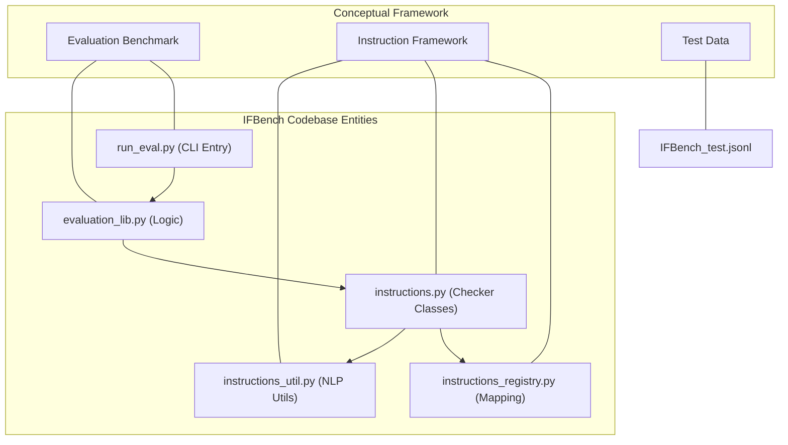
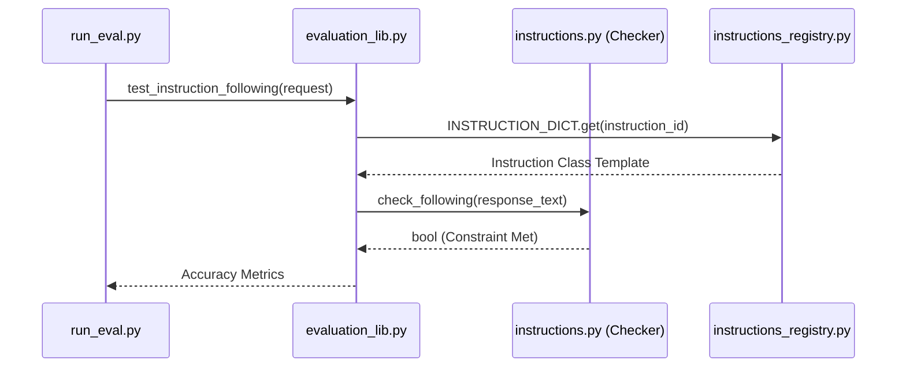

<!-- source: DeepWiki mcp.deepwiki.com · repo allenai/IFBench · page 1 IFBench Overview · fetched 2026-10-26 -->

# IFBench Overview

<details>
<summary>Relevant source files</summary>

The following files were used as context for generating this wiki page:

- [Precise_IF_Generalization_Abilities.pdf](Precise_IF_Generalization_Abilities.pdf)
- [README.md](README.md)

</details>


This document provides an introduction to IFBench, a benchmark system for evaluating and training precise instruction following capabilities in language models. IFBench offers a comprehensive framework for testing how well models can follow specific constraints in their generated text.

For information about the theoretical framework and the generalization gap findings, see [Research Foundation](#1.1). For a high-level overview of the software components and how they interact, see [System Architecture](#1.2).

## Purpose and Scope

IFBench is designed to address the challenge of precise instruction following in language models. It provides:

1.  A benchmark with 58 out-of-distribution (OOD) constraints for evaluation [README.md:9-9]().
2.  Multiturn constraint isolation testing capabilities [README.md:11-11]().
3.  A training methodology (IF-RLVR) with 29 specialized training constraints [README.md:13-13]().
4.  Programmatic verification functions for automated constraint checking [README.md:30-30]().

The system enables researchers and developers to rigorously test and improve language models' ability to follow specific instructions with high precision.

Sources: [README.md:3-13]()

## System Components

IFBench consists of several interconnected components that work together to provide a comprehensive evaluation and training framework.

### System Entity Map: Natural Language to Code
This diagram bridges the conceptual benchmark components to the specific files and scripts implemented in the codebase.



Sources: [README.md:15-20](), [README.md:30-31]()

## Evaluation Benchmark

The IFBench evaluation benchmark is the core component of the system, providing a rigorous testing framework for instruction following capabilities.

### OOD Constraints
IFBench includes 58 challenging out-of-distribution constraints [README.md:9-9](). These constraints are combined with prompts from a held-out set of WildChat (Zhao et al. 2024) to create diverse evaluation scenarios.

### Multiturn Constraint Isolation
IFBench optionally supports multiturn constraint isolation testing, where the prompt and the constraint are separated over two turns: the first turn is the user prompt and the model's response, and the second turn is the constraint that modifies the initial prompt [README.md:11-11]().

For details on the theoretical underpinnings and evaluation methodology, see [Research Foundation](#1.1).

Sources: [README.md:7-11]()

## Instruction Framework

The instruction framework is the backbone of IFBench, providing the programmatic implementation of constraints and verification functions.

### Verification Workflow: Code Execution
This diagram illustrates how the code entities interact to verify a model's response against specific instructions.



The framework consists of:
1.  **Instruction Classes**: Classes that implement logic for checking constraints [README.md:30-30]().
2.  **Instruction Registry**: Maps instruction IDs to their corresponding classes.
3.  **Text Processing Utilities**: Helper functions for text analysis and manipulation.

For details on the internal architecture of these classes, see [System Architecture](#1.2).

Sources: [README.md:7-8](), [README.md:30-30]()

## Training Methodology

IFBench includes IF-RLVR (Instruction Following - Reinforcement Learning from Verifiable Responses), a training methodology specifically designed for improving instruction following capabilities [README.md:27-28]().

### Training Constraints
The system provides 29 specialized training constraints with corresponding verification functions [README.md:13-13](). These are distinct from the 58 OOD evaluation constraints to test for generalization.

### Integration with open-instruct
The IF-RLVR training code is released as part of the [open-instruct](https://github.com/allenai/open-instruct) repository. It utilizes the `grpo_fast.py` script for training models on instruction following tasks [README.md:28-28]().

Sources: [README.md:12-31]()

## Getting Started

To get started with IFBench:

1.  Install the requirements via `requirements.txt` [README.md:16-16]().
2.  Prepare two JSONL files: `IFBench_test.jsonl` (test prompts) and your model's completions (e.g., `sample_output.jsonl`) [README.md:17-17]().
3.  Run the evaluation using the command-line interface:

```bash
python3 -m run_eval --input_data=IFBench_test.jsonl --input_response_data=sample_output.jsonl --output_dir=eval
```

Sources: [README.md:15-20]()

---

