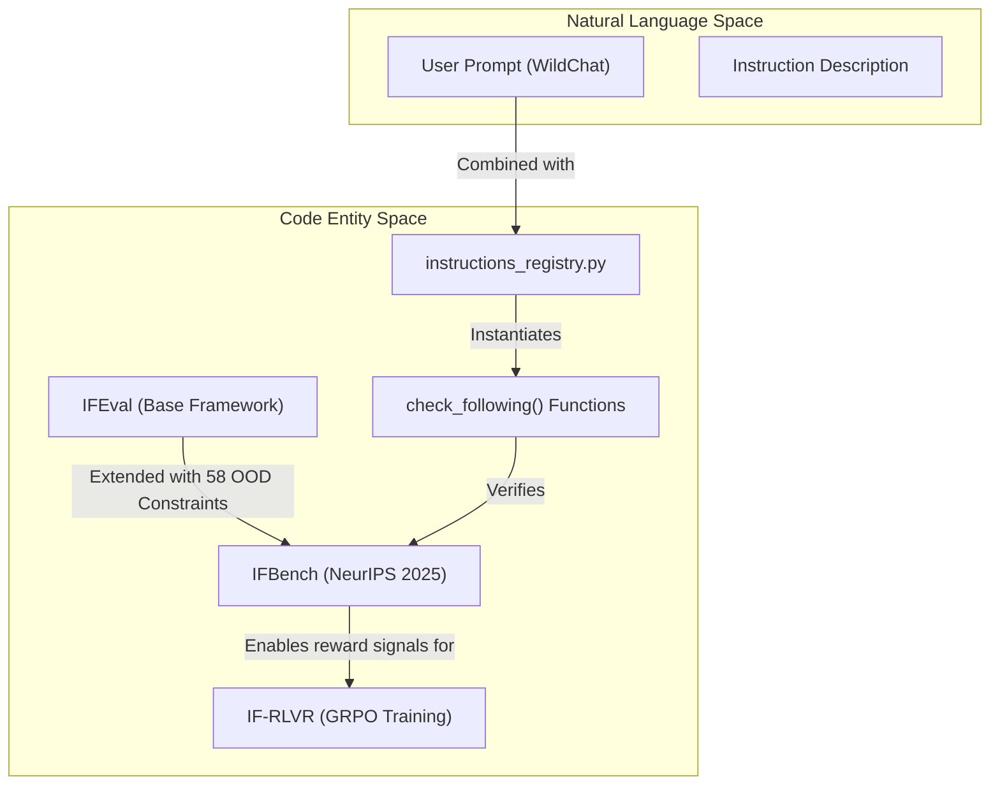
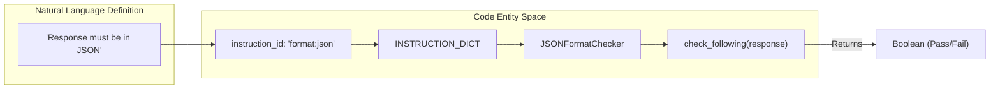

<!-- source: DeepWiki mcp.deepwiki.com · repo allenai/IFBench · page 1.1 Research Foundation · fetched 2026-10-26 -->

# Research Foundation

Relevant source files

The following files were used as context for generating this wiki page:

- [Precise_IF_Generalization_Abilities.pdf](Precise_IF_Generalization_Abilities.pdf)
- [README.md](README.md)

This document explains the theoretical framework and research behind instruction following generalization abilities in the IFBench system. It covers the core research concepts that form the foundation of the benchmark and training methodology, including the lineage from IFEval and the novel IF-RLVR framework.

## Research Background

IFBench builds upon and extends previous work in instruction following evaluation, particularly **IFEval** (Zhou et al. 2023) [README.md:61-61](). The benchmark was developed to address limitations in existing instruction following evaluation methods by creating more challenging constraints and focusing on **Out-of-Distribution (OOD)** generalization [README.md:9-9]().

The research focuses on precise instruction following generalization abilities, examining how language models can follow complex constraints that were not encountered during the training phase.

### Lineage and Evolution
The following diagram maps the conceptual transition from the original IFEval framework to the IFBench implementation, highlighting the shift toward verifiable RL training.

**Research Evolution: IFEval to IFBench**

Sources: [README.md:3-9](), [README.md:61-61]()

## Key Research Contributions

IFBench introduces several key research contributions to the field of instruction following evaluation:

1.  **OOD Constraints**: 58 new and challenging constraints with corresponding verification functions [README.md:9-9]().
2.  **Multiturn Constraint Isolation**: A methodology where the prompt and the constraint are separated over two turns to test the model's ability to modify existing output based on new constraints [README.md:11-12]().
3.  **IF-RLVR Training Methodology**: Reinforcement Learning from Verifiable Responses, which utilizes 29 specific training constraints to improve generalization to the 58 OOD test constraints [README.md:13-13](), [README.md:27-28]().

### The Generalization Gap
A core finding of the accompanying paper is the "Generalization Gap"—the difference in performance between instructions seen during training and those that are structurally or semantically distinct (OOD). IFBench measures this by ensuring the evaluation set contains 58 constraints that are held out from the 29 training constraints [README.md:9-13]().

## Constraint Framework and Verifiability

The research introduces a diverse set of constraint categories designed to be programmatically verifiable. This verifiability allows for precise, objective measurement of model performance without relying on subjective LLM-based grading.

| Category | Research Focus | Implementation Example |
| :--- | :--- | :--- |
| **Count** | Quantitative precision | `count_words`, `count_stopwords` |
| **Format** | Structural adherence | JSON, CSV, List formatting |
| **Linguistic** | Syntactic/Semantic constraints | No-pronouns, syllable counts, sentence structure |
| **Multiturn** | Contextual updates | Modifying turn 1 output in turn 2 |

### Bridging Constraints to Code Entities
The diagram below illustrates how a research-defined "Constraint" is transformed into a verifiable code object within the `IFBench` system.

**Constraint Instantiation Pipeline**

Sources: [README.md:9-13](), [README.md:30-31]()

## IF-RLVR: Training Methodology

The research introduces **IF-RLVR** (Reinforcement Learning from Verifiable Responses). This methodology integrates with the **open-instruct** repository and utilizes **GRPO** (Gradient-based Reinforcement Policy Optimization) [README.md:27-28]().

### The Reward Signal
In IF-RLVR, the "Reward" is derived directly from the verification functions. Instead of a human preference or an LLM judge, the system uses the `check_following` logic to provide a binary or scalar reward based on whether the model's response strictly adheres to the provided constraints.

*   **Training Data**: `IF_multi_constraints_upto5` dataset containing prompts with up to 5 simultaneous constraints [README.md:25-25]().
*   **Optimization**: Uses the `grpo_fast.py` script to optimize the model policy against the verifiable reward [README.md:28-28]().

## Research Findings and Performance

The research establishes a leaderboard that compares state-of-the-art models (e.g., OpenAI o3, DeepSeek R1) against base models fine-tuned with IF-RLVR.

*   **Key Finding**: Models trained with IF-RLVR (e.g., Qwen2.5 Base + IF-RLVR) show significant improvements in both IFEval and IFBench scores, often outperforming much larger instruct-tuned models [README.md:36-47]().
*   **Inference Strategy**: For "thinking models," the research suggests allowing more tokens and processing the output to extract the final answer from reasoning chains to ensure fair evaluation [README.md:22-22]().

Sources: [README.md:22-22](), [README.md:32-47](), [README.md:69-76]()

---

