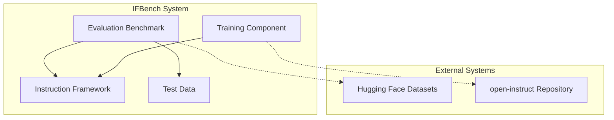
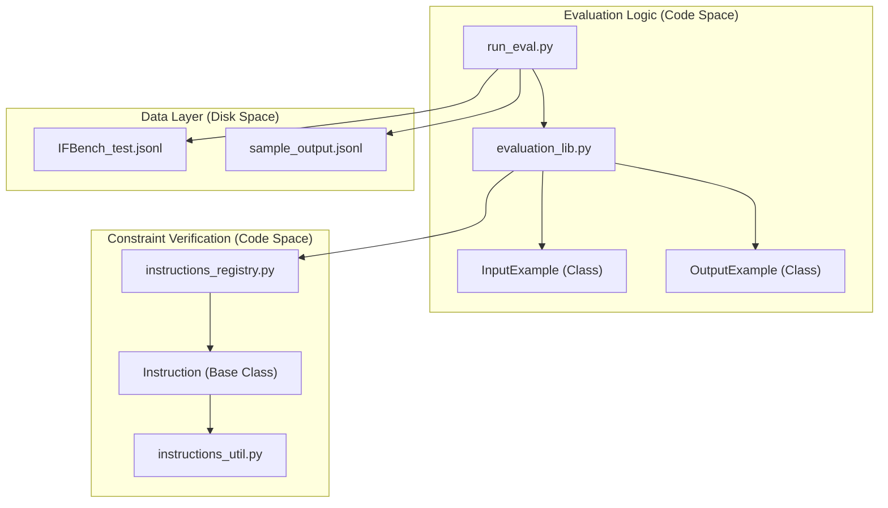
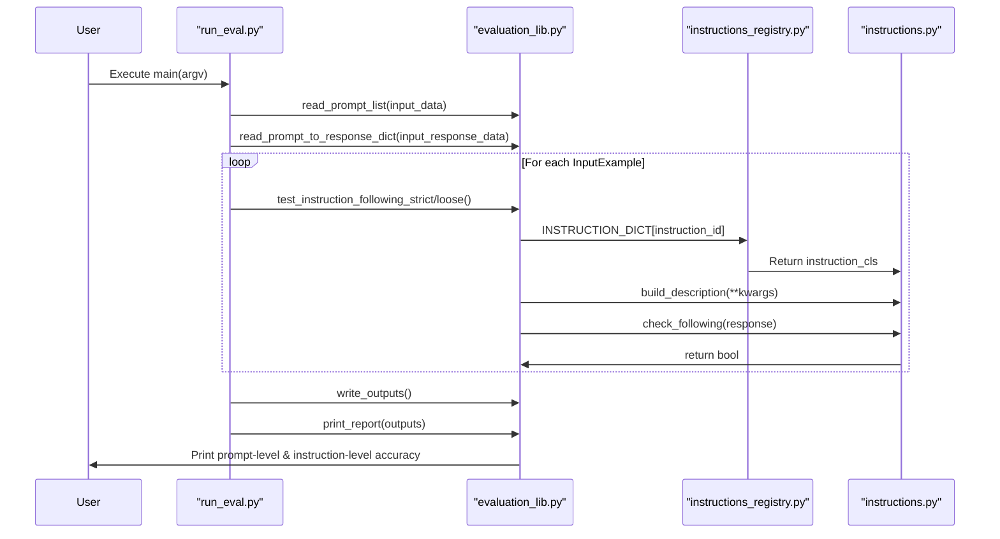
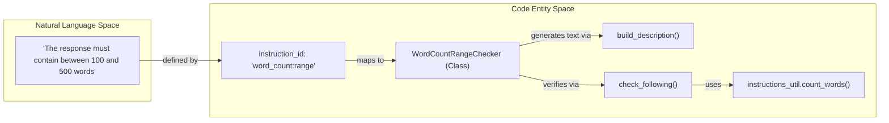
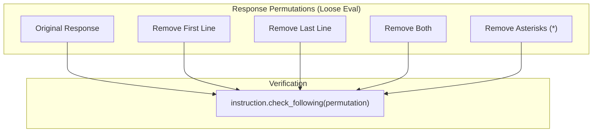

<!-- source: DeepWiki mcp.deepwiki.com · repo allenai/IFBench · page 1.2 System Architecture · fetched 2026-10-26 -->

# System Architecture

Relevant source files

The following files were used as context for generating this wiki page:

- [README.md](README.md)
- [evaluation_lib.py](evaluation_lib.py)
- [instructions.py](instructions.py)
- [run_eval.py](run_eval.py)

This document provides a high-level overview of the IFBench system architecture, its core components, and how they interact. It focuses on the structural organization of the codebase and the relationships between different modules, specifically bridging the natural language instruction space with the underlying code entities.

## Overview

IFBench is a benchmark system for evaluating precise instruction following capabilities in language models. The architecture consists of several interconnected components that work together to provide a comprehensive evaluation framework, ranging from data loading to verifiable constraint checking.

Sources: [README.md:6-14]()

## Core Components

IFBench consists of four primary components that work together to provide a comprehensive instruction following evaluation system:

1.  **Evaluation System**: Orchestrated by `run_eval.py` [run_eval.py:1-86]() and `evaluation_lib.py` [evaluation_lib.py:1-225](). It handles the execution flow, from reading JSONL files to computing final accuracy metrics.
2.  **Instruction Framework**: The logic layer defined in `instructions.py` [instructions.py:83-100]() and `instructions_registry.py`. It contains the `Instruction` base class and specific checker implementations like `WordCountRangeChecker` [instructions.py:104-148]().
3.  **Data Layer**: Managed via `InputExample` [evaluation_lib.py:27-32]() and `OutputExample` [evaluation_lib.py:35-41]() dataclasses. This layer ensures consistent data formatting between the WildChat-sourced prompts and the model responses.
4.  **Training Component (IF-RLVR)**: Integrates with the `open-instruct` repository to provide reward signals during Reinforcement Learning from Verifiable Responses (RLVR) [README.md:27-31]().

Sources: [run_eval.py:27-41](), [evaluation_lib.py:26-41](), [instructions.py:83-100](), [instructions_util.py:1-40]()

## Evaluation Pipeline

The evaluation pipeline is the central workflow in IFBench, responsible for processing test prompts, model responses, and generating evaluation results. It supports two main modes: `test_instruction_following_strict` [evaluation_lib.py:75-104]() and `test_instruction_following_loose` [evaluation_lib.py:107-167]().

Sources: [run_eval.py:43-82](), [evaluation_lib.py:75-167](), [evaluation_lib.py:179-225]()

## Instruction Framework Architecture

The framework bridges natural language constraints to programmatic verification. Every constraint (e.g., "Word Count") is mapped to a Python class that inherits from the `Instruction` base class [instructions.py:83-100]().

| Code Entity | Role | Key Functions |
| :--- | :--- | :--- |
| `Instruction` | Base Interface | `build_description`, `check_following` |
| `INSTRUCTION_DICT` | Registry | Maps `instruction_id` strings to classes |
| `instructions_util` | Utility Layer | `count_words`, `split_into_sentences` |

### Code Entity Mapping
The following diagram maps the logical concept of a "Constraint" to the specific classes and methods used in the codebase.

Sources: [instructions.py:83-148](), [evaluation_lib.py:84-88](), [instructions_util.py:1-40]()

## Key Data Structures

The evaluation system uses two primary data structures to manage the flow of information, defined as dataclasses in `evaluation_lib.py`:

1.  **InputExample**: Represents a test prompt with its associated instruction IDs and parameters [evaluation_lib.py:27-32]().
2.  **OutputExample**: Represents the evaluation results for a given prompt and response, including per-instruction boolean flags [evaluation_lib.py:35-41]().

| Data Structure | Fields | Purpose |
| :--- | :--- | :--- |
| `InputExample` | `key`, `instruction_id_list`, `prompt`, `kwargs` | Stores input test data with instruction parameters. |
| `OutputExample` | `instruction_id_list`, `prompt`, `response`, `follow_all_instructions`, `follow_instruction_list` | Stores evaluation results and model completion. |

Sources: [evaluation_lib.py:26-41]()

## Evaluation Methodologies

IFBench provides two evaluation methods to assess instruction following capabilities, implemented in `evaluation_lib.py`:

1.  **Strict Evaluation (`test_instruction_following_strict`)**: Directly checks if the raw model response follows each instruction exactly as specified [evaluation_lib.py:75-104]().
2.  **Loose Evaluation (`test_instruction_following_loose`)**: Provides an upper bound by trying multiple variations of the response (removing first/last lines, removing asterisks, etc.) to account for model formatting artifacts [evaluation_lib.py:107-167]().

Sources: [evaluation_lib.py:122-139](), [evaluation_lib.py:153-157]()

## External Integrations

IFBench is designed to work within a larger ecosystem for both evaluation and model training:

*   **Hugging Face Datasets**: Hosts the `IFBench_test`, `IFBench_multi-turn`, and `IF_multi_constraints_upto5` datasets [README.md:24-25]().
*   **open-instruct**: The training logic for IF-RLVR is integrated into the `open-instruct` repository, specifically using the `grpo_fast.py` script [README.md:27-31]().
*   **NLTK**: Used for text processing (tokenization, sentence splitting) with local data management in `.nltk_data` [instructions.py:25-32]().

Sources: [README.md:24-31](), [instructions.py:25-32]()

---

