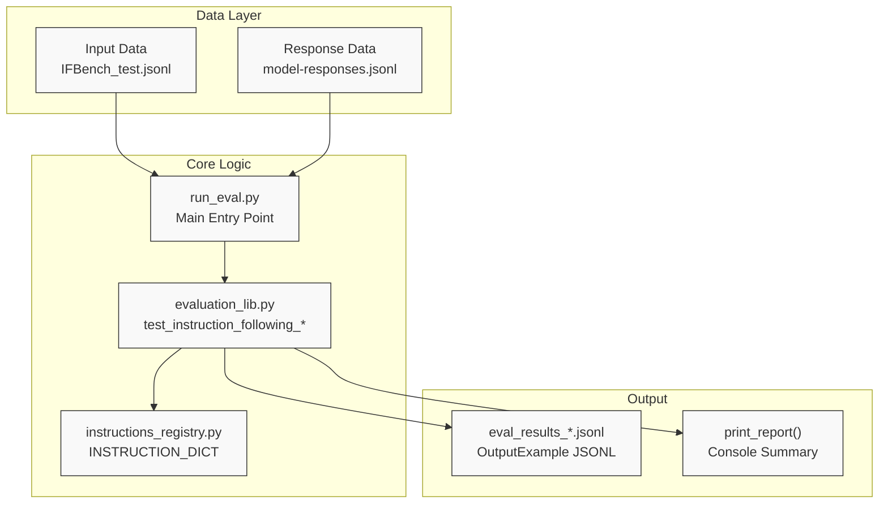
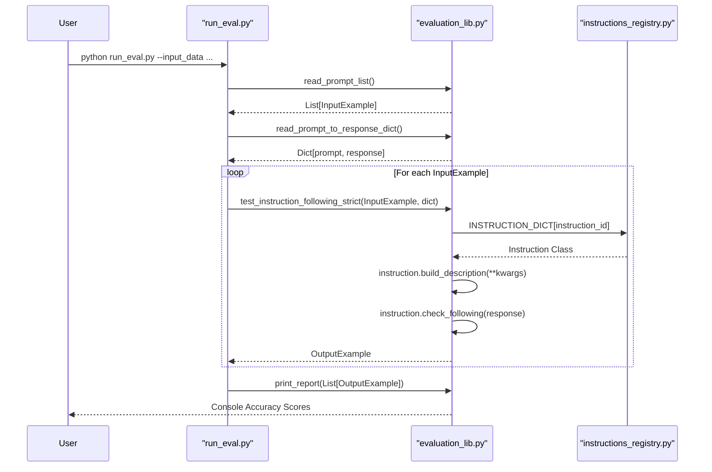

<!-- source: DeepWiki mcp.deepwiki.com · repo allenai/IFBench · page 2 Evaluation System · fetched 2026-10-26 -->

# Evaluation System

Relevant source files

The following files were used as context for generating this wiki page:

- [evaluation_lib.py](evaluation_lib.py)
- [run_eval.py](run_eval.py)

The IFBench Evaluation System is a comprehensive framework for assessing language models' ability to follow precise instructions. This system provides programmatic verification of 58 out-of-distribution (OOD) constraints, enabling both strict and loose evaluation methodologies.

For information about running evaluations via the command-line interface, see [Running Evaluations](#2.2). For details on the underlying instruction framework that defines constraints, see [Instruction Framework](#3).

## Overview

The IFBench Evaluation System measures how accurately language models follow specific instructions by comparing model responses against programmatically defined constraints. The system supports two evaluation modes:

1.  **Strict Evaluation**: Directly checks if responses meet constraints exactly as specified [evaluation_lib.py:75-104]().
2.  **Loose Evaluation**: Provides an upper bound by checking multiple variations of responses (e.g., removing leading/trailing lines or asterisks) [evaluation_lib.py:107-166]().

The evaluation system processes test prompts and model responses, verifies constraint adherence, and generates detailed accuracy reports at both prompt and instruction levels.

Sources: [run_eval.py:16-17](), [evaluation_lib.py:75-166]()

## System Architecture

The following diagram maps the logical components of the evaluation system to their corresponding code entities.

**Evaluation System Components**

The evaluation system consists of several key components:
- **Input Data**: Handled via `read_prompt_list` [evaluation_lib.py:43-54]().
- **Response Data**: Loaded into a lookup table via `read_prompt_to_response_dict` [evaluation_lib.py:169-176]().
- **Evaluation Logic**: Orchestrated by `run_eval.py` which iterates through inputs and calls verification functions [run_eval.py:52-62]().
- **Instruction Registry**: Used by `evaluation_lib.py` to dynamically instantiate constraint checkers [evaluation_lib.py:85-86]().

Sources: [run_eval.py:47-62](), [evaluation_lib.py:43-54](), [evaluation_lib.py:169-176](), [evaluation_lib.py:85-86]()

## Data Flow

The following sequence diagram illustrates how the system bridges the natural language space (prompts/responses) to the code entity space (Instruction classes).

**Evaluation Sequence**

Sources: [run_eval.py:43-85](), [evaluation_lib.py:75-104](), [evaluation_lib.py:107-166]()

## Data Structures

The system relies on two primary `dataclasses` defined in `evaluation_lib.py`.

### InputExample
Represents the raw test case loaded from the benchmark JSONL file [evaluation_lib.py:26-31]().
- `key`: Unique integer ID.
- `instruction_id_list`: List of constraint IDs (e.g., `["word_count:1"]`).
- `prompt`: The user query.
- `kwargs`: List of dictionaries containing arguments for the constraint checkers (e.g., `{"min_words": 10}`).

### OutputExample
Captures the result of the verification process [evaluation_lib.py:34-40]().
- `follow_all_instructions`: Boolean indicating if the model satisfied every constraint for the prompt.
- `follow_instruction_list`: A list of booleans mapping to each instruction in the `instruction_id_list`.

Sources: [evaluation_lib.py:26-41]()

## Evaluation Methods

The system implements two distinct methodologies for verification:

### Strict Evaluation
Implemented in `test_instruction_following_strict`, this method checks the model's raw response string against the constraints [evaluation_lib.py:75-104](). If the response is empty or fails the `check_following` logic of any instruction, it is marked as a failure [evaluation_lib.py:93-96]().

### Loose Evaluation
Implemented in `test_instruction_following_loose`, this method attempts to account for common LLM formatting "noise" [evaluation_lib.py:107-166](). It generates eight variations of the response by:
- Removing the first or last line (common for "Sure, here is..." headers) [evaluation_lib.py:122-125]().
- Removing asterisks used for bolding or bullet points [evaluation_lib.py:126-129]().
- Combinations of the above [evaluation_lib.py:130-139]().

If any variation satisfies the constraint, the instruction is marked as followed [evaluation_lib.py:153-156]().

Sources: [evaluation_lib.py:75-166]()

## Accuracy Reporting

The `print_report` function in `evaluation_lib.py` aggregates results into three tiers [evaluation_lib.py:179-220]():

1.  **Prompt-level Accuracy**: The percentage of prompts where `follow_all_instructions` is true [evaluation_lib.py:198-199]().
2.  **Instruction-level Accuracy**: The percentage of individual constraints satisfied across all prompts [evaluation_lib.py:201-202]().
3.  **Per-Instruction Breakdown**: Detailed accuracy for each constraint ID, allowing developers to identify specific categories (e.g., "word_count" vs "comma_number") where the model struggles [evaluation_lib.py:204-220]().

Sources: [evaluation_lib.py:179-220](), [run_eval.py:78-81]()

## Summary

The IFBench Evaluation System provides a robust, reproducible way to measure instruction following. By utilizing programmatic checkers defined in the [Instruction Framework](#3) and offering both strict and loose metrics, it allows for a nuanced understanding of model performance. For details on the evaluation process and metrics computation, see [Evaluation Pipeline](#2.1). To run these evaluations yourself, see [Running Evaluations](#2.2).

Sources: [run_eval.py:16-17](), [evaluation_lib.py:16-17]()

---

