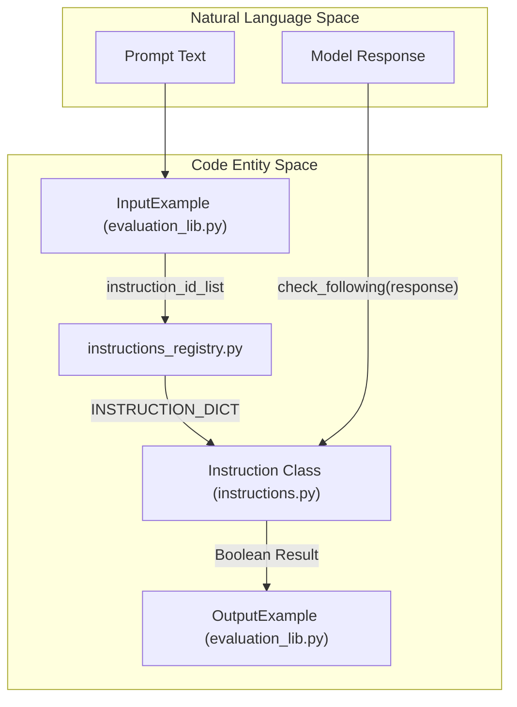
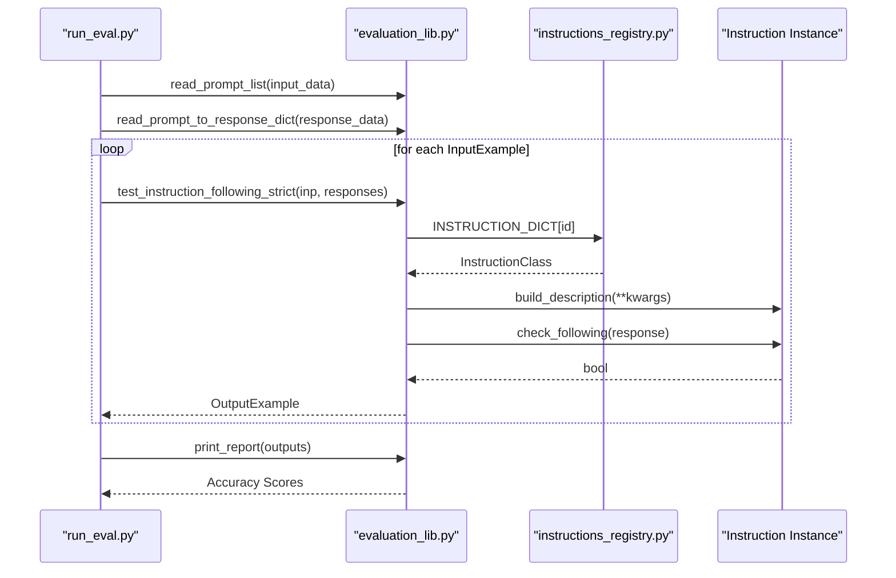

<!-- source: DeepWiki mcp.deepwiki.com · repo allenai/IFBench · page 2.1 Evaluation Pipeline · fetched 2026-10-26 -->

# Evaluation Pipeline

Relevant source files

The following files were used as context for generating this wiki page:

- [evaluation_lib.py](evaluation_lib.py)
- [run_eval.py](run_eval.py)

The evaluation pipeline is the core system responsible for assessing how well language models adhere to verifiable constraints. It processes model responses against test prompts, instantiates instruction checkers via a central registry, and computes multi-level accuracy metrics.

## Overview

The evaluation pipeline bridges the gap between raw model outputs and structured performance metrics. It supports two primary evaluation modes: **Strict**, which requires an exact match to constraints, and **Loose**, which accounts for common formatting artifacts (like markdown or conversational filler) to provide an upper bound on performance.

Sources: [evaluation_lib.py:26-41](), [evaluation_lib.py:75-104](), [instructions_registry.py:1-20]()

## Data Structures

The pipeline relies on two primary `dataclass` objects to manage the flow of information.

### InputExample
Defined in `evaluation_lib.py`, this class encapsulates the data required to perform an evaluation for a single prompt.
*   `key`: A unique integer identifier for the prompt.
*   `instruction_id_list`: A list of strings identifying which constraints apply to this prompt.
*   `prompt`: The actual text sent to the model.
*   `kwargs`: A list of dictionaries containing the specific parameters (e.g., word counts, specific keywords) for each instruction in the `instruction_id_list`.

### OutputExample
This class stores the results of the evaluation process.
*   `instruction_id_list`: The original list of instruction IDs.
*   `prompt`: The original prompt text.
*   `response`: The model's generated text.
*   `follow_all_instructions`: A boolean indicating if every constraint was satisfied (Prompt-level accuracy).
*   `follow_instruction_list`: A list of booleans representing the pass/fail state for each individual instruction (Instruction-level accuracy).

Sources: [evaluation_lib.py:26-41]()

## Evaluation Methodologies

The pipeline implements two distinct logic paths for verification, handled by `test_instruction_following_strict` and `test_instruction_following_loose`.

### Strict Evaluation
`test_instruction_following_strict` performs a direct check on the raw model response.
1.  It iterates through the `instruction_id_list` [evaluation_lib.py:84]().
2.  It retrieves the corresponding class from `instructions_registry.INSTRUCTION_DICT` [evaluation_lib.py:85]().
3.  It instantiates the class and calls `build_description` with the provided `kwargs` [evaluation_lib.py:88]().
4.  It executes `instruction.check_following(response)` [evaluation_lib.py:93]().

### Loose Evaluation
`test_instruction_following_loose` is designed to be more permissive. It generates eight variations of the model's response to ignore common "noise" that doesn't affect the core instruction following [evaluation_lib.py:122-139]():
*   Removing the first line, last line, or both (to ignore conversational "Sure, here is..." or "Hope this helps").
*   Removing markdown characters like asterisks (`*`).
*   Combinations of the above.

An instruction is marked as followed if **any** of these variations satisfy the `check_following` criteria [evaluation_lib.py:153-156]().

Sources: [evaluation_lib.py:75-104](), [evaluation_lib.py:107-166]()

## Metrics and Accuracy Computation

The `print_report` function in `evaluation_lib.py` calculates the benchmark's primary KPIs.

| Metric | Definition | Calculation Logic |
| :--- | :--- | :--- |
| **Prompt-level Accuracy** | Percentage of prompts where every constraint was met. | `sum(follow_all_instructions) / total_prompts` [evaluation_lib.py:197-199]() |
| **Instruction-level Accuracy** | Percentage of total individual constraints satisfied. | `sum(all_individual_bools) / total_constraints` [evaluation_lib.py:201-202]() |

### Tiered Reporting
The pipeline further breaks down accuracy into two tiers:
*   **Tier 0**: Aggregated by the base instruction type (e.g., all "word_count" variants) [evaluation_lib.py:207-210]().
*   **Tier 1**: Specific to the full instruction ID including parameters [evaluation_lib.py:215-217]().

Sources: [evaluation_lib.py:179-220]()

## Data Flow Diagram

The following diagram illustrates the execution flow from the CLI entry point through the library functions.

Sources: [run_eval.py:47-62](), [evaluation_lib.py:75-104](), [evaluation_lib.py:179-220]()

## Implementation Details

### Instruction Instantiation
The pipeline uses dynamic dispatch to load instruction checkers. The registry maps a string ID (e.g., `punctuation:no_comma`) to a Python class. 
1.  The class is instantiated with its ID: `instruction = instruction_cls(instruction_id)` [evaluation_lib.py:86]().
2.  If the instruction requires context from the prompt itself (determined by checking `get_instruction_args`), the pipeline re-runs `build_description` with the prompt text [evaluation_lib.py:89-91]().

### Results Persistence
Results are saved to JSONL files using `write_outputs`. This function uses Python's `dir()` and `__getattribute__` to serialize all non-private attributes of the `OutputExample` objects into a JSON format [evaluation_lib.py:57-72]().

Sources: [evaluation_lib.py:57-72](), [evaluation_lib.py:84-91]()

---

