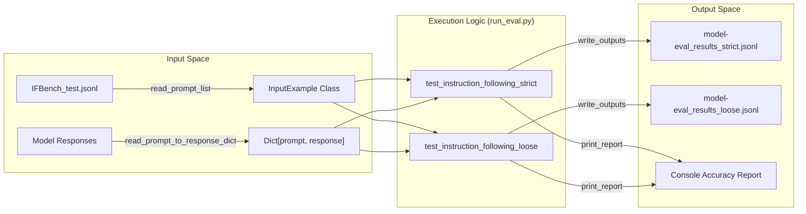
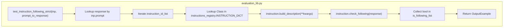

<!-- source: DeepWiki mcp.deepwiki.com · repo allenai/IFBench · page 2.2 Running Evaluations · fetched 2026-10-26 -->

# Running Evaluations

<details>
<summary>Relevant source files</summary>

The following files were used as context for generating this wiki page:

- [data/IFBench_test.jsonl](data/IFBench_test.jsonl)
- [eval/eval_results_loose.jsonl](eval/eval_results_loose.jsonl)
- [eval/eval_results_strict.jsonl](eval/eval_results_strict.jsonl)
- [evaluation_lib.py](evaluation_lib.py)
- [run_eval.py](run_eval.py)

</details>


This document provides detailed instructions on how to run evaluations using the IFBench evaluation system. It covers the command-line interface, required input files, output formats, and evaluation modes.

## Overview of the Evaluation Process

The IFBench evaluation system measures how well language models follow precise instructions. The evaluation process requires two key inputs:
1. A dataset of test prompts with instruction constraints (e.g., `IFBench_test.jsonl`).
2. Model responses to these prompts (e.g., `sample_output.jsonl`).

The system then evaluates whether the model responses adhere to the specified constraints and produces detailed results.

### Evaluation Data Flow

The following diagram bridges the Natural Language requirements to the internal `evaluation_lib.py` logic.



Sources: [run_eval.py:43-82](), [evaluation_lib.py:27-41]()

## Command-Line Interface

The evaluation is run through the `run_eval.py` script, which uses `absl.flags` for configuration.

### Basic Command
```bash
python3 run_eval.py --input_data=data/IFBench_test.jsonl --input_response_data=sample_output.jsonl --output_dir=eval_results
```

### Flag Descriptions

| Flag | Description | Code Reference |
|----------|-------------|----------|
| `--input_data` | Path to the test prompts file (JSONL format containing `instruction_id_list` and `kwargs`). | [run_eval.py:27-29]() |
| `--input_response_data` | Path to the model responses file (JSONL format containing `prompt` and `response`). | [run_eval.py:31-33]() |
| `--output_dir` | Directory where evaluation results and JSONL reports will be saved. | [run_eval.py:35-40]() |

Sources: [run_eval.py:27-41]()

## Expected Input/Output Formats

### Input Formats
1.  **Test Data (`InputExample`)**: A JSONL where each line matches the `InputExample` dataclass: `key`, `instruction_id_list`, `prompt`, and `kwargs` [evaluation_lib.py:27-32]().
2.  **Response Data**: A JSONL containing at minimum the `prompt` (used as a key for lookup) and the `response` string [evaluation_lib.py:169-176]().

### Output Formats (`OutputExample`)
The evaluation produces `OutputExample` objects [evaluation_lib.py:35-41](), which are serialized to JSONL. Key fields include:
*   `follow_all_instructions`: Boolean indicating if every constraint in the prompt was met.
*   `follow_instruction_list`: A list of booleans corresponding to each individual instruction ID.

Sources: [evaluation_lib.py:27-41](), [evaluation_lib.py:169-176]()

## Evaluation Methodologies

The script executes two evaluation passes for every input:

### Strict Evaluation
Implemented in `test_instruction_following_strict` [evaluation_lib.py:75-104](). It checks the raw response against the constraint checkers. If the response is empty or whitespace, it fails by default [evaluation_lib.py:93-96]().

### Loose Evaluation
Implemented in `test_instruction_following_loose` [evaluation_lib.py:107-166](). This methodology provides an upper bound by testing multiple permutations of the response to account for common formatting artifacts. It checks:
*   The original response.
*   The response with the first line, last line, or both removed [evaluation_lib.py:122-125]().
*   Versions of the above with markdown bolding (`*`) removed [evaluation_lib.py:126-129]().

### Internal Evaluation Logic



Sources: [evaluation_lib.py:75-104](), [evaluation_lib.py:107-166]()

## Interpreting the Accuracy Report

After processing all examples, `run_eval.py` calls `evaluation_lib.print_report(outputs)` [run_eval.py:81](). This function calculates and prints several metrics:

1.  **Prompt-level Accuracy**: The ratio of prompts where `follow_all_instructions` is true [evaluation_lib.py:219]().
2.  **Instruction-level Accuracy**: The ratio of individual constraints followed across all prompts [evaluation_lib.py:220]().
3.  **Tiered Breakdown**:
    *   **Tier 0**: Accuracy grouped by the base instruction category (e.g., `count`, `format`) [evaluation_lib.py:207-210]().
    *   **Tier 1**: Accuracy grouped by specific instruction IDs (e.g., `count:keywords_multiple`) [evaluation_lib.py:212-217]().

The output filenames are derived from the model response filename to allow for easy comparison between different model runs [run_eval.py:64-70]().

Sources: [run_eval.py:60-82](), [evaluation_lib.py:179-220]()

---

