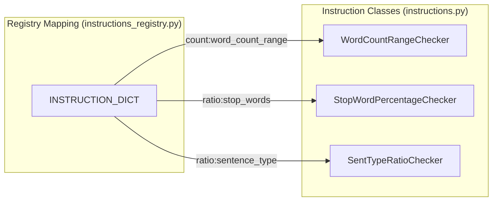
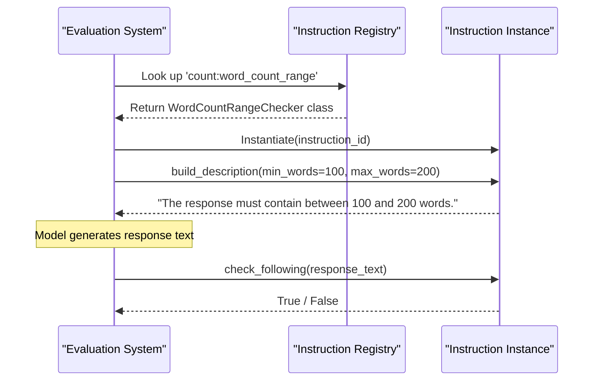

<!-- source: DeepWiki mcp.deepwiki.com · repo allenai/IFBench · page 3 Instruction Framework · fetched 2026-10-26 -->

# Instruction Framework

<details>
<summary>Relevant source files</summary>

The following files were used as context for generating this wiki page:

- [instructions.py](instructions.py)
- [instructions_registry.py](instructions_registry.py)
- [requirements.txt](requirements.txt)

</details>


The Instruction Framework is the core system within IFBench that defines, manages, and verifies instruction-following constraints. It provides a standardized way to specify constraints for language model outputs and programmatically verify whether responses adhere to these constraints.

For information about running evaluations using this framework, see [Evaluation Pipeline](#2.1). For details on the specific instruction classes and their capabilities, see [Instruction Classes](#3.1).

## Overview

The Instruction Framework consists of three main components:

1. A base `Instruction` class that defines the interface for all instruction types.
2. Specialized instruction checker classes that implement specific constraints (e.g., `WordCountRangeChecker`, `UniqueWordCountChecker`).
3. An instruction registry (`INSTRUCTION_DICT`) that maps instruction IDs to their corresponding classes.

Together, these components enable the definition of precise constraints on model outputs and provide mechanisms to verify compliance with these constraints.

### System Components and Code Mapping
The following diagram bridges the Natural Language requirements to the specific code entities responsible for verification.

```mermaid
graph TD
    subgraph "Natural Language Space"
        ID["Instruction ID<br/>'count:word_count_range'"]
        DESC["Description Pattern<br/>'The response must contain between {min} and {max} words.'"]
    end

    subgraph "Code Entity Space"
        Registry["INSTRUCTION_DICT<br/>(instructions_registry.py)"]
        Base["Instruction Base Class<br/>(instructions.py)"]
        Checker["WordCountRangeChecker<br/>(instructions.py)"]
        Util["instructions_util.py<br/>(Text Processing)"]
    end

    ID -->|Lookup| Registry
    Registry -->|Maps to| Checker
    Checker --|>|Inherits| Base
    Checker -->|Uses| Util
    Checker -->|Generates| DESC
```
Sources: [instructions.py:83-100](), [instructions_registry.py:20-79](), [instructions_util.py:1-20]()

## Instruction Base Class

The foundation of the framework is the `Instruction` class [instructions.py:83-100](), which defines the lifecycle and interface that all instruction checkers must implement:

1.  `build_description(**kwargs)`: Constructs the natural language instruction text based on provided parameters [instructions.py:89-90]().
2.  `get_instruction_args()`: Returns the parameters used to build the instruction [instructions.py:92-93]().
3.  `get_instruction_args_keys()`: Returns the parameter names accepted by the instruction [instructions.py:95-96]().
4.  `check_following(value)`: Verifies if a given response string follows the instruction [instructions.py:98-99]().

For details on implementation patterns, see [Instruction Classes](#3.1).

## Instruction Categories

The framework includes over 70 different instruction types organized into several categories in the registry. These categories define the namespace for `instruction_id` strings.

| Category | Description | Example ID |
| :--- | :--- | :--- |
| `count` | Numerical constraints on words, numbers, or entities. | `count:word_count_range` |
| `ratio` | Percentage or balance constraints (e.g., stop words, sentence types). | `ratio:stop_words` |
| `words` | Constraints on specific word properties (vowels, syllables, positions). | `words:prime_lengths` |
| `format` | Structural requirements (indentation, quotes, bullet points). | `format:line_indent` |
| `sentence` | Sentence-level constraints (alliteration, keywords). | `sentence:increment` |
| `custom` | Complex logic tasks (reversal, CSV generation, sorting). | `custom:european_capitals_sort` |

Sources: [instructions_registry.py:20-79]()

## Instruction Registry

The instruction registry maps string identifiers to their corresponding instruction classes. This allows the evaluation system to perform dynamic dispatch based on the `instruction_id` found in the test data.



The registry is implemented as a dictionary in `instructions_registry.py` [instructions_registry.py:20-79](), mapping string identifiers to class references defined in `instructions.py`.

For details on the namespace convention, see [Instruction Registry](#3.2).

## Instruction Lifecycle

The typical lifecycle of an instruction in the IFBench system follows these steps:



Sources: [instructions.py:104-147](), [instructions_registry.py:20-21]()

## Text Processing Utilities

Instruction checkers rely on a centralized suite of text processing functions in `instructions_util.py`. These utilities ensure consistent tokenization, sentence splitting, and linguistic analysis across different constraints.

Key utilities include:
*   `count_words(text)`: Standardized word counting [instructions_util.py:112-114]().
*   `split_into_sentences(text)`: NLTK-based sentence segmentation [instructions_util.py:86-88]().
*   `count_stopwords(text)`: Identifying stop words based on the `WORD_LIST` [instructions_util.py:123-125]().

For details on the utility library, see [Text Processing Utilities](#3.3).

## Summary

The Instruction Framework provides a modular architecture for verifiable constraints. By separating the instruction definition (registry), logic (classes), and processing (utilities), IFBench can scale to complex Out-of-Distribution (OOD) constraints while maintaining a unified interface for both evaluation and RLVR training.

---

