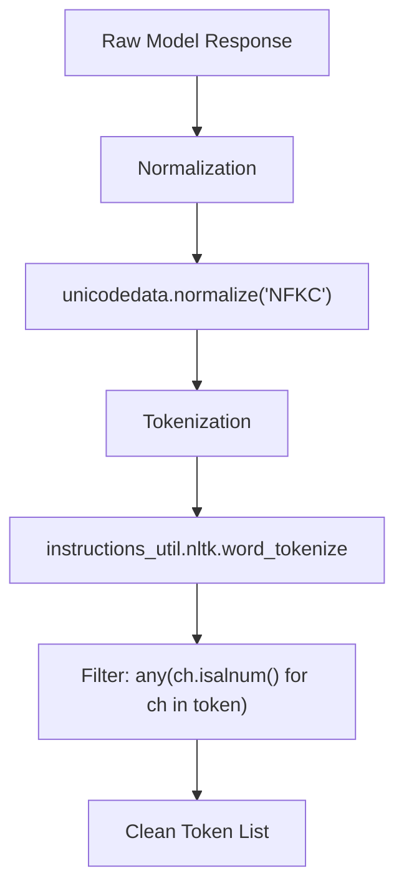
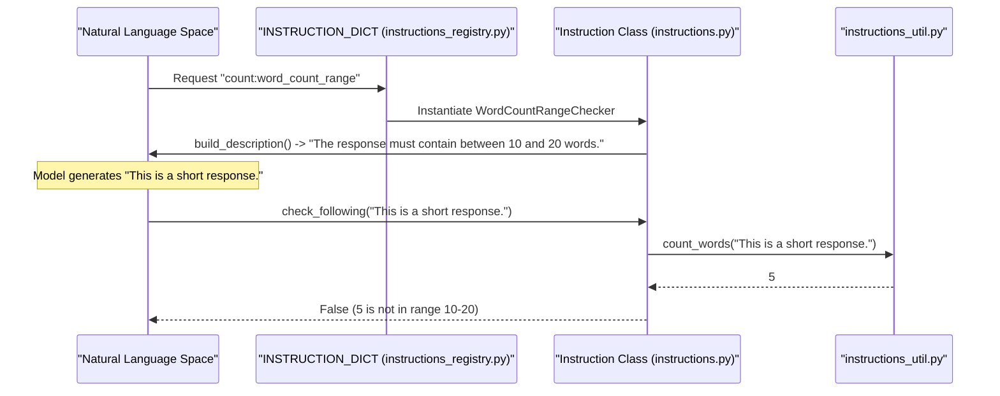

<!-- source: DeepWiki mcp.deepwiki.com · repo allenai/IFBench · page 3.1 Instruction Classes · fetched 2026-10-26 -->

# Instruction Classes

<details>
<summary>Relevant source files</summary>

The following files were used as context for generating this wiki page:

- [instructions.py](instructions.py)
- [instructions_test.py](instructions_test.py)

</details>


This page documents the instruction classes in the IFBench system, which are responsible for defining and checking constraints for instruction following evaluation. These classes form the core of the constraint verification system used to assess model responses against specific requirements.

For information about how these instruction classes are registered and accessed, see [Instruction Registry](3.2). For details on the evaluation process that uses these classes, see [Evaluation Pipeline](2.1).

## Overview of the Instruction Framework

The instruction framework provides a structured way to define constraints and verify if model responses adhere to these constraints. Each instruction class represents a specific type of constraint (such as word count, formatting requirements, or content specifications) and contains logic to check if a response follows that constraint.

### Instruction Class Hierarchy
The system uses an object-oriented approach where a base `Instruction` class defines the interface for all specific checkers.

```mermaid
classDiagram
    class "Instruction" {
        <<Abstract>>
        +id: string
        +build_description(**kwargs): string
        +get_instruction_args(): dict
        +get_instruction_args_keys(): list
        +check_following(value): bool
    }
    
    class "WordCountRangeChecker" {
        +check_following(value): bool
    }
    
    class "UniqueWordCountChecker" {
        +check_following(value): bool
    }
    
    class "SentTypeRatioChecker" {
        +check_following(value): bool
    }

    class "NumbersCountChecker" {
        +check_following(value): bool
    }
    
    "Instruction" <|-- "WordCountRangeChecker"
    "Instruction" <|-- "UniqueWordCountChecker"
    "Instruction" <|-- "SentTypeRatioChecker"
    "Instruction" <|-- "NumbersCountChecker"
    "Instruction" <|-- "StopWordPercentageChecker"
    "Instruction" <|-- "PersonNameCountChecker"
    "Instruction" <|-- "AlphabetLoopChecker"
    "Instruction" <|-- "NestedParenthesesChecker"
    "Instruction" <|-- "CityCSVChecker"
```

Sources: [instructions.py:83-100](), [instructions.py:104-148](), [instructions.py:149-188](), [instructions.py:213-237]()

## Base Instruction Class

All instruction classes inherit from the base `Instruction` class, which defines the lifecycle for instruction generation and verification.

The base `Instruction` class defines four key methods:

1. `build_description(**kwargs)`: Constructs the instruction text that will be presented to the model. If arguments are missing, it often generates random valid values within specified limits (e.g., `_NUM_WORDS_LOWER_LIMIT`).
2. `get_instruction_args()`: Returns the arguments used to build the instruction instance.
3. `get_instruction_args_keys()`: Returns the keys of the arguments for serialization.
4. `check_following(value)`: The core verification logic. It returns a boolean indicating if the `value` (model response) satisfies the constraint.

Sources: [instructions.py:83-100](), [instructions.py:107-133]()

## Instruction Categories

The instruction classes are organized into several categories based on the type of constraint they enforce:

### Count Constraints
These checkers focus on the frequency of specific linguistic or structural elements.

| Class | Description | Implementation Detail |
|-------|-------------|-----------------------|
| `WordCountRangeChecker` | Response length in words must be between X and Y. | Uses `instructions_util.count_words`. |
| `UniqueWordCountChecker` | At least N unique words must be present. | Normalizes words to lowercase and strips punctuation. |
| `NumbersCountChecker` | Exactly N numbers must appear in the text. | Uses regex `r"\d+(?:,\d+)*(?:\.\d+)?"` to find numbers. |
| `PronounCountChecker` | At least N pronouns must be used. | Matches tokens against a hardcoded list of pronouns. |
| `PersonNameCountChecker` | Mentions at least N different person names. | Uses Spacy `en_core_web_sm` for NER (PERSON tag). |

Sources: [instructions.py:143-147](), [instructions.py:180-188](), [instructions.py:1414-1430](), [instructions.py:1078-1117](), [instructions.py:310-389]()

### Ratio and Proportion Constraints
These checkers evaluate the relative frequency of elements.

| Class | Description | Implementation Detail |
|-------|-------------|-----------------------|
| `StopWordPercentageChecker` | Stop words must be ≤ percentage% of total words. | Uses `instructions_util.count_stopwords`. |
| `SentTypeRatioChecker` | 2:1 ratio of declarative to interrogative sentences. | Uses `nltk.pos_tag` and punctuation analysis. |
| `SentBalanceChecker` | Equal distribution of sentence types. | Checks counts of '.', '?', and '!'. |
| `NGramOverlapChecker` | Specific percentage of trigram overlap with reference. | Uses `nltk.util.ngrams` with `n=3`. |

Sources: [instructions.py:219-228](), [instructions.py:213-237](), [instructions.py:240-265](), [instructions.py:391-428]()

### Formatting and Structural Constraints
These checkers verify the visual or syntactic structure of the response.

| Class | Description | Implementation Detail |
|-------|-------------|-----------------------|
| `NestedParenthesesChecker` | Parentheses nested at least 5 levels deep. | Implements a stack-based counter. |
| `NewLineWordsChecker` | Each word must be on its own line. | Checks if `len(value.splitlines())` equals word count. |
| `EmojiSentenceChecker` | Every sentence must end with an emoji. | Uses the `emoji` library to check the last character. |
| `CityCSVChecker` | Data must be in CSV format with specific headers. | Uses `io.StringIO` and `csv.DictReader`. |

Sources: [instructions.py:658-701](), [instructions.py:821-843](), [instructions.py:846-880](), [instructions.py:1716-1746]()

## Internal Architecture Patterns

### Text Normalization and Tokenization
The checkers rely on consistent text processing to ensure fair evaluation. A common pattern is the use of `_word_tokens_without_punctuation`, which filters out standalone punctuation tokens during word-based checks.



Sources: [instructions.py:43-49](), [instructions.py:35]()

### Data Flow: Natural Language to Code Entity
The evaluation system bridges the gap between natural language prompts and programmatic verification through the `Instruction` lifecycle.



Sources: [instructions.py:104-148](), [instructions_registry.py:35-40](), [instructions_util.py:61-64]()

## Implementation Example: `NumbersCountChecker`

The `NumbersCountChecker` demonstrates how the system uses regular expressions to enforce precise constraints.

1.  **Description Building**: It takes a parameter `N` and formats the string `"Your response should contain exactly {N} numbers."` [instructions.py:1391-1412]().
2.  **Verification**: It uses `re.findall` with a pattern that handles commas and decimals to identify all numeric instances in the response [instructions.py:1425-1430]().

```python
# From instructions.py
def check_following(self, value):
    # Regex to find numbers including decimals and commas
    numbers = re.findall(r"\d+(?:,\d+)*(?:\.\d+)?", value)
    return len(numbers) == self._num_numbers
```

Sources: [instructions.py:1414-1430]()

## Conclusion

The `Instruction` classes provide a robust, modular framework for verifiable evaluation. By abstracting the logic of "following an instruction" into discrete classes with standardized `build_description` and `check_following` methods, IFBench can scale to dozens of diverse OOD (Out-of-Distribution) constraints.

Sources: [instructions.py:15-83](), [instructions_test.py:36-150]()

---

