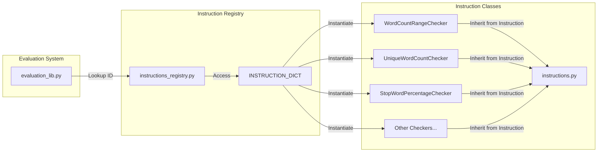
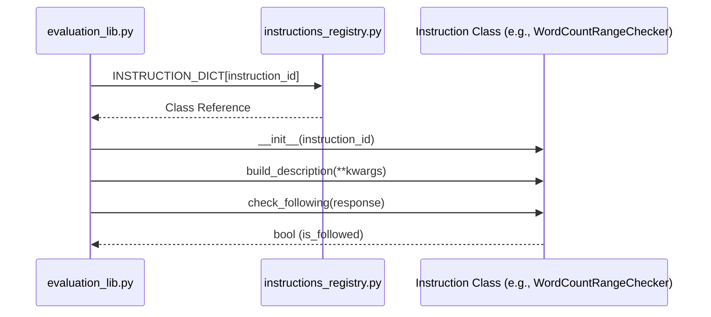

<!-- source: DeepWiki mcp.deepwiki.com · repo allenai/IFBench · page 3.2 Instruction Registry · fetched 2026-10-26 -->

# Instruction Registry

<details>
<summary>Relevant source files</summary>

The following files were used as context for generating this wiki page:

- [evaluation_lib.py](evaluation_lib.py)
- [instructions_registry.py](instructions_registry.py)
- [requirements.txt](requirements.txt)

</details>


The Instruction Registry is a central component of the IFBench framework that maps instruction identifiers to their corresponding instruction class implementations. This page documents how the registry works, its structure, and how it connects instruction IDs to the classes that implement constraint checking logic.

## Overview

The Instruction Registry serves as a lookup table that translates string-based instruction identifiers into concrete Python class implementations. This mapping enables the evaluation system to dynamically instantiate the appropriate instruction checker based on the constraint type specified in test prompts.

### Registry Architecture and Flow
The following diagram illustrates how `evaluation_lib.py` utilizes `instructions_registry.py` to bridge the gap between JSON-based instruction IDs and the class logic in `instructions.py`.


Sources: [instructions_registry.py:15-20](), [evaluation_lib.py:84-86](), [instructions_registry.py:20-79]()

## Registry Structure

The registry is implemented as a Python dictionary named `INSTRUCTION_DICT` in [instructions_registry.py:20](), which maps string identifiers to instruction class implementations. Each identifier follows a categorical naming pattern that helps organize the different types of constraints.

### Identifier Format

Instruction identifiers follow a consistent format of `category:specific_constraint`, where:

- `category` - Represents the broad type of constraint (e.g., `count`, `format`, `words`).
- `specific_constraint` - Describes the specific constraint being applied.

For example, `count:word_count_range` maps to the `WordCountRangeChecker` class [instructions_registry.py:21]().

### Categorical Organization
The registry organizes 58 distinct checkers into namespaces.

```mermaid
classDiagram
    class INSTRUCTION_DICT {
        +String key
        +Class value
    }
    
    class InstructionCategories {
        +count
        +ratio
        +words
        +sentence
        +format
        +custom
        +repeat
    }
    
    class CountConstraints {
        +word_count_range
        +unique_word_count
        +conjunctions
        +person_names
        +numbers
        +pronouns
        +keywords_multiple
    }
    
    class FormatConstraints {
        +parentheses
        +quotes
        +newline
        +emoji
        +line_indent
        +list
        +thesis
        +title_case
        +output_template
        +no_whitespace
    }
    
    INSTRUCTION_DICT ..> InstructionCategories : "Keys follow namespace"
    InstructionCategories ..> CountConstraints : "Prefix: count"
    InstructionCategories ..> FormatConstraints : "Prefix: format"
```
Sources: [instructions_registry.py:20-79]()

## Registry Contents

The registry contains mappings for all instruction types supported by IFBench. These are broadly categorized as follows:

| Category | Description | Example Identifiers |
|----------|-------------|---------------------|
| `count` | Constraints related to counting elements | `count:word_count_range`, `count:unique_word_count`, `count:pronouns` |
| `ratio` | Constraints involving proportions or relationships | `ratio:stop_words`, `ratio:sentence_type`, `ratio:overlap` |
| `words` | Constraints on word properties or patterns | `words:alphabet`, `words:vowel`, `words:prime_lengths` |
| `sentence` | Constraints on sentence structure | `sentence:alliteration_increment`, `sentence:keyword`, `sentence:increment` |
| `format` | Constraints on text formatting | `format:parentheses`, `format:quotes`, `format:newline` |
| `custom` | Specialized or complex constraints | `custom:multiples`, `custom:word_reverse`, `custom:csv_city` |
| `repeat` | Constraints involving repetition patterns | `repeat:repeat_change`, `repeat:repeat_simple`, `repeat:repeat_span` |

Sources: [instructions_registry.py:20-79]()

## Dynamic Dispatch in evaluation_lib

The instruction registry is the primary mechanism for dynamic dispatch in the evaluation pipeline. Functions like `test_instruction_following_strict` use the registry to convert metadata from `InputExample` into executable objects.

### Evaluation Sequence
The lifecycle of an instruction object during evaluation is as follows:

1.  **Lookup**: The `instruction_id` is used as a key in `INSTRUCTION_DICT` [evaluation_lib.py:85]().
2.  **Instantiation**: The retrieved class is instantiated with the `instruction_id` [evaluation_lib.py:86]().
3.  **Configuration**: Parameters from the `InputExample.kwargs` are passed to `build_description` [evaluation_lib.py:88]().
4.  **Verification**: The model response is passed to `check_following(response)` [evaluation_lib.py:93]().


Sources: [evaluation_lib.py:84-96](), [instructions_registry.py:20-21]()

## Implementation Details

The registry is implemented as a simple Python dictionary in [instructions_registry.py](). Each key in the dictionary is a string identifier, and each value is a reference to a class that inherits from the base `Instruction` class defined in `instructions.py`.

```python
# Simplified view of instructions_registry.py
INSTRUCTION_DICT = {
    "count:word_count_range": instructions.WordCountRangeChecker,
    "count:unique_word_count": instructions.UniqueWordCountChecker,
    "ratio:stop_words": instructions.StopWordPercentageChecker,
    # ... 55 more entries ...
    "format:no_whitespace": instructions.NoWhitespaceChecker,
}
```
Sources: [instructions_registry.py:20-79]()

### Relationship to Tier Reporting
During the reporting phase in `print_report`, the colon-delimited format of the registry keys is used to aggregate metrics. `instruction_id.split(":")[0]` is used to calculate "Tier 0" (category-level) accuracy, while the full ID is used for "Tier 1" (specific-instruction) accuracy [evaluation_lib.py:207-217]().

Sources: [evaluation_lib.py:207-217]()

---

