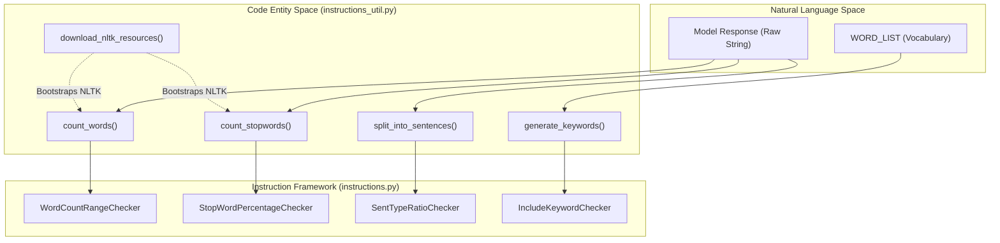
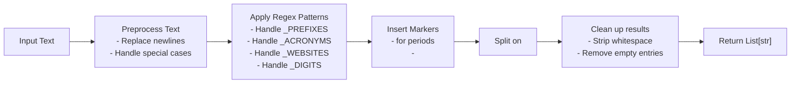
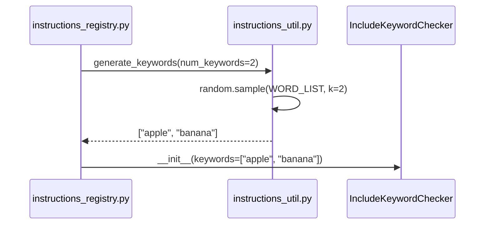

<!-- source: DeepWiki mcp.deepwiki.com · repo allenai/IFBench · page 3.3 Text Processing Utilities · fetched 2026-10-26 -->

# Text Processing Utilities

<details>
<summary>Relevant source files</summary>

The following files were used as context for generating this wiki page:

- [instructions_util.py](instructions_util.py)

</details>


This page documents the utility functions in the IFBench system that support text processing and analysis for instruction checking. These utilities are primarily defined in the [instructions_util.py]() file and are used by various instruction classes to verify if model responses follow specific constraints.

For information about the instruction classes that use these utilities, see [Instruction Classes](3.1).

## Overview

The text processing utilities provide essential functionality for analyzing and manipulating text in the IFBench evaluation system. These utilities handle tasks such as sentence splitting, word counting, stopword analysis, and keyword generation.

These functions form the foundation for many of the constraint checking operations performed by the instruction classes.

### Utility Architecture and Data Flow

The following diagram shows how the utility functions in `instructions_util.py` bridge the gap between raw text (Natural Language Space) and the logic required by the instruction checkers (Code Entity Space).



Sources: [instructions_util.py:15-1650](), [instructions.py:32-32]()

## Core Text Processing Functions

The IFBench system relies on several key text processing functions to analyze model responses against various constraints.

### Sentence Splitting

The `split_into_sentences()` function is a sophisticated text segmentation utility that handles various edge cases in English text, such as abbreviations and decimals, which standard splitters often fail on.



Sources: [instructions_util.py:1574-1622]()

The function handles various edge cases including:
- **Abbreviations**: Uses `_PREFIXES` (e.g., Mr., Mrs., Dr.) and `_SUFFIXES` (e.g., Inc., Ltd.) to avoid false splits [instructions_util.py:1565-1566]().
- **Acronyms**: Uses `_ACRONYMS` to handle patterns like "U.S.A." [instructions_util.py:1568]().
- **Websites**: Uses `_WEBSITES` to protect domain extensions like .com or .org [instructions_util.py:1569]().
- **Decimals**: Uses `_DIGITS` to prevent splitting on numbers like 3.14 [instructions_util.py:1570]().

### Word Counting

The `count_words()` function provides a standardized way to calculate the length of a response in words, which is critical for length-constrained instructions.

```python
def count_words(text):
    """Counts the number of words."""
    tokenizer = nltk.tokenize.RegexpTokenizer(r"\w+")
    tokens = tokenizer.tokenize(text)
    num_words = len(tokens)
    return num_words
```

Sources: [instructions_util.py:1625-1631]()

This function uses NLTK's `RegexpTokenizer` with the pattern `\w+` to split text into words, effectively ignoring punctuation [instructions_util.py:1628-1629]().

### Stopword Analysis

The `count_stopwords()` function calculates the density of common English words in a text.

```python
def count_stopwords(text):
    """Counts the number of stopwords."""
    nltk.download('stopwords')
    stopwords = nltk.corpus.stopwords.words('english')
    tokenizer = nltk.tokenize.RegexpTokenizer(r"\w+")
    tokens = tokenizer.tokenize(text)
    num_stopwords = len([t for t in tokens if t.lower() in stopwords])
    return num_stopwords
```

Sources: [instructions_util.py:1638-1645]()

This utility is primarily used by the `StopWordPercentageChecker` class to verify constraints related to linguistic complexity or brevity [instructions.py:1134-1160]().

### Keyword Generation

The `generate_keywords()` function provides random sampling from the internal vocabulary to create dynamic constraints.

```python
def generate_keywords(num_keywords):
    """Randomly generates a few keywords."""
    return random.sample(WORD_LIST, k=num_keywords)
```

Sources: [instructions_util.py:1647-1649]()

## Vocabulary (WORD_LIST)

The module includes `WORD_LIST`, a comprehensive list of approximately 1,550 common English words [instructions_util.py:23-1551](). This list serves as the ground truth for instructions that require models to include specific words or avoid others.

### Usage in Constraint Instantiation



Sources: [instructions_util.py:1647-1649](), [instructions_registry.py:46-46]()

## NLTK Resource Management

To ensure portability and reliability, `instructions_util.py` includes a bootstrapping function that checks for and downloads necessary NLTK data at runtime.

```python
def download_nltk_resources():
    """Download 'punkt' if not already installed"""
    try:
        nltk.data.find("tokenizers/punkt")
    except LookupError:
        nltk.download("punkt")
```

Sources: [instructions_util.py:1553-1561]()

This function is called immediately upon module import to ensure the `punkt` tokenizer is available for sentence splitting [instructions_util.py:1652]().

## Regular Expression Patterns

The module defines several internal regular expression patterns used by `split_into_sentences()` to ensure high-precision text segmentation:

| Variable | Regex / Pattern Description |
|---------|-------------|
| `_ALPHABETS` | `([A-Za-z])` - Matches any alphabetic character [instructions_util.py:1564](). |
| `_PREFIXES` | Common titles (Mr, Mrs, Dr, etc.) that should not end a sentence [instructions_util.py:1565](). |
| `_SUFFIXES` | Corporate suffixes (Inc, Ltd, Jr, etc.) [instructions_util.py:1566](). |
| `_STARTERS` | Words that typically start a new sentence (Almost, None, My, etc.) [instructions_util.py:1567](). |
| `_ACRONYMS` | `([A-Z][.][A-Z][.](?:[A-Z][.])?)` - Matches multi-period acronyms [instructions_util.py:1568](). |
| `_WEBSITES` | `[.](com|net|org|io|gov|me|edu)` - Matches domain extensions [instructions_util.py:1569](). |
| `_DIGITS` | `([0-9])` - Used to protect decimal points [instructions_util.py:1570](). |

Sources: [instructions_util.py:1564-1571]()

---

