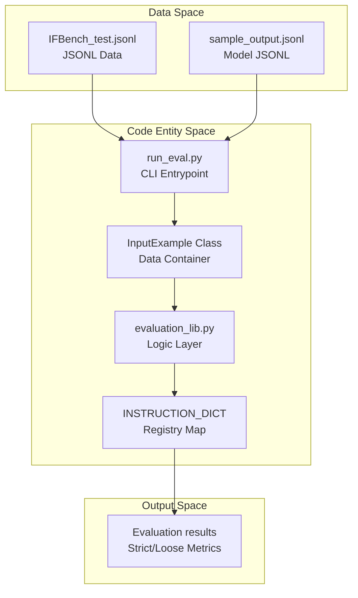
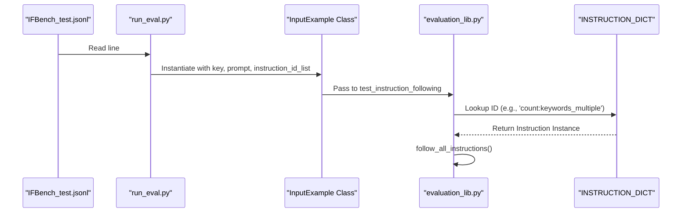

<!-- source: DeepWiki mcp.deepwiki.com · repo allenai/IFBench · page 4 Data Management · fetched 2026-10-26 -->

# Data Management

<details>
<summary>Relevant source files</summary>

The following files were used as context for generating this wiki page:

- [data/IFBench_test.jsonl](data/IFBench_test.jsonl)
- [data/sample_output.jsonl](data/sample_output.jsonl)

</details>


This page documents the data management systems in the IFBench repository, focusing on the test data format and sample outputs used for evaluating instruction following capabilities in language models. It covers the structure of test data files, how constraints are specified, and examples of model responses used in the evaluation process.

For information about the evaluation system that uses this data, see [Evaluation System](#2).

## Overview of Data Files

IFBench uses two primary data files for evaluation:

1. `IFBench_test.jsonl`: Contains test prompts with instruction constraints, sourced primarily from WildChat to ensure natural user intent [data/IFBench_test.jsonl:1-5]().
2. `sample_output.jsonl`: Contains model responses to the test prompts for evaluation purposes [data/sample_output.jsonl:1-5]().

These files form the foundation of the evaluation pipeline, providing both the input prompts with constraints and the model responses that are checked against those constraints.

Sources: [data/IFBench_test.jsonl:1-5](), [data/sample_output.jsonl:1-5]().

## Data Flow Diagram

The following diagram illustrates how the data files interact with the core code entities during an evaluation run.



Sources: [data/IFBench_test.jsonl:1-5](), [data/sample_output.jsonl:1-5]().

## Test Data Format

The `IFBench_test.jsonl` file contains test prompts with instruction constraints in JSONL format. Each line represents an `InputExample` that the system uses to verify model behavior.

For a detailed breakdown of the JSON schema and multi-turn variants, see [Test Data Format](#4.1).

### Key Components

A standard entry includes:
- `key`: A unique identifier for the test case [data/IFBench_test.jsonl:1]().
- `prompt`: The user query, often containing embedded constraints [data/IFBench_test.jsonl:1]().
- `instruction_id_list`: A list of strings mapping to the `INSTRUCTION_DICT` registry [data/IFBench_test.jsonl:1]().
- `kwargs`: A list of dictionaries containing parameters (e.g., specific keywords, counts) passed to the instruction class constructor [data/IFBench_test.jsonl:1]().

Sources: [data/IFBench_test.jsonl:1-5]().

### Instruction Types in Data

The test data includes various categories of constraints defined in the `kwargs`:

| Instruction ID Category | Parameter Examples | Description |
|-----------------|-------------|---------|
| `count:` | `keyword1`, `keyword2`, `N` | Numerical constraints on keywords or linguistic units [data/IFBench_test.jsonl:1-5](). |
| `words:` | `word`, `n`, `m` | Positional or specific word requirements. |
| `format:` | `num_bullets`, `section_spliter` | Structural constraints on the response layout. |

Sources: [data/IFBench_test.jsonl:1-5]().

## Sample Outputs

The `sample_output.jsonl` file provides the ground truth for evaluation scripts. It pairs the original prompt with the model's generated text.

For details on response schemas and naming conventions, see [Sample Outputs](#4.2).

### Schema Structure

```json
{
  "prompt": "What is the female equivalent to chivalry? ...",
  "response": "The female equivalent to chivalry is often referred to as 'courtesy'..."
}
```

Sources: [data/sample_output.jsonl:1-2]().

## Data Processing Sequence

This diagram bridges the "Natural Language Space" (the JSONL files) to the "Code Entity Space" (the classes that process them).



Sources: [data/IFBench_test.jsonl:1-5](), [data/sample_output.jsonl:1-5]().

## Data Distribution and Access

Beyond the local `.jsonl` files, the data is categorized into three main tiers for research purposes:
- **Evaluation Dataset**: `IFBench_test` (58 OOD constraints).
- **Multi-turn Dataset**: `IFBench_multi-turn` (isolated constraint testing).
- **Training Dataset**: `IF_multi_constraints_upto5` (29 base constraints used for IF-RLVR).

Sources: [data/IFBench_test.jsonl:1-5]().

## Integration with Evaluation System

The data management layer is tightly coupled with the evaluation logic. The `run_eval.py` script expects the input files to match the prompt strings exactly between the test set and the output set to ensure the correct `instruction_id_list` is applied to the corresponding model response.

Sources: [data/IFBench_test.jsonl:1-5](), [data/sample_output.jsonl:1-5]().

---

