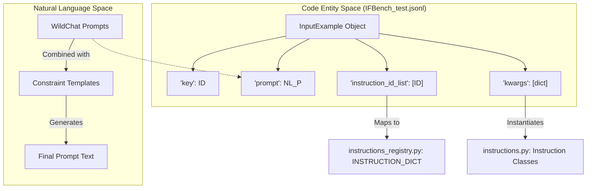
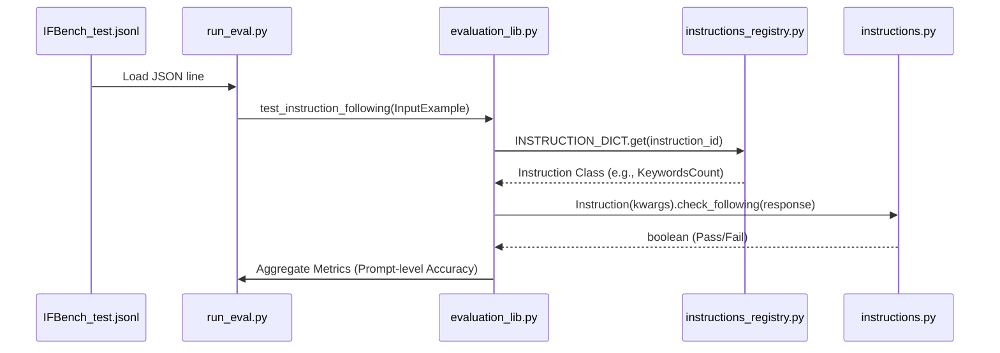

<!-- source: DeepWiki mcp.deepwiki.com · repo allenai/IFBench · page 4.1 Test Data Format · fetched 2026-10-26 -->

# Test Data Format

<details>
<summary>Relevant source files</summary>

The following files were used as context for generating this wiki page:

- [README.md](README.md)
- [data/IFBench_test.jsonl](data/IFBench_test.jsonl)

</details>


This page documents the structure and format of test data files used in the IFBench evaluation system. It explains how constraints are specified in the test data, the sourcing of prompts from WildChat, and the specific schema of `IFBench_test.jsonl`.

## Overview

IFBench test data is stored in JSONL (JSON Lines) format, where each line represents a single test prompt with associated instruction constraints. The benchmark consists of 58 Out-of-Distribution (OOD) constraints paired with prompts sourced from a held-out set of WildChat.



Sources: [README.md:7-10](), [data/IFBench_test.jsonl:1-5]()

## Test Data File Format

The primary test data file is `IFBench_test.jsonl`. Each line in the file is a JSON object representing a single evaluation instance.

### Key Fields

| Field | Description |
|-------|-------------|
| `key` | A unique string identifier for the test example (e.g., "0", "1"). |
| `prompt` | The complete text prompt, combining the original WildChat query with the natural language description of the constraints. |
| `instruction_id_list` | A list of strings mapping to the `INSTRUCTION_DICT` in `instructions_registry.py`. |
| `kwargs` | A list of dictionaries containing the parameters (e.g., `keyword1`, `N`) required to instantiate the corresponding instruction class. |

Sources: [data/IFBench_test.jsonl:1-5]()

## Constraint Specification

Constraints are specified via the `instruction_id_list` and `kwargs` fields. The evaluation engine uses these to dynamically dispatch verification logic.

### Instruction ID Mapping
The `instruction_id_list` contains colon-delimited strings (e.g., `count:keywords_multiple`). These IDs are used by the evaluation library to look up the appropriate `Instruction` class.

### Parameterization (kwargs)
The `kwargs` field provides the specific values for the constraint. Even if a parameter is not used for a specific instruction, the JSON object often contains a full template of possible keys set to `null` for consistency.

**Example: Keyword Frequency Constraint**
```json
{
  "instruction_id_list": ["count:keywords_multiple"],
  "kwargs": [{
    "keyword1": "kaleidoscope",
    "keyword2": "nebula",
    "keyword3": "whisper",
    "keyword4": "labyrinth",
    "keyword5": "paradox"
  }]
}
```

Sources: [data/IFBench_test.jsonl:1-2](), [README.md:9-10]()

## Sourcing and Variants

### WildChat Sourcing
The base prompts in IFBench are derived from **WildChat**, a dataset of real-world user-AI interactions. These prompts are held-out from the training set to ensure OOD (Out-of-Distribution) evaluation. The constraints are programmatically appended or prepended to these real-world prompts.

### Multi-turn Variant
IFBench also supports **Multiturn Constraint Isolation**. In this format, the evaluation is split across two turns:
1.  **Turn 1:** The model receives only the base user prompt from WildChat.
2.  **Turn 2:** The model receives a constraint that modifies or adds to its previous response.

This variant is designed to test how well models can follow instructions when they are separated from the initial task context.

Sources: [README.md:9-11](), [README.md:25-26]()

## Data Flow and Verification

The following diagram illustrates how the `IFBench_test.jsonl` data flows through the evaluation system to produce a score.



Sources: [README.md:15-19](), [data/IFBench_test.jsonl:1-5]()

## Released Datasets

The IFBench project provides several versions of the data via Hugging Face:

1.  **IFBench_test**: The standard OOD evaluation set (58 constraints).
2.  **IFBench_multi-turn**: The two-turn isolated constraint version.
3.  **IF_multi_constraints_upto5**: The training dataset containing 29 training constraints used for IF-RLVR.

Sources: [README.md:24-26]()

---

