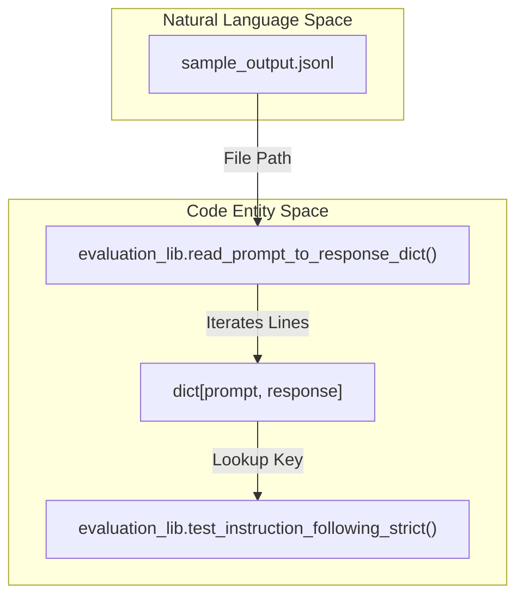
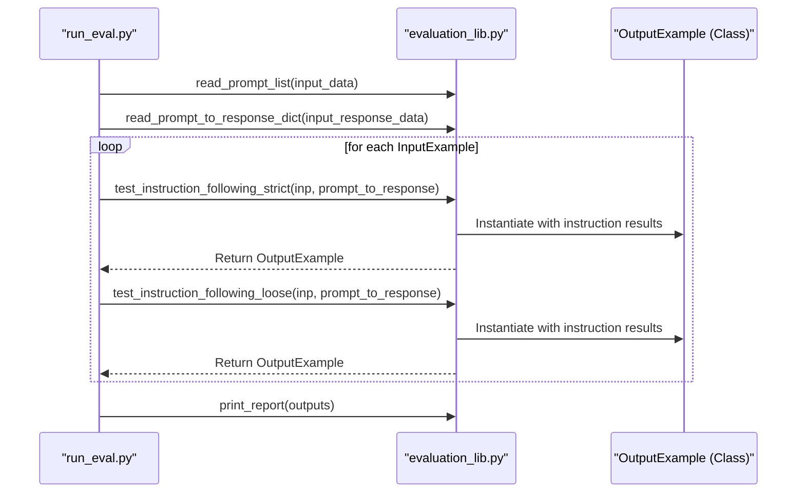

<!-- source: DeepWiki mcp.deepwiki.com · repo allenai/IFBench · page 4.2 Sample Outputs · fetched 2026-10-26 -->

# Sample Outputs

<details>
<summary>Relevant source files</summary>

The following files were used as context for generating this wiki page:

- [data/sample_output.jsonl](data/sample_output.jsonl)
- [run_eval.py](run_eval.py)

</details>


This page documents the sample outputs used in the IFBench evaluation system, detailing their schema, naming conventions, and the evaluation logic that processes them.

## Purpose and Scope

Sample outputs represent the responses generated by a model in response to the benchmark prompts. These are stored in JSONL format and serve as the primary input for the evaluation binary `run_eval.py` [run_eval.py:16-16](). The evaluation system compares these responses against the constraints defined in the original test data to calculate instruction-following accuracy.

## Response File Schema

The `sample_output.jsonl` file and other response files must follow a specific JSONL structure where each line is a valid JSON object.

| Field | Type | Description |
| :--- | :--- | :--- |
| `prompt` | String | The exact input prompt provided to the model. This is used as a key to match responses back to the original instructions [evaluation_lib.py:160-167](). |
| `response` | String | The raw text generated by the model. |

### Example Entry
```json
{
  "prompt": "What is the female equivalent to chivalry? Include keyword meridian once...",
  "response": "The female equivalent to chivalry is often referred to as \"courtesy.\"..."
}
```
Sources: [data/sample_output.jsonl:2-2](), [evaluation_lib.py:160-167]()

## Model Naming Conventions

The `run_eval.py` script uses the filename of the input response data to identify the model being evaluated. This name is then used to prefix the resulting evaluation files [run_eval.py:64-70]().

*   **Standard Suffix**: If the file ends in `-responses.jsonl`, the script strips this suffix to determine the `model_name` [run_eval.py:65-66]().
*   **Generic Fallback**: If the suffix is not present, it uses the file's basename without the extension [run_eval.py:68-68]().
*   **Output Path**: Results are saved as `{model_name}-eval_results_strict.jsonl` and `{model_name}-eval_results_loose.jsonl` in the directory specified by `--output_dir` [run_eval.py:70-74]().

Sources: [run_eval.py:64-76]()

## Data Flow: From Response to Evaluation

The evaluation pipeline bridges the "Natural Language Space" (raw responses) to the "Code Entity Space" (instruction checkers) by loading responses into a dictionary for fast lookup during the verification loop.

### Response Loading and Mapping
Title: Response Mapping Logic

Sources: [run_eval.py:48-49](), [evaluation_lib.py:160-167]()

### Evaluation Execution
The script `run_eval.py` iterates through two evaluation modes for every input prompt [run_eval.py:52-59]().

Title: Evaluation Execution Pipeline

Sources: [run_eval.py:43-82](), [evaluation_lib.py:34-41](), [evaluation_lib.py:75-157]()

## Evaluation Metrics

The system computes two primary levels of accuracy, which are printed to the console at the end of the run [run_eval.py:78-82]():

1.  **Prompt-level Accuracy**: The percentage of prompts where **all** associated instructions were followed (`follow_all_instructions` is `True`) [run_eval.py:60-62]().
2.  **Instruction-level Accuracy**: The percentage of individual constraints followed across the entire dataset [evaluation_lib.py:170-219]().

### Result Storage
The final evaluation results are stored in `OutputExample` objects [evaluation_lib.py:34-41]().

| Attribute | Description |
| :--- | :--- |
| `instruction_id_list` | List of instruction IDs evaluated for this prompt. |
| `prompt` | The original prompt text. |
| `response` | The model's response text. |
| `follow_all_instructions` | Boolean: True if every instruction in the list passed. |
| `follow_instruction_list` | List of Booleans: Individual pass/fail for each instruction. |

Sources: [evaluation_lib.py:34-41](), [run_eval.py:60-62](), [evaluation_lib.py:170-219]()

---

