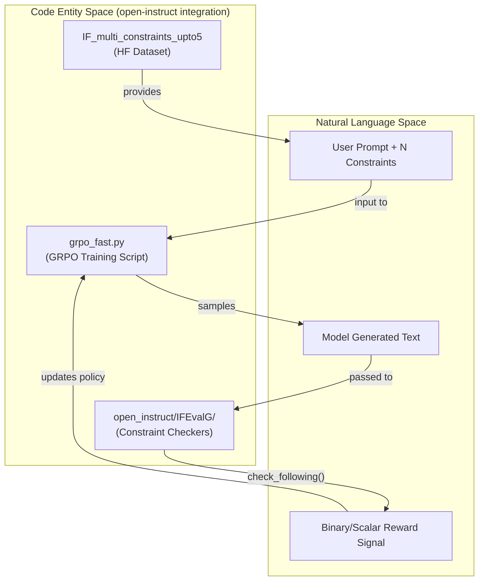
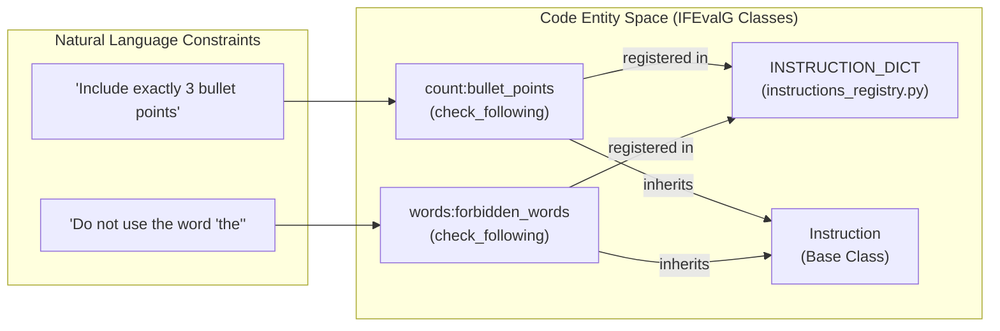

<!-- source: DeepWiki mcp.deepwiki.com · repo allenai/IFBench · page 5 IF-RLVR Training System · fetched 2026-10-26 -->

# IF-RLVR Training System

Relevant source files

The following files were used as context for generating this wiki page:

- [Precise_IF_Generalization_Abilities.pdf](Precise_IF_Generalization_Abilities.pdf)
- [README.md](README.md)

The Instruction Following Reinforcement Learning from Verifiable Responses (IF-RLVR) system is a methodology designed to enhance the precision of language models in following complex instructions. It leverages reinforcement learning (RL) guided by programmatic verification functions that provide objective, sparse reward signals based on constraint satisfaction.

For details on the evaluation benchmark, see [Evaluation System](#2).

Sources: [README.md:27-28](), [Precise_IF_Generalization_Abilities.pdf:1-1]()

## Methodology Overview

IF-RLVR utilizes Group Relative Policy Optimization (GRPO) to fine-tune models. Unlike standard RLHF which relies on subjective human preferences, IF-RLVR uses **verifiable constraints** (e.g., "no commas", "at least 400 words", "JSON format"). The system generates multiple completions for a single prompt and uses the programmatic checkers to determine rewards.

### Bridging Natural Language to Code Entity Space: Training Loop

The following diagram maps the logical training flow to the specific scripts and directories in the integration.

Sources: [README.md:27-31]()

## Training Data

The training system relies on the `IF_multi_constraints_upto5` dataset. This dataset is distinct from the evaluation set in its constraint distribution and composition.

*   **Constraint Set**: Training uses 29 specific constraints, while evaluation (IFBench) tests on 58 Out-of-Distribution (OOD) constraints.
*   **Complexity**: Prompts contain between 1 and 5 simultaneous constraints to teach the model multi-constraint reasoning.
*   **Sourcing**: Constraint templates are combined with prompts sourced from a held-out set of WildChat.

For details, see [Training Data](#5.1).

Sources: [README.md:9-13](), [README.md:25-25]()

## Integration with open-instruct

IF-RLVR is implemented as an extension of the `open-instruct` repository. It uses a high-performance GRPO implementation to handle the computational demands of sampling multiple responses per prompt.

*   **Verification Engine**: The logic for checking instructions is housed in the `IFEvalG` directory. These checkers are essentially the same classes used in evaluation (e.g., `check_following` methods) but serve as the reward function during training.
*   **Execution**: Training is initiated via specialized shell scripts that configure the GRPO hyperparameters and point to the `IFEvalG` verification logic.

For details, see [Integration with open-instruct](#5.2).

### Bridging Natural Language to Code Entity Space: Verification Logic

This diagram shows how natural language constraints are mapped to the programmatic verification classes within the training infrastructure.

Sources: [README.md:30-31](), [instructions_registry.py:1-10]() (Note: Registry logic is shared between IFBench and IFEvalG).

## Comparison with Evaluation System

| Feature | IF-RLVR Training | IFBench Evaluation |
| :--- | :--- | :--- |
| **Constraint Count** | 29 constraints | 58 OOD constraints |
| **Primary Script** | `grpo_fast.py` | `run_eval.py` |
| **Reward/Metric** | Binary Reward for RL update | Prompt-level / Instruction-level Accuracy |
| **Data Source** | `IF_multi_constraints_upto5` | `IFBench_test.jsonl` |
| **Model Output** | Multiple samples (per GRPO) | Single sample (greedy/temp=0) |

Sources: [README.md:15-22](), [README.md:24-28]()

---

