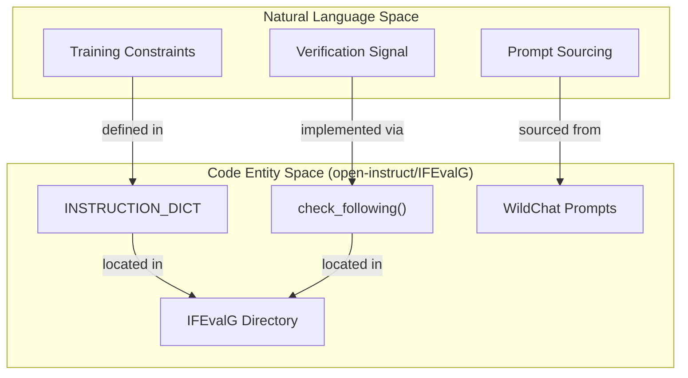
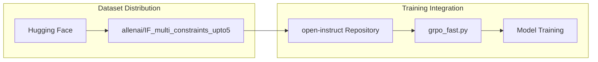
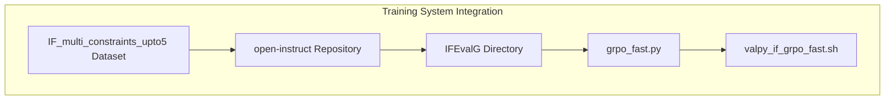
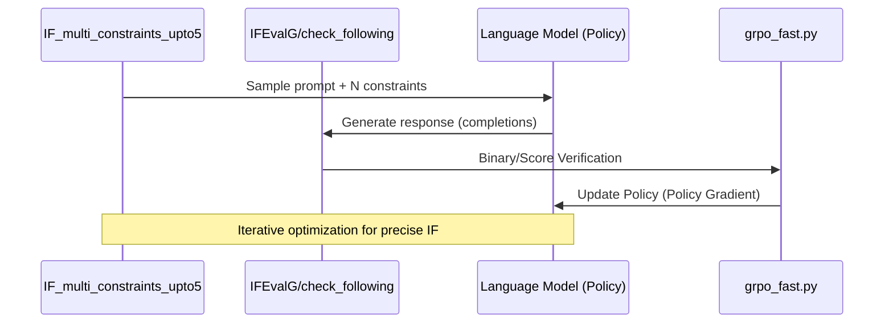
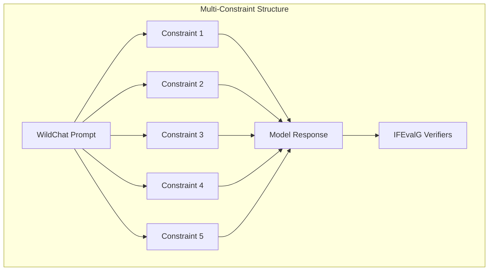

<!-- source: DeepWiki mcp.deepwiki.com · repo allenai/IFBench · page 5.1 Training Data · fetched 2026-10-26 -->

# Training Data

Relevant source files

The following files were used as context for generating this wiki page:

- [Precise_IF_Generalization_Abilities.pdf](Precise_IF_Generalization_Abilities.pdf)
- [README.md](README.md)

This page documents the training datasets used in the IFBench system for the IF-RLVR (Instruction Following - Reinforcement Learning from Verifiable Responses) training methodology. For information about the evaluation benchmark data, see [Test Data Format](4.1).

## Overview

The IFBench training data consists of 29 challenging instruction following constraints with corresponding verification functions, designed to train language models to follow precise instructions. These constraints differ from the 58 out-of-distribution (OOD) constraints used in the evaluation benchmark, ensuring proper assessment of generalization capabilities.

Sources: [README.md:13-13](), [README.md:9-9]()

## Training Dataset Structure

The IF-RLVR training data is structured as a collection of instruction following constraints, each with:

1. A unique constraint identifier.
2. Verification functions to programmatically check constraint adherence.
3. Prompt templates from a held-out set of the WildChat dataset.
4. Parameter specifications for each constraint.

### Data Entity Mapping: Natural Language to Code
The following diagram maps high-level training concepts to the code entities and repositories where they are implemented.

Sources: [README.md:9-13](), [README.md:30-30]()

## Hugging Face Dataset

The training data is publicly available as a Hugging Face dataset at [allenai/IF_multi_constraints_upto5](https://huggingface.co/datasets/allenai/IF_multi_constraints_upto5). This dataset is specifically designed for training models using the IF-RLVR methodology and contains prompts with multiple simultaneous constraints.

Sources: [README.md:25-28]()

## Differences from Evaluation Data

The training data differs from the evaluation data in several key aspects to prevent data leakage and test generalization:

| Aspect | Training Data | Evaluation Data |
|--------|---------------|----------------|
| **Number of constraints** | 29 constraints | 58 OOD constraints |
| **Constraint Set** | IF-RLVR Training Set | OOD Evaluation Set |
| **Purpose** | Model training (Reward signal) | Model benchmarking |
| **Location** | `open-instruct/IFEvalG` | `IFBench/instructions.py` |

The separation between training and evaluation constraints is crucial for properly assessing a model's ability to generalize to unseen instruction types.

Sources: [README.md:8-13](), [README.md:30-30]()

## Integration with open-instruct

The training constraints and verification functions are integrated with the [open-instruct](https://github.com/allenai/open-instruct) repository. This integration enables the use of the GRPO (Group Relative Policy Optimization) training pipeline, where the `IFEvalG` verification functions serve as the reward model.

Sources: [README.md:27-30]()

## Training Methodology: IF-RLVR

The IF-RLVR training methodology uses Reinforcement Learning from Verifiable Responses. This approach leverages the programmatic verification functions to provide objective reward signals during training.

The training process involves:
1. Presenting the model with instruction constraints from the training dataset.
2. Generating multiple completions per prompt.
3. Verifying constraint adherence using the `check_following` functions in the `IFEvalG` directory.
4. Updating the model parameters using GRPO based on the verification results.

Sources: [README.md:27-30]()

## Multi-Constraint Training

The training dataset supports up to 5 simultaneous constraints, as indicated by the dataset name `IF_multi_constraints_upto5`. This forces the model to learn complex instruction following where multiple, potentially conflicting, constraints must be satisfied in a single output.

Sources: [README.md:25-25]()

## Licensing Information

The training data is licensed under **ODC-BY-1.0**. It is intended for research and educational use in accordance with AI2's Responsible Use Guidelines. The dataset includes output data generated from third-party models that are subject to separate terms governing their use.

Sources: [README.md:54-57]()

---

