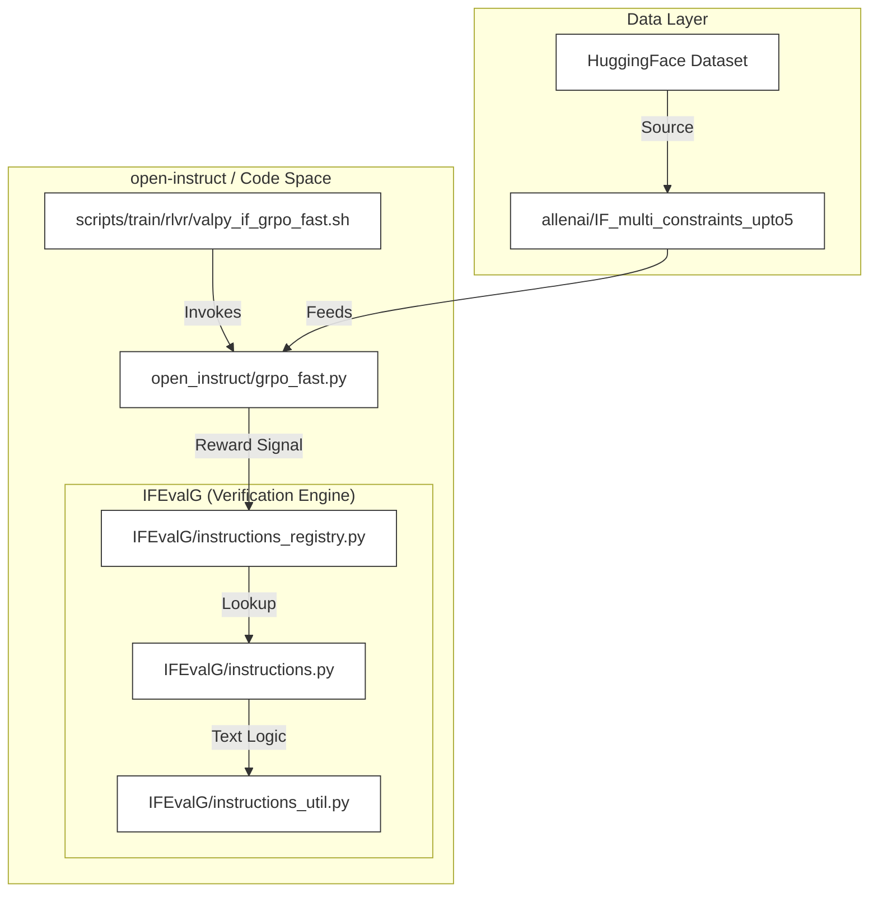
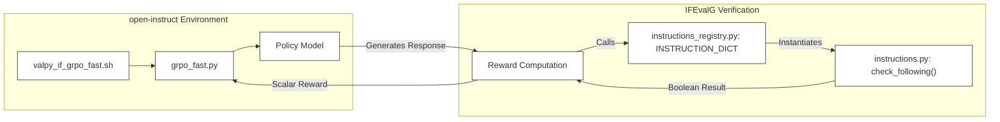

<!-- source: DeepWiki mcp.deepwiki.com · repo allenai/IFBench · page 5.2 Integration with open-instruct · fetched 2026-10-26 -->

# Integration with open-instruct

Relevant source files

The following files were used as context for generating this wiki page:

- [README.md](README.md)

This document details how the IF-RLVR (Instruction Following - Reinforcement Learning from Verifiable Responses) system integrates with the [open-instruct](https://github.com/allenai/open-instruct) repository. This integration provides the infrastructure for training models to follow precise instructions using verifiable reward signals derived from IFBench's constraint-checking logic.

## Overview of Integration

The integration bridges the instruction verification logic of IFBench with the high-performance training scripts in `open-instruct`. Specifically, it utilizes the `grpo_fast.py` script for Group Relative Policy Optimization (GRPO) and a ported version of the IFBench checkers located in the `IFEvalG` directory of the `open-instruct` repository.

### Natural Language Space to Code Entity Space: Training Flow

The following diagram maps the conceptual training flow to specific code entities and scripts within the integrated environment.

Sources: [README.md:24-30]()

## Key Components

### 1. grpo_fast.py (GRPO Script)
The training is driven by `grpo_fast.py`, a script in `open-instruct` designed for efficient reinforcement learning. In the context of IF-RLVR, this script handles:
*   Sampling multiple responses for a single instruction prompt.
*   Interfacing with the `IFEvalG` module to score each response.
*   Computing the relative advantage of responses within a group to update the model policy.

### 2. IFEvalG Directory
This directory is a standalone port of the IFBench verification logic tailored for training. It contains:
*   **`instructions.py`**: Defines the `Instruction` classes that implement the `check_following` method.
*   **`instructions_registry.py`**: Contains the mapping used by the trainer to instantiate the correct checker based on the `instruction_id` provided in the training data.
*   **`instructions_util.py`**: Provides the underlying text processing (tokenization, word counting) required for verification.

### 3. Verification as Reward Signal
During training, the same programmatic logic used for evaluation serves as the reward function. The `check_following` method returns a boolean, which is converted into a scalar reward for the RL algorithm. This ensures that the model is optimized directly for the verifiable constraints it will encounter.

Sources: [README.md:27-30]()

## Training Data and Constraints

The integration uses a specific subset of constraints for training to allow for the measurement of out-of-distribution (OOD) generalization.

| Feature | Training (IF-RLVR) | Evaluation (IFBench) |
| :--- | :--- | :--- |
| **Constraint Count** | 29 New Constraints | 58 OOD Constraints |
| **Dataset Source** | `allenai/IF_multi_constraints_upto5` | `IFBench_test.jsonl` |
| **Complexity** | Up to 5 constraints per prompt | Variable (Single and Multi) |

Sources: [README.md:7-13](), [README.md:24-25]()

## System Integration Diagram

This diagram shows the relationship between the `open-instruct` training environment and the verification functions that provide the feedback loop.

Sources: [README.md:27-30]()

## Execution

Training is initiated using the provided shell scripts in `open-instruct`. These scripts configure the `grpo_fast.py` parameters to use the IFBench training dataset and point to the `IFEvalG` verification logic.

**Example Command Path:**
`open-instruct/scripts/train/rlvr/valpy_if_grpo_fast.sh`

This script effectively automates the pipeline from loading the `IF_multi_constraints_upto5` dataset to executing the GRPO loop with verifiable feedback.

Sources: [README.md:27-28]()

---

