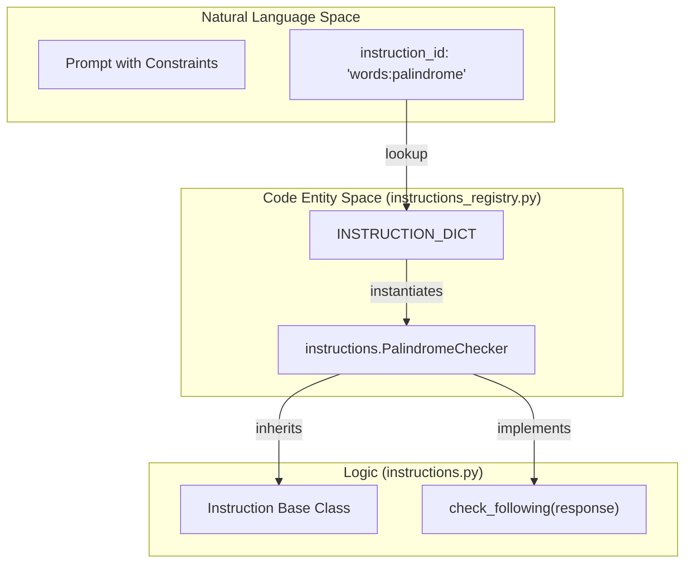
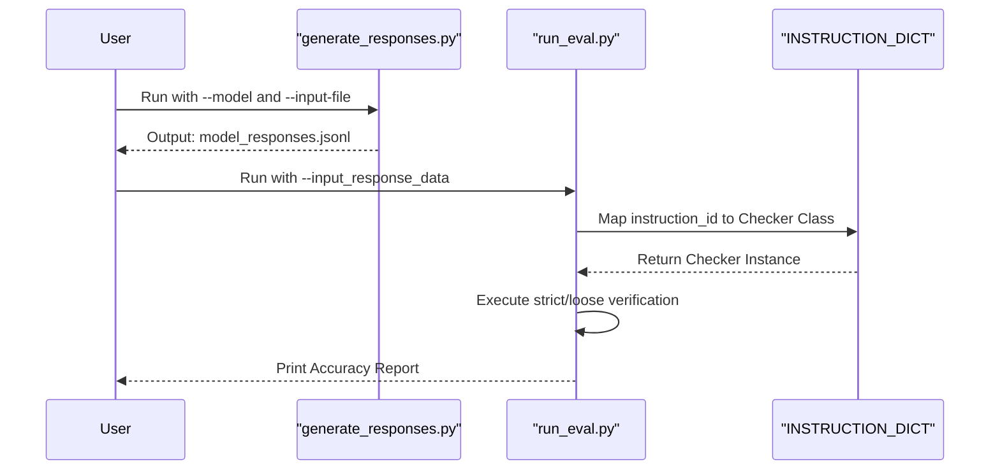

<!-- source: DeepWiki mcp.deepwiki.com · repo allenai/IFBench · page 6 Getting Started · fetched 2026-10-26 -->

# Getting Started

<details>
<summary>Relevant source files</summary>

The following files were used as context for generating this wiki page:

- [.gitignore](.gitignore)
- [instructions_registry.py](instructions_registry.py)
- [pyproject.toml](pyproject.toml)
- [requirements.txt](requirements.txt)

</details>


This guide provides instructions for setting up and using IFBench, a benchmark for evaluating precise instruction following capabilities in language models. It covers installation, environment configuration, and basic execution of the evaluation pipeline.

## Installation

To get started with IFBench, follow these steps to set up your environment:

1. Clone the repository:
   ```bash
   git clone https://github.com/allenai/IFBench
   cd IFBench
   ```

2. Install the required dependencies:
   ```bash
   pip install -r requirements.txt
   ```

The system requires Python >= 3.10 [pyproject.toml:7-7](). Core dependencies include text processing libraries like `nltk`, `spacy`, and `syllapy`, along with configuration management via `pydantic-settings` [pyproject.toml:8-21]().

For detailed dependency lists and configuration options, see [Requirements and Configuration](#6.1).

Sources: [requirements.txt:1-8](), [pyproject.toml:7-21]()

## System Overview

IFBench maps high-level instruction constraints to specific code entities within the `instructions.py` module, which are managed by a central registry.

### Mapping Natural Language to Code Entities
The following diagram illustrates how the evaluation system bridges the gap between the instruction strings found in data files and the Python classes that verify them.


Sources: [instructions_registry.py:20-79]()

## Configuration

IFBench uses a Pydantic-based configuration system. You can manage your environment variables using a `.env` file. A template is provided in `.env.example`.

Key configuration variables include:
- `API_BASE`: The endpoint for response generation.
- `MODEL`: The specific model identifier to evaluate.
- `INPUT_FILE`: Path to the evaluation prompts (e.g., `IFBench_test.jsonl`).
- `WORKERS`: Number of parallel processes for generation and evaluation.

For a full list of environment variables and details on `BenchmarkSettings`, see [Requirements and Configuration](#6.1).

## Quick Start Guide

### Generating and Evaluating Responses
The typical workflow involves generating model outputs and then running the evaluation script to calculate accuracy metrics.


Sources: [instructions_registry.py:20-79]()

### Basic Commands
1. **Generate Responses**: Use the generation script to get outputs from your target model.
   ```bash
   python generate_responses.py --model your-model-name --input-file data/IFBench_test.jsonl
   ```

2. **Run Evaluation**: Process the generated responses to see instruction-following scores.
   ```bash
   python run_eval.py --input_data data/IFBench_test.jsonl --input_response_data data/your-model-responses.jsonl
   ```

For a step-by-step walkthrough of these commands and their flags, see the [Quick Start Guide](#6.2).

## Next Steps

After setting up IFBench and running your first evaluation, you might want to:

1. **Explore Constraints**: Understand the 58+ OOD constraints defined in the [Instruction Registry](#3.2).
2. **Deep Dive into Logic**: Review how specific checks are implemented in [Instruction Classes](#3.1).
3. **Training**: Learn how to use these checkers as reward signals for RLVR in [IF-RLVR Training System](#5).
4. **Data Formats**: Customize your evaluation sets by following the [Test Data Format](#4.1).

---

