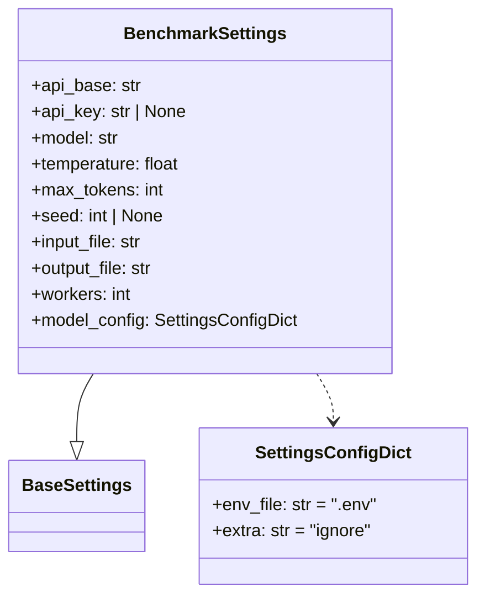
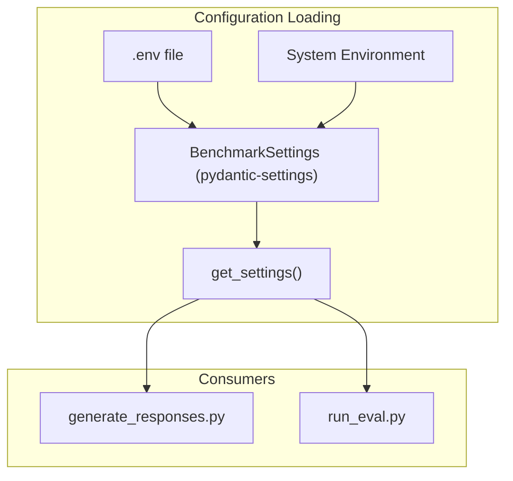

<!-- source: DeepWiki mcp.deepwiki.com · repo allenai/IFBench · page 6.1 Requirements and Configuration · fetched 2026-10-26 -->

# Requirements and Configuration

<details>
<summary>Relevant source files</summary>

The following files were used as context for generating this wiki page:

- [.env.example](.env.example)
- [config.py](config.py)
- [instructions_registry.py](instructions_registry.py)
- [pyproject.toml](pyproject.toml)
- [requirements.txt](requirements.txt)
- [uv.lock](uv.lock)

</details>


This page documents the system requirements, dependencies, and configuration mechanisms for IFBench. It covers the environment setup, the Pydantic-based configuration system, and the environment variables required for model generation and evaluation.

## System Dependencies

IFBench requires Python 3.10 or higher [pyproject.toml:7-7](). The system relies on several NLP and utility libraries to perform precise instruction checking.

### Required Python Packages
The dependencies are managed via `pyproject.toml` and `requirements.txt`.

| Package | Purpose |
|---------|---------|
| `pydantic-settings` | Manages configuration via environment variables and `.env` files [pyproject.toml:20-20](). |
| `nltk` | Used for sentence splitting and word tokenization [requirements.txt:3-3](). |
| `spacy` | Advanced NLP for linguistic analysis [requirements.txt:5-5](). |
| `langdetect` | Identifies the language of model responses [requirements.txt:2-2](). |
| `syllapy` | Counts syllables for constraint checking [requirements.txt:7-7](). |
| `emoji` | Detects and processes emoji characters in text [requirements.txt:6-6](). |
| `httpx` | Handles asynchronous HTTP requests for API-based generation [pyproject.toml:17-17](). |
| `absl-py` | Provides framework for command-line flags and logging [requirements.txt:1-1](). |

Sources: [requirements.txt:1-8](), [pyproject.toml:7-21]()

## Configuration System

IFBench uses a centralized configuration system defined in `config.py`. This system utilizes `pydantic-settings` to provide type-safe configuration with validation.

### BenchmarkSettings Class
The `BenchmarkSettings` class [config.py:7-57]() defines the schema for all system parameters. It automatically loads values from the environment or a `.env` file [config.py:10-14]().


Sources: [config.py:7-57]()

### Data Flow: Settings Initialization
The function `get_settings()` [config.py:59-61]() serves as the entry point for retrieving configuration. It instantiates `BenchmarkSettings`, which triggers the loading process from the `.env` file.


Sources: [config.py:7-61]()

## Environment Variables (.env)

A template for configuration is provided in `.env.example` [env.example:1-18](). Users should copy this to `.env` and populate it with their specific API and benchmark parameters.

### API Configuration
*   `API_BASE`: The base URL for the OpenAI-compatible API (e.g., vLLM or OpenAI) [env.example:5-5](). Defaults to `http://localhost:8000/v1` [config.py:17-20]().
*   `API_KEY`: The authentication key for the API [env.example:6-6](). Defaults to `None` [config.py:21-24]().
*   `MODEL`: The specific model identifier to target for generation [env.example:7-7]().

### Generation Parameters
*   `TEMPERATURE`: Controls sampling randomness [env.example:10-10](). Default: `0.6` [config.py:31-34]().
*   `MAX_TOKENS`: The maximum length of the generated response [env.example:11-11](). Default: `4096` [config.py:35-38]().
*   `SEED`: Integer for reproducible generation [env.example:12-12](). Default: `42` [config.py:39-42]().

### Benchmark Parameters
*   `INPUT_FILE`: Path to the source test file, typically `data/IFBench_test.jsonl` [env.example:15-15]().
*   `OUTPUT_FILE`: Path where generated responses are saved [env.example:16-16]().
*   `WORKERS`: Number of parallel threads/processes for generation [env.example:17-17](). Default: `8` [config.py:53-56]().

Sources: [.env.example:1-18](), [config.py:16-57]()

## Installation

The project uses `hatchling` as the build backend [pyproject.toml:29-30](). To install the package and its dependencies in editable mode:

```bash
pip install -e .
```

To install development dependencies (e.g., `pytest`):
```bash
pip install -e ".[dev]"
```

Sources: [pyproject.toml:23-30]()

---

