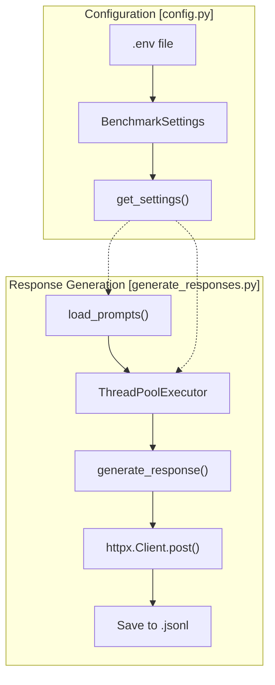
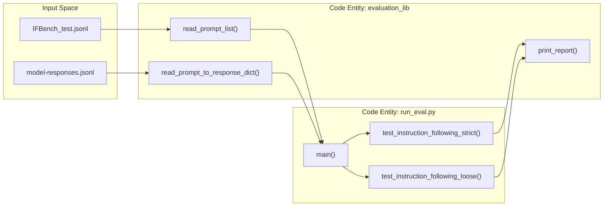

<!-- source: DeepWiki mcp.deepwiki.com · repo allenai/IFBench · page 6.2 Quick Start Guide · fetched 2026-10-26 -->

# Quick Start Guide

<details>
<summary>Relevant source files</summary>

The following files were used as context for generating this wiki page:

- [.env.example](.env.example)
- [README.md](README.md)
- [config.py](config.py)
- [generate_responses.py](generate_responses.py)
- [run_eval.py](run_eval.py)

</details>


This guide provides step-by-step instructions for getting started with IFBench, a benchmark for precise instruction following. It covers installation, generating model responses via an OpenAI-compatible API, and running evaluations.

## Installation

1. **Clone the IFBench repository**:
   ```bash
   git clone https://github.com/allenai/IFBench.git
   cd IFBench
   ```

2. **Install the required dependencies**:
   The project uses `httpx`, `tqdm`, and `pydantic-settings` for generation, and `absl-py` for evaluation.
   ```bash
   pip install -r requirements.txt
   ```

Sources: [README.md:15-16](), [requirements.txt:1-10]()

## Configuration

IFBench uses a `pydantic-settings` based configuration system defined in `config.py` [config.py:7-57](). You can configure the generation process using environment variables or a `.env` file.

1. **Create a `.env` file**:
   ```bash
   cp .env.example .env
   ```

2. **Edit `.env`** with your API details:
   - `API_BASE`: The URL of your OpenAI-compatible server (e.g., vLLM, Ollama, or OpenAI).
   - `MODEL`: The specific model identifier to use.
   - `INPUT_FILE`: Path to the test prompts (default: `data/IFBench_test.jsonl`).

Sources: [.env.example:1-18](), [config.py:10-14]()

## Generating Model Responses

The `generate_responses.py` script allows you to generate completions for the benchmark prompts using parallel workers.

### Execution Flow



### CLI Flags for `generate_responses.py`
You can override `.env` settings using CLI flags:
- `--api-base`: Base URL for the API [generate_responses.py:68-71]().
- `--model`: Model name to use [generate_responses.py:73-76]().
- `--input-file`: Path to the benchmark prompts [generate_responses.py:78-81]().
- `--output-file`: Where to save responses [generate_responses.py:83-85]().
- `--resume`: If set, skips prompts already present in the output file [generate_responses.py:116-119]().
- `--workers`: Number of parallel API calls (default: 8) [generate_responses.py:110-114]().

**Example Command**:
```bash
python3 generate_responses.py --model my-model-v1 --workers 16 --resume
```

Sources: [generate_responses.py:63-121](), [config.py:16-57]()

## Running the Evaluation

Once you have generated responses, use `run_eval.py` to calculate accuracy.

### Evaluation Pipeline



**Example Command**:
```bash
python3 -m run_eval \
  --input_data=data/IFBench_test.jsonl \
  --input_response_data=data/my-model-v1-responses.jsonl \
  --output_dir=eval_results
```

### Accuracy Metrics
The script reports two primary scores:
1. **Strict Accuracy**: Requires the response to satisfy every constraint exactly [run_eval.py:53-54]().
2. **Loose Accuracy**: Uses a more lenient verification approach (often the primary metric reported in the paper) [README.md:22-22](), [run_eval.py:54-54]().

Sources: [run_eval.py:27-82](), [README.md:15-22]()

## Understanding Input/Output Formats

### Response Format (`-responses.jsonl`)
The generation script produces a JSONL file where each line maps a prompt to a model response:
```json
{"prompt": "Write a 300 word essay...", "response": "Here is the essay..."}
```
Sources: [generate_responses.py:180-183]()

### Evaluation Results
The evaluator creates two files in the `--output_dir`:
- `{model_name}-eval_results_strict.jsonl`
- `{model_name}-eval_results_loose.jsonl`

These files contain the original prompt, the response, and a boolean `follow_all_instructions` field indicating if the model passed all constraints [run_eval.py:60-75]().

## Next Steps

- **Advanced Constraints**: See [Instruction Classes](3.1) to learn about the 58 OOD constraints.
- **Training**: See [IF-RLVR Training System](5) for details on using these verifiers as reward signals in GRPO.
- **Thinking Models**: For models like DeepSeek-R1 or OpenAI o1/o3, ensure `MAX_TOKENS` in `.env` is high enough (e.g., 8192) to accommodate reasoning chains [README.md:22-22]().

Sources: [README.md:22-31](), [.env.example:11-11]()

---

