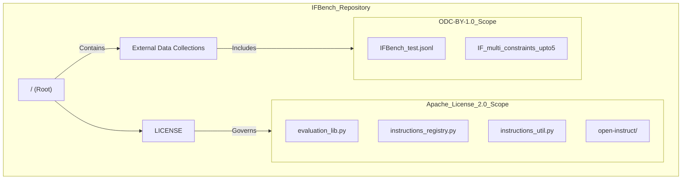
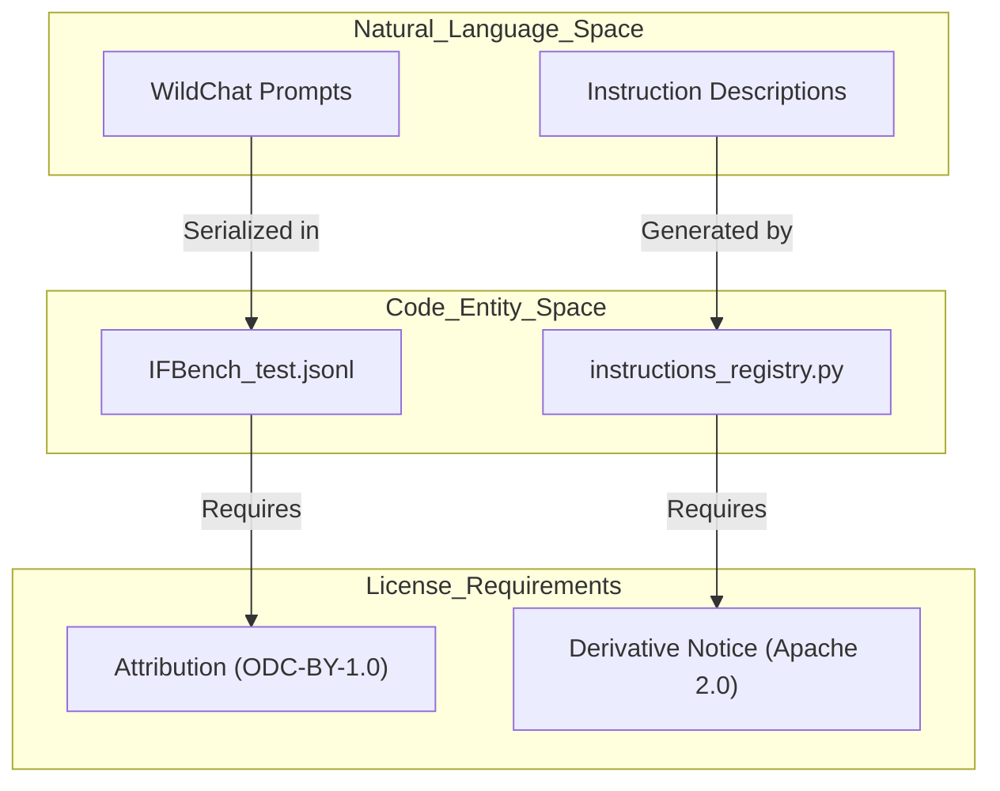

<!-- source: DeepWiki mcp.deepwiki.com · repo allenai/IFBench · page 7 License Information · fetched 2026-10-26 -->

# License Information

Relevant source files

The following files were used as context for generating this wiki page:

- [LICENSE](LICENSE)

This page provides technical details regarding the licensing terms for the IFBench codebase and datasets. The repository is primarily governed by the Apache License 2.0 for software components, while associated data assets follow specific attribution-based open data licenses.

## Overview of IFBench Licensing

The IFBench project employs a bifurcated licensing strategy to distinguish between executable logic (the evaluation framework and training scripts) and the benchmark data (prompts and constraints).

### Code and Data Separation

The following diagram maps the legal framework to the functional directories within the codebase.

**Legal Framework to Code Entity Mapping**

Sources: [LICENSE:1-201](), [README.md:29-33]()

## Apache License 2.0 (Codebase)

The core logic of IFBench—including the instruction checking engine and the evaluation pipeline—is released under the **Apache License, Version 2.0**. This license is a permissive, professional-grade open-source license.

### Definitions and Scope
The license defines several key entities relevant to the codebase:
*   **Source Form**: The preferred form for making modifications, specifically the `.py` files in this repository [LICENSE:26-28]().
*   **Work**: The work of authorship made available under the License [LICENSE:35-38]().
*   **Derivative Works**: Any work based on or derived from the IFBench codebase, such as a modified version of `instructions.py` [LICENSE:40-46]().

### Grant of Rights
The license provides two primary grants to users:
1.  **Copyright Grant**: A perpetual, worldwide, non-exclusive, no-charge, royalty-free, irrevocable license to reproduce, prepare derivative works of, and distribute the software [LICENSE:66-71]().
2.  **Patent Grant**: A similar grant for patent claims necessarily infringed by the contribution [LICENSE:73-81](). This includes a "defensive termination" clause: if you sue any contributor over patent infringement related to the Work, your patent licenses terminate [LICENSE:82-87]().

### Redistribution Requirements
If you redistribute the IFBench codebase or derivative works, you must:
1.  Provide a copy of the [LICENSE]() [LICENSE:94-95]().
2.  Add prominent notices to any files you modify [LICENSE:97-98]().
3.  Retain all copyright, patent, and trademark notices [LICENSE:100-104]().
4.  Include a `NOTICE` file if one is provided [LICENSE:106-111]().

Sources: [LICENSE:1-129](), [README.md:31]()

## Dataset Licensing (ODC-BY-1.0)

While the code is Apache 2.0, the datasets (test prompts, training constraints, and multi-turn data) are licensed under the **Open Data Commons Attribution License (ODC-BY-1.0)**.

### Permitted Actions
Users are permitted to share (copy/distribute), create (produce works from), and adapt (modify/transform) the database.

### Attribution Requirement
The primary obligation under ODC-BY-1.0 is **Attribution**. Any public use of the database or works produced from it must provide attribution to the original authors.

**Data Flow and Usage Rights**

Sources: [README.md:32-33](), [README.md:21-22]()

## Compliance Checklist for Developers

When extending or deploying IFBench, developers should ensure the following technical compliance steps are met:

| Task | File/Entity | License Requirement |
| :--- | :--- | :--- |
| **Modifying Logic** | `instructions.py` or `evaluation_lib.py` | Add change notices to file headers [LICENSE:97-98](). |
| **Distributing Fork** | Entire Repository | Include the original `LICENSE` file [LICENSE:94-95](). |
| **Using Data in Paper** | `IFBench_test.jsonl` | Cite the research paper and attribute AI2 [README.md:41-53](). |
| **Model Outputs** | `sample_output.jsonl` | Verify terms of the specific model (e.g., Llama, GPT) used [README.md:33](). |

## Third-Party Dependencies

The IFBench system relies on several third-party libraries (e.g., `nltk`, `pydantic`, `pandas`) which are governed by their own respective licenses (typically MIT, BSD, or Apache 2.0). Users should consult the `requirements.txt` or `pyproject.toml` for a full list of dependencies.

Sources: [LICENSE:1-201](), [README.md:29-53]()

---

