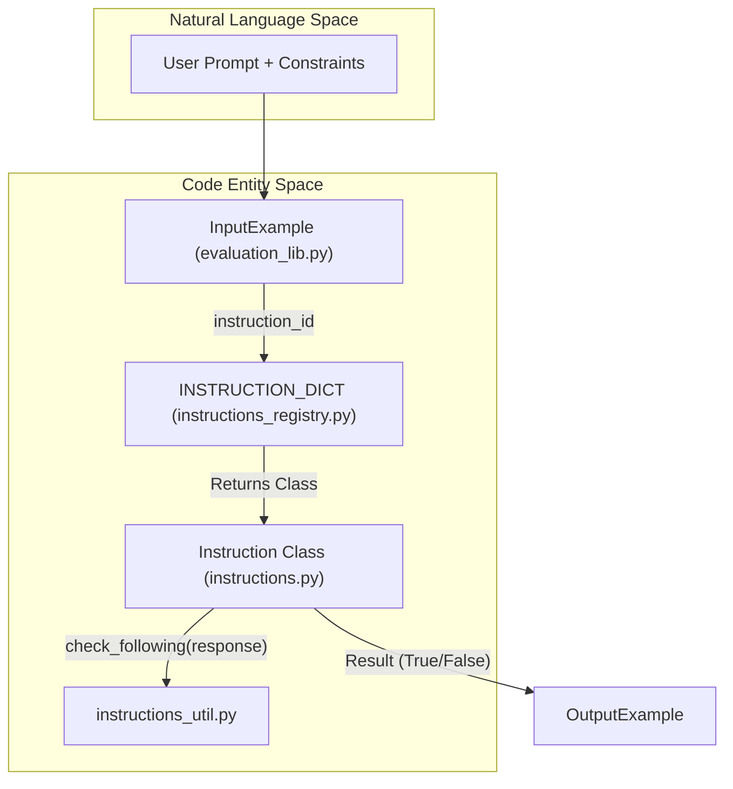
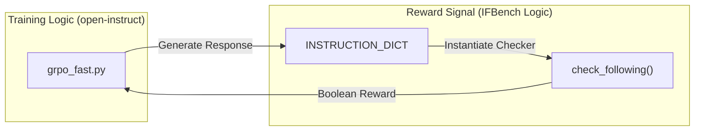

<!-- source: DeepWiki mcp.deepwiki.com · repo allenai/IFBench · page 8 Glossary · fetched 2026-10-26 -->

# Glossary

Relevant source files

The following files were used as context for generating this wiki page:

- [Precise_IF_Generalization_Abilities.pdf](Precise_IF_Generalization_Abilities.pdf)
- [README.md](README.md)
- [evaluation_lib.py](evaluation_lib.py)
- [instructions.py](instructions.py)
- [instructions_registry.py](instructions_registry.py)
- [instructions_util.py](instructions_util.py)
- [requirements.txt](requirements.txt)

This glossary defines technical terms, domain concepts, and architectural components specific to the **IFBench** codebase. It is designed to assist onboarding engineers in navigating the instruction-following evaluation and training pipeline.

## Core Concepts & Project Components

### IFBench
The primary repository and benchmark for precise instruction following. It extends the original IFEval framework by introducing **Out-of-Distribution (OOD)** constraints and a training methodology known as **IF-RLVR** [README.md:1-13]().

### IFEval
The foundational framework developed by Zhou et al. (2023) upon which IFBench is built. It uses verifiable constraints to measure how well Large Language Models (LLMs) follow objective instructions [README.md:61-63]().

### OOD Constraints
"Out-of-Distribution" constraints are 58 new and challenging instructions introduced in IFBench that were not seen during the initial training phase of standard models. These are combined with prompts from **WildChat** to test the generalization limits of models [README.md:9-10]().

### IF-RLVR
**Instruction Following Reinforcement Learning from Verifiable Responses**. This refers to the training methodology where models are optimized using **GRPO** (Group Relative Policy Optimization) against a set of 29 specific training constraints [README.md:13-28]().

### Generalization Gap
A research concept described in the accompanying paper regarding the performance difference between a model's ability to follow seen (training) constraints versus unseen (OOD) constraints.

---

## Technical Data Structures

### InputExample
A dataclass representing a single evaluation task. It contains the prompt and the specific constraints (instructions) the model must satisfy.
*   **Location**: [evaluation_lib.py:26-31]()
*   **Attributes**: `key` (unique ID), `instruction_id_list` (list of constraints), `prompt` (the user query), and `kwargs` (parameters for the constraints).

### OutputExample
A dataclass representing the result of an evaluation for a single prompt.
*   **Location**: [evaluation_lib.py:34-40]()
*   **Attributes**: Includes `response` (the model's text), `follow_all_instructions` (boolean for prompt-level success), and `follow_instruction_list` (per-instruction success booleans).

### INSTRUCTION_DICT
A central registry mapping string-based `instruction_id`s to their corresponding Python class implementations.
*   **Location**: [instructions_registry.py:20-79]()
*   **Format**: Uses a colon-delimited namespace (e.g., `count:word_count_range`).

### WORD_LIST
A static list of common English words used by various checkers to generate keywords or validate vocabulary constraints.
*   **Location**: [instructions_util.py:23-418]()

---

## Evaluation Methodology

### Strict vs. Loose Evaluation
IFBench supports two modes of checking model responses:

1.  **Strict Evaluation**: The model's raw response is checked directly against the constraint [evaluation_lib.py:75-104]().
2.  **Loose Evaluation**: The checker attempts to account for common "chatter" or formatting artifacts (like thinking blocks or markdown bolding) by testing the response with various transformations, such as removing the first/last lines or stripping asterisks [evaluation_lib.py:107-166]().

### Tier 0 / Tier 1
Metrics are reported at two levels of granularity based on the `instruction_id`:
*   **Tier 0**: Aggregates accuracy by the broad category of the instruction (e.g., all `count` instructions) [evaluation_lib.py:207-211]().
*   **Tier 1**: Aggregates accuracy by the specific instruction type (e.g., `count:word_count_range`) [evaluation_lib.py:213-217]().

### Metrics
*   **Prompt-level Accuracy**: The percentage of prompts where *every* associated instruction was followed correctly [evaluation_lib.py:198-199]().
*   **Instruction-level Accuracy**: The percentage of individual instructions followed across all prompts [evaluation_lib.py:201-202]().

---

## Instruction Implementation

### Instruction Base Class
The abstract base class for all verifiable constraints.
*   **Location**: [instructions.py:83-100]()
*   **Key Methods**:
    *   `build_description`: Generates the natural language string for the prompt [instructions.py:89-90]().
    *   `check_following`: The core logic that returns `True` or `False` based on whether the text satisfies the constraint [instructions.py:98-99]().

### Verifiable Constraints Categories
The `INSTRUCTION_DICT` organizes checkers into categories:
| Category | Purpose | Example |
| :--- | :--- | :--- |
| `count` | Quantitative checks (words, names, numbers) | `count:person_names` |
| `ratio` | Percentage-based constraints | `ratio:stop_words` |
| `words` | Content or linguistic patterns | `words:palindrome` |
| `format` | Structural or stylistic requirements | `format:parentheses` |
| `custom` | Complex or multi-step logic | `custom:csv_city` |

---

## System Diagrams

### Data Flow: From Registry to Evaluation
The following diagram bridges the **Natural Language Space** (prompts) to the **Code Entity Space** (Classes and Registry).

**Evaluation Dispatch Flow**

*Sources: [evaluation_lib.py:26-40](), [instructions_registry.py:20-79](), [instructions.py:83-100]()*

### Training Architecture: IF-RLVR
This diagram illustrates how the verifiable constraints serve as reward signals during the GRPO training process.

**IF-RLVR Training Loop**

*Sources: [README.md:27-31](), [instructions_registry.py:20-79](), [instructions.py:98-99]()*

---

## Domain Specific Terms

*   **Multiturn Constraint Isolation**: A variant of the test where the base prompt and the constraint are separated into two turns to test if the model can modify an existing response according to new constraints [README.md:11-12]().
*   **Thinking Models**: Models (like DeepSeek R1 or OpenAI o1/o3) that generate internal reasoning chains. IFBench handles these by allowing more tokens and extracting the final answer for evaluation [README.md:22]().
*   **punkt / stop words**: Refers to NLTK resources used for sentence splitting and linguistic analysis. The codebase bootstraps these into a local `.nltk_data` directory [instructions.py:26-32](), [instructions_util.py:224-225]().
*   **n-gram overlap**: A specific checker (`ratio:overlap`) that ensures the response does not exceed a certain similarity threshold with the prompt or other text [instructions_registry.py:28]().

**Sources:**
*   [README.md:1-77]()
*   [instructions.py:1-100]()
*   [instructions_util.py:1-418]()
*   [instructions_registry.py:1-81]()
*   [evaluation_lib.py:1-222]()