# Page: IFBench Overview

# IFBench Overview

<details>
<summary>Relevant source files</summary>

The following files were used as context for generating this wiki page:

- [Precise_IF_Generalization_Abilities.pdf](Precise_IF_Generalization_Abilities.pdf)
- [README.md](README.md)

</details>


This document provides an introduction to IFBench, a benchmark system for evaluating and training precise instruction following capabilities in language models. IFBench offers a comprehensive framework for testing how well models can follow specific constraints in their generated text.

For information about the theoretical framework and the generalization gap findings, see [Research Foundation](#1.1). For a high-level overview of the software components and how they interact, see [System Architecture](#1.2).

## Purpose and Scope

IFBench is designed to address the challenge of precise instruction following in language models. It provides:

1.  A benchmark with 58 out-of-distribution (OOD) constraints for evaluation [README.md:9-9]().
2.  Multiturn constraint isolation testing capabilities [README.md:11-11]().
3.  A training methodology (IF-RLVR) with 29 specialized training constraints [README.md:13-13]().
4.  Programmatic verification functions for automated constraint checking [README.md:30-30]().

The system enables researchers and developers to rigorously test and improve language models' ability to follow specific instructions with high precision.

Sources: [README.md:3-13]()

## System Components

IFBench consists of several interconnected components that work together to provide a comprehensive evaluation and training framework.

### System Entity Map: Natural Language to Code
This diagram bridges the conceptual benchmark components to the specific files and scripts implemented in the codebase.

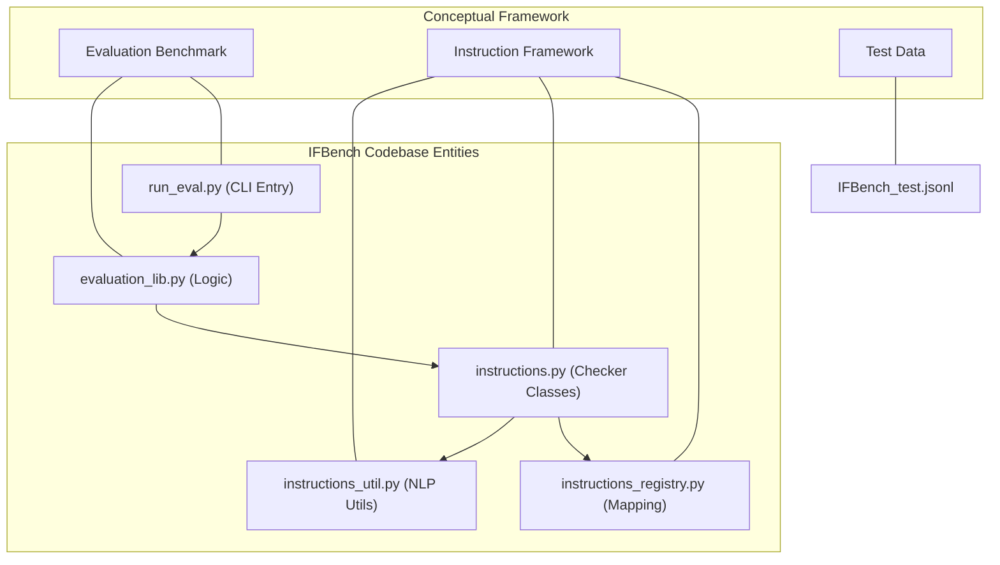

Sources: [README.md:15-20](), [README.md:30-31]()

## Evaluation Benchmark

The IFBench evaluation benchmark is the core component of the system, providing a rigorous testing framework for instruction following capabilities.

### OOD Constraints
IFBench includes 58 challenging out-of-distribution constraints [README.md:9-9](). These constraints are combined with prompts from a held-out set of WildChat (Zhao et al. 2024) to create diverse evaluation scenarios.

### Multiturn Constraint Isolation
IFBench optionally supports multiturn constraint isolation testing, where the prompt and the constraint are separated over two turns: the first turn is the user prompt and the model's response, and the second turn is the constraint that modifies the initial prompt [README.md:11-11]().

For details on the theoretical underpinnings and evaluation methodology, see [Research Foundation](#1.1).

Sources: [README.md:7-11]()

## Instruction Framework

The instruction framework is the backbone of IFBench, providing the programmatic implementation of constraints and verification functions.

### Verification Workflow: Code Execution
This diagram illustrates how the code entities interact to verify a model's response against specific instructions.

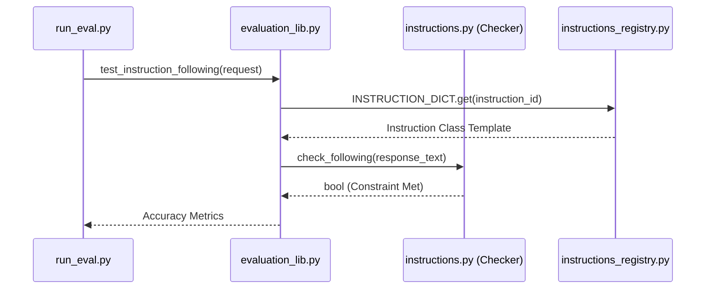

The framework consists of:
1.  **Instruction Classes**: Classes that implement logic for checking constraints [README.md:30-30]().
2.  **Instruction Registry**: Maps instruction IDs to their corresponding classes.
3.  **Text Processing Utilities**: Helper functions for text analysis and manipulation.

For details on the internal architecture of these classes, see [System Architecture](#1.2).

Sources: [README.md:7-8](), [README.md:30-30]()

## Training Methodology

IFBench includes IF-RLVR (Instruction Following - Reinforcement Learning from Verifiable Responses), a training methodology specifically designed for improving instruction following capabilities [README.md:27-28]().

### Training Constraints
The system provides 29 specialized training constraints with corresponding verification functions [README.md:13-13](). These are distinct from the 58 OOD evaluation constraints to test for generalization.

### Integration with open-instruct
The IF-RLVR training code is released as part of the [open-instruct](https://github.com/allenai/open-instruct) repository. It utilizes the `grpo_fast.py` script for training models on instruction following tasks [README.md:28-28]().

Sources: [README.md:12-31]()

## Getting Started

To get started with IFBench:

1.  Install the requirements via `requirements.txt` [README.md:16-16]().
2.  Prepare two JSONL files: `IFBench_test.jsonl` (test prompts) and your model's completions (e.g., `sample_output.jsonl`) [README.md:17-17]().
3.  Run the evaluation using the command-line interface:

```bash
python3 -m run_eval --input_data=IFBench_test.jsonl --input_response_data=sample_output.jsonl --output_dir=eval
```

Sources: [README.md:15-20]()

---

# Page: Research Foundation

# Research Foundation

<details>
<summary>Relevant source files</summary>

The following files were used as context for generating this wiki page:

- [Precise_IF_Generalization_Abilities.pdf](Precise_IF_Generalization_Abilities.pdf)
- [README.md](README.md)

</details>


This document explains the theoretical framework and research behind instruction following generalization abilities in the IFBench system. It covers the core research concepts that form the foundation of the benchmark and training methodology, including the lineage from IFEval and the novel IF-RLVR framework.

## Research Background

IFBench builds upon and extends previous work in instruction following evaluation, particularly **IFEval** (Zhou et al. 2023) [README.md:61-61](). The benchmark was developed to address limitations in existing instruction following evaluation methods by creating more challenging constraints and focusing on **Out-of-Distribution (OOD)** generalization [README.md:9-9]().

The research focuses on precise instruction following generalization abilities, examining how language models can follow complex constraints that were not encountered during the training phase.

### Lineage and Evolution
The following diagram maps the conceptual transition from the original IFEval framework to the IFBench implementation, highlighting the shift toward verifiable RL training.

**Research Evolution: IFEval to IFBench**
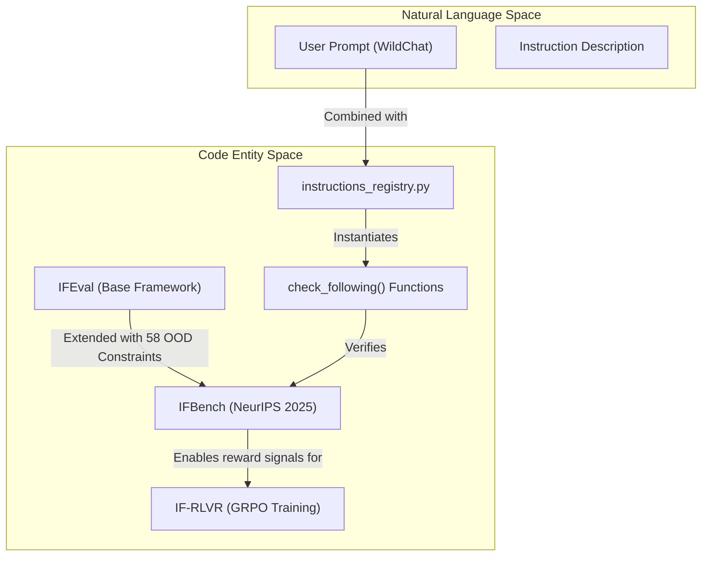
Sources: [README.md:3-9](), [README.md:61-61]()

## Key Research Contributions

IFBench introduces several key research contributions to the field of instruction following evaluation:

1.  **OOD Constraints**: 58 new and challenging constraints with corresponding verification functions [README.md:9-9]().
2.  **Multiturn Constraint Isolation**: A methodology where the prompt and the constraint are separated over two turns to test the model's ability to modify existing output based on new constraints [README.md:11-12]().
3.  **IF-RLVR Training Methodology**: Reinforcement Learning from Verifiable Responses, which utilizes 29 specific training constraints to improve generalization to the 58 OOD test constraints [README.md:13-13](), [README.md:27-28]().

### The Generalization Gap
A core finding of the accompanying paper is the "Generalization Gap"—the difference in performance between instructions seen during training and those that are structurally or semantically distinct (OOD). IFBench measures this by ensuring the evaluation set contains 58 constraints that are held out from the 29 training constraints [README.md:9-13]().

## Constraint Framework and Verifiability

The research introduces a diverse set of constraint categories designed to be programmatically verifiable. This verifiability allows for precise, objective measurement of model performance without relying on subjective LLM-based grading.

| Category | Research Focus | Implementation Example |
| :--- | :--- | :--- |
| **Count** | Quantitative precision | `count_words`, `count_stopwords` |
| **Format** | Structural adherence | JSON, CSV, List formatting |
| **Linguistic** | Syntactic/Semantic constraints | No-pronouns, syllable counts, sentence structure |
| **Multiturn** | Contextual updates | Modifying turn 1 output in turn 2 |

### Bridging Constraints to Code Entities
The diagram below illustrates how a research-defined "Constraint" is transformed into a verifiable code object within the `IFBench` system.

**Constraint Instantiation Pipeline**
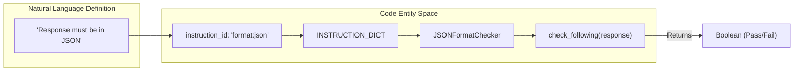
Sources: [README.md:9-13](), [README.md:30-31]()

## IF-RLVR: Training Methodology

The research introduces **IF-RLVR** (Reinforcement Learning from Verifiable Responses). This methodology integrates with the **open-instruct** repository and utilizes **GRPO** (Gradient-based Reinforcement Policy Optimization) [README.md:27-28]().

### The Reward Signal
In IF-RLVR, the "Reward" is derived directly from the verification functions. Instead of a human preference or an LLM judge, the system uses the `check_following` logic to provide a binary or scalar reward based on whether the model's response strictly adheres to the provided constraints.

*   **Training Data**: `IF_multi_constraints_upto5` dataset containing prompts with up to 5 simultaneous constraints [README.md:25-25]().
*   **Optimization**: Uses the `grpo_fast.py` script to optimize the model policy against the verifiable reward [README.md:28-28]().

## Research Findings and Performance

The research establishes a leaderboard that compares state-of-the-art models (e.g., OpenAI o3, DeepSeek R1) against base models fine-tuned with IF-RLVR.

*   **Key Finding**: Models trained with IF-RLVR (e.g., Qwen2.5 Base + IF-RLVR) show significant improvements in both IFEval and IFBench scores, often outperforming much larger instruct-tuned models [README.md:36-47]().
*   **Inference Strategy**: For "thinking models," the research suggests allowing more tokens and processing the output to extract the final answer from reasoning chains to ensure fair evaluation [README.md:22-22]().

Sources: [README.md:22-22](), [README.md:32-47](), [README.md:69-76]()

---

# Page: System Architecture

# System Architecture

<details>
<summary>Relevant source files</summary>

The following files were used as context for generating this wiki page:

- [README.md](README.md)
- [evaluation_lib.py](evaluation_lib.py)
- [instructions.py](instructions.py)
- [run_eval.py](run_eval.py)

</details>


This document provides a high-level overview of the IFBench system architecture, its core components, and how they interact. It focuses on the structural organization of the codebase and the relationships between different modules, specifically bridging the natural language instruction space with the underlying code entities.

## Overview

IFBench is a benchmark system for evaluating precise instruction following capabilities in language models. The architecture consists of several interconnected components that work together to provide a comprehensive evaluation framework, ranging from data loading to verifiable constraint checking.

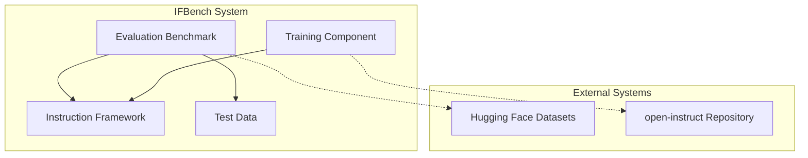

Sources: [README.md:6-14]()

## Core Components

IFBench consists of four primary components that work together to provide a comprehensive instruction following evaluation system:

1.  **Evaluation System**: Orchestrated by `run_eval.py` [run_eval.py:1-86]() and `evaluation_lib.py` [evaluation_lib.py:1-225](). It handles the execution flow, from reading JSONL files to computing final accuracy metrics.
2.  **Instruction Framework**: The logic layer defined in `instructions.py` [instructions.py:83-100]() and `instructions_registry.py`. It contains the `Instruction` base class and specific checker implementations like `WordCountRangeChecker` [instructions.py:104-148]().
3.  **Data Layer**: Managed via `InputExample` [evaluation_lib.py:27-32]() and `OutputExample` [evaluation_lib.py:35-41]() dataclasses. This layer ensures consistent data formatting between the WildChat-sourced prompts and the model responses.
4.  **Training Component (IF-RLVR)**: Integrates with the `open-instruct` repository to provide reward signals during Reinforcement Learning from Verifiable Responses (RLVR) [README.md:27-31]().

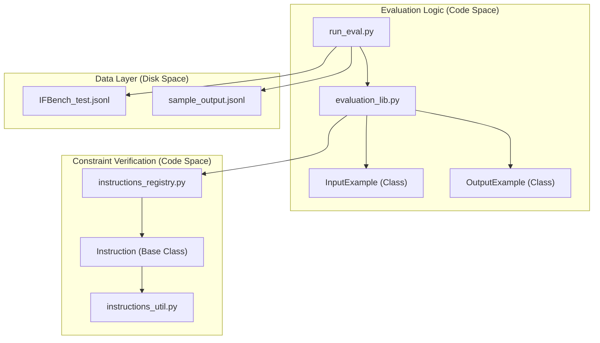

Sources: [run_eval.py:27-41](), [evaluation_lib.py:26-41](), [instructions.py:83-100](), [instructions_util.py:1-40]()

## Evaluation Pipeline

The evaluation pipeline is the central workflow in IFBench, responsible for processing test prompts, model responses, and generating evaluation results. It supports two main modes: `test_instruction_following_strict` [evaluation_lib.py:75-104]() and `test_instruction_following_loose` [evaluation_lib.py:107-167]().

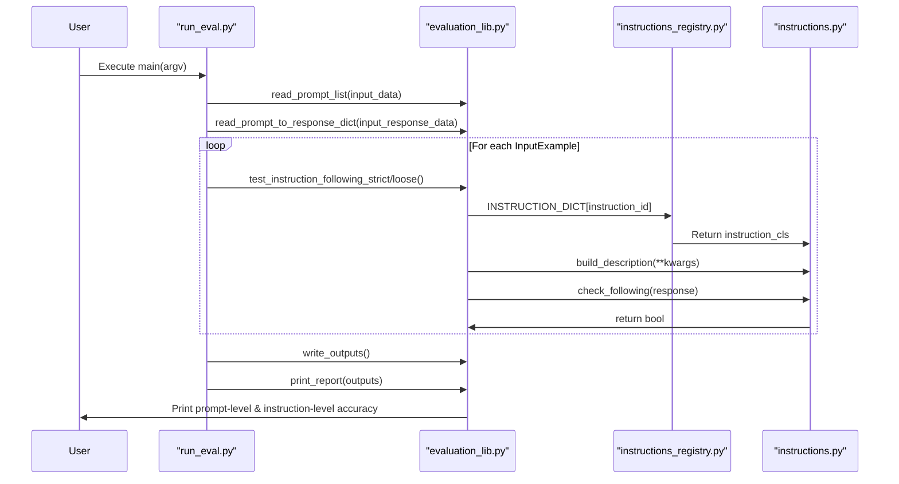

Sources: [run_eval.py:43-82](), [evaluation_lib.py:75-167](), [evaluation_lib.py:179-225]()

## Instruction Framework Architecture

The framework bridges natural language constraints to programmatic verification. Every constraint (e.g., "Word Count") is mapped to a Python class that inherits from the `Instruction` base class [instructions.py:83-100]().

| Code Entity | Role | Key Functions |
| :--- | :--- | :--- |
| `Instruction` | Base Interface | `build_description`, `check_following` |
| `INSTRUCTION_DICT` | Registry | Maps `instruction_id` strings to classes |
| `instructions_util` | Utility Layer | `count_words`, `split_into_sentences` |

### Code Entity Mapping
The following diagram maps the logical concept of a "Constraint" to the specific classes and methods used in the codebase.

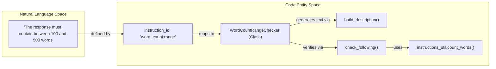

Sources: [instructions.py:83-148](), [evaluation_lib.py:84-88](), [instructions_util.py:1-40]()

## Key Data Structures

The evaluation system uses two primary data structures to manage the flow of information, defined as dataclasses in `evaluation_lib.py`:

1.  **InputExample**: Represents a test prompt with its associated instruction IDs and parameters [evaluation_lib.py:27-32]().
2.  **OutputExample**: Represents the evaluation results for a given prompt and response, including per-instruction boolean flags [evaluation_lib.py:35-41]().

| Data Structure | Fields | Purpose |
| :--- | :--- | :--- |
| `InputExample` | `key`, `instruction_id_list`, `prompt`, `kwargs` | Stores input test data with instruction parameters. |
| `OutputExample` | `instruction_id_list`, `prompt`, `response`, `follow_all_instructions`, `follow_instruction_list` | Stores evaluation results and model completion. |

Sources: [evaluation_lib.py:26-41]()

## Evaluation Methodologies

IFBench provides two evaluation methods to assess instruction following capabilities, implemented in `evaluation_lib.py`:

1.  **Strict Evaluation (`test_instruction_following_strict`)**: Directly checks if the raw model response follows each instruction exactly as specified [evaluation_lib.py:75-104]().
2.  **Loose Evaluation (`test_instruction_following_loose`)**: Provides an upper bound by trying multiple variations of the response (removing first/last lines, removing asterisks, etc.) to account for model formatting artifacts [evaluation_lib.py:107-167]().

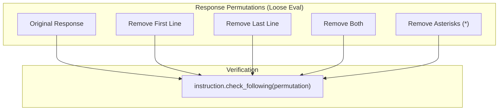

Sources: [evaluation_lib.py:122-139](), [evaluation_lib.py:153-157]()

## External Integrations

IFBench is designed to work within a larger ecosystem for both evaluation and model training:

*   **Hugging Face Datasets**: Hosts the `IFBench_test`, `IFBench_multi-turn`, and `IF_multi_constraints_upto5` datasets [README.md:24-25]().
*   **open-instruct**: The training logic for IF-RLVR is integrated into the `open-instruct` repository, specifically using the `grpo_fast.py` script [README.md:27-31]().
*   **NLTK**: Used for text processing (tokenization, sentence splitting) with local data management in `.nltk_data` [instructions.py:25-32]().

Sources: [README.md:24-31](), [instructions.py:25-32]()

---

# Page: Evaluation System

# Evaluation System

<details>
<summary>Relevant source files</summary>

The following files were used as context for generating this wiki page:

- [evaluation_lib.py](evaluation_lib.py)
- [run_eval.py](run_eval.py)

</details>


The IFBench Evaluation System is a comprehensive framework for assessing language models' ability to follow precise instructions. This system provides programmatic verification of 58 out-of-distribution (OOD) constraints, enabling both strict and loose evaluation methodologies.

For information about running evaluations via the command-line interface, see [Running Evaluations](#2.2). For details on the underlying instruction framework that defines constraints, see [Instruction Framework](#3).

## Overview

The IFBench Evaluation System measures how accurately language models follow specific instructions by comparing model responses against programmatically defined constraints. The system supports two evaluation modes:

1.  **Strict Evaluation**: Directly checks if responses meet constraints exactly as specified [evaluation_lib.py:75-104]().
2.  **Loose Evaluation**: Provides an upper bound by checking multiple variations of responses (e.g., removing leading/trailing lines or asterisks) [evaluation_lib.py:107-166]().

The evaluation system processes test prompts and model responses, verifies constraint adherence, and generates detailed accuracy reports at both prompt and instruction levels.

Sources: [run_eval.py:16-17](), [evaluation_lib.py:75-166]()

## System Architecture

The following diagram maps the logical components of the evaluation system to their corresponding code entities.

**Evaluation System Components**
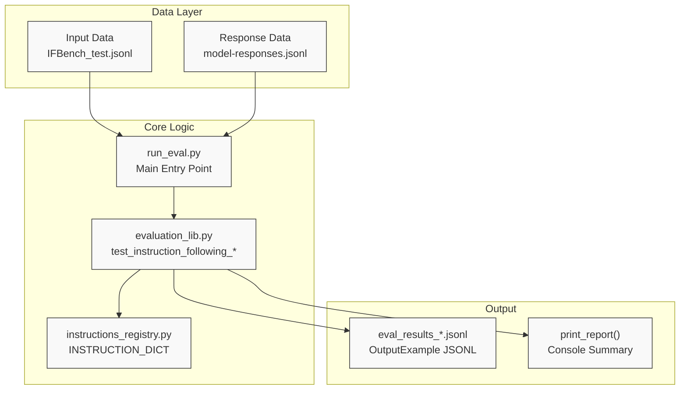

The evaluation system consists of several key components:
- **Input Data**: Handled via `read_prompt_list` [evaluation_lib.py:43-54]().
- **Response Data**: Loaded into a lookup table via `read_prompt_to_response_dict` [evaluation_lib.py:169-176]().
- **Evaluation Logic**: Orchestrated by `run_eval.py` which iterates through inputs and calls verification functions [run_eval.py:52-62]().
- **Instruction Registry**: Used by `evaluation_lib.py` to dynamically instantiate constraint checkers [evaluation_lib.py:85-86]().

Sources: [run_eval.py:47-62](), [evaluation_lib.py:43-54](), [evaluation_lib.py:169-176](), [evaluation_lib.py:85-86]()

## Data Flow

The following sequence diagram illustrates how the system bridges the natural language space (prompts/responses) to the code entity space (Instruction classes).

**Evaluation Sequence**
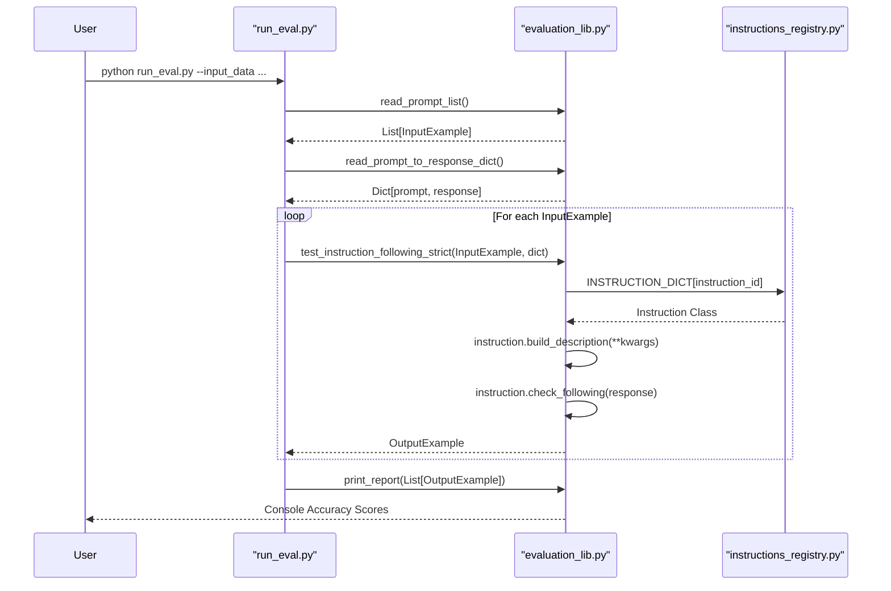

Sources: [run_eval.py:43-85](), [evaluation_lib.py:75-104](), [evaluation_lib.py:107-166]()

## Data Structures

The system relies on two primary `dataclasses` defined in `evaluation_lib.py`.

### InputExample
Represents the raw test case loaded from the benchmark JSONL file [evaluation_lib.py:26-31]().
- `key`: Unique integer ID.
- `instruction_id_list`: List of constraint IDs (e.g., `["word_count:1"]`).
- `prompt`: The user query.
- `kwargs`: List of dictionaries containing arguments for the constraint checkers (e.g., `{"min_words": 10}`).

### OutputExample
Captures the result of the verification process [evaluation_lib.py:34-40]().
- `follow_all_instructions`: Boolean indicating if the model satisfied every constraint for the prompt.
- `follow_instruction_list`: A list of booleans mapping to each instruction in the `instruction_id_list`.

Sources: [evaluation_lib.py:26-41]()

## Evaluation Methods

The system implements two distinct methodologies for verification:

### Strict Evaluation
Implemented in `test_instruction_following_strict`, this method checks the model's raw response string against the constraints [evaluation_lib.py:75-104](). If the response is empty or fails the `check_following` logic of any instruction, it is marked as a failure [evaluation_lib.py:93-96]().

### Loose Evaluation
Implemented in `test_instruction_following_loose`, this method attempts to account for common LLM formatting "noise" [evaluation_lib.py:107-166](). It generates eight variations of the response by:
- Removing the first or last line (common for "Sure, here is..." headers) [evaluation_lib.py:122-125]().
- Removing asterisks used for bolding or bullet points [evaluation_lib.py:126-129]().
- Combinations of the above [evaluation_lib.py:130-139]().

If any variation satisfies the constraint, the instruction is marked as followed [evaluation_lib.py:153-156]().

Sources: [evaluation_lib.py:75-166]()

## Accuracy Reporting

The `print_report` function in `evaluation_lib.py` aggregates results into three tiers [evaluation_lib.py:179-220]():

1.  **Prompt-level Accuracy**: The percentage of prompts where `follow_all_instructions` is true [evaluation_lib.py:198-199]().
2.  **Instruction-level Accuracy**: The percentage of individual constraints satisfied across all prompts [evaluation_lib.py:201-202]().
3.  **Per-Instruction Breakdown**: Detailed accuracy for each constraint ID, allowing developers to identify specific categories (e.g., "word_count" vs "comma_number") where the model struggles [evaluation_lib.py:204-220]().

Sources: [evaluation_lib.py:179-220](), [run_eval.py:78-81]()

## Summary

The IFBench Evaluation System provides a robust, reproducible way to measure instruction following. By utilizing programmatic checkers defined in the [Instruction Framework](#3) and offering both strict and loose metrics, it allows for a nuanced understanding of model performance. For details on the evaluation process and metrics computation, see [Evaluation Pipeline](#2.1). To run these evaluations yourself, see [Running Evaluations](#2.2).

Sources: [run_eval.py:16-17](), [evaluation_lib.py:16-17]()

---

# Page: Evaluation Pipeline

# Evaluation Pipeline

<details>
<summary>Relevant source files</summary>

The following files were used as context for generating this wiki page:

- [evaluation_lib.py](evaluation_lib.py)
- [run_eval.py](run_eval.py)

</details>


The evaluation pipeline is the core system responsible for assessing how well language models adhere to verifiable constraints. It processes model responses against test prompts, instantiates instruction checkers via a central registry, and computes multi-level accuracy metrics.

## Overview

The evaluation pipeline bridges the gap between raw model outputs and structured performance metrics. It supports two primary evaluation modes: **Strict**, which requires an exact match to constraints, and **Loose**, which accounts for common formatting artifacts (like markdown or conversational filler) to provide an upper bound on performance.

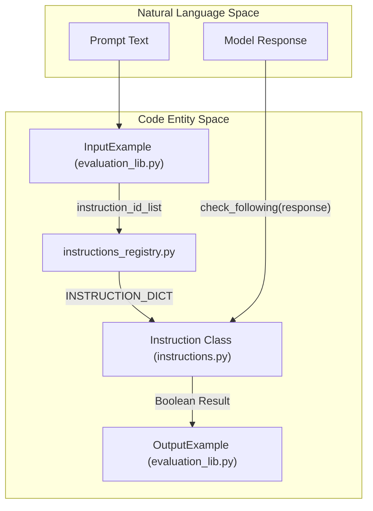

Sources: [evaluation_lib.py:26-41](), [evaluation_lib.py:75-104](), [instructions_registry.py:1-20]()

## Data Structures

The pipeline relies on two primary `dataclass` objects to manage the flow of information.

### InputExample
Defined in `evaluation_lib.py`, this class encapsulates the data required to perform an evaluation for a single prompt.
*   `key`: A unique integer identifier for the prompt.
*   `instruction_id_list`: A list of strings identifying which constraints apply to this prompt.
*   `prompt`: The actual text sent to the model.
*   `kwargs`: A list of dictionaries containing the specific parameters (e.g., word counts, specific keywords) for each instruction in the `instruction_id_list`.

### OutputExample
This class stores the results of the evaluation process.
*   `instruction_id_list`: The original list of instruction IDs.
*   `prompt`: The original prompt text.
*   `response`: The model's generated text.
*   `follow_all_instructions`: A boolean indicating if every constraint was satisfied (Prompt-level accuracy).
*   `follow_instruction_list`: A list of booleans representing the pass/fail state for each individual instruction (Instruction-level accuracy).

Sources: [evaluation_lib.py:26-41]()

## Evaluation Methodologies

The pipeline implements two distinct logic paths for verification, handled by `test_instruction_following_strict` and `test_instruction_following_loose`.

### Strict Evaluation
`test_instruction_following_strict` performs a direct check on the raw model response.
1.  It iterates through the `instruction_id_list` [evaluation_lib.py:84]().
2.  It retrieves the corresponding class from `instructions_registry.INSTRUCTION_DICT` [evaluation_lib.py:85]().
3.  It instantiates the class and calls `build_description` with the provided `kwargs` [evaluation_lib.py:88]().
4.  It executes `instruction.check_following(response)` [evaluation_lib.py:93]().

### Loose Evaluation
`test_instruction_following_loose` is designed to be more permissive. It generates eight variations of the model's response to ignore common "noise" that doesn't affect the core instruction following [evaluation_lib.py:122-139]():
*   Removing the first line, last line, or both (to ignore conversational "Sure, here is..." or "Hope this helps").
*   Removing markdown characters like asterisks (`*`).
*   Combinations of the above.

An instruction is marked as followed if **any** of these variations satisfy the `check_following` criteria [evaluation_lib.py:153-156]().

Sources: [evaluation_lib.py:75-104](), [evaluation_lib.py:107-166]()

## Metrics and Accuracy Computation

The `print_report` function in `evaluation_lib.py` calculates the benchmark's primary KPIs.

| Metric | Definition | Calculation Logic |
| :--- | :--- | :--- |
| **Prompt-level Accuracy** | Percentage of prompts where every constraint was met. | `sum(follow_all_instructions) / total_prompts` [evaluation_lib.py:197-199]() |
| **Instruction-level Accuracy** | Percentage of total individual constraints satisfied. | `sum(all_individual_bools) / total_constraints` [evaluation_lib.py:201-202]() |

### Tiered Reporting
The pipeline further breaks down accuracy into two tiers:
*   **Tier 0**: Aggregated by the base instruction type (e.g., all "word_count" variants) [evaluation_lib.py:207-210]().
*   **Tier 1**: Specific to the full instruction ID including parameters [evaluation_lib.py:215-217]().

Sources: [evaluation_lib.py:179-220]()

## Data Flow Diagram

The following diagram illustrates the execution flow from the CLI entry point through the library functions.

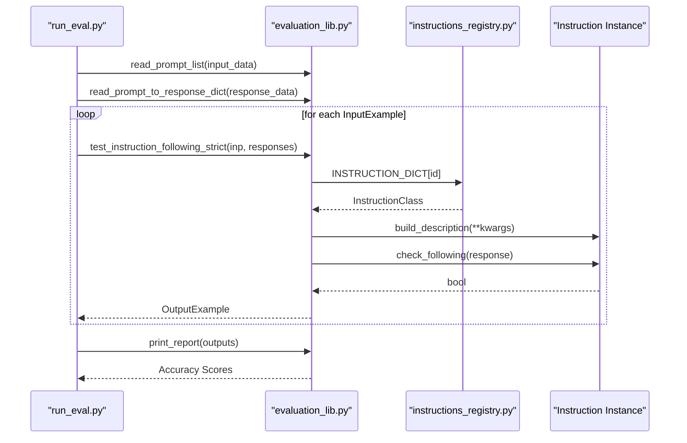

Sources: [run_eval.py:47-62](), [evaluation_lib.py:75-104](), [evaluation_lib.py:179-220]()

## Implementation Details

### Instruction Instantiation
The pipeline uses dynamic dispatch to load instruction checkers. The registry maps a string ID (e.g., `punctuation:no_comma`) to a Python class. 
1.  The class is instantiated with its ID: `instruction = instruction_cls(instruction_id)` [evaluation_lib.py:86]().
2.  If the instruction requires context from the prompt itself (determined by checking `get_instruction_args`), the pipeline re-runs `build_description` with the prompt text [evaluation_lib.py:89-91]().

### Results Persistence
Results are saved to JSONL files using `write_outputs`. This function uses Python's `dir()` and `__getattribute__` to serialize all non-private attributes of the `OutputExample` objects into a JSON format [evaluation_lib.py:57-72]().

Sources: [evaluation_lib.py:57-72](), [evaluation_lib.py:84-91]()

---

# Page: Running Evaluations

# Running Evaluations

<details>
<summary>Relevant source files</summary>

The following files were used as context for generating this wiki page:

- [data/IFBench_test.jsonl](data/IFBench_test.jsonl)
- [eval/eval_results_loose.jsonl](eval/eval_results_loose.jsonl)
- [eval/eval_results_strict.jsonl](eval/eval_results_strict.jsonl)
- [evaluation_lib.py](evaluation_lib.py)
- [run_eval.py](run_eval.py)

</details>


This document provides detailed instructions on how to run evaluations using the IFBench evaluation system. It covers the command-line interface, required input files, output formats, and evaluation modes.

## Overview of the Evaluation Process

The IFBench evaluation system measures how well language models follow precise instructions. The evaluation process requires two key inputs:
1. A dataset of test prompts with instruction constraints (e.g., `IFBench_test.jsonl`).
2. Model responses to these prompts (e.g., `sample_output.jsonl`).

The system then evaluates whether the model responses adhere to the specified constraints and produces detailed results.

### Evaluation Data Flow

The following diagram bridges the Natural Language requirements to the internal `evaluation_lib.py` logic.

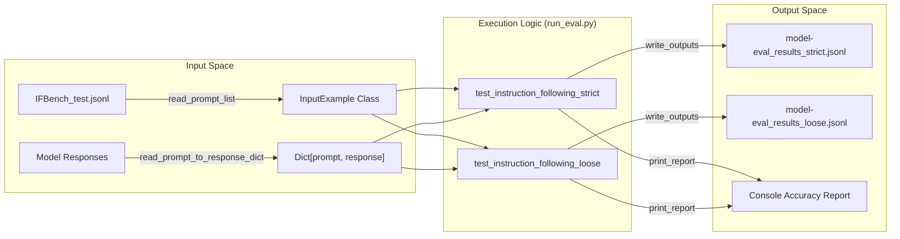

Sources: [run_eval.py:43-82](), [evaluation_lib.py:27-41]()

## Command-Line Interface

The evaluation is run through the `run_eval.py` script, which uses `absl.flags` for configuration.

### Basic Command
```bash
python3 run_eval.py --input_data=data/IFBench_test.jsonl --input_response_data=sample_output.jsonl --output_dir=eval_results
```

### Flag Descriptions

| Flag | Description | Code Reference |
|----------|-------------|----------|
| `--input_data` | Path to the test prompts file (JSONL format containing `instruction_id_list` and `kwargs`). | [run_eval.py:27-29]() |
| `--input_response_data` | Path to the model responses file (JSONL format containing `prompt` and `response`). | [run_eval.py:31-33]() |
| `--output_dir` | Directory where evaluation results and JSONL reports will be saved. | [run_eval.py:35-40]() |

Sources: [run_eval.py:27-41]()

## Expected Input/Output Formats

### Input Formats
1.  **Test Data (`InputExample`)**: A JSONL where each line matches the `InputExample` dataclass: `key`, `instruction_id_list`, `prompt`, and `kwargs` [evaluation_lib.py:27-32]().
2.  **Response Data**: A JSONL containing at minimum the `prompt` (used as a key for lookup) and the `response` string [evaluation_lib.py:169-176]().

### Output Formats (`OutputExample`)
The evaluation produces `OutputExample` objects [evaluation_lib.py:35-41](), which are serialized to JSONL. Key fields include:
*   `follow_all_instructions`: Boolean indicating if every constraint in the prompt was met.
*   `follow_instruction_list`: A list of booleans corresponding to each individual instruction ID.

Sources: [evaluation_lib.py:27-41](), [evaluation_lib.py:169-176]()

## Evaluation Methodologies

The script executes two evaluation passes for every input:

### Strict Evaluation
Implemented in `test_instruction_following_strict` [evaluation_lib.py:75-104](). It checks the raw response against the constraint checkers. If the response is empty or whitespace, it fails by default [evaluation_lib.py:93-96]().

### Loose Evaluation
Implemented in `test_instruction_following_loose` [evaluation_lib.py:107-166](). This methodology provides an upper bound by testing multiple permutations of the response to account for common formatting artifacts. It checks:
*   The original response.
*   The response with the first line, last line, or both removed [evaluation_lib.py:122-125]().
*   Versions of the above with markdown bolding (`*`) removed [evaluation_lib.py:126-129]().

### Internal Evaluation Logic

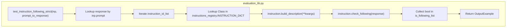

Sources: [evaluation_lib.py:75-104](), [evaluation_lib.py:107-166]()

## Interpreting the Accuracy Report

After processing all examples, `run_eval.py` calls `evaluation_lib.print_report(outputs)` [run_eval.py:81](). This function calculates and prints several metrics:

1.  **Prompt-level Accuracy**: The ratio of prompts where `follow_all_instructions` is true [evaluation_lib.py:219]().
2.  **Instruction-level Accuracy**: The ratio of individual constraints followed across all prompts [evaluation_lib.py:220]().
3.  **Tiered Breakdown**:
    *   **Tier 0**: Accuracy grouped by the base instruction category (e.g., `count`, `format`) [evaluation_lib.py:207-210]().
    *   **Tier 1**: Accuracy grouped by specific instruction IDs (e.g., `count:keywords_multiple`) [evaluation_lib.py:212-217]().

The output filenames are derived from the model response filename to allow for easy comparison between different model runs [run_eval.py:64-70]().

Sources: [run_eval.py:60-82](), [evaluation_lib.py:179-220]()

---

# Page: Instruction Framework

# Instruction Framework

<details>
<summary>Relevant source files</summary>

The following files were used as context for generating this wiki page:

- [instructions.py](instructions.py)
- [instructions_registry.py](instructions_registry.py)
- [requirements.txt](requirements.txt)

</details>


The Instruction Framework is the core system within IFBench that defines, manages, and verifies instruction-following constraints. It provides a standardized way to specify constraints for language model outputs and programmatically verify whether responses adhere to these constraints.

For information about running evaluations using this framework, see [Evaluation Pipeline](#2.1). For details on the specific instruction classes and their capabilities, see [Instruction Classes](#3.1).

## Overview

The Instruction Framework consists of three main components:

1. A base `Instruction` class that defines the interface for all instruction types.
2. Specialized instruction checker classes that implement specific constraints (e.g., `WordCountRangeChecker`, `UniqueWordCountChecker`).
3. An instruction registry (`INSTRUCTION_DICT`) that maps instruction IDs to their corresponding classes.

Together, these components enable the definition of precise constraints on model outputs and provide mechanisms to verify compliance with these constraints.

### System Components and Code Mapping
The following diagram bridges the Natural Language requirements to the specific code entities responsible for verification.

```mermaid
graph TD
    subgraph "Natural Language Space"
        ID["Instruction ID<br/>'count:word_count_range'"]
        DESC["Description Pattern<br/>'The response must contain between {min} and {max} words.'"]
    end

    subgraph "Code Entity Space"
        Registry["INSTRUCTION_DICT<br/>(instructions_registry.py)"]
        Base["Instruction Base Class<br/>(instructions.py)"]
        Checker["WordCountRangeChecker<br/>(instructions.py)"]
        Util["instructions_util.py<br/>(Text Processing)"]
    end

    ID -->|Lookup| Registry
    Registry -->|Maps to| Checker
    Checker --|>|Inherits| Base
    Checker -->|Uses| Util
    Checker -->|Generates| DESC
```
Sources: [instructions.py:83-100](), [instructions_registry.py:20-79](), [instructions_util.py:1-20]()

## Instruction Base Class

The foundation of the framework is the `Instruction` class [instructions.py:83-100](), which defines the lifecycle and interface that all instruction checkers must implement:

1.  `build_description(**kwargs)`: Constructs the natural language instruction text based on provided parameters [instructions.py:89-90]().
2.  `get_instruction_args()`: Returns the parameters used to build the instruction [instructions.py:92-93]().
3.  `get_instruction_args_keys()`: Returns the parameter names accepted by the instruction [instructions.py:95-96]().
4.  `check_following(value)`: Verifies if a given response string follows the instruction [instructions.py:98-99]().

For details on implementation patterns, see [Instruction Classes](#3.1).

## Instruction Categories

The framework includes over 70 different instruction types organized into several categories in the registry. These categories define the namespace for `instruction_id` strings.

| Category | Description | Example ID |
| :--- | :--- | :--- |
| `count` | Numerical constraints on words, numbers, or entities. | `count:word_count_range` |
| `ratio` | Percentage or balance constraints (e.g., stop words, sentence types). | `ratio:stop_words` |
| `words` | Constraints on specific word properties (vowels, syllables, positions). | `words:prime_lengths` |
| `format` | Structural requirements (indentation, quotes, bullet points). | `format:line_indent` |
| `sentence` | Sentence-level constraints (alliteration, keywords). | `sentence:increment` |
| `custom` | Complex logic tasks (reversal, CSV generation, sorting). | `custom:european_capitals_sort` |

Sources: [instructions_registry.py:20-79]()

## Instruction Registry

The instruction registry maps string identifiers to their corresponding instruction classes. This allows the evaluation system to perform dynamic dispatch based on the `instruction_id` found in the test data.

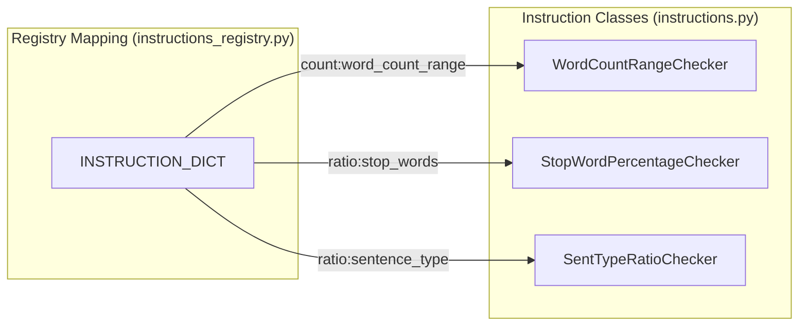

The registry is implemented as a dictionary in `instructions_registry.py` [instructions_registry.py:20-79](), mapping string identifiers to class references defined in `instructions.py`.

For details on the namespace convention, see [Instruction Registry](#3.2).

## Instruction Lifecycle

The typical lifecycle of an instruction in the IFBench system follows these steps:

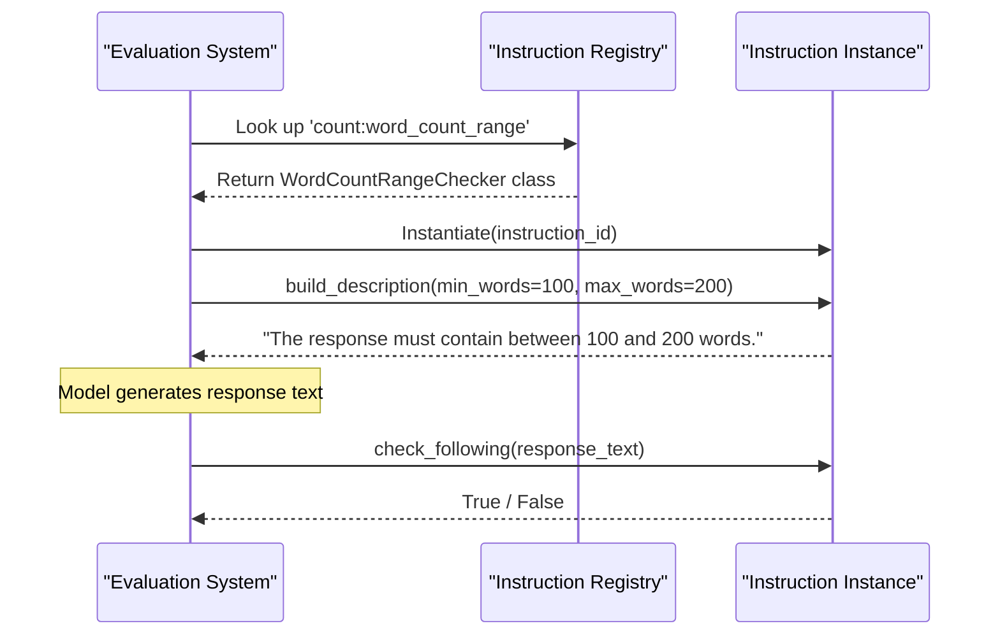

Sources: [instructions.py:104-147](), [instructions_registry.py:20-21]()

## Text Processing Utilities

Instruction checkers rely on a centralized suite of text processing functions in `instructions_util.py`. These utilities ensure consistent tokenization, sentence splitting, and linguistic analysis across different constraints.

Key utilities include:
*   `count_words(text)`: Standardized word counting [instructions_util.py:112-114]().
*   `split_into_sentences(text)`: NLTK-based sentence segmentation [instructions_util.py:86-88]().
*   `count_stopwords(text)`: Identifying stop words based on the `WORD_LIST` [instructions_util.py:123-125]().

For details on the utility library, see [Text Processing Utilities](#3.3).

## Summary

The Instruction Framework provides a modular architecture for verifiable constraints. By separating the instruction definition (registry), logic (classes), and processing (utilities), IFBench can scale to complex Out-of-Distribution (OOD) constraints while maintaining a unified interface for both evaluation and RLVR training.

---

# Page: Instruction Classes

# Instruction Classes

<details>
<summary>Relevant source files</summary>

The following files were used as context for generating this wiki page:

- [instructions.py](instructions.py)
- [instructions_test.py](instructions_test.py)

</details>


This page documents the instruction classes in the IFBench system, which are responsible for defining and checking constraints for instruction following evaluation. These classes form the core of the constraint verification system used to assess model responses against specific requirements.

For information about how these instruction classes are registered and accessed, see [Instruction Registry](3.2). For details on the evaluation process that uses these classes, see [Evaluation Pipeline](2.1).

## Overview of the Instruction Framework

The instruction framework provides a structured way to define constraints and verify if model responses adhere to these constraints. Each instruction class represents a specific type of constraint (such as word count, formatting requirements, or content specifications) and contains logic to check if a response follows that constraint.

### Instruction Class Hierarchy
The system uses an object-oriented approach where a base `Instruction` class defines the interface for all specific checkers.

```mermaid
classDiagram
    class "Instruction" {
        <<Abstract>>
        +id: string
        +build_description(**kwargs): string
        +get_instruction_args(): dict
        +get_instruction_args_keys(): list
        +check_following(value): bool
    }
    
    class "WordCountRangeChecker" {
        +check_following(value): bool
    }
    
    class "UniqueWordCountChecker" {
        +check_following(value): bool
    }
    
    class "SentTypeRatioChecker" {
        +check_following(value): bool
    }

    class "NumbersCountChecker" {
        +check_following(value): bool
    }
    
    "Instruction" <|-- "WordCountRangeChecker"
    "Instruction" <|-- "UniqueWordCountChecker"
    "Instruction" <|-- "SentTypeRatioChecker"
    "Instruction" <|-- "NumbersCountChecker"
    "Instruction" <|-- "StopWordPercentageChecker"
    "Instruction" <|-- "PersonNameCountChecker"
    "Instruction" <|-- "AlphabetLoopChecker"
    "Instruction" <|-- "NestedParenthesesChecker"
    "Instruction" <|-- "CityCSVChecker"
```

Sources: [instructions.py:83-100](), [instructions.py:104-148](), [instructions.py:149-188](), [instructions.py:213-237]()

## Base Instruction Class

All instruction classes inherit from the base `Instruction` class, which defines the lifecycle for instruction generation and verification.

The base `Instruction` class defines four key methods:

1. `build_description(**kwargs)`: Constructs the instruction text that will be presented to the model. If arguments are missing, it often generates random valid values within specified limits (e.g., `_NUM_WORDS_LOWER_LIMIT`).
2. `get_instruction_args()`: Returns the arguments used to build the instruction instance.
3. `get_instruction_args_keys()`: Returns the keys of the arguments for serialization.
4. `check_following(value)`: The core verification logic. It returns a boolean indicating if the `value` (model response) satisfies the constraint.

Sources: [instructions.py:83-100](), [instructions.py:107-133]()

## Instruction Categories

The instruction classes are organized into several categories based on the type of constraint they enforce:

### Count Constraints
These checkers focus on the frequency of specific linguistic or structural elements.

| Class | Description | Implementation Detail |
|-------|-------------|-----------------------|
| `WordCountRangeChecker` | Response length in words must be between X and Y. | Uses `instructions_util.count_words`. |
| `UniqueWordCountChecker` | At least N unique words must be present. | Normalizes words to lowercase and strips punctuation. |
| `NumbersCountChecker` | Exactly N numbers must appear in the text. | Uses regex `r"\d+(?:,\d+)*(?:\.\d+)?"` to find numbers. |
| `PronounCountChecker` | At least N pronouns must be used. | Matches tokens against a hardcoded list of pronouns. |
| `PersonNameCountChecker` | Mentions at least N different person names. | Uses Spacy `en_core_web_sm` for NER (PERSON tag). |

Sources: [instructions.py:143-147](), [instructions.py:180-188](), [instructions.py:1414-1430](), [instructions.py:1078-1117](), [instructions.py:310-389]()

### Ratio and Proportion Constraints
These checkers evaluate the relative frequency of elements.

| Class | Description | Implementation Detail |
|-------|-------------|-----------------------|
| `StopWordPercentageChecker` | Stop words must be ≤ percentage% of total words. | Uses `instructions_util.count_stopwords`. |
| `SentTypeRatioChecker` | 2:1 ratio of declarative to interrogative sentences. | Uses `nltk.pos_tag` and punctuation analysis. |
| `SentBalanceChecker` | Equal distribution of sentence types. | Checks counts of '.', '?', and '!'. |
| `NGramOverlapChecker` | Specific percentage of trigram overlap with reference. | Uses `nltk.util.ngrams` with `n=3`. |

Sources: [instructions.py:219-228](), [instructions.py:213-237](), [instructions.py:240-265](), [instructions.py:391-428]()

### Formatting and Structural Constraints
These checkers verify the visual or syntactic structure of the response.

| Class | Description | Implementation Detail |
|-------|-------------|-----------------------|
| `NestedParenthesesChecker` | Parentheses nested at least 5 levels deep. | Implements a stack-based counter. |
| `NewLineWordsChecker` | Each word must be on its own line. | Checks if `len(value.splitlines())` equals word count. |
| `EmojiSentenceChecker` | Every sentence must end with an emoji. | Uses the `emoji` library to check the last character. |
| `CityCSVChecker` | Data must be in CSV format with specific headers. | Uses `io.StringIO` and `csv.DictReader`. |

Sources: [instructions.py:658-701](), [instructions.py:821-843](), [instructions.py:846-880](), [instructions.py:1716-1746]()

## Internal Architecture Patterns

### Text Normalization and Tokenization
The checkers rely on consistent text processing to ensure fair evaluation. A common pattern is the use of `_word_tokens_without_punctuation`, which filters out standalone punctuation tokens during word-based checks.

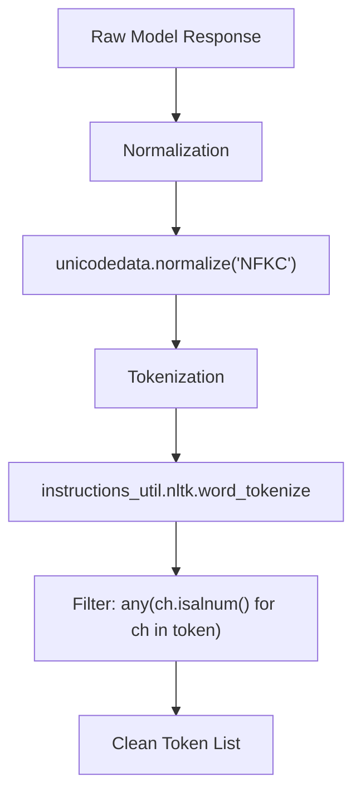

Sources: [instructions.py:43-49](), [instructions.py:35]()

### Data Flow: Natural Language to Code Entity
The evaluation system bridges the gap between natural language prompts and programmatic verification through the `Instruction` lifecycle.

```mermaid
sequenceDiagram
    participant User as "Natural Language Space"
    participant Registry as "INSTRUCTION_DICT (instructions_registry.py)"
    participant Inst as "Instruction Class (instructions.py)"
    participant Util as "instructions_util.py"

    User->>Registry: Request "count:word_count_range"
    Registry->>Inst: Instantiate WordCountRangeChecker
    Inst->>User: build_description() -> "The response must contain between 10 and 20 words."
    Note over User: Model generates "This is a short response."
    User->>Inst: check_following("This is a short response.")
    Inst->>Util: count_words("This is a short response.")
    Util-->>Inst: 5
    Inst-->>User: False (5 is not in range 10-20)
```

Sources: [instructions.py:104-148](), [instructions_registry.py:35-40](), [instructions_util.py:61-64]()

## Implementation Example: `NumbersCountChecker`

The `NumbersCountChecker` demonstrates how the system uses regular expressions to enforce precise constraints.

1.  **Description Building**: It takes a parameter `N` and formats the string `"Your response should contain exactly {N} numbers."` [instructions.py:1391-1412]().
2.  **Verification**: It uses `re.findall` with a pattern that handles commas and decimals to identify all numeric instances in the response [instructions.py:1425-1430]().

```python
# From instructions.py
def check_following(self, value):
    # Regex to find numbers including decimals and commas
    numbers = re.findall(r"\d+(?:,\d+)*(?:\.\d+)?", value)
    return len(numbers) == self._num_numbers
```

Sources: [instructions.py:1414-1430]()

## Conclusion

The `Instruction` classes provide a robust, modular framework for verifiable evaluation. By abstracting the logic of "following an instruction" into discrete classes with standardized `build_description` and `check_following` methods, IFBench can scale to dozens of diverse OOD (Out-of-Distribution) constraints.

Sources: [instructions.py:15-83](), [instructions_test.py:36-150]()

---

# Page: Instruction Registry

# Instruction Registry

<details>
<summary>Relevant source files</summary>

The following files were used as context for generating this wiki page:

- [evaluation_lib.py](evaluation_lib.py)
- [instructions_registry.py](instructions_registry.py)
- [requirements.txt](requirements.txt)

</details>


The Instruction Registry is a central component of the IFBench framework that maps instruction identifiers to their corresponding instruction class implementations. This page documents how the registry works, its structure, and how it connects instruction IDs to the classes that implement constraint checking logic.

## Overview

The Instruction Registry serves as a lookup table that translates string-based instruction identifiers into concrete Python class implementations. This mapping enables the evaluation system to dynamically instantiate the appropriate instruction checker based on the constraint type specified in test prompts.

### Registry Architecture and Flow
The following diagram illustrates how `evaluation_lib.py` utilizes `instructions_registry.py` to bridge the gap between JSON-based instruction IDs and the class logic in `instructions.py`.

```mermaid
flowchart LR
    subgraph "Evaluation System"
        EL["evaluation_lib.py"]
    end
    
    subgraph "Instruction Registry"
        IR["instructions_registry.py"]
        ID["INSTRUCTION_DICT"]
    end
    
    subgraph "Instruction Classes"
        IC["instructions.py"]
        WC["WordCountRangeChecker"]
        UC["UniqueWordCountChecker"]
        SC["StopWordPercentageChecker"]
        OC["Other Checkers..."]
    end
    
    EL -- "Lookup ID" --> IR
    IR -- "Access" --> ID
    ID -- "Instantiate" --> WC
    ID -- "Instantiate" --> UC
    ID -- "Instantiate" --> SC
    ID -- "Instantiate" --> OC
    WC & UC & SC & OC -- "Inherit from Instruction" --> IC
```
Sources: [instructions_registry.py:15-20](), [evaluation_lib.py:84-86](), [instructions_registry.py:20-79]()

## Registry Structure

The registry is implemented as a Python dictionary named `INSTRUCTION_DICT` in [instructions_registry.py:20](), which maps string identifiers to instruction class implementations. Each identifier follows a categorical naming pattern that helps organize the different types of constraints.

### Identifier Format

Instruction identifiers follow a consistent format of `category:specific_constraint`, where:

- `category` - Represents the broad type of constraint (e.g., `count`, `format`, `words`).
- `specific_constraint` - Describes the specific constraint being applied.

For example, `count:word_count_range` maps to the `WordCountRangeChecker` class [instructions_registry.py:21]().

### Categorical Organization
The registry organizes 58 distinct checkers into namespaces.

```mermaid
classDiagram
    class INSTRUCTION_DICT {
        +String key
        +Class value
    }
    
    class InstructionCategories {
        +count
        +ratio
        +words
        +sentence
        +format
        +custom
        +repeat
    }
    
    class CountConstraints {
        +word_count_range
        +unique_word_count
        +conjunctions
        +person_names
        +numbers
        +pronouns
        +keywords_multiple
    }
    
    class FormatConstraints {
        +parentheses
        +quotes
        +newline
        +emoji
        +line_indent
        +list
        +thesis
        +title_case
        +output_template
        +no_whitespace
    }
    
    INSTRUCTION_DICT ..> InstructionCategories : "Keys follow namespace"
    InstructionCategories ..> CountConstraints : "Prefix: count"
    InstructionCategories ..> FormatConstraints : "Prefix: format"
```
Sources: [instructions_registry.py:20-79]()

## Registry Contents

The registry contains mappings for all instruction types supported by IFBench. These are broadly categorized as follows:

| Category | Description | Example Identifiers |
|----------|-------------|---------------------|
| `count` | Constraints related to counting elements | `count:word_count_range`, `count:unique_word_count`, `count:pronouns` |
| `ratio` | Constraints involving proportions or relationships | `ratio:stop_words`, `ratio:sentence_type`, `ratio:overlap` |
| `words` | Constraints on word properties or patterns | `words:alphabet`, `words:vowel`, `words:prime_lengths` |
| `sentence` | Constraints on sentence structure | `sentence:alliteration_increment`, `sentence:keyword`, `sentence:increment` |
| `format` | Constraints on text formatting | `format:parentheses`, `format:quotes`, `format:newline` |
| `custom` | Specialized or complex constraints | `custom:multiples`, `custom:word_reverse`, `custom:csv_city` |
| `repeat` | Constraints involving repetition patterns | `repeat:repeat_change`, `repeat:repeat_simple`, `repeat:repeat_span` |

Sources: [instructions_registry.py:20-79]()

## Dynamic Dispatch in evaluation_lib

The instruction registry is the primary mechanism for dynamic dispatch in the evaluation pipeline. Functions like `test_instruction_following_strict` use the registry to convert metadata from `InputExample` into executable objects.

### Evaluation Sequence
The lifecycle of an instruction object during evaluation is as follows:

1.  **Lookup**: The `instruction_id` is used as a key in `INSTRUCTION_DICT` [evaluation_lib.py:85]().
2.  **Instantiation**: The retrieved class is instantiated with the `instruction_id` [evaluation_lib.py:86]().
3.  **Configuration**: Parameters from the `InputExample.kwargs` are passed to `build_description` [evaluation_lib.py:88]().
4.  **Verification**: The model response is passed to `check_following(response)` [evaluation_lib.py:93]().

```mermaid
sequenceDiagram
    participant Eval as evaluation_lib.py
    participant Registry as instructions_registry.py
    participant Checker as Instruction Class (e.g., WordCountRangeChecker)
    
    Eval->>Registry: INSTRUCTION_DICT[instruction_id]
    Registry-->>Eval: Class Reference
    Eval->>Checker: __init__(instruction_id)
    Eval->>Checker: build_description(**kwargs)
    Eval->>Checker: check_following(response)
    Checker-->>Eval: bool (is_followed)
```
Sources: [evaluation_lib.py:84-96](), [instructions_registry.py:20-21]()

## Implementation Details

The registry is implemented as a simple Python dictionary in [instructions_registry.py](). Each key in the dictionary is a string identifier, and each value is a reference to a class that inherits from the base `Instruction` class defined in `instructions.py`.

```python
# Simplified view of instructions_registry.py
INSTRUCTION_DICT = {
    "count:word_count_range": instructions.WordCountRangeChecker,
    "count:unique_word_count": instructions.UniqueWordCountChecker,
    "ratio:stop_words": instructions.StopWordPercentageChecker,
    # ... 55 more entries ...
    "format:no_whitespace": instructions.NoWhitespaceChecker,
}
```
Sources: [instructions_registry.py:20-79]()

### Relationship to Tier Reporting
During the reporting phase in `print_report`, the colon-delimited format of the registry keys is used to aggregate metrics. `instruction_id.split(":")[0]` is used to calculate "Tier 0" (category-level) accuracy, while the full ID is used for "Tier 1" (specific-instruction) accuracy [evaluation_lib.py:207-217]().

Sources: [evaluation_lib.py:207-217]()

---

# Page: Text Processing Utilities

# Text Processing Utilities

<details>
<summary>Relevant source files</summary>

The following files were used as context for generating this wiki page:

- [instructions_util.py](instructions_util.py)

</details>


This page documents the utility functions in the IFBench system that support text processing and analysis for instruction checking. These utilities are primarily defined in the [instructions_util.py]() file and are used by various instruction classes to verify if model responses follow specific constraints.

For information about the instruction classes that use these utilities, see [Instruction Classes](3.1).

## Overview

The text processing utilities provide essential functionality for analyzing and manipulating text in the IFBench evaluation system. These utilities handle tasks such as sentence splitting, word counting, stopword analysis, and keyword generation.

These functions form the foundation for many of the constraint checking operations performed by the instruction classes.

### Utility Architecture and Data Flow

The following diagram shows how the utility functions in `instructions_util.py` bridge the gap between raw text (Natural Language Space) and the logic required by the instruction checkers (Code Entity Space).

```mermaid
flowchart TD
    subgraph "Natural Language Space"
        raw_text["Model Response (Raw String)"]
        vocab["WORD_LIST (Vocabulary)"]
    end

    subgraph "Code Entity Space (instructions_util.py)"
        split_fn["split_into_sentences()"]
        count_fn["count_words()"]
        stop_fn["count_stopwords()"]
        key_fn["generate_keywords()"]
        nltk_boot["download_nltk_resources()"]
    end

    subgraph "Instruction Framework (instructions.py)"
        wordcount["WordCountRangeChecker"]
        stopword["StopWordPercentageChecker"]
        senttype["SentTypeRatioChecker"]
        keyword["IncludeKeywordChecker"]
    end

    raw_text --> split_fn
    raw_text --> count_fn
    raw_text --> stop_fn
    vocab --> key_fn

    split_fn --> senttype
    count_fn --> wordcount
    stop_fn --> stopword
    key_fn --> keyword
    
    nltk_boot -.->|"Bootstraps NLTK"| count_fn
    nltk_boot -.->|"Bootstraps NLTK"| stop_fn
```

Sources: [instructions_util.py:15-1650](), [instructions.py:32-32]()

## Core Text Processing Functions

The IFBench system relies on several key text processing functions to analyze model responses against various constraints.

### Sentence Splitting

The `split_into_sentences()` function is a sophisticated text segmentation utility that handles various edge cases in English text, such as abbreviations and decimals, which standard splitters often fail on.

```mermaid
flowchart LR
    input["Input Text"] --> preprocess["Preprocess Text\n- Replace newlines\n- Handle special cases"]
    preprocess --> patterns["Apply Regex Patterns\n- Handle _PREFIXES\n- Handle _ACRONYMS\n- Handle _WEBSITES\n- Handle _DIGITS"]
    patterns --> markers["Insert Markers\n- <prd> for periods\n- <stop> for sentence ends"]
    markers --> split["Split on <stop> markers"]
    split --> cleanup["Clean up results\n- Strip whitespace\n- Remove empty entries"]
    cleanup --> output["Return List[str]"]
```

Sources: [instructions_util.py:1574-1622]()

The function handles various edge cases including:
- **Abbreviations**: Uses `_PREFIXES` (e.g., Mr., Mrs., Dr.) and `_SUFFIXES` (e.g., Inc., Ltd.) to avoid false splits [instructions_util.py:1565-1566]().
- **Acronyms**: Uses `_ACRONYMS` to handle patterns like "U.S.A." [instructions_util.py:1568]().
- **Websites**: Uses `_WEBSITES` to protect domain extensions like .com or .org [instructions_util.py:1569]().
- **Decimals**: Uses `_DIGITS` to prevent splitting on numbers like 3.14 [instructions_util.py:1570]().

### Word Counting

The `count_words()` function provides a standardized way to calculate the length of a response in words, which is critical for length-constrained instructions.

```python
def count_words(text):
    """Counts the number of words."""
    tokenizer = nltk.tokenize.RegexpTokenizer(r"\w+")
    tokens = tokenizer.tokenize(text)
    num_words = len(tokens)
    return num_words
```

Sources: [instructions_util.py:1625-1631]()

This function uses NLTK's `RegexpTokenizer` with the pattern `\w+` to split text into words, effectively ignoring punctuation [instructions_util.py:1628-1629]().

### Stopword Analysis

The `count_stopwords()` function calculates the density of common English words in a text.

```python
def count_stopwords(text):
    """Counts the number of stopwords."""
    nltk.download('stopwords')
    stopwords = nltk.corpus.stopwords.words('english')
    tokenizer = nltk.tokenize.RegexpTokenizer(r"\w+")
    tokens = tokenizer.tokenize(text)
    num_stopwords = len([t for t in tokens if t.lower() in stopwords])
    return num_stopwords
```

Sources: [instructions_util.py:1638-1645]()

This utility is primarily used by the `StopWordPercentageChecker` class to verify constraints related to linguistic complexity or brevity [instructions.py:1134-1160]().

### Keyword Generation

The `generate_keywords()` function provides random sampling from the internal vocabulary to create dynamic constraints.

```python
def generate_keywords(num_keywords):
    """Randomly generates a few keywords."""
    return random.sample(WORD_LIST, k=num_keywords)
```

Sources: [instructions_util.py:1647-1649]()

## Vocabulary (WORD_LIST)

The module includes `WORD_LIST`, a comprehensive list of approximately 1,550 common English words [instructions_util.py:23-1551](). This list serves as the ground truth for instructions that require models to include specific words or avoid others.

### Usage in Constraint Instantiation

```mermaid
sequenceDiagram
    participant Registry as instructions_registry.py
    participant Utils as instructions_util.py
    participant Checker as IncludeKeywordChecker
    
    Registry->>Utils: generate_keywords(num_keywords=2)
    Utils->>Utils: random.sample(WORD_LIST, k=2)
    Utils-->>Registry: ["apple", "banana"]
    Registry->>Checker: __init__(keywords=["apple", "banana"])
```

Sources: [instructions_util.py:1647-1649](), [instructions_registry.py:46-46]()

## NLTK Resource Management

To ensure portability and reliability, `instructions_util.py` includes a bootstrapping function that checks for and downloads necessary NLTK data at runtime.

```python
def download_nltk_resources():
    """Download 'punkt' if not already installed"""
    try:
        nltk.data.find("tokenizers/punkt")
    except LookupError:
        nltk.download("punkt")
```

Sources: [instructions_util.py:1553-1561]()

This function is called immediately upon module import to ensure the `punkt` tokenizer is available for sentence splitting [instructions_util.py:1652]().

## Regular Expression Patterns

The module defines several internal regular expression patterns used by `split_into_sentences()` to ensure high-precision text segmentation:

| Variable | Regex / Pattern Description |
|---------|-------------|
| `_ALPHABETS` | `([A-Za-z])` - Matches any alphabetic character [instructions_util.py:1564](). |
| `_PREFIXES` | Common titles (Mr, Mrs, Dr, etc.) that should not end a sentence [instructions_util.py:1565](). |
| `_SUFFIXES` | Corporate suffixes (Inc, Ltd, Jr, etc.) [instructions_util.py:1566](). |
| `_STARTERS` | Words that typically start a new sentence (Almost, None, My, etc.) [instructions_util.py:1567](). |
| `_ACRONYMS` | `([A-Z][.][A-Z][.](?:[A-Z][.])?)` - Matches multi-period acronyms [instructions_util.py:1568](). |
| `_WEBSITES` | `[.](com|net|org|io|gov|me|edu)` - Matches domain extensions [instructions_util.py:1569](). |
| `_DIGITS` | `([0-9])` - Used to protect decimal points [instructions_util.py:1570](). |

Sources: [instructions_util.py:1564-1571]()

---

# Page: Data Management

# Data Management

<details>
<summary>Relevant source files</summary>

The following files were used as context for generating this wiki page:

- [data/IFBench_test.jsonl](data/IFBench_test.jsonl)
- [data/sample_output.jsonl](data/sample_output.jsonl)

</details>


This page documents the data management systems in the IFBench repository, focusing on the test data format and sample outputs used for evaluating instruction following capabilities in language models. It covers the structure of test data files, how constraints are specified, and examples of model responses used in the evaluation process.

For information about the evaluation system that uses this data, see [Evaluation System](#2).

## Overview of Data Files

IFBench uses two primary data files for evaluation:

1. `IFBench_test.jsonl`: Contains test prompts with instruction constraints, sourced primarily from WildChat to ensure natural user intent [data/IFBench_test.jsonl:1-5]().
2. `sample_output.jsonl`: Contains model responses to the test prompts for evaluation purposes [data/sample_output.jsonl:1-5]().

These files form the foundation of the evaluation pipeline, providing both the input prompts with constraints and the model responses that are checked against those constraints.

Sources: [data/IFBench_test.jsonl:1-5](), [data/sample_output.jsonl:1-5]().

## Data Flow Diagram

The following diagram illustrates how the data files interact with the core code entities during an evaluation run.

```mermaid
flowchart TD
    subgraph "Data Space"
        IFBench["IFBench_test.jsonl\nJSONL Data"]
        SampleOut["sample_output.jsonl\nModel JSONL"]
    end
    
    subgraph "Code Entity Space"
        RunEval["run_eval.py\nCLI Entrypoint"]
        EvalLib["evaluation_lib.py\nLogic Layer"]
        InputEx["InputExample Class\nData Container"]
        InstReg["INSTRUCTION_DICT\nRegistry Map"]
    end
    
    subgraph "Output Space"
        Results["Evaluation results\nStrict/Loose Metrics"]
    end
    
    IFBench --> RunEval
    SampleOut --> RunEval
    RunEval --> InputEx
    InputEx --> EvalLib
    EvalLib --> InstReg
    InstReg --> Results
```

Sources: [data/IFBench_test.jsonl:1-5](), [data/sample_output.jsonl:1-5]().

## Test Data Format

The `IFBench_test.jsonl` file contains test prompts with instruction constraints in JSONL format. Each line represents an `InputExample` that the system uses to verify model behavior.

For a detailed breakdown of the JSON schema and multi-turn variants, see [Test Data Format](#4.1).

### Key Components

A standard entry includes:
- `key`: A unique identifier for the test case [data/IFBench_test.jsonl:1]().
- `prompt`: The user query, often containing embedded constraints [data/IFBench_test.jsonl:1]().
- `instruction_id_list`: A list of strings mapping to the `INSTRUCTION_DICT` registry [data/IFBench_test.jsonl:1]().
- `kwargs`: A list of dictionaries containing parameters (e.g., specific keywords, counts) passed to the instruction class constructor [data/IFBench_test.jsonl:1]().

Sources: [data/IFBench_test.jsonl:1-5]().

### Instruction Types in Data

The test data includes various categories of constraints defined in the `kwargs`:

| Instruction ID Category | Parameter Examples | Description |
|-----------------|-------------|---------|
| `count:` | `keyword1`, `keyword2`, `N` | Numerical constraints on keywords or linguistic units [data/IFBench_test.jsonl:1-5](). |
| `words:` | `word`, `n`, `m` | Positional or specific word requirements. |
| `format:` | `num_bullets`, `section_spliter` | Structural constraints on the response layout. |

Sources: [data/IFBench_test.jsonl:1-5]().

## Sample Outputs

The `sample_output.jsonl` file provides the ground truth for evaluation scripts. It pairs the original prompt with the model's generated text.

For details on response schemas and naming conventions, see [Sample Outputs](#4.2).

### Schema Structure

```json
{
  "prompt": "What is the female equivalent to chivalry? ...",
  "response": "The female equivalent to chivalry is often referred to as 'courtesy'..."
}
```

Sources: [data/sample_output.jsonl:1-2]().

## Data Processing Sequence

This diagram bridges the "Natural Language Space" (the JSONL files) to the "Code Entity Space" (the classes that process them).

```mermaid
sequenceDiagram
    participant JSON as "IFBench_test.jsonl"
    participant RE as "run_eval.py"
    participant IE as "InputExample Class"
    participant EL as "evaluation_lib.py"
    participant IR as "INSTRUCTION_DICT"
    
    JSON->>RE: Read line
    RE->>IE: Instantiate with key, prompt, instruction_id_list
    IE->>EL: Pass to test_instruction_following
    EL->>IR: Lookup ID (e.g., 'count:keywords_multiple')
    IR-->>EL: Return Instruction Instance
    EL->>EL: follow_all_instructions()
```

Sources: [data/IFBench_test.jsonl:1-5](), [data/sample_output.jsonl:1-5]().

## Data Distribution and Access

Beyond the local `.jsonl` files, the data is categorized into three main tiers for research purposes:
- **Evaluation Dataset**: `IFBench_test` (58 OOD constraints).
- **Multi-turn Dataset**: `IFBench_multi-turn` (isolated constraint testing).
- **Training Dataset**: `IF_multi_constraints_upto5` (29 base constraints used for IF-RLVR).

Sources: [data/IFBench_test.jsonl:1-5]().

## Integration with Evaluation System

The data management layer is tightly coupled with the evaluation logic. The `run_eval.py` script expects the input files to match the prompt strings exactly between the test set and the output set to ensure the correct `instruction_id_list` is applied to the corresponding model response.

Sources: [data/IFBench_test.jsonl:1-5](), [data/sample_output.jsonl:1-5]().

---

# Page: Test Data Format

# Test Data Format

<details>
<summary>Relevant source files</summary>

The following files were used as context for generating this wiki page:

- [README.md](README.md)
- [data/IFBench_test.jsonl](data/IFBench_test.jsonl)

</details>


This page documents the structure and format of test data files used in the IFBench evaluation system. It explains how constraints are specified in the test data, the sourcing of prompts from WildChat, and the specific schema of `IFBench_test.jsonl`.

## Overview

IFBench test data is stored in JSONL (JSON Lines) format, where each line represents a single test prompt with associated instruction constraints. The benchmark consists of 58 Out-of-Distribution (OOD) constraints paired with prompts sourced from a held-out set of WildChat.

```mermaid
graph TD
    subgraph "Natural Language Space"
        WC["WildChat Prompts"] -- "Combined with" --> CT["Constraint Templates"]
        CT -- "Generates" --> NL_P["Final Prompt Text"]
    end

    subgraph "Code Entity Space (IFBench_test.jsonl)"
        direction TB
        InputExample["InputExample Object"]
        InputExample --> key["'key': ID"]
        InputExample --> prompt["'prompt': NL_P"]
        InputExample --> inst_list["'instruction_id_list': [ID]"]
        InputExample --> kwargs["'kwargs': [dict]"]
    end

    WC -.-> prompt
    inst_list -- "Maps to" --> INSTRUCTION_DICT["instructions_registry.py: INSTRUCTION_DICT"]
    kwargs -- "Instantiates" --> InstructionClass["instructions.py: Instruction Classes"]
```

Sources: [README.md:7-10](), [data/IFBench_test.jsonl:1-5]()

## Test Data File Format

The primary test data file is `IFBench_test.jsonl`. Each line in the file is a JSON object representing a single evaluation instance.

### Key Fields

| Field | Description |
|-------|-------------|
| `key` | A unique string identifier for the test example (e.g., "0", "1"). |
| `prompt` | The complete text prompt, combining the original WildChat query with the natural language description of the constraints. |
| `instruction_id_list` | A list of strings mapping to the `INSTRUCTION_DICT` in `instructions_registry.py`. |
| `kwargs` | A list of dictionaries containing the parameters (e.g., `keyword1`, `N`) required to instantiate the corresponding instruction class. |

Sources: [data/IFBench_test.jsonl:1-5]()

## Constraint Specification

Constraints are specified via the `instruction_id_list` and `kwargs` fields. The evaluation engine uses these to dynamically dispatch verification logic.

### Instruction ID Mapping
The `instruction_id_list` contains colon-delimited strings (e.g., `count:keywords_multiple`). These IDs are used by the evaluation library to look up the appropriate `Instruction` class.

### Parameterization (kwargs)
The `kwargs` field provides the specific values for the constraint. Even if a parameter is not used for a specific instruction, the JSON object often contains a full template of possible keys set to `null` for consistency.

**Example: Keyword Frequency Constraint**
```json
{
  "instruction_id_list": ["count:keywords_multiple"],
  "kwargs": [{
    "keyword1": "kaleidoscope",
    "keyword2": "nebula",
    "keyword3": "whisper",
    "keyword4": "labyrinth",
    "keyword5": "paradox"
  }]
}
```

Sources: [data/IFBench_test.jsonl:1-2](), [README.md:9-10]()

## Sourcing and Variants

### WildChat Sourcing
The base prompts in IFBench are derived from **WildChat**, a dataset of real-world user-AI interactions. These prompts are held-out from the training set to ensure OOD (Out-of-Distribution) evaluation. The constraints are programmatically appended or prepended to these real-world prompts.

### Multi-turn Variant
IFBench also supports **Multiturn Constraint Isolation**. In this format, the evaluation is split across two turns:
1.  **Turn 1:** The model receives only the base user prompt from WildChat.
2.  **Turn 2:** The model receives a constraint that modifies or adds to its previous response.

This variant is designed to test how well models can follow instructions when they are separated from the initial task context.

Sources: [README.md:9-11](), [README.md:25-26]()

## Data Flow and Verification

The following diagram illustrates how the `IFBench_test.jsonl` data flows through the evaluation system to produce a score.

```mermaid
sequenceDiagram
    participant JSONL as IFBench_test.jsonl
    participant RE as run_eval.py
    participant EL as evaluation_lib.py
    participant REG as instructions_registry.py
    participant INST as instructions.py

    JSONL->>RE: Load JSON line
    RE->>EL: test_instruction_following(InputExample)
    EL->>REG: INSTRUCTION_DICT.get(instruction_id)
    REG-->>EL: Instruction Class (e.g., KeywordsCount)
    EL->>INST: Instruction(kwargs).check_following(response)
    INST-->>EL: boolean (Pass/Fail)
    EL->>RE: Aggregate Metrics (Prompt-level Accuracy)
```

Sources: [README.md:15-19](), [data/IFBench_test.jsonl:1-5]()

## Released Datasets

The IFBench project provides several versions of the data via Hugging Face:

1.  **IFBench_test**: The standard OOD evaluation set (58 constraints).
2.  **IFBench_multi-turn**: The two-turn isolated constraint version.
3.  **IF_multi_constraints_upto5**: The training dataset containing 29 training constraints used for IF-RLVR.

Sources: [README.md:24-26]()

---

# Page: Sample Outputs

# Sample Outputs

<details>
<summary>Relevant source files</summary>

The following files were used as context for generating this wiki page:

- [data/sample_output.jsonl](data/sample_output.jsonl)
- [run_eval.py](run_eval.py)

</details>


This page documents the sample outputs used in the IFBench evaluation system, detailing their schema, naming conventions, and the evaluation logic that processes them.

## Purpose and Scope

Sample outputs represent the responses generated by a model in response to the benchmark prompts. These are stored in JSONL format and serve as the primary input for the evaluation binary `run_eval.py` [run_eval.py:16-16](). The evaluation system compares these responses against the constraints defined in the original test data to calculate instruction-following accuracy.

## Response File Schema

The `sample_output.jsonl` file and other response files must follow a specific JSONL structure where each line is a valid JSON object.

| Field | Type | Description |
| :--- | :--- | :--- |
| `prompt` | String | The exact input prompt provided to the model. This is used as a key to match responses back to the original instructions [evaluation_lib.py:160-167](). |
| `response` | String | The raw text generated by the model. |

### Example Entry
```json
{
  "prompt": "What is the female equivalent to chivalry? Include keyword meridian once...",
  "response": "The female equivalent to chivalry is often referred to as \"courtesy.\"..."
}
```
Sources: [data/sample_output.jsonl:2-2](), [evaluation_lib.py:160-167]()

## Model Naming Conventions

The `run_eval.py` script uses the filename of the input response data to identify the model being evaluated. This name is then used to prefix the resulting evaluation files [run_eval.py:64-70]().

*   **Standard Suffix**: If the file ends in `-responses.jsonl`, the script strips this suffix to determine the `model_name` [run_eval.py:65-66]().
*   **Generic Fallback**: If the suffix is not present, it uses the file's basename without the extension [run_eval.py:68-68]().
*   **Output Path**: Results are saved as `{model_name}-eval_results_strict.jsonl` and `{model_name}-eval_results_loose.jsonl` in the directory specified by `--output_dir` [run_eval.py:70-74]().

Sources: [run_eval.py:64-76]()

## Data Flow: From Response to Evaluation

The evaluation pipeline bridges the "Natural Language Space" (raw responses) to the "Code Entity Space" (instruction checkers) by loading responses into a dictionary for fast lookup during the verification loop.

### Response Loading and Mapping
Title: Response Mapping Logic
```mermaid
graph TD
    subgraph "Natural Language Space"
        A["sample_output.jsonl"]
    end

    subgraph "Code Entity Space"
        B["evaluation_lib.read_prompt_to_response_dict()"]
        C["dict[prompt, response]"]
        D["evaluation_lib.test_instruction_following_strict()"]
    end

    A -->|File Path| B
    B -->|Iterates Lines| C
    C -->|Lookup Key| D
```
Sources: [run_eval.py:48-49](), [evaluation_lib.py:160-167]()

### Evaluation Execution
The script `run_eval.py` iterates through two evaluation modes for every input prompt [run_eval.py:52-59]().

Title: Evaluation Execution Pipeline
```mermaid
sequenceDiagram
    participant RE as "run_eval.py"
    participant EL as "evaluation_lib.py"
    participant OE as "OutputExample (Class)"

    RE->>EL: read_prompt_list(input_data)
    RE->>EL: read_prompt_to_response_dict(input_response_data)
    
    loop for each InputExample
        RE->>EL: test_instruction_following_strict(inp, prompt_to_response)
        EL->>OE: Instantiate with instruction results
        EL-->>RE: Return OutputExample
        
        RE->>EL: test_instruction_following_loose(inp, prompt_to_response)
        EL->>OE: Instantiate with instruction results
        EL-->>RE: Return OutputExample
    end
    
    RE->>EL: print_report(outputs)
```
Sources: [run_eval.py:43-82](), [evaluation_lib.py:34-41](), [evaluation_lib.py:75-157]()

## Evaluation Metrics

The system computes two primary levels of accuracy, which are printed to the console at the end of the run [run_eval.py:78-82]():

1.  **Prompt-level Accuracy**: The percentage of prompts where **all** associated instructions were followed (`follow_all_instructions` is `True`) [run_eval.py:60-62]().
2.  **Instruction-level Accuracy**: The percentage of individual constraints followed across the entire dataset [evaluation_lib.py:170-219]().

### Result Storage
The final evaluation results are stored in `OutputExample` objects [evaluation_lib.py:34-41]().

| Attribute | Description |
| :--- | :--- |
| `instruction_id_list` | List of instruction IDs evaluated for this prompt. |
| `prompt` | The original prompt text. |
| `response` | The model's response text. |
| `follow_all_instructions` | Boolean: True if every instruction in the list passed. |
| `follow_instruction_list` | List of Booleans: Individual pass/fail for each instruction. |

Sources: [evaluation_lib.py:34-41](), [run_eval.py:60-62](), [evaluation_lib.py:170-219]()

---

# Page: IF-RLVR Training System

# IF-RLVR Training System

<details>
<summary>Relevant source files</summary>

The following files were used as context for generating this wiki page:

- [Precise_IF_Generalization_Abilities.pdf](Precise_IF_Generalization_Abilities.pdf)
- [README.md](README.md)

</details>


The Instruction Following Reinforcement Learning from Verifiable Responses (IF-RLVR) system is a methodology designed to enhance the precision of language models in following complex instructions. It leverages reinforcement learning (RL) guided by programmatic verification functions that provide objective, sparse reward signals based on constraint satisfaction.

For details on the evaluation benchmark, see [Evaluation System](#2).

Sources: [README.md:27-28](), [Precise_IF_Generalization_Abilities.pdf:1-1]()

## Methodology Overview

IF-RLVR utilizes Group Relative Policy Optimization (GRPO) to fine-tune models. Unlike standard RLHF which relies on subjective human preferences, IF-RLVR uses **verifiable constraints** (e.g., "no commas", "at least 400 words", "JSON format"). The system generates multiple completions for a single prompt and uses the programmatic checkers to determine rewards.

### Bridging Natural Language to Code Entity Space: Training Loop

The following diagram maps the logical training flow to the specific scripts and directories in the integration.

```mermaid
graph TD
    subgraph "Natural Language Space"
        Prompt["User Prompt + N Constraints"]
        Response["Model Generated Text"]
        Reward["Binary/Scalar Reward Signal"]
    end

    subgraph "Code Entity Space (open-instruct integration)"
        Script["grpo_fast.py<br>(GRPO Training Script)"]
        Dataset["IF_multi_constraints_upto5<br>(HF Dataset)"]
        Verifiers["open_instruct/IFEvalG/<br>(Constraint Checkers)"]
    end

    Dataset -- "provides" --> Prompt
    Prompt -- "input to" --> Script
    Script -- "samples" --> Response
    Response -- "passed to" --> Verifiers
    Verifiers -- "check_following()" --> Reward
    Reward -- "updates policy" --> Script
```

Sources: [README.md:27-31]()

## Training Data

The training system relies on the `IF_multi_constraints_upto5` dataset. This dataset is distinct from the evaluation set in its constraint distribution and composition.

*   **Constraint Set**: Training uses 29 specific constraints, while evaluation (IFBench) tests on 58 Out-of-Distribution (OOD) constraints.
*   **Complexity**: Prompts contain between 1 and 5 simultaneous constraints to teach the model multi-constraint reasoning.
*   **Sourcing**: Constraint templates are combined with prompts sourced from a held-out set of WildChat.

For details, see [Training Data](#5.1).

Sources: [README.md:9-13](), [README.md:25-25]()

## Integration with open-instruct

IF-RLVR is implemented as an extension of the `open-instruct` repository. It uses a high-performance GRPO implementation to handle the computational demands of sampling multiple responses per prompt.

*   **Verification Engine**: The logic for checking instructions is housed in the `IFEvalG` directory. These checkers are essentially the same classes used in evaluation (e.g., `check_following` methods) but serve as the reward function during training.
*   **Execution**: Training is initiated via specialized shell scripts that configure the GRPO hyperparameters and point to the `IFEvalG` verification logic.

For details, see [Integration with open-instruct](#5.2).

### Bridging Natural Language to Code Entity Space: Verification Logic

This diagram shows how natural language constraints are mapped to the programmatic verification classes within the training infrastructure.

```mermaid
graph LR
    subgraph "Natural Language Constraints"
        C1["'Include exactly 3 bullet points'"]
        C2["'Do not use the word 'the''"]
    end

    subgraph "Code Entity Space (IFEvalG Classes)"
        Registry["INSTRUCTION_DICT<br>(instructions_registry.py)"]
        Base["Instruction<br>(Base Class)"]
        P1["count:bullet_points<br>(check_following)"]
        P2["words:forbidden_words<br>(check_following)"]
    end

    C1 --> P1
    C2 --> P2
    P1 -- "inherits" --> Base
    P2 -- "inherits" --> Base
    P1 -- "registered in" --> Registry
    P2 -- "registered in" --> Registry
```

Sources: [README.md:30-31](), [instructions_registry.py:1-10]() (Note: Registry logic is shared between IFBench and IFEvalG).

## Comparison with Evaluation System

| Feature | IF-RLVR Training | IFBench Evaluation |
| :--- | :--- | :--- |
| **Constraint Count** | 29 constraints | 58 OOD constraints |
| **Primary Script** | `grpo_fast.py` | `run_eval.py` |
| **Reward/Metric** | Binary Reward for RL update | Prompt-level / Instruction-level Accuracy |
| **Data Source** | `IF_multi_constraints_upto5` | `IFBench_test.jsonl` |
| **Model Output** | Multiple samples (per GRPO) | Single sample (greedy/temp=0) |

Sources: [README.md:15-22](), [README.md:24-28]()

---

# Page: Training Data

# Training Data

<details>
<summary>Relevant source files</summary>

The following files were used as context for generating this wiki page:

- [Precise_IF_Generalization_Abilities.pdf](Precise_IF_Generalization_Abilities.pdf)
- [README.md](README.md)

</details>


This page documents the training datasets used in the IFBench system for the IF-RLVR (Instruction Following - Reinforcement Learning from Verifiable Responses) training methodology. For information about the evaluation benchmark data, see [Test Data Format](4.1).

## Overview

The IFBench training data consists of 29 challenging instruction following constraints with corresponding verification functions, designed to train language models to follow precise instructions. These constraints differ from the 58 out-of-distribution (OOD) constraints used in the evaluation benchmark, ensuring proper assessment of generalization capabilities.

Sources: [README.md:13-13](), [README.md:9-9]()

## Training Dataset Structure

The IF-RLVR training data is structured as a collection of instruction following constraints, each with:

1. A unique constraint identifier.
2. Verification functions to programmatically check constraint adherence.
3. Prompt templates from a held-out set of the WildChat dataset.
4. Parameter specifications for each constraint.

### Data Entity Mapping: Natural Language to Code
The following diagram maps high-level training concepts to the code entities and repositories where they are implemented.

```mermaid
flowchart TD
    subgraph "Natural Language Space"
        NC["Training Constraints"]
        NV["Verification Signal"]
        NP["Prompt Sourcing"]
    end

    subgraph "Code Entity Space (open-instruct/IFEvalG)"
        TR["IFEvalG Directory"]
        ID["INSTRUCTION_DICT"]
        CF["check_following()"]
        WC["WildChat Prompts"]
    end

    NC -- "defined in" --> ID
    NV -- "implemented via" --> CF
    NP -- "sourced from" --> WC
    ID -- "located in" --> TR
    CF -- "located in" --> TR
```

Sources: [README.md:9-13](), [README.md:30-30]()

## Hugging Face Dataset

The training data is publicly available as a Hugging Face dataset at [allenai/IF_multi_constraints_upto5](https://huggingface.co/datasets/allenai/IF_multi_constraints_upto5). This dataset is specifically designed for training models using the IF-RLVR methodology and contains prompts with multiple simultaneous constraints.

```mermaid
flowchart LR
    subgraph "Dataset Distribution"
        HF["Hugging Face"]
        TD["allenai/IF_multi_constraints_upto5"]
        
        HF --> TD
    end
    
    subgraph "Training Integration"
        TD --> OI["open-instruct Repository"]
        OI --> GRPO["grpo_fast.py"]
        GRPO --> IFM["Model Training"]
    end
```

Sources: [README.md:25-28]()

## Differences from Evaluation Data

The training data differs from the evaluation data in several key aspects to prevent data leakage and test generalization:

| Aspect | Training Data | Evaluation Data |
|--------|---------------|----------------|
| **Number of constraints** | 29 constraints | 58 OOD constraints |
| **Constraint Set** | IF-RLVR Training Set | OOD Evaluation Set |
| **Purpose** | Model training (Reward signal) | Model benchmarking |
| **Location** | `open-instruct/IFEvalG` | `IFBench/instructions.py` |

The separation between training and evaluation constraints is crucial for properly assessing a model's ability to generalize to unseen instruction types.

Sources: [README.md:8-13](), [README.md:30-30]()

## Integration with open-instruct

The training constraints and verification functions are integrated with the [open-instruct](https://github.com/allenai/open-instruct) repository. This integration enables the use of the GRPO (Group Relative Policy Optimization) training pipeline, where the `IFEvalG` verification functions serve as the reward model.

```mermaid
flowchart TD
    subgraph "Training System Integration"
        TD["IF_multi_constraints_upto5 Dataset"]
        OI["open-instruct Repository"]
        IFE["IFEvalG Directory"]
        GRPO["grpo_fast.py"]
        TS["valpy_if_grpo_fast.sh"]
        
        TD --> OI
        OI --> IFE
        IFE --> GRPO
        GRPO --> TS
    end
```

Sources: [README.md:27-30]()

## Training Methodology: IF-RLVR

The IF-RLVR training methodology uses Reinforcement Learning from Verifiable Responses. This approach leverages the programmatic verification functions to provide objective reward signals during training.

```mermaid
sequenceDiagram
    participant TD as IF_multi_constraints_upto5
    participant VF as IFEvalG/check_following
    participant LM as Language Model (Policy)
    participant GRPO as grpo_fast.py
    
    TD->>LM: Sample prompt + N constraints
    LM->>VF: Generate response (completions)
    VF->>GRPO: Binary/Score Verification
    GRPO->>LM: Update Policy (Policy Gradient)
    
    Note over TD,LM: Iterative optimization for precise IF
```

The training process involves:
1. Presenting the model with instruction constraints from the training dataset.
2. Generating multiple completions per prompt.
3. Verifying constraint adherence using the `check_following` functions in the `IFEvalG` directory.
4. Updating the model parameters using GRPO based on the verification results.

Sources: [README.md:27-30]()

## Multi-Constraint Training

The training dataset supports up to 5 simultaneous constraints, as indicated by the dataset name `IF_multi_constraints_upto5`. This forces the model to learn complex instruction following where multiple, potentially conflicting, constraints must be satisfied in a single output.

```mermaid
flowchart TD
    subgraph "Multi-Constraint Structure"
        P["WildChat Prompt"]
        C1["Constraint 1"]
        C2["Constraint 2"]
        C3["Constraint 3"]
        C4["Constraint 4"]
        C5["Constraint 5"]
        R["Model Response"]
        V["IFEvalG Verifiers"]
        
        P --> C1 & C2 & C3 & C4 & C5
        C1 & C2 & C3 & C4 & C5 --> R
        R --> V
    end
```

Sources: [README.md:25-25]()

## Licensing Information

The training data is licensed under **ODC-BY-1.0**. It is intended for research and educational use in accordance with AI2's Responsible Use Guidelines. The dataset includes output data generated from third-party models that are subject to separate terms governing their use.

Sources: [README.md:54-57]()

---

# Page: Integration with open-instruct

# Integration with open-instruct

<details>
<summary>Relevant source files</summary>

The following files were used as context for generating this wiki page:

- [README.md](README.md)

</details>


This document details how the IF-RLVR (Instruction Following - Reinforcement Learning from Verifiable Responses) system integrates with the [open-instruct](https://github.com/allenai/open-instruct) repository. This integration provides the infrastructure for training models to follow precise instructions using verifiable reward signals derived from IFBench's constraint-checking logic.

## Overview of Integration

The integration bridges the instruction verification logic of IFBench with the high-performance training scripts in `open-instruct`. Specifically, it utilizes the `grpo_fast.py` script for Group Relative Policy Optimization (GRPO) and a ported version of the IFBench checkers located in the `IFEvalG` directory of the `open-instruct` repository.

### Natural Language Space to Code Entity Space: Training Flow

The following diagram maps the conceptual training flow to specific code entities and scripts within the integrated environment.

```mermaid
graph TD
    subgraph "Data Layer"
        D1["HuggingFace Dataset"] -- "Source" --> DS["allenai/IF_multi_constraints_upto5"]
    end

    subgraph "open-instruct / Code Space"
        GRPO["open_instruct/grpo_fast.py"]
        SH["scripts/train/rlvr/valpy_if_grpo_fast.sh"]
        
        subgraph "IFEvalG (Verification Engine)"
            REG["IFEvalG/instructions_registry.py"]
            INST["IFEvalG/instructions.py"]
            UTIL["IFEvalG/instructions_util.py"]
        end
    end

    SH -- "Invokes" --> GRPO
    DS -- "Feeds" --> GRPO
    GRPO -- "Reward Signal" --> REG
    REG -- "Lookup" --> INST
    INST -- "Text Logic" --> UTIL

    classDef default fill:white,stroke:#333,stroke-width:1px;
```
Sources: [README.md:24-30]()

## Key Components

### 1. grpo_fast.py (GRPO Script)
The training is driven by `grpo_fast.py`, a script in `open-instruct` designed for efficient reinforcement learning. In the context of IF-RLVR, this script handles:
*   Sampling multiple responses for a single instruction prompt.
*   Interfacing with the `IFEvalG` module to score each response.
*   Computing the relative advantage of responses within a group to update the model policy.

### 2. IFEvalG Directory
This directory is a standalone port of the IFBench verification logic tailored for training. It contains:
*   **`instructions.py`**: Defines the `Instruction` classes that implement the `check_following` method.
*   **`instructions_registry.py`**: Contains the mapping used by the trainer to instantiate the correct checker based on the `instruction_id` provided in the training data.
*   **`instructions_util.py`**: Provides the underlying text processing (tokenization, word counting) required for verification.

### 3. Verification as Reward Signal
During training, the same programmatic logic used for evaluation serves as the reward function. The `check_following` method returns a boolean, which is converted into a scalar reward for the RL algorithm. This ensures that the model is optimized directly for the verifiable constraints it will encounter.

Sources: [README.md:27-30]()

## Training Data and Constraints

The integration uses a specific subset of constraints for training to allow for the measurement of out-of-distribution (OOD) generalization.

| Feature | Training (IF-RLVR) | Evaluation (IFBench) |
| :--- | :--- | :--- |
| **Constraint Count** | 29 New Constraints | 58 OOD Constraints |
| **Dataset Source** | `allenai/IF_multi_constraints_upto5` | `IFBench_test.jsonl` |
| **Complexity** | Up to 5 constraints per prompt | Variable (Single and Multi) |

Sources: [README.md:7-13](), [README.md:24-25]()

## System Integration Diagram

This diagram shows the relationship between the `open-instruct` training environment and the verification functions that provide the feedback loop.

```mermaid
flowchart LR
    subgraph "open-instruct Environment"
        direction TB
        EXEC["valpy_if_grpo_fast.sh"] --> TRAIN["grpo_fast.py"]
        TRAIN --> MODEL["Policy Model"]
    end

    subgraph "IFEvalG Verification"
        direction TB
        REWARD["Reward Computation"]
        CHECK["instructions.py: check_following()"]
        REGISTRY["instructions_registry.py: INSTRUCTION_DICT"]
    end

    MODEL -- "Generates Response" --> REWARD
    REWARD -- "Calls" --> REGISTRY
    REGISTRY -- "Instantiates" --> CHECK
    CHECK -- "Boolean Result" --> REWARD
    REWARD -- "Scalar Reward" --> TRAIN

    classDef default fill:white,stroke:#333,stroke-width:1px;
```
Sources: [README.md:27-30]()

## Execution

Training is initiated using the provided shell scripts in `open-instruct`. These scripts configure the `grpo_fast.py` parameters to use the IFBench training dataset and point to the `IFEvalG` verification logic.

**Example Command Path:**
`open-instruct/scripts/train/rlvr/valpy_if_grpo_fast.sh`

This script effectively automates the pipeline from loading the `IF_multi_constraints_upto5` dataset to executing the GRPO loop with verifiable feedback.

Sources: [README.md:27-28]()

---

# Page: Getting Started

# Getting Started

<details>
<summary>Relevant source files</summary>

The following files were used as context for generating this wiki page:

- [.gitignore](.gitignore)
- [instructions_registry.py](instructions_registry.py)
- [pyproject.toml](pyproject.toml)
- [requirements.txt](requirements.txt)

</details>


This guide provides instructions for setting up and using IFBench, a benchmark for evaluating precise instruction following capabilities in language models. It covers installation, environment configuration, and basic execution of the evaluation pipeline.

## Installation

To get started with IFBench, follow these steps to set up your environment:

1. Clone the repository:
   ```bash
   git clone https://github.com/allenai/IFBench
   cd IFBench
   ```

2. Install the required dependencies:
   ```bash
   pip install -r requirements.txt
   ```

The system requires Python >= 3.10 [pyproject.toml:7-7](). Core dependencies include text processing libraries like `nltk`, `spacy`, and `syllapy`, along with configuration management via `pydantic-settings` [pyproject.toml:8-21]().

For detailed dependency lists and configuration options, see [Requirements and Configuration](#6.1).

Sources: [requirements.txt:1-8](), [pyproject.toml:7-21]()

## System Overview

IFBench maps high-level instruction constraints to specific code entities within the `instructions.py` module, which are managed by a central registry.

### Mapping Natural Language to Code Entities
The following diagram illustrates how the evaluation system bridges the gap between the instruction strings found in data files and the Python classes that verify them.

```mermaid
graph TD
    subgraph "Natural Language Space"
        P["Prompt with Constraints"]
        ID["instruction_id: 'words:palindrome'"]
    end

    subgraph "Code Entity Space (instructions_registry.py)"
        DICT["INSTRUCTION_DICT"]
        Checker["instructions.PalindromeChecker"]
    end

    subgraph "Logic (instructions.py)"
        Base["Instruction Base Class"]
        Check["check_following(response)"]
    end

    ID -- "lookup" --> DICT
    DICT -- "instantiates" --> Checker
    Checker -- "inherits" --> Base
    Checker -- "implements" --> Check
```
Sources: [instructions_registry.py:20-79]()

## Configuration

IFBench uses a Pydantic-based configuration system. You can manage your environment variables using a `.env` file. A template is provided in `.env.example`.

Key configuration variables include:
- `API_BASE`: The endpoint for response generation.
- `MODEL`: The specific model identifier to evaluate.
- `INPUT_FILE`: Path to the evaluation prompts (e.g., `IFBench_test.jsonl`).
- `WORKERS`: Number of parallel processes for generation and evaluation.

For a full list of environment variables and details on `BenchmarkSettings`, see [Requirements and Configuration](#6.1).

## Quick Start Guide

### Generating and Evaluating Responses
The typical workflow involves generating model outputs and then running the evaluation script to calculate accuracy metrics.

```mermaid
sequenceDiagram
    participant User
    participant Gen as "generate_responses.py"
    participant Eval as "run_eval.py"
    participant Registry as "INSTRUCTION_DICT"
    
    User->>Gen: Run with --model and --input-file
    Gen-->>User: Output: model_responses.jsonl
    
    User->>Eval: Run with --input_response_data
    Eval->>Registry: Map instruction_id to Checker Class
    Registry-->>Eval: Return Checker Instance
    Eval->>Eval: Execute strict/loose verification
    Eval-->>User: Print Accuracy Report
```
Sources: [instructions_registry.py:20-79]()

### Basic Commands
1. **Generate Responses**: Use the generation script to get outputs from your target model.
   ```bash
   python generate_responses.py --model your-model-name --input-file data/IFBench_test.jsonl
   ```

2. **Run Evaluation**: Process the generated responses to see instruction-following scores.
   ```bash
   python run_eval.py --input_data data/IFBench_test.jsonl --input_response_data data/your-model-responses.jsonl
   ```

For a step-by-step walkthrough of these commands and their flags, see the [Quick Start Guide](#6.2).

## Next Steps

After setting up IFBench and running your first evaluation, you might want to:

1. **Explore Constraints**: Understand the 58+ OOD constraints defined in the [Instruction Registry](#3.2).
2. **Deep Dive into Logic**: Review how specific checks are implemented in [Instruction Classes](#3.1).
3. **Training**: Learn how to use these checkers as reward signals for RLVR in [IF-RLVR Training System](#5).
4. **Data Formats**: Customize your evaluation sets by following the [Test Data Format](#4.1).

---

# Page: Requirements and Configuration

# Requirements and Configuration

<details>
<summary>Relevant source files</summary>

The following files were used as context for generating this wiki page:

- [.env.example](.env.example)
- [config.py](config.py)
- [instructions_registry.py](instructions_registry.py)
- [pyproject.toml](pyproject.toml)
- [requirements.txt](requirements.txt)
- [uv.lock](uv.lock)

</details>


This page documents the system requirements, dependencies, and configuration mechanisms for IFBench. It covers the environment setup, the Pydantic-based configuration system, and the environment variables required for model generation and evaluation.

## System Dependencies

IFBench requires Python 3.10 or higher [pyproject.toml:7-7](). The system relies on several NLP and utility libraries to perform precise instruction checking.

### Required Python Packages
The dependencies are managed via `pyproject.toml` and `requirements.txt`.

| Package | Purpose |
|---------|---------|
| `pydantic-settings` | Manages configuration via environment variables and `.env` files [pyproject.toml:20-20](). |
| `nltk` | Used for sentence splitting and word tokenization [requirements.txt:3-3](). |
| `spacy` | Advanced NLP for linguistic analysis [requirements.txt:5-5](). |
| `langdetect` | Identifies the language of model responses [requirements.txt:2-2](). |
| `syllapy` | Counts syllables for constraint checking [requirements.txt:7-7](). |
| `emoji` | Detects and processes emoji characters in text [requirements.txt:6-6](). |
| `httpx` | Handles asynchronous HTTP requests for API-based generation [pyproject.toml:17-17](). |
| `absl-py` | Provides framework for command-line flags and logging [requirements.txt:1-1](). |

Sources: [requirements.txt:1-8](), [pyproject.toml:7-21]()

## Configuration System

IFBench uses a centralized configuration system defined in `config.py`. This system utilizes `pydantic-settings` to provide type-safe configuration with validation.

### BenchmarkSettings Class
The `BenchmarkSettings` class [config.py:7-57]() defines the schema for all system parameters. It automatically loads values from the environment or a `.env` file [config.py:10-14]().

```mermaid
classDiagram
    class BenchmarkSettings {
        +api_base: str
        +api_key: str | None
        +model: str
        +temperature: float
        +max_tokens: int
        +seed: int | None
        +input_file: str
        +output_file: str
        +workers: int
        +model_config: SettingsConfigDict
    }
    class SettingsConfigDict {
        +env_file: str = ".env"
        +extra: str = "ignore"
    }
    BenchmarkSettings --|> BaseSettings
    BenchmarkSettings ..> SettingsConfigDict
```
Sources: [config.py:7-57]()

### Data Flow: Settings Initialization
The function `get_settings()` [config.py:59-61]() serves as the entry point for retrieving configuration. It instantiates `BenchmarkSettings`, which triggers the loading process from the `.env` file.

```mermaid
flowchart TD
    subgraph "Configuration Loading"
        ENV[".env file"] --> P["BenchmarkSettings (pydantic-settings)"]
        SYS["System Environment"] --> P
        P --> GS["get_settings()"]
    end

    subgraph "Consumers"
        GS --> GEN["generate_responses.py"]
        GS --> EVAL["run_eval.py"]
    end
```
Sources: [config.py:7-61]()

## Environment Variables (.env)

A template for configuration is provided in `.env.example` [env.example:1-18](). Users should copy this to `.env` and populate it with their specific API and benchmark parameters.

### API Configuration
*   `API_BASE`: The base URL for the OpenAI-compatible API (e.g., vLLM or OpenAI) [env.example:5-5](). Defaults to `http://localhost:8000/v1` [config.py:17-20]().
*   `API_KEY`: The authentication key for the API [env.example:6-6](). Defaults to `None` [config.py:21-24]().
*   `MODEL`: The specific model identifier to target for generation [env.example:7-7]().

### Generation Parameters
*   `TEMPERATURE`: Controls sampling randomness [env.example:10-10](). Default: `0.6` [config.py:31-34]().
*   `MAX_TOKENS`: The maximum length of the generated response [env.example:11-11](). Default: `4096` [config.py:35-38]().
*   `SEED`: Integer for reproducible generation [env.example:12-12](). Default: `42` [config.py:39-42]().

### Benchmark Parameters
*   `INPUT_FILE`: Path to the source test file, typically `data/IFBench_test.jsonl` [env.example:15-15]().
*   `OUTPUT_FILE`: Path where generated responses are saved [env.example:16-16]().
*   `WORKERS`: Number of parallel threads/processes for generation [env.example:17-17](). Default: `8` [config.py:53-56]().

Sources: [.env.example:1-18](), [config.py:16-57]()

## Installation

The project uses `hatchling` as the build backend [pyproject.toml:29-30](). To install the package and its dependencies in editable mode:

```bash
pip install -e .
```

To install development dependencies (e.g., `pytest`):
```bash
pip install -e ".[dev]"
```

Sources: [pyproject.toml:23-30]()

---

# Page: Quick Start Guide

# Quick Start Guide

<details>
<summary>Relevant source files</summary>

The following files were used as context for generating this wiki page:

- [.env.example](.env.example)
- [README.md](README.md)
- [config.py](config.py)
- [generate_responses.py](generate_responses.py)
- [run_eval.py](run_eval.py)

</details>


This guide provides step-by-step instructions for getting started with IFBench, a benchmark for precise instruction following. It covers installation, generating model responses via an OpenAI-compatible API, and running evaluations.

## Installation

1. **Clone the IFBench repository**:
   ```bash
   git clone https://github.com/allenai/IFBench.git
   cd IFBench
   ```

2. **Install the required dependencies**:
   The project uses `httpx`, `tqdm`, and `pydantic-settings` for generation, and `absl-py` for evaluation.
   ```bash
   pip install -r requirements.txt
   ```

Sources: [README.md:15-16](), [requirements.txt:1-10]()

## Configuration

IFBench uses a `pydantic-settings` based configuration system defined in `config.py` [config.py:7-57](). You can configure the generation process using environment variables or a `.env` file.

1. **Create a `.env` file**:
   ```bash
   cp .env.example .env
   ```

2. **Edit `.env`** with your API details:
   - `API_BASE`: The URL of your OpenAI-compatible server (e.g., vLLM, Ollama, or OpenAI).
   - `MODEL`: The specific model identifier to use.
   - `INPUT_FILE`: Path to the test prompts (default: `data/IFBench_test.jsonl`).

Sources: [.env.example:1-18](), [config.py:10-14]()

## Generating Model Responses

The `generate_responses.py` script allows you to generate completions for the benchmark prompts using parallel workers.

### Execution Flow

```mermaid
graph TD
    subgraph "Response Generation [generate_responses.py]"
        A["load_prompts()"] --> B["ThreadPoolExecutor"]
        B --> C["generate_response()"]
        C --> D["httpx.Client.post()"]
        D --> E["Save to .jsonl"]
    end
    
    subgraph "Configuration [config.py]"
        F[".env file"] --> G["BenchmarkSettings"]
        G --> H["get_settings()"]
    end
    
    H -.-> A
    H -.-> B
```

### CLI Flags for `generate_responses.py`
You can override `.env` settings using CLI flags:
- `--api-base`: Base URL for the API [generate_responses.py:68-71]().
- `--model`: Model name to use [generate_responses.py:73-76]().
- `--input-file`: Path to the benchmark prompts [generate_responses.py:78-81]().
- `--output-file`: Where to save responses [generate_responses.py:83-85]().
- `--resume`: If set, skips prompts already present in the output file [generate_responses.py:116-119]().
- `--workers`: Number of parallel API calls (default: 8) [generate_responses.py:110-114]().

**Example Command**:
```bash
python3 generate_responses.py --model my-model-v1 --workers 16 --resume
```

Sources: [generate_responses.py:63-121](), [config.py:16-57]()

## Running the Evaluation

Once you have generated responses, use `run_eval.py` to calculate accuracy.

### Evaluation Pipeline

```mermaid
flowchart LR
    subgraph "Input Space"
        P["IFBench_test.jsonl"]
        R["model-responses.jsonl"]
    end

    subgraph "Code Entity: run_eval.py"
        M["main()"]
        S["test_instruction_following_strict()"]
        L["test_instruction_following_loose()"]
    end

    subgraph "Code Entity: evaluation_lib"
        RL["read_prompt_list()"]
        RR["read_prompt_to_response_dict()"]
        PR["print_report()"]
    end

    P --> RL --> M
    R --> RR --> M
    M --> S
    M --> L
    S --> PR
    L --> PR
```

**Example Command**:
```bash
python3 -m run_eval \
  --input_data=data/IFBench_test.jsonl \
  --input_response_data=data/my-model-v1-responses.jsonl \
  --output_dir=eval_results
```

### Accuracy Metrics
The script reports two primary scores:
1. **Strict Accuracy**: Requires the response to satisfy every constraint exactly [run_eval.py:53-54]().
2. **Loose Accuracy**: Uses a more lenient verification approach (often the primary metric reported in the paper) [README.md:22-22](), [run_eval.py:54-54]().

Sources: [run_eval.py:27-82](), [README.md:15-22]()

## Understanding Input/Output Formats

### Response Format (`-responses.jsonl`)
The generation script produces a JSONL file where each line maps a prompt to a model response:
```json
{"prompt": "Write a 300 word essay...", "response": "Here is the essay..."}
```
Sources: [generate_responses.py:180-183]()

### Evaluation Results
The evaluator creates two files in the `--output_dir`:
- `{model_name}-eval_results_strict.jsonl`
- `{model_name}-eval_results_loose.jsonl`

These files contain the original prompt, the response, and a boolean `follow_all_instructions` field indicating if the model passed all constraints [run_eval.py:60-75]().

## Next Steps

- **Advanced Constraints**: See [Instruction Classes](3.1) to learn about the 58 OOD constraints.
- **Training**: See [IF-RLVR Training System](5) for details on using these verifiers as reward signals in GRPO.
- **Thinking Models**: For models like DeepSeek-R1 or OpenAI o1/o3, ensure `MAX_TOKENS` in `.env` is high enough (e.g., 8192) to accommodate reasoning chains [README.md:22-22]().

Sources: [README.md:22-31](), [.env.example:11-11]()

---

# Page: License Information

# License Information

<details>
<summary>Relevant source files</summary>

The following files were used as context for generating this wiki page:

- [LICENSE](LICENSE)

</details>


This page provides technical details regarding the licensing terms for the IFBench codebase and datasets. The repository is primarily governed by the Apache License 2.0 for software components, while associated data assets follow specific attribution-based open data licenses.

## Overview of IFBench Licensing

The IFBench project employs a bifurcated licensing strategy to distinguish between executable logic (the evaluation framework and training scripts) and the benchmark data (prompts and constraints).

### Code and Data Separation

The following diagram maps the legal framework to the functional directories within the codebase.

**Legal Framework to Code Entity Mapping**
```mermaid
graph TD
    subgraph "IFBench_Repository"
        ROOT["/ (Root)"]
        LICENSE_FILE["LICENSE"]
        
        subgraph "Apache_License_2.0_Scope"
            EVAL_LIB["evaluation_lib.py"]
            INST_REG["instructions_registry.py"]
            INST_UTIL["instructions_util.py"]
            TRAIN_DIR["open-instruct/"]
        end
        
        subgraph "ODC-BY-1.0_Scope"
            TEST_DATA["IFBench_test.jsonl"]
            TRAIN_DATA["IF_multi_constraints_upto5"]
        end
        
        ROOT --> LICENSE_FILE
        LICENSE_FILE -- "Governs" --> Apache_License_2.0_Scope
        ROOT -- "Contains" --> ODC_BY_1_0_Data["External Data Collections"]
        ODC_BY_1_0_Data -- "Includes" --> ODC-BY-1.0_Scope
    end
```
Sources: [LICENSE:1-201](), [README.md:29-33]()

## Apache License 2.0 (Codebase)

The core logic of IFBench—including the instruction checking engine and the evaluation pipeline—is released under the **Apache License, Version 2.0**. This license is a permissive, professional-grade open-source license.

### Definitions and Scope
The license defines several key entities relevant to the codebase:
*   **Source Form**: The preferred form for making modifications, specifically the `.py` files in this repository [LICENSE:26-28]().
*   **Work**: The work of authorship made available under the License [LICENSE:35-38]().
*   **Derivative Works**: Any work based on or derived from the IFBench codebase, such as a modified version of `instructions.py` [LICENSE:40-46]().

### Grant of Rights
The license provides two primary grants to users:
1.  **Copyright Grant**: A perpetual, worldwide, non-exclusive, no-charge, royalty-free, irrevocable license to reproduce, prepare derivative works of, and distribute the software [LICENSE:66-71]().
2.  **Patent Grant**: A similar grant for patent claims necessarily infringed by the contribution [LICENSE:73-81](). This includes a "defensive termination" clause: if you sue any contributor over patent infringement related to the Work, your patent licenses terminate [LICENSE:82-87]().

### Redistribution Requirements
If you redistribute the IFBench codebase or derivative works, you must:
1.  Provide a copy of the [LICENSE]() [LICENSE:94-95]().
2.  Add prominent notices to any files you modify [LICENSE:97-98]().
3.  Retain all copyright, patent, and trademark notices [LICENSE:100-104]().
4.  Include a `NOTICE` file if one is provided [LICENSE:106-111]().

Sources: [LICENSE:1-129](), [README.md:31]()

## Dataset Licensing (ODC-BY-1.0)

While the code is Apache 2.0, the datasets (test prompts, training constraints, and multi-turn data) are licensed under the **Open Data Commons Attribution License (ODC-BY-1.0)**.

### Permitted Actions
Users are permitted to share (copy/distribute), create (produce works from), and adapt (modify/transform) the database.

### Attribution Requirement
The primary obligation under ODC-BY-1.0 is **Attribution**. Any public use of the database or works produced from it must provide attribution to the original authors.

**Data Flow and Usage Rights**
```mermaid
flowchart TD
    subgraph "Natural_Language_Space"
        PROMPTS["WildChat Prompts"]
        CONSTRAINTS["Instruction Descriptions"]
    end

    subgraph "Code_Entity_Space"
        JSONL["IFBench_test.jsonl"]
        REGISTRY["instructions_registry.py"]
    end

    subgraph "License_Requirements"
        ATTR["Attribution (ODC-BY-1.0)"]
        DERIV["Derivative Notice (Apache 2.0)"]
    end

    PROMPTS -- "Serialized in" --> JSONL
    CONSTRAINTS -- "Generated by" --> REGISTRY
    
    JSONL -- "Requires" --> ATTR
    REGISTRY -- "Requires" --> DERIV
```
Sources: [README.md:32-33](), [README.md:21-22]()

## Compliance Checklist for Developers

When extending or deploying IFBench, developers should ensure the following technical compliance steps are met:

| Task | File/Entity | License Requirement |
| :--- | :--- | :--- |
| **Modifying Logic** | `instructions.py` or `evaluation_lib.py` | Add change notices to file headers [LICENSE:97-98](). |
| **Distributing Fork** | Entire Repository | Include the original `LICENSE` file [LICENSE:94-95](). |
| **Using Data in Paper** | `IFBench_test.jsonl` | Cite the research paper and attribute AI2 [README.md:41-53](). |
| **Model Outputs** | `sample_output.jsonl` | Verify terms of the specific model (e.g., Llama, GPT) used [README.md:33](). |

## Third-Party Dependencies

The IFBench system relies on several third-party libraries (e.g., `nltk`, `pydantic`, `pandas`) which are governed by their own respective licenses (typically MIT, BSD, or Apache 2.0). Users should consult the `requirements.txt` or `pyproject.toml` for a full list of dependencies.

Sources: [LICENSE:1-201](), [README.md:29-53]()

---

# Page: Glossary

# Glossary

<details>
<summary>Relevant source files</summary>

The following files were used as context for generating this wiki page:

- [Precise_IF_Generalization_Abilities.pdf](Precise_IF_Generalization_Abilities.pdf)
- [README.md](README.md)
- [evaluation_lib.py](evaluation_lib.py)
- [instructions.py](instructions.py)
- [instructions_registry.py](instructions_registry.py)
- [instructions_util.py](instructions_util.py)
- [requirements.txt](requirements.txt)

</details>


This glossary defines technical terms, domain concepts, and architectural components specific to the **IFBench** codebase. It is designed to assist onboarding engineers in navigating the instruction-following evaluation and training pipeline.

## Core Concepts & Project Components

### IFBench
The primary repository and benchmark for precise instruction following. It extends the original IFEval framework by introducing **Out-of-Distribution (OOD)** constraints and a training methodology known as **IF-RLVR** [README.md:1-13]().

### IFEval
The foundational framework developed by Zhou et al. (2023) upon which IFBench is built. It uses verifiable constraints to measure how well Large Language Models (LLMs) follow objective instructions [README.md:61-63]().

### OOD Constraints
"Out-of-Distribution" constraints are 58 new and challenging instructions introduced in IFBench that were not seen during the initial training phase of standard models. These are combined with prompts from **WildChat** to test the generalization limits of models [README.md:9-10]().

### IF-RLVR
**Instruction Following Reinforcement Learning from Verifiable Responses**. This refers to the training methodology where models are optimized using **GRPO** (Group Relative Policy Optimization) against a set of 29 specific training constraints [README.md:13-28]().

### Generalization Gap
A research concept described in the accompanying paper regarding the performance difference between a model's ability to follow seen (training) constraints versus unseen (OOD) constraints.

---

## Technical Data Structures

### InputExample
A dataclass representing a single evaluation task. It contains the prompt and the specific constraints (instructions) the model must satisfy.
*   **Location**: [evaluation_lib.py:26-31]()
*   **Attributes**: `key` (unique ID), `instruction_id_list` (list of constraints), `prompt` (the user query), and `kwargs` (parameters for the constraints).

### OutputExample
A dataclass representing the result of an evaluation for a single prompt.
*   **Location**: [evaluation_lib.py:34-40]()
*   **Attributes**: Includes `response` (the model's text), `follow_all_instructions` (boolean for prompt-level success), and `follow_instruction_list` (per-instruction success booleans).

### INSTRUCTION_DICT
A central registry mapping string-based `instruction_id`s to their corresponding Python class implementations.
*   **Location**: [instructions_registry.py:20-79]()
*   **Format**: Uses a colon-delimited namespace (e.g., `count:word_count_range`).

### WORD_LIST
A static list of common English words used by various checkers to generate keywords or validate vocabulary constraints.
*   **Location**: [instructions_util.py:23-418]()

---

## Evaluation Methodology

### Strict vs. Loose Evaluation
IFBench supports two modes of checking model responses:

1.  **Strict Evaluation**: The model's raw response is checked directly against the constraint [evaluation_lib.py:75-104]().
2.  **Loose Evaluation**: The checker attempts to account for common "chatter" or formatting artifacts (like thinking blocks or markdown bolding) by testing the response with various transformations, such as removing the first/last lines or stripping asterisks [evaluation_lib.py:107-166]().

### Tier 0 / Tier 1
Metrics are reported at two levels of granularity based on the `instruction_id`:
*   **Tier 0**: Aggregates accuracy by the broad category of the instruction (e.g., all `count` instructions) [evaluation_lib.py:207-211]().
*   **Tier 1**: Aggregates accuracy by the specific instruction type (e.g., `count:word_count_range`) [evaluation_lib.py:213-217]().

### Metrics
*   **Prompt-level Accuracy**: The percentage of prompts where *every* associated instruction was followed correctly [evaluation_lib.py:198-199]().
*   **Instruction-level Accuracy**: The percentage of individual instructions followed across all prompts [evaluation_lib.py:201-202]().

---

## Instruction Implementation

### Instruction Base Class
The abstract base class for all verifiable constraints.
*   **Location**: [instructions.py:83-100]()
*   **Key Methods**:
    *   `build_description`: Generates the natural language string for the prompt [instructions.py:89-90]().
    *   `check_following`: The core logic that returns `True` or `False` based on whether the text satisfies the constraint [instructions.py:98-99]().

### Verifiable Constraints Categories
The `INSTRUCTION_DICT` organizes checkers into categories:
| Category | Purpose | Example |
| :--- | :--- | :--- |
| `count` | Quantitative checks (words, names, numbers) | `count:person_names` |
| `ratio` | Percentage-based constraints | `ratio:stop_words` |
| `words` | Content or linguistic patterns | `words:palindrome` |
| `format` | Structural or stylistic requirements | `format:parentheses` |
| `custom` | Complex or multi-step logic | `custom:csv_city` |

---

## System Diagrams

### Data Flow: From Registry to Evaluation
The following diagram bridges the **Natural Language Space** (prompts) to the **Code Entity Space** (Classes and Registry).

**Evaluation Dispatch Flow**
```mermaid
graph TD
    subgraph "Natural Language Space"
        P["User Prompt + Constraints"]
    end

    subgraph "Code Entity Space"
        IE["InputExample (evaluation_lib.py)"]
        REG["INSTRUCTION_DICT (instructions_registry.py)"]
        ICLASS["Instruction Class (instructions.py)"]
        UTIL["instructions_util.py"]
    end

    P --> IE
    IE -- "instruction_id" --> REG
    REG -- "Returns Class" --> ICLASS
    ICLASS -- "check_following(response)" --> UTIL
    ICLASS -- "Result (True/False)" --> OE["OutputExample"]
```
*Sources: [evaluation_lib.py:26-40](), [instructions_registry.py:20-79](), [instructions.py:83-100]()*

### Training Architecture: IF-RLVR
This diagram illustrates how the verifiable constraints serve as reward signals during the GRPO training process.

**IF-RLVR Training Loop**
```mermaid
graph LR
    subgraph "Training Logic (open-instruct)"
        GRPO["grpo_fast.py"]
    end

    subgraph "Reward Signal (IFBench Logic)"
        DICT["INSTRUCTION_DICT"]
        CHECK["check_following()"]
    end

    GRPO -- "Generate Response" --> DICT
    DICT -- "Instantiate Checker" --> CHECK
    CHECK -- "Boolean Reward" --> GRPO
```
*Sources: [README.md:27-31](), [instructions_registry.py:20-79](), [instructions.py:98-99]()*

---

## Domain Specific Terms

*   **Multiturn Constraint Isolation**: A variant of the test where the base prompt and the constraint are separated into two turns to test if the model can modify an existing response according to new constraints [README.md:11-12]().
*   **Thinking Models**: Models (like DeepSeek R1 or OpenAI o1/o3) that generate internal reasoning chains. IFBench handles these by allowing more tokens and extracting the final answer for evaluation [README.md:22]().
*   **punkt / stop words**: Refers to NLTK resources used for sentence splitting and linguistic analysis. The codebase bootstraps these into a local `.nltk_data` directory [instructions.py:26-32](), [instructions_util.py:224-225]().
*   **n-gram overlap**: A specific checker (`ratio:overlap`) that ensures the response does not exceed a certain similarity threshold with the prompt or other text [instructions_registry.py:28]().

**Sources:**
*   [README.md:1-77]()
*   [instructions.py:1-100]()
*   [instructions_util.py:1-418]()
*   [instructions_registry.py:1-81]()
*   [evaluation_lib.py:1-222]()