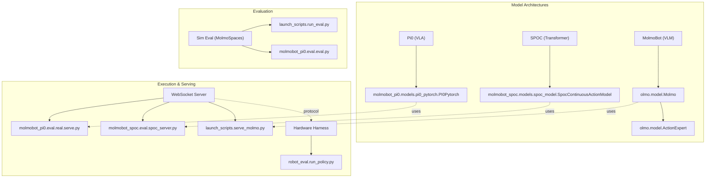
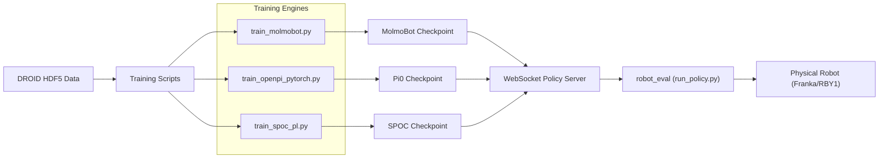

<!-- source: DeepWiki mcp.deepwiki.com · repo allenai/MolmoBot · page 1 MolmoBot Repository Overview · fetched 2026-10-26 -->

# MolmoBot Repository Overview

Relevant source files

The following files were used as context for generating this wiki page:

- [.gitignore](.gitignore)
- [MolmoBot-Pi0/README.md](MolmoBot-Pi0/README.md)
- [MolmoBot-Pi0/assets/MolmoBot-Pi0.png](MolmoBot-Pi0/assets/MolmoBot-Pi0.png)
- [MolmoBot-SPOC/README.md](MolmoBot-SPOC/README.md)
- [MolmoBot-SPOC/docs/images/molmobot_spoc.png](MolmoBot-SPOC/docs/images/molmobot_spoc.png)
- [MolmoBot/README.md](MolmoBot/README.md)

The **MolmoBot** monorepo is a collection of vision-language-action (VLA) models and evaluation tools designed for robotic manipulation. It provides a unified infrastructure for training and deploying diverse policy architectures—ranging from large-scale multimodal models to lightweight goal-conditioned transformers—across multiple robot platforms including Franka Panda and RBY1.

### Core Projects
The repository is organized into three primary sub-projects and a shared evaluation harness:

1.  **MolmoBot**: A high-capacity VLA based on the Molmo2-4B architecture, fine-tuned for action prediction using flow-matching diffusion.
2.  **MolmoBot-Pi0**: A PyTorch-based adaptation and fine-tuning suite for Physical Intelligence’s Pi0/Pi0.5 models.
3.  **MolmoBot-SPOC**: A lightweight, goal-conditioned transformer policy (based on SigLIP and Llama) optimized for efficient execution.
4.  **robot_eval**: A shared hardware abstraction layer and evaluation harness for running these policies on physical robots.

---

### System Architecture and Code Mapping

The following diagram illustrates how high-level system components map to specific code entities and directories within the monorepo.

**Component to Code Entity Mapping**

Sources: [MolmoBot/README.md:38-43](), [MolmoBot-Pi0/README.md:47-48](), [MolmoBot-SPOC/README.md:87-90](), [MolmoBot-SPOC/README.md:35-42]()

---

### Sub-Project Relationships

The sub-projects share a common data philosophy (using DROID-format HDF5 trajectories) but differ in their computational requirements and model backbones.

| Sub-Project | Base Architecture | Action Head | Primary Use Case |
| :--- | :--- | :--- | :--- |
| **MolmoBot** | Molmo2-4B (VLM) | Flow-matching Diffusion | Zero-shot & Generalist manipulation |
| **MolmoBot-Pi0** | PaliGemma / Pi0 | Diffusion / Flow | Fine-tuning state-of-the-art VLAs |
| **MolmoBot-SPOC** | SigLIP + Llama | Parallel Linear Heads | Lightweight, real-time goal conditioning |

**Data Flow from Training to Deployment**

Sources: [MolmoBot/README.md:111-136](), [MolmoBot-Pi0/README.md:110-123](), [MolmoBot-SPOC/README.md:35-42](), [MolmoBot-SPOC/README.md:106-106]()

---

### Supported Platforms and Evaluation

The repository supports both simulation and real-world evaluation:
*   **Simulation**: Uses the `MolmoSpaces` benchmark suite [MolmoBot-Pi0/README.md:82-82]() integrated with MuJoCo. Evaluation is triggered via specialized scripts in each sub-directory (e.g., `run_eval.py` or `eval.py`).
*   **Real Robot**: The `robot_eval` harness provides a `run_policy.py` script that acts as a client to the WebSocket servers provided by the model sub-projects [MolmoBot-SPOC/README.md:106-106](). It currently supports Franka Panda (via `polymetis`) and RBY1 platforms.

---

### Child Pages

For detailed technical information, please refer to the following child pages:

*   **[Getting Started & Installation](#1.1)**: Environment setup (uv/conda), dependency management, and downloading model weights from HuggingFace.
*   **[Repository Structure & Licensing](#1.2)**: Detailed directory layout and information on the Apache 2.0 license.

---
Sources: [MolmoBot/README.md:1-185](), [MolmoBot-Pi0/README.md:1-126](), [MolmoBot-SPOC/README.md:1-107]()

---

