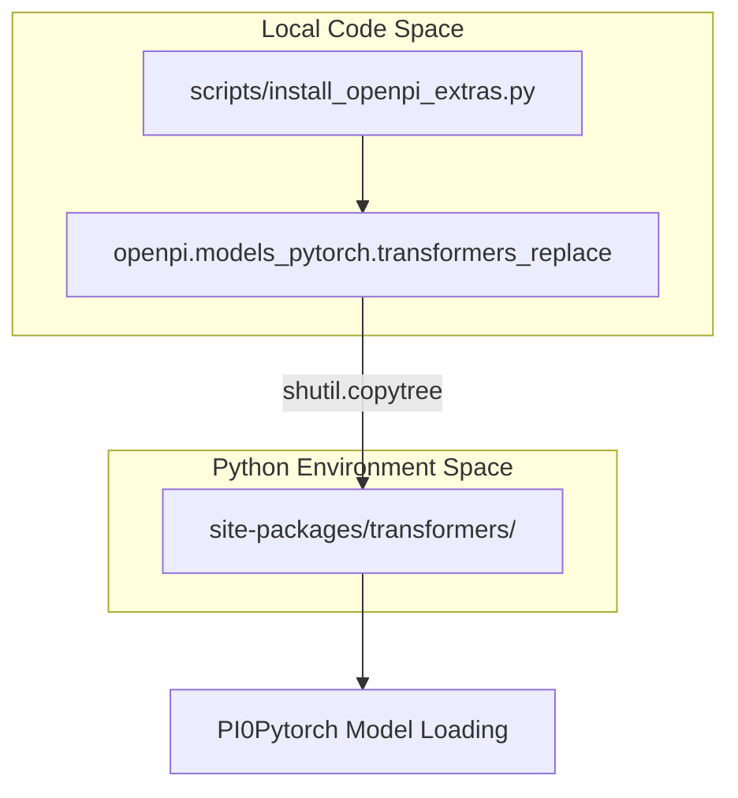
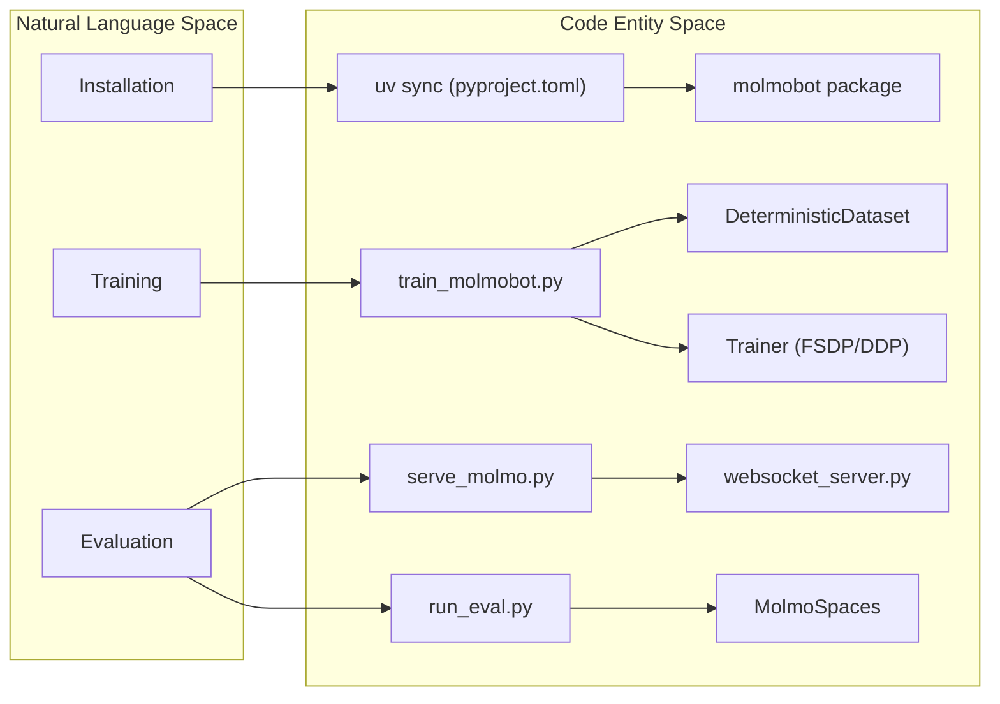

<!-- source: DeepWiki mcp.deepwiki.com · repo allenai/MolmoBot · page 1.1 Getting Started & Installation · fetched 2026-10-26 -->

# Getting Started & Installation

<details>
<summary>Relevant source files</summary>

The following files were used as context for generating this wiki page:

- [MolmoBot-Pi0/.python-version](MolmoBot-Pi0/.python-version)
- [MolmoBot-Pi0/README.md](MolmoBot-Pi0/README.md)
- [MolmoBot-Pi0/pyproject.toml](MolmoBot-Pi0/pyproject.toml)
- [MolmoBot-Pi0/scripts/install_openpi_extras.py](MolmoBot-Pi0/scripts/install_openpi_extras.py)
- [MolmoBot-Pi0/uv.lock](MolmoBot-Pi0/uv.lock)
- [MolmoBot-SPOC/README.md](MolmoBot-SPOC/README.md)
- [MolmoBot-SPOC/pyproject.toml](MolmoBot-SPOC/pyproject.toml)
- [MolmoBot/README.md](MolmoBot/README.md)

</details>


This page provides technical instructions for setting up the three primary sub-projects within the MolmoBot repository: **MolmoBot** (VLM-based), **MolmoBot-Pi0** (Pi0/Pi0.5 fine-tuning), and **MolmoBot-SPOC** (lightweight transformer). It covers environment creation, dependency management, and the acquisition of model checkpoints and datasets.

## 1. MolmoBot (Primary VLM Policy)

The core MolmoBot project leverages the Molmo2-4B architecture for robot manipulation. It uses `uv` for environment management and requires specific sharding conversions for training.

### Environment Setup
Installation is performed using the `uv` package manager. The project includes optional dependency groups for `eval` and `train`.

```bash
git clone https://github.com/allenai/MolmoBot.git
cd MolmoBot/MolmoBot
uv sync --extra eval
# For training support
uv sync --extra train
```
Sources: [MolmoBot/README.md:27-32](), [MolmoBot/README.md:87-90]()

### Model Checkpoint Preparation
MolmoBot models are typically distributed as sharded weights. For training or local inference, these must be unsharded.

1. **Download Base Weights**: Download the Molmo2-4B base model.
2. **Unshard Weights**: Use the provided conversion script.
```bash
python launch_scripts/convert_to_unsharded.py <model_path>/Molmo2-4B <model_path>/Molmo2-4B-unsharded
```
Sources: [MolmoBot/README.md:92-100]()

### Environment Variables
For stable distributed training and simulation evaluation, set the following:

| Variable | Purpose | Recommended Value |
| :--- | :--- | :--- |
| `MUJOCO_GL` | Rendering backend for simulation | `egl` |
| `PYOPENGL_PLATFORM` | OpenGL platform | `egl` |
| `OLMO_SHARED_FS` | Enables shared filesystem checkpointing | `1` |
| `LOG_FILTER_TYPE` | Controls logging verbosity | `rank0_only` |

Sources: [MolmoBot/README.md:56-58](), [MolmoBot/README.md:103-108]()

---

## 2. MolmoBot-Pi0 (Pi0/Pi0.5 Fine-Tuning)

MolmoBot-Pi0 is a PyTorch-based implementation for fine-tuning Physical Intelligence's Pi0 models. It requires a specific post-installation step to override `transformers` library behaviors.

### Installation & Extra Setup
The installation involves a script that patches the `transformers` library with OpenPI-specific logic.

```bash
cd MolmoBot/MolmoBot-Pi0
uv sync --extra eval
uv run scripts/install_openpi_extras.py
```
Sources: [MolmoBot-Pi0/README.md:8-12]()

### Dependency Flow and Logic
The `install_openpi_extras.py` script maps OpenPI-specific model logic directly into the installed `transformers` package to support the PaliGemma-based architecture.

**OpenPI Override Logic**

Sources: [MolmoBot-Pi0/scripts/install_openpi_extras.py:11-20]()

---

## 3. MolmoBot-SPOC (Lightweight Policy)

MolmoBot-SPOC uses a standard `conda` and `pip` workflow. It is designed for goal-conditioned manipulation using a SigLIP encoder and a Llama-style decoder.

### Environment Setup
```bash
conda create -n molmobot python=3.11
conda activate molmobot
cd MolmoBot/MolmoBot-SPOC
pip install -e .
```
Sources: [MolmoBot-SPOC/README.md:12-23]()

### Dependency Requirements
The SPOC sub-project relies on `lightning` for training and `molmo_spaces` for evaluation.
- `transformers==4.57.1`
- `open_clip_torch` (for SigLIP)
- `molmospaces` (via git)
Sources: [MolmoBot-SPOC/pyproject.toml:9-21]()

---

## 4. Dataset Acquisition (Shared)

All sub-projects utilize the **MolmoBot-Data** collection on HuggingFace. A `bulk_download.py` script is provided to fetch specific robot configurations (e.g., `FrankaPickAndPlaceOmniCamConfig`).

### Example Download
```bash
python bulk_download.py --config FrankaPickAndPlaceOmniCamConfig --part 1 <data_root>
```
Sources: [MolmoBot-Pi0/README.md:95-100](), [MolmoBot/README.md:72-82]()

---

## 5. System Interaction Diagram

The following diagram bridges the high-level installation commands to the internal code entities and their roles in the data flow.

**Installation and Runtime Entity Mapping**

Sources: [MolmoBot/README.md:31-63](), [MolmoBot/README.md:111-112](), [MolmoBot-Pi0/pyproject.toml:11-41]()

---

