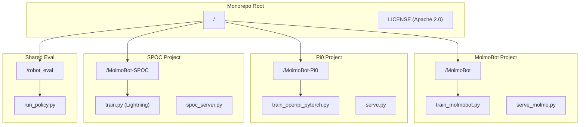
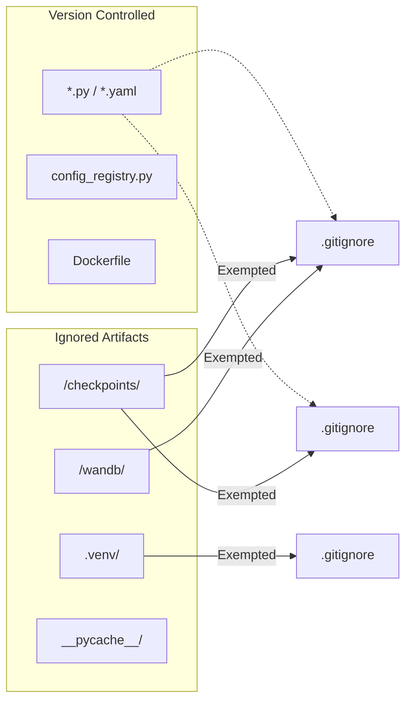

<!-- source: DeepWiki mcp.deepwiki.com · repo allenai/MolmoBot · page 1.2 Repository Structure & Licensing · fetched 2026-10-26 -->

# Repository Structure & Licensing

Relevant source files

The following files were used as context for generating this wiki page:

- [.gitignore](.gitignore)
- [LICENSE](LICENSE)
- [MolmoBot-Pi0/.gitignore](MolmoBot-Pi0/.gitignore)
- [MolmoBot-Pi0/LICENSE](MolmoBot-Pi0/LICENSE)
- [MolmoBot-SPOC/LICENSE](MolmoBot-SPOC/LICENSE)
- [MolmoBot/.gitignore](MolmoBot/.gitignore)
- [MolmoBot/LICENSE](MolmoBot/LICENSE)

This page details the organizational layout of the MolmoBot monorepo and the licensing terms governing its use. The repository is structured to support three distinct robot manipulation policy projects and a shared evaluation harness, all unified under a single open-source license.

## Monorepo Layout

The MolmoBot repository is organized into sub-directories that separate model architectures, training frameworks, and hardware-specific evaluation logic. Each major sub-project functions as a semi-independent codebase with its own dependency management and configuration patterns.

### Top-Level Directory Purpose

| Directory | Purpose | Key Contents |
|:---|:---|:---|
| `MolmoBot/` | Primary VLM policy based on Molmo2-4B. | ActionExpert heads, flow-matching diffusion, and distributed FSDP trainer. |
| `MolmoBot-Pi0/` | Fine-tuning framework for Physical Intelligence Pi0/Pi0.5 VLA models. | JAX-to-PyTorch weight loaders and DROID-format data pipelines. |
| `MolmoBot-SPOC/` | Lightweight goal-conditioned transformer policy. | SigLIP encoders, Llama-based decoders, and PyTorch Lightning training. |
| `robot_eval/` | Shared hardware evaluation harness. | Hydra configs for Franka robots and ZED camera observation loops. |
| `assets/` | Static resources. | Architecture diagrams, sample images, and documentation media. |

### System Data Flow & Entity Mapping

The following diagram bridges the conceptual sub-projects to their primary entry points and implementation directories within the codebase.

**Sub-Project Implementation Map**

**Sources:** `MolmoBot/` [1-68](), `MolmoBot-Pi0/` [1-217](), `MolmoBot-SPOC/` [1-135](), `robot_eval/` [1-50]()

---

## Licensing

The entire MolmoBot repository is released under the **Apache License, Version 2.0**. This license applies to all sub-projects including `MolmoBot`, `MolmoBot-Pi0`, `MolmoBot-SPOC`, and `robot_eval`.

### Key License Provisions
*   **Grant of Copyright License:** Contributors grant a perpetual, worldwide, non-exclusive, no-charge, royalty-free, irrevocable copyright license to reproduce, prepare derivative works of, and distribute the Work [LICENSE:66-71]().
*   **Grant of Patent License:** Contributors grant a patent license for claims necessarily infringed by their contributions alone or in combination with the Work [LICENSE:73-81]().
*   **Redistribution:** Redistribution is permitted provided that recipients are given a copy of the license and modified files carry prominent notices of changes [LICENSE:89-98]().
*   **No Warranty:** The work is provided on an "AS IS" BASIS, WITHOUT WARRANTIES OR CONDITIONS OF ANY KIND [LICENSE:131-135]().

Each sub-directory contains its own copy of the license file to ensure clarity when sub-projects are used in isolation.
**Sources:** `LICENSE:1-135`(), `MolmoBot/LICENSE:1-135`(), `MolmoBot-Pi0/LICENSE:1-135`(), `MolmoBot-SPOC/LICENSE:1-135`()

---

## Repository Artifacts & Ignored Files

The repository uses specific `.gitignore` configurations for each sub-project to manage build artifacts, model checkpoints, and local environment data.

### Artifact Management Map
The following diagram illustrates how the codebase distinguishes between version-controlled source code and ephemeral artifacts (like checkpoints and logs) across the different sub-directories.

**Code vs. Artifact Separation**

### Critical Ignored Paths
*   **Checkpoints:** Model weights and training states are stored in `ckpts/` or `checkpoints/` directories, which are excluded from version control to prevent large binary bloat [.gitignore:180](), [MolmoBot/.gitignore:64](), [MolmoBot-Pi0/.gitignore:7]().
*   **Virtual Environments:** Standard Python environment directories such as `.venv/`, `env/`, and `.pixi/` are ignored to ensure environment portability [.gitignore:128-135](), [MolmoBot-Pi0/.gitignore:134-149]().
*   **Build Artifacts:** Distribution folders (`dist/`, `build/`) and Python egg information (`*.egg-info/`) are ignored [.gitignore:15-28](), [MolmoBot/.gitignore:8-10]().
*   **Telemetry & Logs:** Weights & Biases logs (`wandb/`) and evaluation outputs (`eval_output/`) are excluded [.gitignore:181-182](), [MolmoBot/.gitignore:59-60]().

**Sources:** `.gitignore:1-185`(), `MolmoBot/.gitignore:1-68`(), `MolmoBot-Pi0/.gitignore:1-217`()

---

