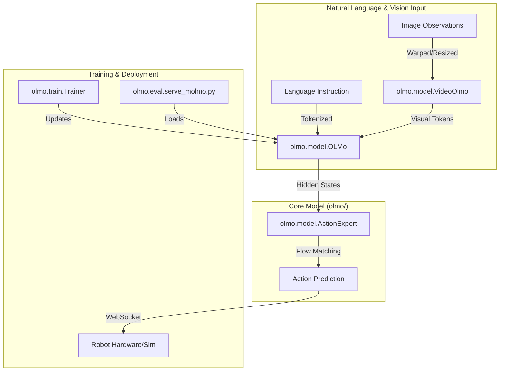
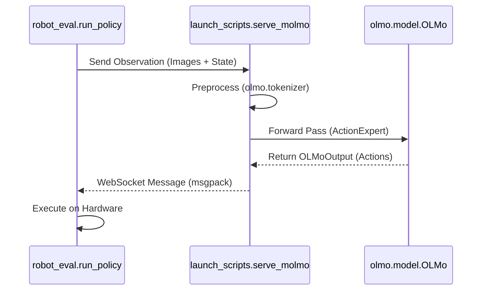

<!-- source: DeepWiki mcp.deepwiki.com · repo allenai/MolmoBot · page 2 MolmoBot: VLM-Based Manipulation Policy · fetched 2026-10-26 -->

# MolmoBot: VLM-Based Manipulation Policy

<details>
<summary>Relevant source files</summary>

The following files were used as context for generating this wiki page:

- [MolmoBot/README.md](MolmoBot/README.md)
- [MolmoBot/olmo/__init__.py](MolmoBot/olmo/__init__.py)
- [MolmoBot/olmo/config.py](MolmoBot/olmo/config.py)

</details>


MolmoBot is a vision-language-action (VLA) policy based on the **Molmo2-4B** architecture. It is specifically fine-tuned to map natural language instructions and multi-view image observations directly to robot end-effector or joint actions. By leveraging large-scale simulation data and the robust visual reasoning capabilities of the Molmo backbone, MolmoBot enables zero-shot and few-shot manipulation across diverse environments.

### System Overview

The MolmoBot sub-project consists of a unified architecture that combines a Vision-Language Model (VLM) with a diffusion-based action head. The system is designed for high-throughput distributed training and low-latency deployment on physical hardware or in simulation.

The following diagram illustrates the relationship between the high-level policy components and the core classes defined in the `olmo/` package.

**MolmoBot Logical Architecture to Code Mapping**

Sources: [MolmoBot/README.md:5-23](), [MolmoBot/olmo/model.py:1-50]() (implied structure), [MolmoBot/launch_scripts/serve_molmo.py:42-43]()

---

### Model Architecture
The backbone of MolmoBot is the **Molmo2-4B** model, which utilizes a transformer-based LLM and a vision backbone. To adapt this for robotics, the model incorporates:
*   **VideoOlmo**: A wrapper to handle multi-frame and multi-camera temporal observations.
*   **ActionExpert**: A specialized head that uses flow-matching diffusion to generate continuous action trajectories.
*   **Action Presets**: Configurations for different action spaces, such as `franka_joint` or `franka_state_8_clamp_abs_pos`.

For a deep dive into the model layers and the diffusion process, see [MolmoBot Model Architecture](#2.1).

Sources: [MolmoBot/README.md:112-115](), [MolmoBot/README.md:168-172]()

---

### Training Pipeline
MolmoBot utilizes a distributed training framework optimized for Large Language Models, adapted for robotics.
*   **Trainer**: Supports Fully Sharded Data Parallel (FSDP) and DDP for scaling across multiple H100 nodes.
*   **Config System**: Uses `TrainConfig` and `TrainerConfig` for managing hyperparameters like `device_batch_size`, `learning_rate`, and `seq_len`.
*   **Checkpointing**: Implements atomic saves and unsharding utilities to convert distributed weights into standard formats.

For details on the training loop and distributed setup, see [MolmoBot Training Pipeline](#2.2).

Sources: [MolmoBot/olmo/config.py:19-82](), [MolmoBot/README.md:102-136]()

---

### Data Pipeline & Preprocessing
The model is trained on diverse datasets (e.g., DROID, SynthManip) stored in HDF5 format.
*   **DynamicPacker**: Uses a 2D knapsack algorithm to pack variable-length robot trajectories into fixed-length sequences efficiently.
*   **MultimodalPreprocessor**: Handles the synchronization of text prompts and image frames.
*   **Augmentation**: Includes image warping and random camera selection (`furthest_camera_prob`) to improve robustness.

For details on data loading and sequence packing, see [Data Pipeline & Preprocessing](#2.4).

Sources: [MolmoBot/README.md:125-136](), [MolmoBot/README.md:171-172]()

---

### Evaluation & Serving
MolmoBot can be deployed in simulation or on real robots via a WebSocket-based server architecture.
*   **MolmoSpaces**: A simulation environment used for benchmarking (e.g., `FrankaState8ClampAbsPosConfig`).
*   **serve_molmo.py**: A script that hosts the model as a service, allowing remote robot clients to request actions.
*   **Policy Clients**: Implementation of the observation-action loop that interfaces with physical controllers.

For details on running evaluations and setting up the inference server, see [MolmoBot Evaluation & Serving](#2.3).

**Inference Flow: From Code to Action**

Sources: [MolmoBot/README.md:42-43](), [MolmoBot/README.md:59-64]()

---

### Quick Start
To serve a pre-trained MolmoBot-DROID checkpoint:
```bash
python launch_scripts/serve_molmo.py --hf-repo allenai/MolmoBot-DROID
```
To launch a training run:
```bash
torchrun --nproc-per-node=8 launch_scripts/train_molmobot.py <model_path> \
  --action_preset franka_joint \
  --camera_preset franka_one_random_then_wrist \
  --device_batch_size 32
```
Sources: [MolmoBot/README.md:42-43](), [MolmoBot/README.md:111-124]()

---

