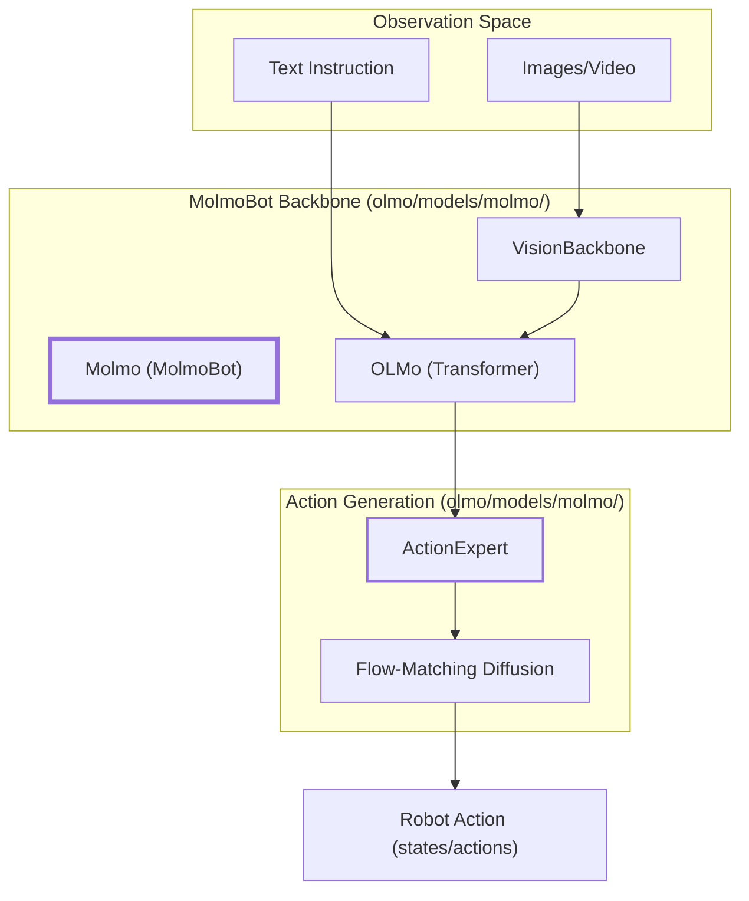
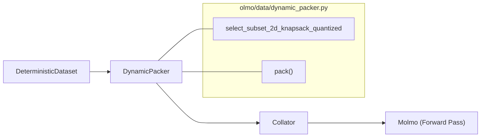

<!-- source: DeepWiki mcp.deepwiki.com · repo allenai/MolmoBot · page 2.1 MolmoBot Model Architecture · fetched 2026-10-26 -->

# MolmoBot Model Architecture

Relevant source files

The following files were used as context for generating this wiki page:

- [MolmoBot/olmo/__init__.py](MolmoBot/olmo/__init__.py)
- [MolmoBot/olmo/config.py](MolmoBot/olmo/config.py)
- [MolmoBot/olmo/data/data_loader.py](MolmoBot/olmo/data/data_loader.py)
- [MolmoBot/olmo/data/dataset.py](MolmoBot/olmo/data/dataset.py)
- [MolmoBot/olmo/data/dynamic_packer.py](MolmoBot/olmo/data/dynamic_packer.py)
- [MolmoBot/olmo/data/get_dataset.py](MolmoBot/olmo/data/get_dataset.py)
- [MolmoBot/olmo/data/image_warping_utils.py](MolmoBot/olmo/data/image_warping_utils.py)
- [MolmoBot/olmo/data/iterable_dataset_mixture.py](MolmoBot/olmo/data/iterable_dataset_mixture.py)

The MolmoBot model is a Vision-Language-Action (VLA) policy built upon the **Molmo** family of models. It extends the base Molmo architecture—which consists of a vision backbone and a language model (LLM)—with specialized components for high-frequency robotic control, including an action-prediction head and support for multi-frame temporal observations.

## System Overview

The architecture bridges the gap between multimodal perception and continuous action spaces. It processes visual inputs (single or multi-frame) and natural language instructions to produce robotic actions via a flow-matching diffusion process.

### Code Entity Mapping

The following diagram maps the high-level architectural components to their respective classes and modules within the `olmo/` package.

**Component to Code Entity Mapping**

Sources: `[MolmoBot/olmo/models/molmo/molmo.py:1-100]()`, `[MolmoBot/olmo/models/molmo/action_expert.py:1-50]()`

---

## The Molmo VLM Backbone

The core of MolmoBot is the **Molmo** model, a multimodal transformer designed to process interleaved image and text data.

### Vision and Language Integration
The model uses a `VisionBackbone` to extract features from input images. These features are projected into the same embedding space as the text tokens.
- **Vision Backbone**: Typically a ViT-based encoder that processes high-resolution images.
- **Language Model**: A decoder-only transformer (OLMo) that serves as the reasoning engine.
- **Data Flow**: Images are processed into "patches," which are then mapped to tokens that the LLM treats as part of its input sequence.

### VideoOlmo: Multi-Frame Observations
For tasks requiring temporal context, MolmoBot utilizes `VideoOlmo`. This variant allows the model to ingest sequences of frames, effectively treating video as a series of visual tokens distributed across the temporal dimension.

Sources: `[MolmoBot/olmo/models/molmo/molmo.py:105-250]()`, `[MolmoBot/olmo/data/data_loader.py:158-164]()`

---

## ActionExpert and Action Prediction

Unlike standard VLMs that output text tokens, MolmoBot incorporates an `ActionExpert` head to predict continuous robot actions.

### Flow-Matching Diffusion
MolmoBot employs a **flow-matching diffusion** approach for action generation. This allows the model to represent complex, multimodal action distributions (e.g., multiple ways to pick up an object) which are common in manipulation tasks.

### Action Data Structures
The model interacts with specific action-related keys during training and inference:
- `states`: The current proprioceptive state of the robot (e.g., joint positions, end-effector pose).
- `actions`: The target actions to be executed.
- `action_is_pad`: A mask used to handle variable-length action sequences or padding.

| Key | Type | Description |
| :--- | :--- | :--- |
| `packed_states` | `np.ndarray` | Proprioceptive states concatenated for batch processing. |
| `packed_actions` | `np.ndarray` | The target action sequence for the diffusion head. |
| `packed_example_ids` | `np.int64` | Identifiers to track chunks back to original trajectories. |

Sources: `[MolmoBot/olmo/models/molmo/action_expert.py:20-80]()`, `[MolmoBot/olmo/data/dynamic_packer.py:12-21]()`

---

## Data Flow and Sequence Packing

To maximize training efficiency, MolmoBot uses a **Dynamic Packer** that implements a 2D knapsack algorithm to pack multiple robot trajectories into a single training sequence.

**Data Processing Pipeline**

### Key Functions
- `select_subset_2d_knapsack_quantized`: Optimizes how examples are grouped to fit within the `sequence_length` and visual token limits `[MolmoBot/olmo/data/dynamic_packer.py:23-78]()`.
- `pack`: Handles the concatenation of `input_tokens`, `images`, and `action_chunks`, ensuring that `subsegment_ids` are updated to prevent intra-example attention leakage `[MolmoBot/olmo/data/dynamic_packer.py:137-173]()`.

Sources: `[MolmoBot/olmo/data/dynamic_packer.py:1-150]()`, `[MolmoBot/olmo/data/data_loader.py:105-116]()`

---

## Output Structures

The model's outputs are encapsulated in `OLMoOutput` (and specialized variants for Molmo). These structures contain:
1. **Logits**: For text generation (if applicable).
2. **Action Predictions**: The output from the `ActionExpert` head.
3. **Hidden States**: Intermediate representations often used for debugging or auxiliary losses.

### Configuration
The model architecture is governed by `MolmoConfig`, which inherits from `BaseConfig`. This configuration defines:
- `d_model`: The hidden dimension of the transformer.
- `n_layers`: Number of transformer blocks.
- `vision_config`: Parameters for the image encoder.
- `action_config`: Parameters for the diffusion head and action dimensions.

Sources: `[MolmoBot/olmo/config.py:19-81]()`, `[MolmoBot/olmo/models/molmo/molmo.py:21-45]()`

---

