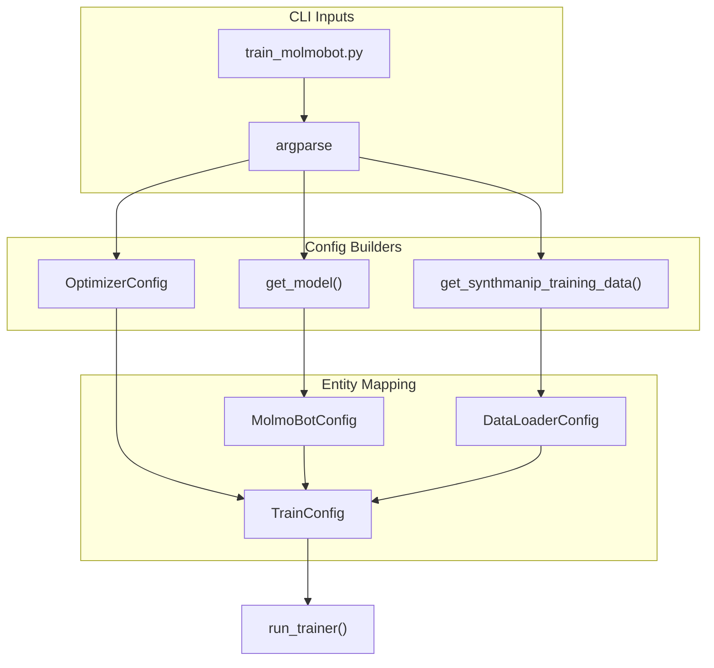
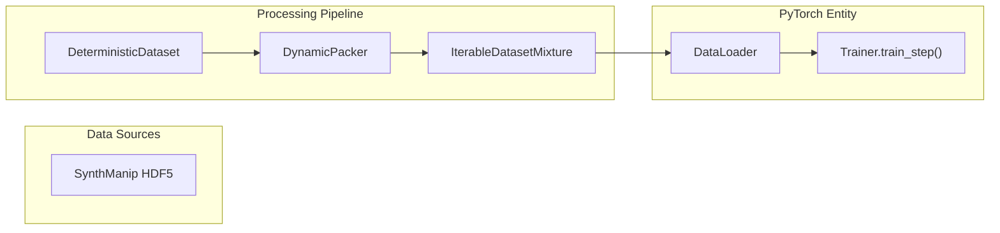

<!-- source: DeepWiki mcp.deepwiki.com · repo allenai/MolmoBot · page 2.2 MolmoBot Training Pipeline · fetched 2026-10-26 -->

# MolmoBot Training Pipeline

Relevant source files

The following files were used as context for generating this wiki page:

- [MolmoBot/launch_scripts/convert_to_unsharded.py](MolmoBot/launch_scripts/convert_to_unsharded.py)
- [MolmoBot/launch_scripts/train_molmobot.py](MolmoBot/launch_scripts/train_molmobot.py)
- [MolmoBot/olmo/data/data_loader.py](MolmoBot/olmo/data/data_loader.py)
- [MolmoBot/olmo/data/dataset.py](MolmoBot/olmo/data/dataset.py)
- [MolmoBot/olmo/data/dynamic_packer.py](MolmoBot/olmo/data/dynamic_packer.py)
- [MolmoBot/olmo/data/get_dataset.py](MolmoBot/olmo/data/get_dataset.py)
- [MolmoBot/olmo/data/iterable_dataset_mixture.py](MolmoBot/olmo/data/iterable_dataset_mixture.py)

The MolmoBot training pipeline is a distributed system designed for fine-tuning the Molmo 7B-O (and other variants) on robot manipulation tasks. It leverages PyTorch's Fully Sharded Data Parallel (FSDP) for efficient distributed training, supports multi-modal sequence packing for high throughput, and includes specialized components for handling robot observation-action trajectories.

## Training Launch and Presets

The primary entry point for training is the `train_molmobot.py` script [MolmoBot/launch_scripts/train_molmobot.py:1-35](). This script abstracts the complexity of model configuration through a system of presets for different robot platforms (e.g., Franka, RBY1) and camera configurations.

### Action and Camera Configuration
Training requires specifying how the model should interpret robot states and actions.
*   **Action Presets**: Define the dimensionality and semantic meaning of the action vector (e.g., `RBY1_full`, `franka_joint`) [MolmoBot/launch_scripts/train_molmobot.py:21-21]().
*   **Camera Presets**: Define which camera streams (e.g., `RBY1_right_arm`) are used as visual input [MolmoBot/launch_scripts/train_molmobot.py:22-22]().
*   **Sequence Parameters**: Configurable via `--seq_len`, `--action_horizon`, and `--n_obs_steps` [MolmoBot/launch_scripts/train_molmobot.py:160-170]().

### Configuration Flow
The diagram below illustrates how CLI arguments are transformed into a unified `TrainConfig`.

**Training Configuration Assembly**

Sources: [MolmoBot/launch_scripts/train_molmobot.py:70-144](), [MolmoBot/launch_scripts/train_molmobot.py:147-166](), [MolmoBot/olmo/train/trainer_config.py:57-64]()

## Distributed Training System

MolmoBot uses a custom `Trainer` class that supports both Distributed Data Parallel (DDP) and Fully Sharded Data Parallel (FSDP).

### FSDP and Sharding
The `FSDPConfig` class governs how model parameters, gradients, and optimizer states are sharded across GPUs [MolmoBot/olmo/train/trainer_config.py:60-60](). This is critical for fitting the 7B parameter backbone into VRAM while maintaining large effective batch sizes.

### Optimizer and LR Scheduling
*   **Optimizer**: Supports `AdamW` and other standard types via `OptimizerConfig` [MolmoBot/olmo/train/optim.py:55-55]().
*   **Scheduler**: Implements linear warmup followed by cosine decay or constant schedules, managed by `SchedulerConfig` [MolmoBot/olmo/train/optim.py:55-55]().
*   **Precision**: Typically utilizes `bfloat16` for stable mixed-precision training.

## Data Loading and Sequence Packing

The pipeline uses a sophisticated data loading strategy to handle the variable-length nature of multi-modal robot data.

### Sequence Packing (2D Knapsack)
To maximize GPU utilization, MolmoBot employs a `DynamicPacker` [MolmoBot/olmo/data/dynamic_packer.py:1-5](). This component uses a vectorized 2D knapsack algorithm (`select_subset_2d_knapsack_quantized`) to pack multiple robot trajectories into a single training sequence [MolmoBot/olmo/data/dynamic_packer.py:23-78]().

### Dataset Mixture
The `IterableDatasetMixture` class allows for blending multiple data sources with specific sampling rates [MolmoBot/olmo/data/iterable_dataset_mixture.py:21-38]().
*   **Deterministic Sampling**: Uses a seed-based approach to ensure that data order is reproducible across restarts [MolmoBot/olmo/data/iterable_dataset_mixture.py:45-48]().
*   **Stratification**: Optionally ensures that rare datasets are represented correctly in every batch [MolmoBot/olmo/data/iterable_dataset_mixture.py:64-64]().

**Data Flow Architecture**

Sources: [MolmoBot/olmo/data/dataset.py:40-43](), [MolmoBot/olmo/data/dynamic_packer.py:137-163](), [MolmoBot/olmo/data/iterable_dataset_mixture.py:89-152](), [MolmoBot/olmo/data/data_loader.py:197-203]()

## Checkpointing and Logging

### Atomic Saves and Unsharding
Training produces sharded checkpoints by default for performance. The `convert_to_unsharded.py` script is provided to consolidate these into a single `pytorch_model.bin` file for easier inference and HuggingFace compatibility [MolmoBot/launch_scripts/convert_to_unsharded.py:1-11]().
*   **Atomic Saves**: Uses `save_unsharded` to ensure that model state and configuration are written consistently [MolmoBot/launch_scripts/convert_to_unsharded.py:33-33]().
*   **Metadata**: Saves a `config.yaml` alongside weights to preserve `TrainConfig` parameters [MolmoBot/launch_scripts/convert_to_unsharded.py:21-23]().

### Logging
Integration with Weights & Biases (W&B) is handled via `WandbConfig` [MolmoBot/olmo/train/trainer_config.py:63-63]().
*   **Metrics**: Logs total loss, action-specific loss, and language modeling loss [MolmoBot/launch_scripts/train_molmobot.py:28-28]().
*   **Speed Monitoring**: Tracks tokens per second and MFU (Model Flops Utilization) through `SpeedMonitorConfig` [MolmoBot/olmo/train/trainer_config.py:62-62]().

## Validation Pipeline
The trainer automatically executes a validation loop at intervals defined by `--val_interval` [MolmoBot/launch_scripts/train_molmobot.py:27-27]().
*   **Evaluator**: Uses `LossDatasetEvaluatorConfig` to compute metrics on a held-out 'val' split [MolmoBot/launch_scripts/train_molmobot.py:48-48]().
*   **Metrics**: Specifically tracks the accuracy of action prediction (diffusion flow-matching loss) and text generation [MolmoBot/launch_scripts/train_molmobot.py:28-29]().

Sources: [MolmoBot/launch_scripts/train_molmobot.py:1-68](), [MolmoBot/olmo/train/trainer_config.py:57-64](), [MolmoBot/olmo/data/data_loader.py:67-116](), [MolmoBot/olmo/data/dynamic_packer.py:1-134](), [MolmoBot/launch_scripts/convert_to_unsharded.py:19-35]()

---

