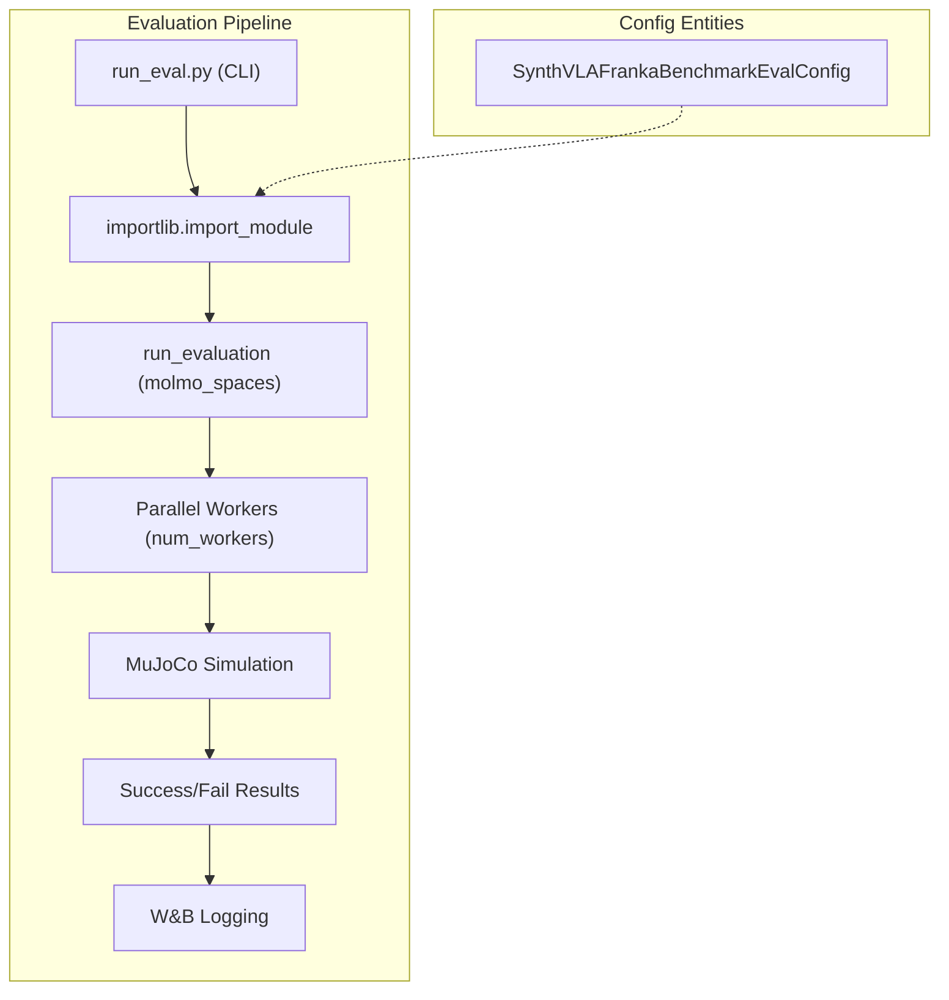
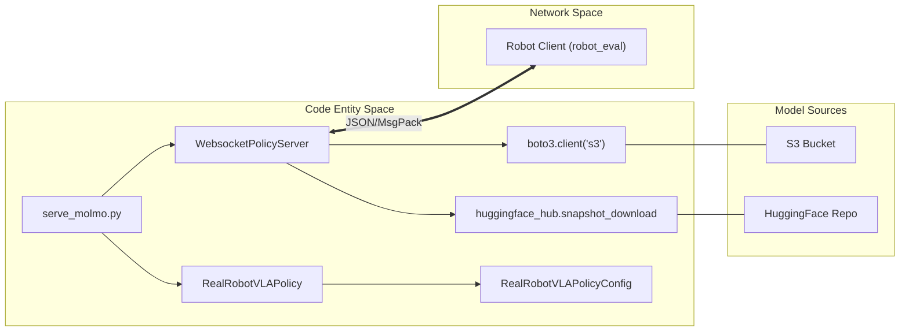
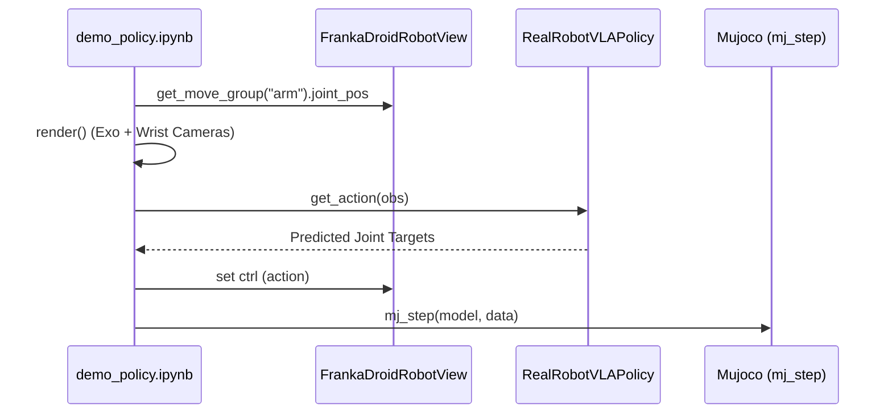

<!-- source: DeepWiki mcp.deepwiki.com · repo allenai/MolmoBot · page 2.3 MolmoBot Evaluation & Serving · fetched 2026-10-26 -->

# MolmoBot Evaluation & Serving

Relevant source files

The following files were used as context for generating this wiki page:

- [MolmoBot/demo_policy.ipynb](MolmoBot/demo_policy.ipynb)
- [MolmoBot/launch_scripts/run_eval.py](MolmoBot/launch_scripts/run_eval.py)
- [MolmoBot/launch_scripts/serve_molmo.py](MolmoBot/launch_scripts/serve_molmo.py)
- [MolmoBot/launch_scripts/serve_molmobot_rby1_door.py](MolmoBot/launch_scripts/serve_molmobot_rby1_door.py)
- [MolmoBot/launch_scripts/serve_molmobot_rby1_multitask.py](MolmoBot/launch_scripts/serve_molmobot_rby1_multitask.py)
- [MolmoBot/olmo/data/__init__.py](MolmoBot/olmo/data/__init__.py)

This page documents the evaluation infrastructure for MolmoBot, covering both simulation-based evaluation via `molmo_spaces` and real-robot serving through WebSocket protocols. The system supports multiple robot platforms (Franka, RBY1) and various task configurations (DROID manipulation, door opening, and multitask pick-and-place).

## Simulation Evaluation

MolmoBot uses `molmo_spaces` (a MuJoCo-based simulation environment) for automated benchmarking. The evaluation pipeline is designed to be scalable, supporting parallel workers and logging to Weights & Biases (W&B).

### Evaluation Entry Point
The primary script for running simulation benchmarks is `run_eval.py` [MolmoBot/launch_scripts/run_eval.py:1-112](). It serves as the entry point for evaluation jobs, typically invoked by orchestration tools like Gantry.

Key parameters include:
*   `--checkpoint_path`: Path to the fine-tuned MolmoBot weights [MolmoBot/launch_scripts/run_eval.py:27-31]().
*   `--benchmark_path`: Directory containing the benchmark house/task definitions [MolmoBot/launch_scripts/run_eval.py:33-37]().
*   `--eval_config_cls`: The configuration class (e.g., `SynthVLAFrankaBenchmarkEvalConfig`) used to initialize the environment and robot [MolmoBot/launch_scripts/run_eval.py:39-43]().

### Data Flow: Simulation Eval
The script resolves the configuration class and invokes `run_evaluation` from the `molmo_spaces` library [MolmoBot/launch_scripts/run_eval.py:88-104]().

**Sources:** [MolmoBot/launch_scripts/run_eval.py:18-104]()

---

## Real-Robot Serving & WebSocket Infrastructure

For physical robot deployment, MolmoBot operates as a WebSocket server. This decouples the heavy VLM inference (running on a GPU server) from the robot control loop (running on the robot's local PC).

### WebSocket Server Implementation
The `WebsocketPolicyServer` class manages the communication [MolmoBot/launch_scripts/serve_molmo.py:153-155](). It listens for observation packets (images and joint states) and returns predicted actions.

### Serving Scripts
The repository provides specialized serving scripts for different robot platforms and tasks:

| Script | Robot/Task | Config Class |
| :--- | :--- | :--- |
| `serve_molmo.py` | Franka (DROID) | `RealRobotVLAPolicyConfig` |
| `serve_molmobot_rby1_door.py` | RBY1 Door Opening | `MolmoBotRBY1DoorPolicyConfig` |
| `serve_molmobot_rby1_multitask.py`| RBY1 Pick/Place/Door | `MolmoBotRBY1MultitaskPolicyConfig` |

**Sources:** [MolmoBot/launch_scripts/serve_molmo.py:14-15](), [MolmoBot/launch_scripts/serve_molmobot_rby1_door.py:23-27](), [MolmoBot/launch_scripts/serve_molmobot_rby1_multitask.py:24-30]()

### Model Loading and Deployment
Serving scripts support loading models from three sources:
1.  **HuggingFace Hub:** Using `snapshot_download` [MolmoBot/launch_scripts/serve_molmo.py:20-22]().
2.  **Amazon S3:** Using `boto3` with support for unsigned requests for public buckets [MolmoBot/launch_scripts/serve_molmo.py:25-73]().
3.  **Local Path:** Directly loading from a filesystem path [MolmoBot/launch_scripts/serve_molmo.py:128-131]().

### Data Flow: Serving Infrastructure
The diagram below maps the serving logic to the code entities responsible for model deployment and network communication.

**Sources:** [MolmoBot/launch_scripts/serve_molmo.py:10-15](), [MolmoBot/launch_scripts/serve_molmo.py:153-155](), [MolmoBot/launch_scripts/serve_molmobot_rby1_door.py:32-75]()

---

## Policy Configurations

### Franka (DROID) Policy
The Franka policy supports both absolute (`joint_pos`) and relative (`joint_pos_rel`) joint control [MolmoBot/launch_scripts/serve_molmo.py:95-99](). It utilizes a `RealRobotVLAPolicy` wrapper that handles the conversion between the raw VLM output and the robot's action space [MolmoBot/launch_scripts/serve_molmo.py:103]().

### RBY1 Multitask Policy
The RBY1 multitask server uses a `TASK_CONFIGS` registry to switch between `door_plus_open` and `pick_pnp` configurations [MolmoBot/launch_scripts/serve_molmobot_rby1_multitask.py:34-37](). This allows a single model checkpoint to be served with different task-specific preprocessing or post-processing logic [MolmoBot/launch_scripts/serve_molmobot_rby1_multitask.py:75-77]().

---

## Interactive Evaluation (Demo Notebook)

The `demo_policy.ipynb` provides a reference implementation for manually running a policy against a simulated environment [MolmoBot/demo_policy.ipynb:1-223]().

### Key Simulation Components
1.  **Environment Setup:** Uses `MjSpec` to compile MuJoCo scenes from XML paths provided by `get_procthor_10k_houses` [MolmoBot/demo_policy.ipynb:52-56]().
2.  **Robot Integration:** Adds a Franka robot to the scene using `FrankaRobot.add_robot_to_scene` [MolmoBot/demo_policy.ipynb:62-69]().
3.  **Observation Loop:** 
    *   Captures images from `exo_camera_1` and `wrist_camera` [MolmoBot/demo_policy.ipynb:104-112]().
    *   Retrieves joint positions via `FrankaDroidRobotView` [MolmoBot/demo_policy.ipynb:200-207]().
    *   Queries the policy via `policy.get_action(obs)` [MolmoBot/demo_policy.ipynb:214]().
    *   Steps the simulation using `mujoco.mj_step` [MolmoBot/demo_policy.ipynb:219]().

### Simulation Interaction Diagram
This diagram bridges the conceptual "Robot Simulation" to the specific classes and methods used in the demo.

**Sources:** [MolmoBot/demo_policy.ipynb:91-112](), [MolmoBot/demo_policy.ipynb:200-219]()

---

