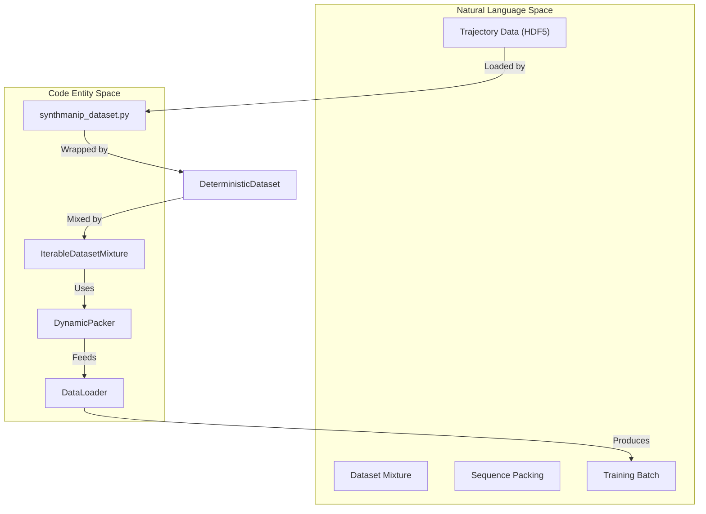
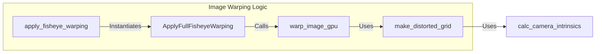

<!-- source: DeepWiki mcp.deepwiki.com · repo allenai/MolmoBot · page 2.4 Data Pipeline & Preprocessing · fetched 2026-10-26 -->

# Data Pipeline & Preprocessing

Relevant source files

The following files were used as context for generating this wiki page:

- [MolmoBot/olmo/data/data_loader.py](MolmoBot/olmo/data/data_loader.py)
- [MolmoBot/olmo/data/dataset.py](MolmoBot/olmo/data/dataset.py)
- [MolmoBot/olmo/data/dynamic_packer.py](MolmoBot/olmo/data/dynamic_packer.py)
- [MolmoBot/olmo/data/get_dataset.py](MolmoBot/olmo/data/get_dataset.py)
- [MolmoBot/olmo/data/image_warping_utils.py](MolmoBot/olmo/data/image_warping_utils.py)
- [MolmoBot/olmo/data/iterable_dataset_mixture.py](MolmoBot/olmo/data/iterable_dataset_mixture.py)

The MolmoBot data pipeline is designed to handle large-scale multimodal robot trajectory data, specifically in HDF5 or SynthManip formats. It supports complex dataset mixtures, deterministic shuffling, and efficient sequence packing using a 2D knapsack algorithm to maximize GPU utilization during training.

## Data Flow Overview

The pipeline transforms raw robot trajectories into batched, padded, and preprocessed tensors suitable for the Molmo VLM.

### System to Code Entity Mapping: Data Loading

The following diagram illustrates the relationship between high-level data loading concepts and the specific classes implemented in `olmo/data/`.

**Data Loading Architecture**

Sources: [MolmoBot/olmo/data/data_loader.py:19-26](), [MolmoBot/olmo/data/dataset.py:40-74](), [MolmoBot/olmo/data/iterable_dataset_mixture.py:21-38]()

## Dataset Classes

### DeterministicDataset
The `DeterministicDataset` acts as a wrapper for base datasets to ensure reproducibility across epochs. It handles:
*   **Seeding**: Calculates a unique seed for each example based on the global seed, example index, and current epoch `(self.seed * 195172 + idx + len(self.dataset)*epoch) % (2 ** 32 - 1)` [MolmoBot/olmo/data/dataset.py:61-63]().
*   **Padding**: Generates "padding examples" if the requested index exceeds the dataset length, marking them as invalid in the metadata [MolmoBot/olmo/data/dataset.py:64-67]().
*   **Preprocessing**: Applies the `MultimodalPreprocessor` to each item as it is retrieved [MolmoBot/olmo/data/dataset.py:72-74]().

### IterableDatasetMixture
This class provides an infinite stream of data sampled from multiple `DeterministicDataset` instances [MolmoBot/olmo/data/iterable_dataset_mixture.py:21-22]().
*   **Sampling**: Supports flat sampling rates or stratified sampling to ensure under-represented datasets are picked more frequently [MolmoBot/olmo/data/iterable_dataset_mixture.py:68-87]().
*   **Distributed Awareness**: Each rank in a `DeviceMesh` or DDP setup identifies which examples it is responsible for to avoid duplicate processing across the world size [MolmoBot/olmo/data/iterable_dataset_mixture.py:52-63]().
*   **Fast Forwarding**: Supports starting training from a specific index by fast-forwarding the RNG state without loading actual data [MolmoBot/olmo/data/iterable_dataset_mixture.py:97-109]().

Sources: [MolmoBot/olmo/data/dataset.py:40-74](), [MolmoBot/olmo/data/iterable_dataset_mixture.py:21-152]()

## Dynamic Packing (2D Knapsack)

To optimize training, MolmoBot uses a `DynamicPacker` to pack multiple examples into a single sequence (up to a maximum token length and image count). This is treated as a 2D knapsack problem where the two constraints are the number of text tokens and the number of image patches.

### select_subset_2d_knapsack_quantized
The core packing logic uses a vectorized DP approach with quantized constraints to reduce memory usage [MolmoBot/olmo/data/dynamic_packer.py:23-43]().
*   **Constraints**: `T` (Max Tokens) and `I` (Max Images/Patches).
*   **Granularity**: Supports `t_granularity` and `i_granularity` to speed up the DP table fill [MolmoBot/olmo/data/dynamic_packer.py:32-37]().
*   **Objective**: Maximizes `t_weight * tokens + i_weight * images` [MolmoBot/olmo/data/dynamic_packer.py:40]().

### Action Chunking
When packing examples that contain robot actions, the packer extracts "action chunks" (states, actions, and padding masks) and stacks them into `packed_states` and `packed_actions` tensors [MolmoBot/olmo/data/dynamic_packer.py:84-134](). It also manages `subsegment_ids` to prevent cross-example attention within a packed sequence [MolmoBot/olmo/data/dynamic_packer.py:165-172]().

Sources: [MolmoBot/olmo/data/dynamic_packer.py:23-78](), [MolmoBot/olmo/data/dynamic_packer.py:137-187]()

## Image Preprocessing & Warping

### Multimodal Preprocessing
The `MultimodalPreprocessor` (referenced in `data_loader.py`) prepares images and text for the model. For training, it can override the probability of high-resolution image processing via `override_p_high_res` [MolmoBot/olmo/data/data_loader.py:61-63]().

### Fisheye Warping Utilities
For synthetic data (SynthManip), the pipeline includes utilities to simulate GoPro-style fisheye distortion, which helps models generalize to real-world wide-angle cameras.

**Warping Pipeline**
1.  **Center-Crop**: Adjusts to a 4:3 aspect ratio [MolmoBot/olmo/data/image_warping_utils.py:8]().
2.  **Barrel Distortion**: Applies distortion using parameters `k1, k2, k3, k4` [MolmoBot/olmo/data/image_warping_utils.py:35-40]().
3.  **Edge Crop**: Removes 30% of the edges to eliminate warping artifacts [MolmoBot/olmo/data/image_warping_utils.py:147-152]().

**Warping Logic Entity Map**

The `ApplyFullFisheyeWarping` class is a `torch.nn.Module` that precomputes normalized grids (`x_normalized`, `y_normalized`, `r`) to accelerate the distortion process on the GPU [MolmoBot/olmo/data/image_warping_utils.py:156-190]().

Sources: [MolmoBot/olmo/data/image_warping_utils.py:1-17](), [MolmoBot/olmo/data/image_warping_utils.py:111-153](), [MolmoBot/olmo/data/image_warping_utils.py:156-200]()

## DataLoader Construction

The `DataLoaderConfig` handles the instantiation of the final PyTorch `DataLoader`.

| Function | Purpose | Key Parameters |
| :--- | :--- | :--- |
| `build_eval_dataloader` | Builds a deterministic loader for evaluation. | `pad_batches`, `for_inference`, `include_metadata` [MolmoBot/olmo/data/data_loader.py:117-127]() |
| `build_train_dataloader` | Builds the training mixture loader with packing. | `global_batch_size`, `kwargs_mixture`, `packing` [MolmoBot/olmo/data/data_loader.py:197-203]() |

The `build_eval_dataloader` specifically ensures that for FSDP (Fully Sharded Data Parallel) models, the dataset is padded such that every device receives the exact same number of batches, preventing hangs during synchronization [MolmoBot/olmo/data/data_loader.py:142-152]().

Sources: [MolmoBot/olmo/data/data_loader.py:67-115](), [MolmoBot/olmo/data/data_loader.py:117-195]()

---

