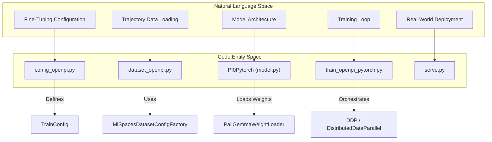
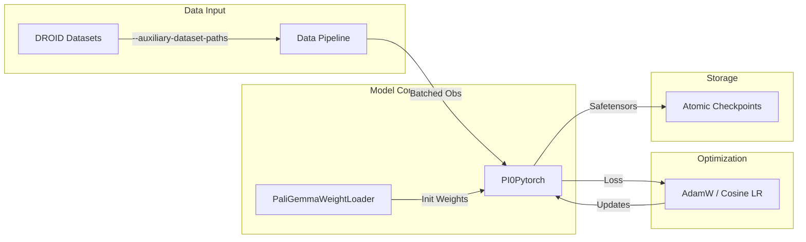

<!-- source: DeepWiki mcp.deepwiki.com · repo allenai/MolmoBot · page 3 MolmoBot-Pi0: Pi0/Pi0.5 Policy Fine-Tuning · fetched 2026-10-26 -->

# MolmoBot-Pi0: Pi0/Pi0.5 Policy Fine-Tuning

<details>
<summary>Relevant source files</summary>

The following files were used as context for generating this wiki page:

- [MolmoBot-Pi0/.gitignore](MolmoBot-Pi0/.gitignore)
- [MolmoBot-Pi0/.python-version](MolmoBot-Pi0/.python-version)
- [MolmoBot-Pi0/README.md](MolmoBot-Pi0/README.md)

</details>


The **MolmoBot-Pi0** sub-project provides a PyTorch-based framework for fine-tuning Physical Intelligence’s Pi0 and Pi0.5 Vision-Language-Action (VLA) models. While the original Pi0 models are often implemented in JAX, this project enables training and deployment within a standard PyTorch ecosystem, specifically targeting robot manipulation tasks using DROID-format trajectory data.

## System Overview

MolmoBot-Pi0 bridges the gap between high-level language instructions and low-level robot control by adapting the PaliGemma-based Pi0 architecture. It includes a complete pipeline for data ingestion, distributed training (DDP), and evaluation in both simulation (via MolmoSpaces) and real-world hardware.

### Natural Language to Code Entity Mapping

The following diagram illustrates how conceptual components map to specific code entities within the `MolmoBot-Pi0` directory.

**Conceptual to Code Mapping**

**Sources:** [molmobot_pi0/train_openpi_pytorch.py:1-126](), [molmobot_pi0/eval/real/serve.py:1-58]()

---

## Data and Configuration

The project utilizes the `openpi` configuration system to manage complex training hyperparameters and dataset mixtures. It specifically supports the DROID data format and provides utilities for sampling from multiple dataset sources (e.g., `FrankaPickAndPlaceOmniCamConfig`).

*   **Dataset Factory:** Uses `MlSpacesDatasetConfigFactory` to generate configurations for loading robot trajectories.
*   **Data Exploration:** The `explore_data.py` utility allows developers to visualize and inspect trajectories before training.
*   **Camera Presets:** Supports various camera configurations including `randomized_zed2_analogue_1` and `wrist_camera_zed_mini`.

For details, see [Pi0 Configuration & Dataset](#3.1).

**Sources:** [README.md:93-123](), [molmobot_pi0/train_openpi_pytorch.py:110-117]()

---

## Training Pipeline

The training infrastructure is built on PyTorch and designed for high-throughput distributed training across multiple GPUs (e.g., H100 clusters).

### Training Architecture
The diagram below describes the flow of data through the training script `train_openpi_pytorch.py`.

**Training Data Flow**


*   **Model Implementation:** The `PI0Pytorch` class implements the VLA logic in PyTorch.
*   **Weight Loading:** Supports loading from JAX checkpoints or HuggingFace snapshots via `PaliGemmaWeightLoader`.
*   **Efficiency:** Employs gradient checkpointing and `DistributedDataParallel` (DDP) to handle the large PaliGemma backbone.

For details, see [Pi0 Training](#3.2).

**Sources:** [README.md:109-126](), [molmobot_pi0/train_openpi_pytorch.py:1-50]()

---

## Evaluation and Policy Serving

MolmoBot-Pi0 supports two primary evaluation modes: simulation and real-robot serving.

### Evaluation Modes
| Mode | Entry Point | Primary Configuration |
| :--- | :--- | :--- |
| **Simulation** | `eval.py` | `eval.yaml`, `sim_exo_shoulder` |
| **Real Robot** | `serve.py` | `paligemma.yaml`, `PiJointPosPolicy` |

*   **Simulation:** Integrates with `MolmoSpaces` for physics-based evaluation. It supports high-fidelity rendering via Filament.
*   **Real Robot:** The `serve.py` script initializes a `PiJointPosPolicy` and serves it over a network (often via WebSocket) to the robot hardware.
*   **Policy Classes:** `PiJointPosPolicy` handles the transformation of raw observations (images and joint positions) into actionable robot commands.

For details, see [Pi0 Evaluation & Policy Serving](#3.3).

**Sources:** [README.md:19-40](), [README.md:42-82](), [molmobot_pi0/eval/real/serve.py:1-58]()

---

## Quick Start: Inference Example

The following snippet demonstrates how to load a fine-tuned DROID checkpoint and run a single inference step.

```python
import numpy as np
from huggingface_hub import snapshot_download
from molmobot_pi0.eval.policies.pi import PiJointPosPolicy

# Download and load the policy
ckpt_dir = snapshot_download("allenai/MolmoBot-Pi0-DROID")
policy = PiJointPosPolicy(checkpoint_dir=ckpt_dir)
policy.prepare_model()

# Prepare observation
obs = {
    "task": "put the mug in the bowl",
    "qpos": {"arm": np.zeros(7), "gripper": np.zeros(2)},
    "exo_camera_1": np.zeros((360, 640, 3), dtype=np.uint8),
    "wrist_camera": np.zeros((360, 640, 3), dtype=np.uint8),
}

# Generate action
action = policy.get_action(obs)
```
**Sources:** [README.md:19-40]()

---

