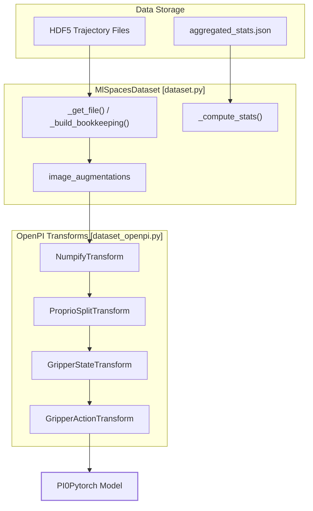

<!-- source: DeepWiki mcp.deepwiki.com · repo allenai/MolmoBot · page 3.1 Pi0 Configuration & Dataset · fetched 2026-10-26 -->

# Pi0 Configuration & Dataset

Relevant source files

The following files were used as context for generating this wiki page:

- [MolmoBot-Pi0/molmobot_pi0/config_openpi.py](MolmoBot-Pi0/molmobot_pi0/config_openpi.py)
- [MolmoBot-Pi0/molmobot_pi0/dataset.py](MolmoBot-Pi0/molmobot_pi0/dataset.py)
- [MolmoBot-Pi0/molmobot_pi0/dataset_openpi.py](MolmoBot-Pi0/molmobot_pi0/dataset_openpi.py)
- [MolmoBot-Pi0/molmobot_pi0/explore_data.py](MolmoBot-Pi0/molmobot_pi0/explore_data.py)
- [MolmoBot-Pi0/molmobot_pi0/prompt_templates.py](MolmoBot-Pi0/molmobot_pi0/prompt_templates.py)
- [MolmoBot-Pi0/molmobot_pi0/utils.py](MolmoBot-Pi0/molmobot_pi0/utils.py)

This page documents the configuration and data loading infrastructure for the MolmoBot-Pi0 sub-project. It covers the integration with the `openpi` framework, the custom dataset implementations for MolmoSpaces data, and the prompt engineering system used for fine-tuning Pi0 and Pi0.5 models.

## OpenPI Configuration System

The configuration system leverages the `openpi` training framework to define model architectures, data sources, and optimization parameters. Configurations are registered in `molmobot_pi0/config_openpi.py` using the `TrainConfig` class.

### TrainConfig Registry
The repository registers two primary configurations:
1.  **`molmobot_pi0_droid`**: Configured for the Pi0 model with an 8-dimensional action space and 16-step horizon [molmobot_pi0/config_openpi.py:10-37](). It uses a `PaliGemmaWeightLoader` and freezes the `vision_tower` during training [molmobot_pi0/config_openpi.py:23-36]().
2.  **`pi05_mlspaces_finetune`**: Configured for the Pi0.5 model with a 32-dimensional action space [molmobot_pi0/config_openpi.py:38-69](). It utilizes a `CheckpointWeightLoader` to initialize from pre-trained JAX checkpoints [molmobot_pi0/config_openpi.py:56]().

### Optimization & Scheduling
Both configurations utilize a `CosineDecaySchedule` with a warmup period (typically 1,000 steps) and a peak learning rate of `5e-5` [molmobot_pi0/config_openpi.py:24-29, 57-62]().

**Sources:** [molmobot_pi0/config_openpi.py:1-74]()

---

## MlSpacesDataset & Data Flow

The `MlSpacesDataset` is the core PyTorch `Dataset` implementation for loading robot trajectories stored in HDF5 format.

### Dataset Implementation
The dataset handles the following responsibilities:
*   **Trajectory Bookkeeping**: Parses `valid_trajectory_index.json` to map global indices to specific HDF5 files and trajectory keys [molmobot_pi0/dataset.py:142-166]().
*   **Feature Selection**: Allows selective loading of states, actions, and observations (e.g., specific camera views) [molmobot_pi0/dataset.py:85-88]().
*   **Image Augmentation**: Applies a standard pipeline including `ColorJitter`, `GaussianBlur`, and `RandomPosterize` via `torchvision.transforms` [molmobot_pi0/dataset.py:102-112]().
*   **Normalization**: Computes and applies statistics (mean, std, min, max) derived from `aggregated_stats.json` [molmobot_pi0/dataset.py:168-179]().

### Data Flow Diagram: From HDF5 to Model Input

This diagram illustrates how raw data from HDF5 files is transformed into the format expected by the `PI0Pytorch` model.

**Sources:** [molmobot_pi0/dataset.py:61-129](), [molmobot_pi0/dataset_openpi.py:24-77]()

---

## MlSpacesDatasetConfigFactory

The `MlSpacesDatasetConfigFactory` bridges the custom `MlSpacesDataset` with the `openpi` data loader infrastructure.

### Transformation Pipeline
The factory defines a series of `DataTransformFn` operations to reshape the data for Pi0 [molmobot_pi0/dataset_openpi.py:106-140]():
*   **`ProprioSplitTransform`**: Splits the unified state vector into `observation/joint_position` (7-dim) and `observation/gripper_position` [molmobot_pi0/dataset_openpi.py:43-50]().
*   **`GripperStateTransform`**: Rescales the gripper position to a `[0, 1]` range [molmobot_pi0/dataset_openpi.py:53-58]().
*   **`GripperActionTransform`**: Normalizes gripper actions by dividing by `255.0` [molmobot_pi0/dataset_openpi.py:60-67]().
*   **`RepackTransform`**: Maps internal dataset keys (e.g., `exterior_image_1_left`) to the standard `openpi` naming convention (e.g., `observation.image.exo_camera_1`) [molmobot_pi0/dataset_openpi.py:112-119]().

### Sampling Strategy
For multi-dataset training, the `DistributedWeightedDatasetSampler` in `molmobot_pi0/utils.py` handles weighted sampling across different data sources based on provided paths and weights [molmobot_pi0/dataset_openpi.py:21](), [molmobot_pi0/utils.py:181-182]().

**Sources:** [molmobot_pi0/dataset_openpi.py:79-168](), [molmobot_pi0/utils.py:174-183]()

---

## Prompt Engineering & Templates

The system uses a templated approach to generate natural language instructions for the model, defined in `molmobot_pi0/prompt_templates.py`.

### Template Structure
Prompts are organized by task type (e.g., `pick_and_place`, `pick_and_place_next_to`, `pick`) [molmobot_pi0/prompt_templates.py:9-162]().
*   **Prompt Groups**: Each task contains multiple "groups" of related templates. This allows the system to uniformly sample a group first, then a specific template within that group, preventing the model from over-fitting to a single phrasing style [molmobot_pi0/prompt_templates.py:3-8]().
*   **Placeholders**: Templates use placeholders like `{pickup_name}` and `{place_name}` which are filled during dataset iteration [molmobot_pi0/prompt_templates.py:13-15]().

### Randomization
The `MlSpacesDataset` applies several layers of randomization to prompts [molmobot_pi0/dataset.py:77-82]():
*   **Sampling**: Randomly selects templates based on `prompt_sampling_temperature` [molmobot_pi0/dataset.py:99]().
*   **Formatting**: Optional randomization of casing and punctuation [molmobot_pi0/dataset.py:100-101]().

**Sources:** [molmobot_pi0/prompt_templates.py:1-165](), [molmobot_pi0/dataset.py:96-101]()

---

## Data Inspection Utility

The `explore_data.py` script is a CLI tool for inspecting the contents of the HDF5 trajectory files.

### Key Capabilities
*   **Tree Visualization**: Uses `build_group_tree` to recursively display the hierarchy of groups and datasets within an HDF5 file [molmobot_pi0/explore_data.py:45-55]().
*   **Metadata Parsing**: Automatically detects and decodes JSON-encoded metadata stored as `uint8` arrays (e.g., `obs_scene` or `valid_trajectory_index`) [molmobot_pi0/explore_data.py:37-42, 72-83]().
*   **Paging**: Supports an automatic pager for large outputs to facilitate terminal-based inspection [molmobot_pi0/explore_data.py:23-27]().

### Code Entity Association

| Code Entity | Purpose | File |
| :--- | :--- | :--- |
| `build_group_tree` | Generates a dictionary representing HDF5 structure | [molmobot_pi0/explore_data.py:45]() |
| `load_dicts_data` | Decodes byte-arrays into Python dictionaries | [molmobot_pi0/explore_data.py:37]() |
| `print_dataset` | Formats and prints specific dataset values | [molmobot_pi0/explore_data.py:67]() |

**Sources:** [molmobot_pi0/explore_data.py:1-121]()

---

